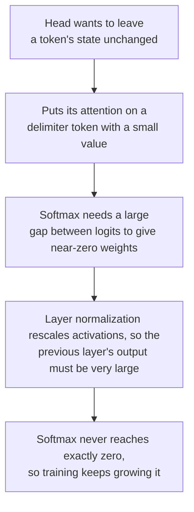

# 第 7 课：LLM 为什么有离群值

**使命关联:** 要说清朴素的 int8 LLM 为什么会出问题、该用哪种修复办法，得先知道那些大值是什么、位于哪里，以及模型为什么会产生它们。
**主要来源:** [论文：“LLM.int8(): 8-bit Matrix Multiplication for Transformers at Scale”，Dettmers 等，2022](https://arxiv.org/abs/2208.07339)，第 3 节和第 4 节
**前置知识:** [第 6 课](0006-granularity.md)、[离群特征](../GLOSSARY.md)、[巨大激活值](../GLOSSARY.md)、[激活值](../GLOSSARY.md)

## 热身

1. ▢ 在 -7 到 7 的 4 位有符号对称网格下，一个张量的最大值是 1.506。步长是多少？哪些值会舍入成零？

<details markdown="1"><summary>检查</summary>

`s = 1.506 / 7 = 0.215`，绝对值小于 `s/2 = 0.108` 的任何值都舍入成零（第 5 课）。一个大值让网格对许多小值来说变得太粗。

</details>

2. ▢ 为什么逐 token 的缩放因子救不了一个大值集中在某一个特征维度上的激活值张量？

<details markdown="1"><summary>检查</summary>

逐 token 的缩放因子由每个 token 自己的最大值决定，而一个在每个 token 上都很大的特征维度，是几乎每一行的最大值。每一行的缩放因子都被同样地撑大了（第 6 课）。

</details>

3. ▢ 哪一根轴能把这样的特征维度分隔开？为什么整数矩阵乘法无法廉价地使用它？

<details markdown="1"><summary>检查</summary>

每个输入特征一个缩放因子，也就是对激活值做逐通道量化。它在对输入特征的求和内部就变了，所以整数累加器必须在每个输入通道都重新缩放（第 6 课）。

</details>

## 要点

### 离群特征

Dettmers 等人观察了从 125M 到 13B 参数的 Transformer 中，进入注意力投影和第一个前馈层的隐藏状态，发现少数几个隐藏维度中存在很大的值。他们用三个阈值来定义**离群特征**：幅值至少为 6.0，出现在至少 25% 的层中，并且至少占 6% 的序列位置。

以下是论文自己文字里报告的内容：

| 发现 | 数值 |
|---|---|
| 离群值的大小 | 最多比其他维度大 20 倍 |
| 占特征的比例 | 约 0.1% |
| 位置 | 少数几个固定的隐藏维度：6.7B 模型中有 6 个维度，直到 13B 最多 7 个 |
| 数量 | 在 6.7B 时，每个 2048 token 的序列约有 150,000 个离群值，集中在这几个维度上 |
| 涌现 | 在 6B 到 6.7B 参数之间，受影响的层的比例从 65% 升到 100%，序列位置的比例从 35% 升到 75% |
| 去掉它们的后果 | 平均 top-1 注意力概率从约 40% 降到约 20%，困惑度上升 600% 到 1000% |
| 对照 | 去掉 7 个随机维度，困惑度只变化约 0.1% |

同一篇论文还有两点提醒。突然的跃升出现在模型规模上，但如果改为对困惑度作图，涌现就是平滑的、指数式的，他们提出，决定这一转变的是困惑度，而不只是规模。还有，在他们的表 1 中，每个张量用一个 absmax 缩放因子的 int8，在小规模上就已经比浮点差了：在 125M 时 C4 困惑度是 87.76 对 25.65，在 13B 时是 19.08 对 12.45。6.7B 这个点，是离群值变得系统化的地方，而不是低于它朴素 int8 就安全的某个规模。

### 巨大激活值

[Sun 等人](https://arxiv.org/abs/2402.17762)发现了第二种模式。**巨大激活值**是隐藏状态中的单个值，宽松地定义为大于 100，并且至少约为它所在隐藏状态幅值中位数的 1,000 倍。在 LLaMA2-7B 中最大的是 2622，而中位数是 0.2，在 LLaMA2-70B 中，有的值超过 15,000。它们极其稀少，在数千万个激活值中常常不到 10 个。它们位于固定的特征维度上（LLaMA2-7B 中是 1415 和 2533），也位于特定的 token 上：起始 token，以及第一个句号或换行符。

它们不是噪声。在 LLaMA2-7B 中，只把其中四个置零，模型就崩溃了，而把它们设为各自的均值则不会伤害模型，所以它们的行为像固定的偏置项。它们也和离群特征不是一回事，论文核对过这一点：在 LLaMA2-7B 和 13B 中，按 Dettmers 等人的定义找到了 10 个和 25 个离群特征，没有一个与巨大激活值所在的维度吻合。

| | 离群特征 | 巨大激活值 |
|---|---|---|
| 形态 | 一个维度：在大多数 token 上都很大 | 一个条目：一个 token，一个维度 |
| 数量 | 少数几个维度 | 总共往往不到 10 个值 |
| 发现者 | Dettmers 等，2022 | Sun 等，2024 |

按这张表来看，逐 token 的缩放因子能把巨大激活值限制在它所在 token 的那一行里，因为它只出现在少数几个 token 上，这是根据它们的形态做出的推断，不是任何一篇论文的结果。对于出现在每一行的离群特征，它没有帮助。

### 模型为什么会产生它们

[Bondarenko 等人](https://arxiv.org/abs/2306.12929)把离群值与那些试图学会“什么也不做”的注意力头联系起来。在 BERT-base 中，他们记录到的离群值有超过 97% 与分隔符 token 对齐，例如分隔符、句号或逗号，对应的注意力头把几乎全部注意力放在这些 token 上，而它们的值向量很小。关注一个值很小的低信息量 token，是一种不更新隐藏状态的柔和办法。他们的假设，在 BERT 和一个视觉 Transformer 上得到了支持，其链条如下：



Sun 等人从另一头得出了一幅相容的图景：巨大激活值把注意力吸引到它们所在的 token 上，并在自注意力中充当隐式的偏置。这两者都是它们的作者所论证的解释，而不是对每一个模型都成立的定论。

### 一个值，一个缩放因子

现在来算第 4 课的算术。取 8 位对称 absmax，整个张量用一个缩放因子，其中一个特征维度的幅值是 60，其余的值标准差为 1。步长是 `60 / 127 = 0.47`，所以每个小于 `0.24` 的值都舍入成零，约占标准正态分布的 19%。在 4 位时，步长是 `60 / 7 = 8.6`，小于 4.3 的一切都舍入成零，这实际上就是全部。Dettmers 等人描述的是同一个机制：范围大到大多数量化区间都是空的，小的值被量化成零，信息就被抹掉了。

## 练习

1. ▢ 说出 Dettmers 等人把一个特征称为离群特征的三个阈值。

<details markdown="1"><summary>检查</summary>

幅值至少为 6.0，出现在至少 25% 的层中，并且至少占 6% 的序列位置。三个都重要：层和位置的阈值，正是把一个系统性的特征维度与偶尔出现的大值区分开的东西。

</details>

2. ▢ 一个特征维度在每个 token 上的幅值都是 60，其余的标准差是 1。对 8 位和 4 位的对称 absmax，整个张量一个缩放因子，分别给出步长，以及低于多大的幅值，值会舍入成零。

<details markdown="1"><summary>检查</summary>

8 位：`s = 60 / 127 = 0.47`，所以小于 0.24 的值舍入成零，约占标准正态分布的 19%。4 位：`s = 60 / 7 = 8.6`，所以小于 4.3 的值舍入成零，这超过了标准正态分布的 99.99%。同一个离群值，在 8 位时是个麻烦，在 4 位时是致命的。

</details>

3. ▢ 下面哪一种说法正确地区分了巨大激活值和离群特征？

    - a) 巨大激活值是单个条目，而离群特征横跨一个维度
    - b) 巨大激活值横跨大多数 token，而离群特征只跨越一个 token
    - c) 巨大激活值存在于权重中，而离群特征存在于激活值中
    - d) 巨大激活值随模型规模缩小，而离群特征基本保持平稳

<details markdown="1"><summary>检查</summary>

**a)** 巨大激活值是在某一个 token、某一个维度上的标量，而离群特征是一个在大多数 token 上都很大的维度，这是 Sun 等人区分这两者时所说的。(b) 把两种形态对调了。(c) 是错的，因为两者都是隐藏状态中的值，也就是激活值。(d) 不是任何一篇论文所报告的：Dettmers 等人报告的是离群特征随模型规模增长。

</details>

4. ▢ 先预测，再运行。一个 128 个 token、512 个特征的张量，有一个离群特征，在每个 token 上的幅值都约为 60。运行之前，先预测在哪种位宽、用三种缩放轴中的哪一种时，正常特征上的误差会降到 5% 以下。

    ```python
    import numpy as np

    rng = np.random.default_rng(0)
    tokens, features = 128, 512
    X = rng.normal(size=(tokens, features))
    X[:, 7] = 60 * rng.uniform(0.8, 1.2, size=tokens)  # one outlier feature, large at every token
    normal = np.arange(features) != 7


    def quantize(X, axis, bits):
        qmax = 2 ** (bits - 1) - 1
        s = np.abs(X).max(axis=axis, keepdims=True) / qmax
        return s * np.clip(np.round(X / s), -qmax, qmax)


    print("scheme        bits  error on normal features  share rounded to zero")
    for bits in (8, 4):
        for name, axis in [("per-tensor", None), ("per-token", 1), ("per-channel", 0)]:
            Q = quantize(X, axis, bits)
            err = np.mean((Q - X)[:, normal] ** 2) / np.mean(X[:, normal] ** 2)
            zero = np.mean(Q[:, normal] == 0)
            print(f"{name:12s}  {bits}     {err:8.4f}                  {zero:6.1%}")
    ```

<details markdown="1"><summary>提示</summary>

在代码中，`axis=1` 沿着每一行取最大值，也就是每个 token 一个缩放因子，而 `axis=0` 沿着每一列向下取最大值，也就是每个特征一个缩放因子。

</details>

<details markdown="1"><summary>检查</summary>

```text
scheme        bits  error on normal features  share rounded to zero
per-tensor    8       0.0269                   22.2%
per-token     8       0.0190                   18.5%
per-channel   8       0.0000                    0.8%
per-tensor    4       1.0000                  100.0%
per-token     4       0.9998                  100.0%
per-channel   4       0.0138                   15.8%
```

在 8 位时，每一根轴的误差都在 5% 以下，但逐张量和逐 token 仍然把约五分之一的正常值舍入成零。在 4 位时，只有逐通道的缩放因子管用：逐张量和逐 token 丢光了一切，误差接近 1.0，每个正常值都舍入成零。逐通道缩放因子正是整数矩阵乘法无法廉价应用的那个，所以第 8 课需要别的修复办法。这个张量是合成的。

</details>

5. ▢ 用四个环节解释，为什么一个想让某个 token 保持不变的注意力头，最终会产生一个很大的激活值。

<details markdown="1"><summary>检查</summary>

注意力头把几乎全部的注意力放在一个低信息量的 token 上，例如分隔符，它的值向量很小，所以这个头几乎什么也没加。要让 softmax 给其他一切接近零的权重，logit 之间需要很大的差距，这需要很大的输入。层归一化会重新缩放激活值，所以前面那一层的输出必须非常大，才能扛住它。softmax 永远不会恰好到零，所以训练会不断把这些值推得更大。这是 Bondarenko 等人的假设，在 BERT 和一个视觉 Transformer 上得到了支持，它对分隔符 token 处的离群值的解释，比对每一个 LLM 里每一个离群值的解释更直接。

</details>

6. ▢ 一个团队读到离群值在 6.7B 参数时涌现，于是认定 3B 的模型做逐张量 int8 是安全的。Dettmers 等人自己的结果中，有什么反对这个结论？

<details markdown="1"><summary>检查</summary>

他们的表 1 显示，在他们测试的每一个规模上，int8 absmax 都已经比 32 位浮点差：在 1.3B 时 C4 困惑度是 16.55 对 15.91，在 2.7B 时是 15.11 对 14.43，在 125M 时是 87.76 对 25.65。他们还报告说，对困惑度作图时涌现是平滑的，并且离群特征的数量随着困惑度下降而单调上升，所以模型规模只是几个协变量之一。6.7B 这个数字标志的是离群值在所有层中变得系统化的地方，而不是低于它朴素 int8 就安全的阈值。

</details>

## 实战练习

- [ ] 加载一个小型开源模型，在某一个解码器层上注册前向钩子，打印它输出的隐藏状态的最大绝对值，以及它出现的 token 和维度，并同时打印绝对值的中位数。记录有没有哪个值通过了 Sun 等人的检验，即大于 100 且约为中位数的 1,000 倍，如果一个也没有，也要记下来。
- [ ] 在练习第 4 题的代码中，把离群值的幅值从 60 先改成 6，再改成 20，找出 4 位逐张量第一次不再把每个正常值都舍入成零时的那个幅值。用第 4 课的步长公式解释它。
- [ ] 明天：不看笔记，说出这两种离群值模式，各自是怎么发现的，哪根轴能把各自分隔开，以及 Bondarenko 等人提出的注意力头的因果链。

## 延伸阅读

- [量化映射](../reference/quantization-mapping.md)
- [论文：“LLM.int8(): 8-bit Matrix Multiplication for Transformers at Scale”，Dettmers 等，2022](https://arxiv.org/abs/2208.07339)
- [论文：“Massive Activations in Large Language Models”，Sun 等，2024](https://arxiv.org/abs/2402.17762)
- [论文：“Quantizable Transformers: Removing Outliers by Helping Attention Heads Do Nothing”，Bondarenko 等，2023](https://arxiv.org/abs/2306.12929)
- [资源](../RESOURCES.md)

---

没学明白？请重读顶部的主要来源，因为本课是对它的压缩，而理解正是在压缩中流失的。如果有哪个术语觉得含糊，可以查看[术语表](../GLOSSARY.md)。

如果问题出在课程本身，而不是学习材料，那就是一个缺陷：[提交 issue](https://github.com/TokenCemetery/teach/issues)。
