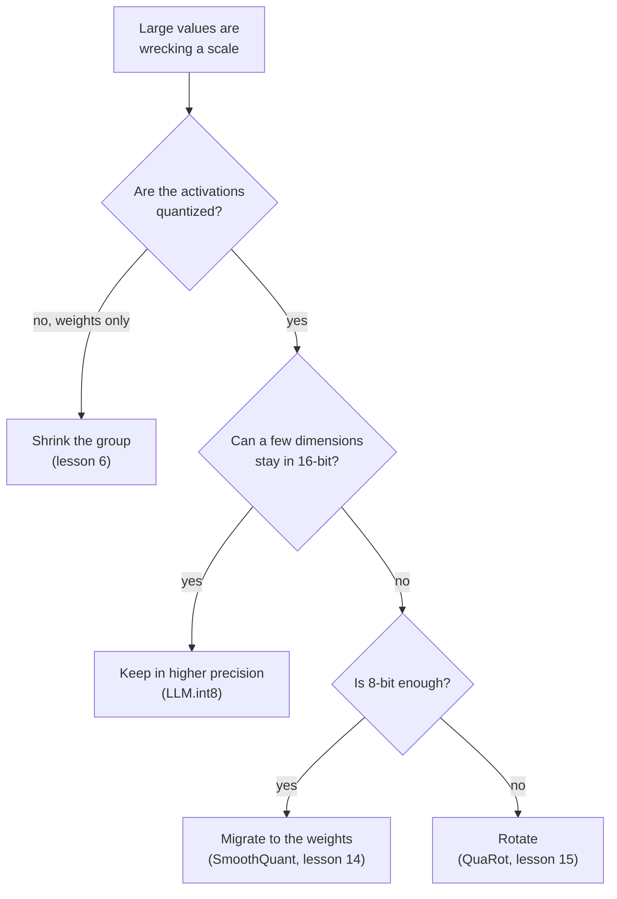

# Lección 8. Manejar los outliers

**Vínculo con la misión:** Decir qué solución aplica a un LLM en int8 roto significa conocer las cuatro maneras de superar un outlier, a qué renuncia cada una y qué lección posterior la enseña completa.
**Fuente principal:** [Paper: "LLM.int8(): 8-bit Matrix Multiplication for Transformers at Scale", Dettmers et al., 2022](https://arxiv.org/abs/2208.07339), sección 3.2
**Requisitos previos:** [Lección 7](0007-why-llms-have-outliers.md), [Granularidad](../GLOSSARY.md), [Rotación](../GLOSSARY.md), [Outlier feature](../GLOSSARY.md)

## Calentamiento

1. ▢ ¿Aproximadamente qué parte de las features son outlier features en Dettmers et al., y qué pasa con la perplexity si se ponen a cero?

<details markdown="1"><summary>Comprobación</summary>

Cerca del 0.1 por ciento de las features, y la perplexity sube entre un 600 y un 1000 por ciento (lección 7). Muy pocos valores cargan con buena parte del comportamiento del modelo.

</details>

2. ▢ ¿Por qué recortar esos valores, como haría una búsqueda de rango por MSE, es la respuesta equivocada para un LLM?

<details markdown="1"><summary>Comprobación</summary>

MSE cuenta por igual todos los valores, así que recortar una parte diminuta de ellos parece barato, pero esos valores son los importantes (lección 5). La solución tiene que conservarlos, no fijarlos.

</details>

3. ▢ A 4 bits con un scale por tensor, una feature de magnitud 60 entre valores de desviación estándar 1: ¿qué pasa con los valores normales?

<details markdown="1"><summary>Comprobación</summary>

El paso es 60 / 7 = 8.6, así que todo lo que queda por debajo de 4.3 se redondea a cero, que es prácticamente todo valor normal (lección 7).

</details>

## Qué debes saber

### Cuatro maneras de superar un outlier

Toda solución responde al mismo problema de la lección 7: un valor grande fija un scale demasiado grueso para todo lo que tiene cerca. Se diferencian en lo que cambian.

| Familia | La idea | Dónde actúa | Se enseña en |
|---|---|---|---|
| Mantener en mayor precisión | Calcular las dimensiones outlier en 16 bits y el resto en int8 | La multiplicación de matrices, con las dimensiones outlier elegidas a partir de las activaciones | Esta lección |
| Reducir el grupo | Dar a conjuntos pequeños de valores su propio scale, de modo que un outlier dañe solo a su conjunto | La granularidad de los scales | Lección 6 |
| Migrar | Dividir los canales outlier de las activaciones por un scale y multiplicar por él los pesos correspondientes | Offline, en los pesos y en la operación anterior | Lección 14 |
| Rotar | Multiplicar por una matriz ortogonal para que un outlier se reparta entre todos los canales | Los pesos offline, las activaciones mediante la rotación | Lección 15 |



Lee el diagrama como una regla empírica sacada de lo que persigue cada paper, no como una clasificación: los métodos se solapan, y las lecciones posteriores dan la evidencia.

### Mantener los outliers en mayor precisión

Dettmers et al. lo llaman descomposición de precisión mixta. Toma la matriz de hidden states y reúne las dimensiones de features que contienen al menos un valor con una magnitud por encima de un umbral `α`. Encontraron que `α = 6.0` lleva la degradación casi a cero. La multiplicación de matrices se divide entonces en dos partes: esas dimensiones se multiplican en 16 bits, y todas las demás en 8 bits con un scale por fila de las activaciones y por columna de los pesos, el esquema vector-wise de la lección 6.

```text
Out = sum over outlier dimensions of (X_16bit * W_16bit)  +  scale * sum over the rest of (X_int8 * W_int8)
```

La parte de 16 bits es pequeña. Hasta 13B parámetros hay como mucho 7 dimensiones outlier, lo que según el paper cuesta cerca de un 0.1 por ciento más de memoria, y más del 99.9 por ciento de los valores se multiplican en 8 bits. Los autores informan de que no hay degradación hasta 175B parámetros, y de una reducción de memoria de 1.96 veces para BLOOM-176B. El precio es trabajo de precisión mixta dentro de una misma multiplicación de matrices, y señalan que la sobrecarga de la cuantización puede ralentizar la inferencia en modelos por debajo de 6.7B, con matrices grandes cerca del doble de rápidas que en 16 bits.

### Reducir el grupo

La herramienta de la lección 6. Los grupos pequeños confinan un outlier a su propio grupo, y Dettmers y Zettlemoyer afirman que tanto el tamaño de bloque pequeño como la cuantización dependiente de outliers mejoran la precisión de los outliers ([Dettmers and Zettlemoyer, 2022](https://arxiv.org/abs/2212.09720)). Para los pesos es la respuesta estándar. Para las activaciones no sigue el eje que encontró la lección 7: un scale por token lo fija la fila, y la outlier feature está en todas las filas. El ejercicio 6 de la práctica repasa qué necesitaría un grupo a lo largo del eje de features.

### Migrar la dificultad

[SmoothQuant](https://arxiv.org/abs/2211.10438) parte de la observación de que los pesos son fáciles de cuantizar y las activaciones no. Migra la dificultad offline de las activaciones a los pesos con una transformación matemáticamente equivalente, lo que permite pesos de 8 bits y activaciones de 8 bits. La identidad es álgebra llana: dividir el canal de activación `k` por `s[k]` y multiplicar la fila `k` de los pesos por `s[k]` deja el producto sin cambios. La lección 14 muestra cómo se elige el scale. El outlier no ha desaparecido: ahora está en los pesos, y el ejercicio 4 de la práctica muestra lo grande que se vuelve allí.

### Rotar el outlier para dispersarlo

[QuaRot](https://arxiv.org/abs/2404.00456) rota el hidden state para eliminar los outliers sin cambiar la salida del modelo, y cuantiza los pesos, las activaciones y la KV cache a 4 bits. La identidad vuelve a ser álgebra: para una matriz ortogonal `Q`, `X W = (X Q)(Q^T W)`. Una rotación densa mezcla cada canal con todos los demás, así que un canal grande se convierte en muchos moderadamente grandes. La lección 15 cubre qué rotaciones funcionan y qué cuestan.

Una quinta vía queda fuera del post-entrenamiento: [Bondarenko et al.](https://arxiv.org/abs/2306.12929) cambian el mecanismo de atención durante el preentrenamiento para que las cabezas puedan no hacer nada sin producir outliers, e informan de cuantización int8 de las activaciones sin esfuerzo adicional. Eso necesita que el modelo se haya entrenado así, así que este track lo trata como una razón de que existan los outliers (lección 7), no como una solución que se pueda aplicar a un checkpoint.

## Práctica

1. ▢ Describe la descomposición de LLM.int8(): cómo se eligen las dimensiones outlier, qué aritmética usa cada parte y qué parte de los valores se queda en 8 bits.

<details markdown="1"><summary>Comprobación</summary>

Las dimensiones de features con al menos un valor de magnitud 6.0 o más pasan por una multiplicación de matrices de 16 bits. Todas las demás dimensiones pasan por una multiplicación de 8 bits con scales por fila y por columna, y los dos resultados se suman. Más del 99.9 por ciento de los valores se multiplican en 8 bits.

</details>

2. ▢ ¿Qué frase nombra correctamente una familia con su mecanismo?

    - a) Migración: multiplicar las activaciones por una matriz ortogonal antes de redondear
    - b) Rotación: mover el scale de los canales de activación a los pesos offline
    - c) Agrupación: almacenar los valores outlier en un archivo disperso aparte
    - d) Descomposición: mantener unas pocas dimensiones outlier en aritmética de 16 bits

<details markdown="1"><summary>Comprobación</summary>

**d)** LLM.int8() calcula las pocas dimensiones outlier en 16 bits y el resto en int8. (a) y (b) intercambian los dos nombres: la migración mueve scale a los pesos, y la rotación multiplica por una matriz ortogonal. (c) es incorrecta: la agrupación da a cada conjunto pequeño de valores su propio scale y no almacena nada por separado.

</details>

3. ▢ Predice y luego ejecuta. Una matriz de activaciones de 128 tokens tiene una outlier feature de magnitud cercana a 60, y los pesos son normales. Antes de ejecutar, predice cuál de los tres esquemas tiene el menor error en el producto de matrices a 4 bits, y si los scales por token y por canal superan a un scale por tensor.

    ```python
    import numpy as np

    rng = np.random.default_rng(0)
    tokens, features, out = 128, 512, 64
    X = rng.normal(size=(tokens, features))
    X[:, 7] = 60 * rng.uniform(0.8, 1.2, size=tokens)  # outlier feature dimension
    W = rng.normal(size=(features, out)) * 0.05


    def fake_quant(A, axis, bits):
        qmax = 2 ** (bits - 1) - 1
        s = np.abs(A).max(axis=axis, keepdims=True) / qmax
        s = np.where(s == 0, 1.0, s)
        return s * np.clip(np.round(A / s), -qmax, qmax)


    def rel_err(Y_hat, Y):
        return np.linalg.norm(Y_hat - Y) / np.linalg.norm(Y)


    Y = X @ W
    outlier = np.abs(X).max(axis=0) > 6.0  # LLM.int8() threshold on magnitude
    print("outlier feature dimensions:", np.flatnonzero(outlier))
    print("bits  per-tensor  per-token+per-channel  outliers kept in float")
    for bits in (8, 4):
        plain = fake_quant(X, None, bits) @ fake_quant(W, None, bits)
        vector = fake_quant(X, 1, bits) @ fake_quant(W, 0, bits)
        X_rest, W_rest = X[:, ~outlier], W[~outlier]
        split = fake_quant(X_rest, 1, bits) @ fake_quant(W_rest, 0, bits) + X[:, outlier] @ W[outlier]
        print(f"{bits}     {rel_err(plain, Y):.4f}      {rel_err(vector, Y):.4f}                 {rel_err(split, Y):.4f}")
    ```

<details markdown="1"><summary>Pista</summary>

El scale por token de la lección 6 es el que usa el esquema vector-wise de Dettmers et al. Pregúntate si separa una dimensión de features que es grande en todos los tokens.

</details>

<details markdown="1"><summary>Comprobación</summary>

```text
outlier feature dimensions: [7]
bits  per-tensor  per-token+per-channel  outliers kept in float
8     0.0632      0.0529                 0.0040
4     0.4175      0.4045                 0.0744
```

Mantener la dimensión outlier en float es mucho mejor con ambos anchos: un error unas 16 veces menor que con un scale por tensor a 8 bits y unas 5.6 veces menor a 4. Los scales por token y por canal mejoran solo ligeramente a un scale por tensor, porque el outlier está en todas las filas, que es el fallo que predijo la lección 7. Incluso con la división, el error a 4 bits es 0.074, así que el resto del tensor sigue pagando la menor precisión. Los datos son sintéticos.

</details>

4. ▢ Predice y luego ejecuta. Esto aplica una migración y una rotación a un tensor con una outlier feature. Antes de ejecutar, predice si cada una deja sin cambios el producto `X @ W`, dónde acaba el outlier migrado y si la rotación lo elimina por completo.

    ```python
    import numpy as np

    rng = np.random.default_rng(0)
    X = rng.normal(size=(128, 64))
    X[:, 5] *= 50                      # one outlier feature dimension
    W = rng.normal(size=(64, 32)) * 0.1
    Y = X @ W

    # Migrate: divide activation column k by s[k], multiply weight row k by s[k].
    colmax = np.abs(X).max(axis=0)
    s = colmax / np.median(colmax)
    X2, W2 = X / s, W * s[:, None]
    print("migrate: same output?", np.allclose(X2 @ W2, Y))
    print("migrate: max |X|  before", round(np.abs(X).max(), 1), " after", round(np.abs(X2).max(), 1))
    print("migrate: max |W|  before", round(np.abs(W).max(), 2), " after", round(np.abs(W2).max(), 2))

    # Rotate: multiply X by an orthogonal Q and W by Q transposed.
    Q, _ = np.linalg.qr(rng.normal(size=(64, 64)))
    X3, W3 = X @ Q, Q.T @ W
    print("rotate:  same output?", np.allclose(X3 @ W3, Y))
    print("rotate:  max |x| / rms of x  before", round(np.abs(X).max() / np.sqrt(np.mean(X**2)), 1),
          " after", round(np.abs(X3).max() / np.sqrt(np.mean(X3**2)), 1))
    ```

<details markdown="1"><summary>Comprobación</summary>

```text
migrate: same output? True
migrate: max |X|  before 150.7  after 2.7
migrate: max |W|  before 0.35  after 16.54
rotate:  same output? True
rotate:  max |x| / rms of x  before 22.7  after 6.3
```

Ambas dejan el producto sin cambios. La migración mueve la dificultad: la mayor activación baja de 150.7 a 2.7 mientras que el mayor peso sube de 0.35 a 16.54, así que el outlier está ahora en los pesos. La rotación no elimina el valor grande sino que lo reparte: la razón entre el mayor valor y el rms baja de 22.7 a 6.3, que es mucho más fácil de cuantizar pero no es plano. Las lecciones que siguen, 14 y 15, dedican su tiempo a elegir bien `s` y `Q`.

</details>

5. ▢ Elige una familia para cada caso y di por qué: (i) pesos de 4 bits con activaciones en 16 bits, (ii) pesos y activaciones en int8 en un hardware con un kernel de multiplicación de matrices en int8, con outliers de hasta magnitud 60 en algunos canales de activación, (iii) pesos y activaciones de 4 bits.

<details markdown="1"><summary>Comprobación</summary>

(i) Reducir el grupo: las activaciones no se cuantizan, así que solo hay que proteger los pesos, y los grupos pequeños confinan cualquier outlier. (ii) O bien mantener las dimensiones outlier en 16 bits, como hace LLM.int8(), o bien migrar la dificultad a los pesos, como hace SmoothQuant para pesos y activaciones de 8 bits, según si es aceptable un kernel de precisión mixta. (iii) Rotar: de los métodos de aquí, QuaRot es el que apunta a 4 bits para pesos, activaciones y KV cache. Es una regla empírica sacada de lo que persigue cada paper, no una clasificación medida, y las lecciones posteriores de la etapa 5 la examinan.

</details>

6. ▢ Razonamiento, no una cita. Un equipo quiere que "reducir el grupo" funcione en las activaciones. ¿A lo largo de qué eje debe estar el grupo, y qué necesita del hardware, dado lo que dijo la lección 6 sobre los scales dentro de una suma?

<details markdown="1"><summary>Comprobación</summary>

A lo largo del eje de features, por ejemplo 32 features consecutivas de un token, de modo que la outlier feature caiga dentro de un grupo por token en lugar de inflar el scale de toda la fila. Un scale así varía a lo largo del índice sumado de la multiplicación de matrices, que es el caso que según Nagel et al. la mayoría de los aceleradores de punto fijo no soportan, así que necesita un kernel que maneje un scale distinto por grupo en la acumulación, o una ruta que descuantice primero. Es otra vez la restricción del acumulador de la lección 6, aquí desde el lado de las activaciones. Es una inferencia a partir de los dos papers, no un resultado que ninguno afirme.

</details>

## Prácticas en el mundo real

- [ ] En el código de la Práctica 3, cambia la magnitud del outlier de 60 a 8 y vuelve a ejecutar. Anota a qué magnitud mantener el outlier en float deja de valer el código extra a 8 bits, y da la razón en términos del tamaño del paso.
- [ ] Elige un checkpoint abierto de 8 o 4 bits, lee su model card y nombra cuál de las cuatro familias usa su método y cuál no.
- [ ] Mañana: sin apuntes, dibuja de memoria el diagrama de decisión y escribe un costo para cada una de las cuatro familias. Luego compáralo con la tabla de arriba.

## Para profundizar

- [El mapeo de cuantización](../reference/quantization-mapping.md)
- [Paper: "LLM.int8(): 8-bit Matrix Multiplication for Transformers at Scale", Dettmers et al., 2022](https://arxiv.org/abs/2208.07339)
- [Paper: "SmoothQuant: Accurate and Efficient Post-Training Quantization for Large Language Models", Xiao et al., 2022](https://arxiv.org/abs/2211.10438)
- [Paper: "QuaRot: Outlier-Free 4-Bit Inference in Rotated LLMs", Ashkboos et al., 2024](https://arxiv.org/abs/2404.00456)
- [Recursos](../RESOURCES.md)

---

¿No termina de quedar claro? Vuelve a leer la fuente primaria de arriba, ya que esta lección la comprime y en la compresión es donde se escapa la comprensión. Consulta el [glosario](../GLOSSARY.md) por si algún término te resultó resbaladizo.

Si lo poco claro es la propia lección y no el material, eso es un defecto: [abre un issue](https://github.com/TokenCemetery/teach/issues).
