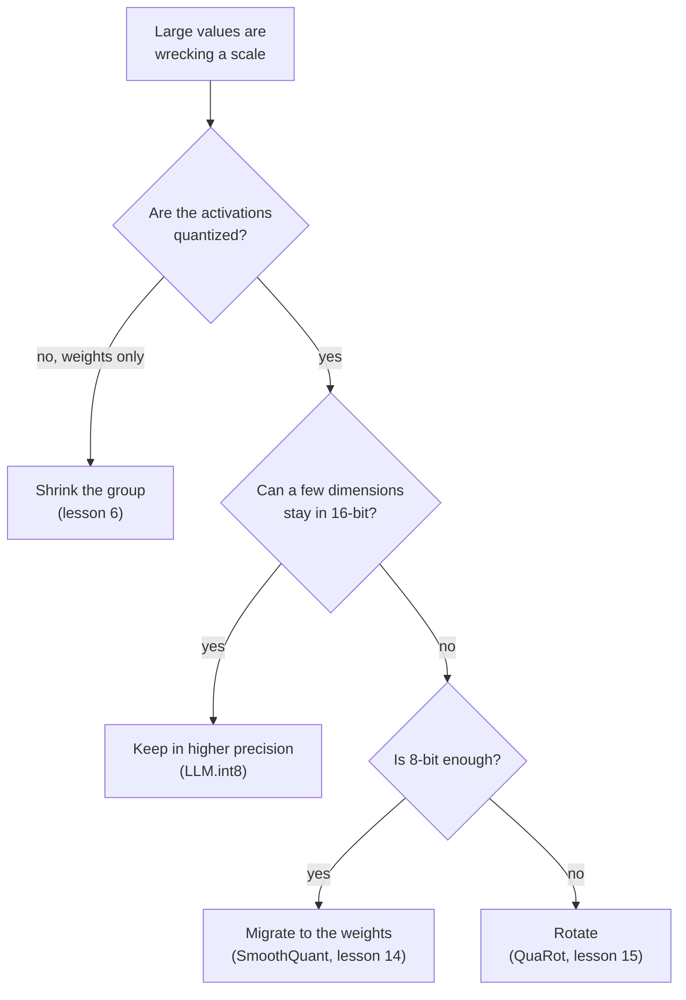

# Leçon 8. Traiter les outliers

**Lien avec la mission :** Dire quelle parade s'applique à un LLM en int8 cassé, c'est connaître les quatre façons de contourner un outlier, ce que chacune sacrifie, et quelle leçon ultérieure l'enseigne en entier.
**Source primaire :** [Article : "LLM.int8(): 8-bit Matrix Multiplication for Transformers at Scale", Dettmers et al., 2022](https://arxiv.org/abs/2208.07339), section 3.2
**Prérequis :** [Leçon 7](0007-why-llms-have-outliers.md), [Granularité](../GLOSSARY.md), [Rotation](../GLOSSARY.md), [Feature outlier](../GLOSSARY.md)

## Échauffement

1. ▢ Quelle part des features représentent à peu près les features outlier chez Dettmers et al., et que devient la perplexity si on les met à zéro ?

<details markdown="1"><summary>Vérifier</summary>

Environ 0.1 pour cent des features, et la perplexity monte de 600 à 1000 pour cent (leçon 7). Très peu de valeurs portent une grande part du comportement du modèle.

</details>

2. ▢ Pourquoi écrêter ces valeurs, comme le ferait une recherche de plage par MSE, est-il la mauvaise réponse pour un LLM ?

<details markdown="1"><summary>Vérifier</summary>

La MSE compte toutes les valeurs à égalité, donc écrêter une toute petite part des valeurs paraît bon marché, mais ces valeurs sont les importantes (leçon 5). La parade doit les garder, pas les ramener à la limite.

</details>

3. ▢ En 4 bits avec un scale par tenseur, une feature de grandeur 60 parmi des valeurs d'écart type 1 : que deviennent les valeurs normales ?

<details markdown="1"><summary>Vérifier</summary>

Le pas est 60 / 7 = 8.6, donc tout ce qui est inférieur à 4.3 est arrondi à zéro, c'est-à-dire pratiquement toute valeur normale (leçon 7).

</details>

## À savoir

### Quatre façons de contourner un outlier

Chaque parade répond au même problème que la leçon 7 : une grande valeur fixe un scale trop grossier pour tout ce qui l'entoure. Elles diffèrent par ce qu'elles changent.

| Famille | L'idée | Où elle agit | Enseignée dans |
|---|---|---|---|
| Garder en plus haute précision | Calculer les dimensions outlier en 16 bits et le reste en int8 | La multiplication de matrices, dimensions outlier choisies d'après les activations | Cette leçon |
| Réduire le groupe | Donner à de petits ensembles de valeurs leur propre scale, pour qu'un outlier n'abîme que son propre ensemble | La granularité des scales | Leçon 6 |
| Migrer | Diviser les canaux outlier des activations par un scale et multiplier les poids correspondants par ce scale | Hors ligne, dans les poids et dans l'opération précédente | Leçon 14 |
| Faire pivoter | Multiplier par une matrice orthogonale pour qu'un outlier soit réparti sur tous les canaux | Les poids hors ligne, les activations par la rotation | Leçon 15 |



Lisez le schéma comme une règle empirique tirée de ce que vise chaque article, pas comme un classement : les méthodes se recoupent, et les leçons suivantes donnent les preuves.

### Garder les outliers en plus haute précision

Dettmers et al. appellent cela la décomposition en précision mixte. Prenez la matrice d'états cachés et rassemblez les dimensions de features qui contiennent au moins une valeur de grandeur supérieure à un seuil `α`. Ils ont trouvé que `α = 6.0` ramène la dégradation près de zéro. La multiplication de matrices se découpe alors en deux parties : ces dimensions sont multipliées en 16 bits, et toutes les autres en 8 bits avec un scale par ligne des activations et par colonne des poids, le schéma vector-wise de la leçon 6.

```text
Out = sum over outlier dimensions of (X_16bit * W_16bit)  +  scale * sum over the rest of (X_int8 * W_int8)
```

La partie en 16 bits est petite. Jusqu'à 13B paramètres, il y a au plus 7 dimensions outlier, ce qui, dit l'article, coûte environ 0.1 pour cent de mémoire en plus, et plus de 99.9 pour cent des valeurs sont multipliées en 8 bits. Les auteurs ne rapportent aucune dégradation jusqu'à 175B paramètres, et une réduction de mémoire de 1.96 fois pour BLOOM-176B. Le prix est un travail en précision mixte à l'intérieur d'une même multiplication de matrices, et ils notent que le surcoût de quantification peut ralentir l'inférence pour les modèles sous 6.7B, les grandes matrices étant environ deux fois plus rapides que le 16 bits.

### Réduire le groupe

L'outil de la leçon 6. Les petits groupes confinent un outlier à son propre groupe, et Dettmers et Zettlemoyer indiquent que la petite taille de bloc comme la quantification dépendante des outliers améliorent la précision des outliers ([Dettmers et Zettlemoyer, 2022](https://arxiv.org/abs/2212.09720)). Pour les poids, c'est la réponse standard. Pour les activations, elle ne suit pas l'axe que la leçon 7 a trouvé : un scale par token est fixé par la ligne, et la feature outlier se trouve dans chaque ligne. L'exercice 6 de la pratique examine ce qu'exigerait un groupe le long de l'axe des features.

### Migrer la difficulté

[SmoothQuant](https://arxiv.org/abs/2211.10438) part de l'observation que les poids sont faciles à quantifier et les activations non. Il migre la difficulté hors ligne des activations vers les poids avec une transformation mathématiquement équivalente, ce qui permet des poids et des activations en 8 bits. L'identité est de l'algèbre élémentaire : diviser le canal d'activation `k` par `s[k]` et multiplier la ligne `k` des poids par `s[k]` laisse le produit inchangé. La leçon 14 montre comment le scale est choisi. L'outlier n'a pas disparu : il se trouve désormais dans les poids, et l'exercice 4 de la pratique montre à quel point il y devient grand.

### Faire pivoter l'outlier hors du chemin

[QuaRot](https://arxiv.org/abs/2404.00456) fait pivoter l'état caché pour que les outliers soient supprimés sans changer la sortie du modèle, et quantifie poids, activations et KV cache en 4 bits. L'identité est de nouveau de l'algèbre : pour une matrice orthogonale `Q`, `X W = (X Q)(Q^T W)`. Une rotation dense mélange chaque canal dans tous les autres, donc un grand canal devient de nombreux canaux modérément grands. La leçon 15 couvre quelles rotations fonctionnent et ce qu'elles coûtent.

Une cinquième voie se situe hors du post-entraînement : [Bondarenko et al.](https://arxiv.org/abs/2306.12929) changent le mécanisme d'attention pendant le pré-entraînement pour que les têtes puissent ne rien faire sans produire d'outliers, et ils rapportent une quantification int8 des activations sans effort supplémentaire. Cela exige que le modèle ait été entraîné ainsi, donc ce parcours la traite comme une raison de l'existence des outliers (leçon 7), pas comme une parade applicable à un checkpoint.

## Pratique

1. ▢ Décrivez la décomposition de LLM.int8() : comment les dimensions outlier sont choisies, quelle arithmétique utilise chaque partie, et quelle part des valeurs reste en 8 bits.

<details markdown="1"><summary>Vérifier</summary>

Les dimensions de features qui ont au moins une valeur de grandeur 6.0 ou plus passent par une multiplication de matrices en 16 bits. Toute autre dimension passe par une multiplication en 8 bits avec des scales par ligne et par colonne, et les deux résultats sont additionnés. Plus de 99.9 pour cent des valeurs sont multipliées en 8 bits.

</details>

2. ▢ Quelle phrase nomme correctement une famille avec son mécanisme ?

    - a) Migration : multiplier les activations par une matrice orthogonale avant d'arrondir
    - b) Rotation : déplacer le scale des canaux d'activation vers les poids hors ligne
    - c) Regroupement : stocker les valeurs outlier dans un fichier creux séparé
    - d) Décomposition : garder quelques dimensions outlier en arithmétique 16 bits

<details markdown="1"><summary>Vérifier</summary>

**d)** LLM.int8() calcule les quelques dimensions outlier en 16 bits et le reste en int8. (a) et (b) échangent les deux noms : la migration déplace du scale vers les poids, et la rotation multiplie par une matrice orthogonale. (c) est faux : le regroupement donne à chaque petit ensemble de valeurs son propre scale et ne stocke rien séparément.

</details>

3. ▢ Prédisez, puis exécutez. Une matrice d'activations de 128 tokens a une feature outlier de grandeur environ 60, et les poids sont ordinaires. Avant d'exécuter, prédisez lequel des trois schémas a l'erreur la plus basse dans le produit matriciel en 4 bits, et si les scales par token et par canal battent un scale par tenseur.

    ```python
    import numpy as np

    rng = np.random.default_rng(0)
    tokens, features, out = 128, 512, 64
    X = rng.normal(size=(tokens, features))
    X[:, 7] = 60 * rng.uniform(0.8, 1.2, size=tokens)  # outlier feature dimension
    W = rng.normal(size=(features, out)) * 0.05


    def fake_quant(A, axis, bits):
        qmax = 2 ** (bits - 1) - 1
        s = np.abs(A).max(axis=axis, keepdims=True) / qmax
        s = np.where(s == 0, 1.0, s)
        return s * np.clip(np.round(A / s), -qmax, qmax)


    def rel_err(Y_hat, Y):
        return np.linalg.norm(Y_hat - Y) / np.linalg.norm(Y)


    Y = X @ W
    outlier = np.abs(X).max(axis=0) > 6.0  # LLM.int8() threshold on magnitude
    print("outlier feature dimensions:", np.flatnonzero(outlier))
    print("bits  per-tensor  per-token+per-channel  outliers kept in float")
    for bits in (8, 4):
        plain = fake_quant(X, None, bits) @ fake_quant(W, None, bits)
        vector = fake_quant(X, 1, bits) @ fake_quant(W, 0, bits)
        X_rest, W_rest = X[:, ~outlier], W[~outlier]
        split = fake_quant(X_rest, 1, bits) @ fake_quant(W_rest, 0, bits) + X[:, outlier] @ W[outlier]
        print(f"{bits}     {rel_err(plain, Y):.4f}      {rel_err(vector, Y):.4f}                 {rel_err(split, Y):.4f}")
    ```

<details markdown="1"><summary>Indice</summary>

Le scale par token de la leçon 6 est celui qu'utilise le schéma vector-wise de Dettmers et al. Demandez-vous s'il sépare une dimension de feature qui est grande à chaque token.

</details>

<details markdown="1"><summary>Vérifier</summary>

```text
outlier feature dimensions: [7]
bits  per-tensor  per-token+per-channel  outliers kept in float
8     0.0632      0.0529                 0.0040
4     0.4175      0.4045                 0.0744
```

Garder la dimension outlier en float est bien meilleur aux deux largeurs : une erreur environ 16 fois plus basse qu'avec un scale par tenseur en 8 bits et environ 5.6 fois plus basse en 4. Les scales par token et par canal n'améliorent que légèrement un scale par tenseur, parce que l'outlier est dans chaque ligne, ce qui est l'échec que prédisait la leçon 7. Même avec la séparation, l'erreur en 4 bits est de 0.074, donc le reste du tenseur paie encore la précision plus basse. Les données sont synthétiques.

</details>

4. ▢ Prédisez, puis exécutez. Ce code applique une migration et une rotation à un tenseur qui a une feature outlier. Avant d'exécuter, prédisez si chacune laisse le produit `X @ W` inchangé, où se retrouve l'outlier migré, et si la rotation le supprime complètement.

    ```python
    import numpy as np

    rng = np.random.default_rng(0)
    X = rng.normal(size=(128, 64))
    X[:, 5] *= 50                      # one outlier feature dimension
    W = rng.normal(size=(64, 32)) * 0.1
    Y = X @ W

    # Migrate: divide activation column k by s[k], multiply weight row k by s[k].
    colmax = np.abs(X).max(axis=0)
    s = colmax / np.median(colmax)
    X2, W2 = X / s, W * s[:, None]
    print("migrate: same output?", np.allclose(X2 @ W2, Y))
    print("migrate: max |X|  before", round(np.abs(X).max(), 1), " after", round(np.abs(X2).max(), 1))
    print("migrate: max |W|  before", round(np.abs(W).max(), 2), " after", round(np.abs(W2).max(), 2))

    # Rotate: multiply X by an orthogonal Q and W by Q transposed.
    Q, _ = np.linalg.qr(rng.normal(size=(64, 64)))
    X3, W3 = X @ Q, Q.T @ W
    print("rotate:  same output?", np.allclose(X3 @ W3, Y))
    print("rotate:  max |x| / rms of x  before", round(np.abs(X).max() / np.sqrt(np.mean(X**2)), 1),
          " after", round(np.abs(X3).max() / np.sqrt(np.mean(X3**2)), 1))
    ```

<details markdown="1"><summary>Vérifier</summary>

```text
migrate: same output? True
migrate: max |X|  before 150.7  after 2.7
migrate: max |W|  before 0.35  after 16.54
rotate:  same output? True
rotate:  max |x| / rms of x  before 22.7  after 6.3
```

Les deux laissent le produit inchangé. La migration déplace la difficulté : la plus grande activation passe de 150.7 à 2.7 tandis que le plus grand poids passe de 0.35 à 16.54, donc l'outlier est maintenant dans les poids. La rotation ne supprime pas la grande valeur mais la répartit : le rapport entre la plus grande valeur et le rms passe de 22.7 à 6.3, ce qui est bien plus facile à quantifier mais pas plat. Les leçons qui suivent, 14 et 15, passent leur temps à bien choisir `s` et `Q`.

</details>

5. ▢ Choisissez une famille pour chaque cas et dites pourquoi : (i) des poids en 4 bits avec des activations laissées en 16 bits, (ii) des poids et des activations int8 sur un matériel doté d'un kernel de multiplication de matrices int8, avec des outliers allant jusqu'à une grandeur de 60 dans certains canaux d'activation, (iii) des poids et des activations en 4 bits.

<details markdown="1"><summary>Vérifier</summary>

(i) Réduire le groupe : les activations ne sont pas quantifiées, donc seuls les poids ont besoin de protection, et les petits groupes confinent tout outlier. (ii) Soit garder les dimensions outlier en 16 bits, comme le fait LLM.int8(), soit migrer la difficulté dans les poids, comme le fait SmoothQuant pour des poids et des activations en 8 bits, selon qu'un kernel en précision mixte est acceptable ou non. (iii) Faire pivoter : parmi les méthodes d'ici, QuaRot est celle qui vise le 4 bits pour les poids, les activations et le KV cache. C'est une règle empirique tirée de ce que vise chaque article, pas un classement mesuré, et les leçons de l'étape 5 qui suivent l'examinent.

</details>

6. ▢ Raisonnement, pas citation. Une équipe veut que « réduire le groupe » fonctionne sur les activations. Le long de quel axe le groupe doit-il se trouver, et que faut-il du matériel, vu ce que la leçon 6 disait des scales à l'intérieur d'une somme ?

<details markdown="1"><summary>Vérifier</summary>

Le long de l'axe des features, par exemple 32 features consécutives d'un token, de sorte que la feature outlier tombe dans un seul groupe par token au lieu de gonfler le scale de toute la ligne. Un tel scale varie le long de l'indice sommé de la multiplication de matrices, ce qui est le cas que, selon Nagel et al., la plupart des accélérateurs en virgule fixe ne prennent pas en charge, donc il faut un kernel qui gère un scale différent par groupe dans l'accumulation, ou un chemin qui déquantifie d'abord. C'est de nouveau la contrainte d'accumulateur de la leçon 6, ici du côté des activations. C'est une inférence tirée des deux articles, pas un résultat que l'un ou l'autre énonce.

</details>

## Exercices en situation réelle

- [ ] Dans le code de la Pratique 3, changez la grandeur de l'outlier de 60 à 8 et relancez. Notez à partir de quelle grandeur garder l'outlier en float cesse de valoir le code supplémentaire en 8 bits, et donnez la raison en termes de taille de pas.
- [ ] Choisissez un checkpoint ouvert en 8 bits ou en 4 bits, lisez sa fiche de modèle, et nommez laquelle des quatre familles sa méthode utilise et lesquelles elle n'utilise pas.
- [ ] Demain : sans notes, dessinez de mémoire le schéma de décision et écrivez un coût pour chacune des quatre familles. Comparez ensuite avec le tableau ci-dessus.

## Pour aller plus loin

- [La correspondance de quantification](../reference/quantization-mapping.md)
- [Article : "LLM.int8(): 8-bit Matrix Multiplication for Transformers at Scale", Dettmers et al., 2022](https://arxiv.org/abs/2208.07339)
- [Article : "SmoothQuant: Accurate and Efficient Post-Training Quantization for Large Language Models", Xiao et al., 2022](https://arxiv.org/abs/2211.10438)
- [Article : "QuaRot: Outlier-Free 4-Bit Inference in Rotated LLMs", Ashkboos et al., 2024](https://arxiv.org/abs/2404.00456)
- [Ressources](../RESOURCES.md)

---

Ça ne passe pas ? Relisez la source primaire en haut de page, car cette leçon la condense et c'est dans la condensation que la compréhension s'échappe. Consultez le [glossaire](../GLOSSARY.md) pour tout terme qui vous a paru glissant.

Si c'est la leçon elle-même qui n'est pas claire plutôt que la matière, c'est un défaut : [ouvrez une issue](https://github.com/TokenCemetery/teach/issues).
