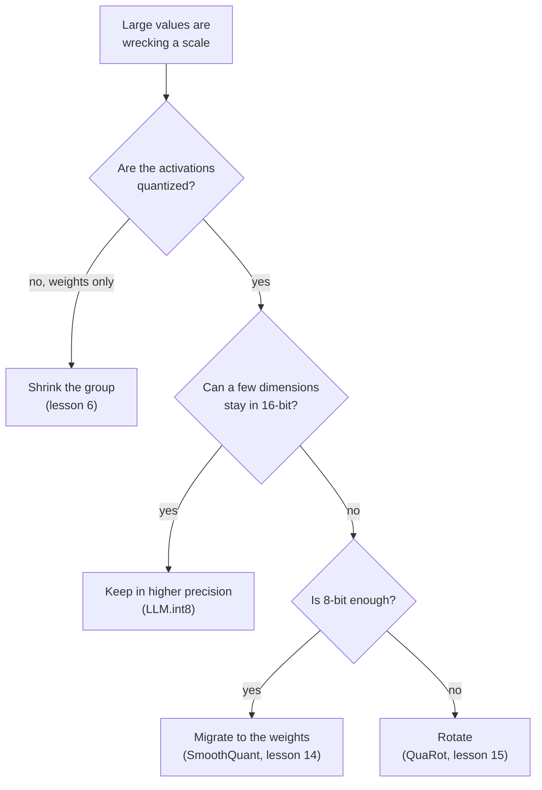

# पाठ 8. Outliers को सँभालना

**मिशन से संबंध:** यह बताना कि टूटे हुए int8 LLM पर कौन-सा इलाज लागू होता है, इसका मतलब है outlier से पार पाने के चार तरीक़े जानना, हर एक क्या छोड़ता है, और कौन-सा आगे का पाठ उसे पूरा सिखाता है।
**मुख्य स्रोत:** [पेपर: "LLM.int8(): 8-bit Matrix Multiplication for Transformers at Scale", Dettmers et al., 2022](https://arxiv.org/abs/2208.07339), section 3.2
**पूर्व-आवश्यकताएँ:** [पाठ 7](0007-why-llms-have-outliers.md), [Granularity](../GLOSSARY.md), [Rotation](../GLOSSARY.md), [Outlier feature](../GLOSSARY.md)

## वार्म-अप

1. ▢ Dettmers et al. में लगभग कितने features outlier features हैं, और अगर उन्हें zero कर दिया जाए तो perplexity का क्या होता है?

<details markdown="1"><summary>जाँचें</summary>

Features का लगभग 0.1 प्रतिशत, और perplexity 600 से 1000 प्रतिशत बढ़ती है (पाठ 7)। बहुत कम values model के व्यवहार का बहुत बड़ा हिस्सा ढोती हैं।

</details>

2. ▢ उन values को clip करना, जैसा MSE range search करता, LLM के लिए ग़लत प्रतिक्रिया क्यों है?

<details markdown="1"><summary>जाँचें</summary>

MSE हर value को बराबर गिनता है, इसलिए values के छोटे हिस्से को clip करना सस्ता दिखता है, पर वही values ज़रूरी हैं (पाठ 5)। इलाज को उन्हें रखना होगा, clamp नहीं करना।

</details>

3. ▢ प्रति tensor एक scale के साथ 4 bits पर, standard deviation 1 वाली values के बीच magnitude 60 का एक feature: सामान्य values का क्या होता है?

<details markdown="1"><summary>जाँचें</summary>

Step 60 / 7 = 8.6 है, इसलिए 4.3 से नीचे सब कुछ zero पर round होता है, जो व्यावहारिक रूप से हर सामान्य value है (पाठ 7)।

</details>

## यह जानें

### Outlier से पार पाने के चार तरीक़े

हर इलाज पाठ 7 की उसी समस्या का जवाब देता है: एक बड़ी value ऐसा scale तय करती है जो उसके आसपास की हर चीज़ के लिए बहुत मोटा है। वे इसमें अलग हैं कि क्या बदलते हैं।

| परिवार | विचार | कहाँ काम करता है | कहाँ सिखाया गया |
|---|---|---|---|
| ऊँची precision में रखना | Outlier dimensions को 16-bit में और बाक़ी को int8 में compute करना | Matrix multiplication, outlier dimensions activations से चुनी जाती हैं | यह पाठ |
| Group छोटा करना | Values के छोटे सेट को अपना scale देना, ताकि outlier सिर्फ़ अपने ही सेट को बिगाड़े | Scales की granularity | पाठ 6 |
| Migrate करना | Activations के outlier channels को किसी scale से भाग देना और संबंधित weights को उससे गुणा करना | Offline, weights में और पिछले operation में | पाठ 14 |
| Rotate करना | Orthogonal matrix से गुणा करना ताकि outlier सभी channels में फैल जाए | Weights पर offline, activations पर rotation से | पाठ 15 |



Diagram को अंगूठे के नियम की तरह पढ़ें, जो हर पेपर के लक्ष्य से निकला है, रैंकिंग की तरह नहीं: methods एक-दूसरे पर चढ़ते हैं, और आगे के पाठ सबूत देते हैं।

### Outliers को ऊँची precision में रखना

Dettmers et al. इसे mixed-precision decomposition कहते हैं। Hidden-state matrix लें और वे feature dimensions इकट्ठा करें जिनमें कम से कम एक value की magnitude थ्रेशोल्ड `α` से ऊपर हो। उन्होंने पाया कि `α = 6.0` गिरावट को लगभग zero तक ले आता है। Matrix multiplication फिर दो हिस्सों में बँटता है: वे dimensions 16-bit में गुणा होती हैं, और बाक़ी सब 8-bit में, activations की हर row और weights के हर column के एक scale के साथ, जो पाठ 6 की vector-wise योजना है।

```text
Out = sum over outlier dimensions of (X_16bit * W_16bit)  +  scale * sum over the rest of (X_int8 * W_int8)
```

16-bit वाला हिस्सा छोटा है। 13B parameters तक ज़्यादा से ज़्यादा 7 outlier dimensions हैं, जिसकी लागत पेपर के अनुसार लगभग 0.1 प्रतिशत अतिरिक्त memory है, और 99.9 प्रतिशत से ज़्यादा values 8-bit में गुणा होती हैं। लेखक 175B parameters तक कोई गिरावट नहीं बताते, और BLOOM-176B के लिए memory में 1.96 गुना की कमी। क़ीमत है एक matrix multiplication के भीतर mixed-precision का काम, और वे ध्यान दिलाते हैं कि 6.7B से छोटे models के लिए quantization overhead inference को धीमा कर सकता है, जबकि बड़ी matrices 16-bit से लगभग दोगुनी तेज़ हैं।

### Group छोटा करना

पाठ 6 का औज़ार। छोटे groups outlier को उसके अपने group तक सीमित करते हैं, और Dettmers और Zettlemoyer कहते हैं कि छोटा block size और outlier-निर्भर quantization दोनों outliers की precision सुधारते हैं ([Dettmers and Zettlemoyer, 2022](https://arxiv.org/abs/2212.09720))। Weights के लिए यही मानक उत्तर है। Activations के लिए यह उस axis का पालन नहीं करता जो पाठ 7 ने पाया: per-token scale row से तय होता है, और outlier feature हर row में है। अभ्यास का सवाल 6 बताता है कि feature axis के साथ group को क्या चाहिए होगा।

### कठिनाई को migrate करना

[SmoothQuant](https://arxiv.org/abs/2211.10438) इस अवलोकन से शुरू होता है कि weights को quantize करना आसान है और activations को नहीं। वह कठिनाई को offline गणितीय रूप से समतुल्य रूपांतरण से activations से weights में खिसका देता है, जिससे 8-bit weights और 8-bit activations संभव होते हैं। Identity सीधा बीजगणित है: activation channel `k` को `s[k]` से भाग देना और weights की row `k` को `s[k]` से गुणा करना गुणनफल को वही रखता है। पाठ 14 दिखाता है कि scale कैसे चुना जाता है। Outlier ग़ायब नहीं हुआ है: वह अब weights में बैठा है, और अभ्यास का सवाल 4 दिखाता है कि वहाँ वह कितना बड़ा हो जाता है।

### Outlier को rotate करके हटाना

[QuaRot](https://arxiv.org/abs/2404.00456) hidden state को rotate करता है ताकि model के output को बदले बिना outliers हट जाएँ, और weights, activations और KV cache को 4 bits पर quantize करता है। Identity फिर बीजगणित है: orthogonal matrix `Q` के लिए, `X W = (X Q)(Q^T W)`। Dense rotation हर channel को हर दूसरे channel में मिला देता है, इसलिए एक बड़ा channel कई मध्यम रूप से बड़े channels बन जाता है। पाठ 15 बताता है कि कौन-से rotations काम करते हैं और उनकी क्या लागत है।

एक पाँचवाँ रास्ता post-training से बाहर है: [Bondarenko et al.](https://arxiv.org/abs/2306.12929) pretraining के दौरान attention mechanism बदलते हैं ताकि heads outliers बनाए बिना कुछ न कर सकें, और वे बिना अतिरिक्त मेहनत के activations का int8 quantization बताते हैं। इसके लिए model का वैसे ही train होना ज़रूरी है, इसलिए यह track इसे outliers के होने की वजह मानता है (पाठ 7), ऐसा इलाज नहीं जो आप checkpoint पर लगा सकें।

## अभ्यास

1. ▢ LLM.int8() के decomposition का वर्णन करें: outlier dimensions कैसे चुनी जाती हैं, हर हिस्सा कौन-सा arithmetic इस्तेमाल करता है, और values का कितना हिस्सा 8-bit में रहता है।

<details markdown="1"><summary>जाँचें</summary>

जिन feature dimensions में कम से कम एक value की magnitude 6.0 या उससे ज़्यादा है, वे 16-bit matrix multiplication से गुज़रती हैं। हर दूसरी dimension per-row और per-column scales के साथ 8-bit multiplication से गुज़रती है, और दोनों नतीजे जोड़ दिए जाते हैं। 99.9 प्रतिशत से ज़्यादा values 8-bit में गुणा होती हैं।

</details>

2. ▢ कौन-सा वाक्य किसी परिवार को उसके तंत्र के साथ सही ढंग से नाम देता है?

    - a) Migration: rounding से पहले activations को orthogonal matrix से गुणा करना
    - b) Rotation: offline scale को activation channels से weights में खिसकाना
    - c) Grouping: outlier values को अलग sparse file में store करना
    - d) Decomposition: कुछ outlier dimensions को 16-bit arithmetic में रखना

<details markdown="1"><summary>जाँचें</summary>

**d)** LLM.int8() कुछ outlier dimensions को 16-bit में और बाक़ी को int8 में compute करता है। (a) और (b) दोनों नाम आपस में उलट देते हैं: migration scale को weights में खिसकाता है, और rotation orthogonal matrix से गुणा करता है। (c) ग़लत है: grouping values के हर छोटे सेट को अपना scale देती है और अलग से कुछ store नहीं करती।

</details>

3. ▢ पहले अनुमान लगाएँ, फिर चलाएँ। 128-token की activation matrix में लगभग 60 magnitude का एक outlier feature है, और weights सामान्य हैं। चलाने से पहले अनुमान लगाएँ कि तीन schemes में से किसकी matrix product में 4 bits पर error सबसे कम है, और क्या per-token और per-channel scales प्रति tensor एक scale को हराते हैं।

    ```python
    import numpy as np

    rng = np.random.default_rng(0)
    tokens, features, out = 128, 512, 64
    X = rng.normal(size=(tokens, features))
    X[:, 7] = 60 * rng.uniform(0.8, 1.2, size=tokens)  # outlier feature dimension
    W = rng.normal(size=(features, out)) * 0.05


    def fake_quant(A, axis, bits):
        qmax = 2 ** (bits - 1) - 1
        s = np.abs(A).max(axis=axis, keepdims=True) / qmax
        s = np.where(s == 0, 1.0, s)
        return s * np.clip(np.round(A / s), -qmax, qmax)


    def rel_err(Y_hat, Y):
        return np.linalg.norm(Y_hat - Y) / np.linalg.norm(Y)


    Y = X @ W
    outlier = np.abs(X).max(axis=0) > 6.0  # LLM.int8() threshold on magnitude
    print("outlier feature dimensions:", np.flatnonzero(outlier))
    print("bits  per-tensor  per-token+per-channel  outliers kept in float")
    for bits in (8, 4):
        plain = fake_quant(X, None, bits) @ fake_quant(W, None, bits)
        vector = fake_quant(X, 1, bits) @ fake_quant(W, 0, bits)
        X_rest, W_rest = X[:, ~outlier], W[~outlier]
        split = fake_quant(X_rest, 1, bits) @ fake_quant(W_rest, 0, bits) + X[:, outlier] @ W[outlier]
        print(f"{bits}     {rel_err(plain, Y):.4f}      {rel_err(vector, Y):.4f}                 {rel_err(split, Y):.4f}")
    ```

<details markdown="1"><summary>संकेत</summary>

पाठ 6 का per-token scale वही है जो Dettmers et al. की vector-wise योजना इस्तेमाल करती है। पूछें कि क्या वह उस feature dimension को अलग करता है जो हर token पर बड़ी है।

</details>

<details markdown="1"><summary>जाँचें</summary>

```text
outlier feature dimensions: [7]
bits  per-tensor  per-token+per-channel  outliers kept in float
8     0.0632      0.0529                 0.0040
4     0.4175      0.4045                 0.0744
```

Outlier dimension को float में रखना दोनों widths पर कहीं बेहतर है: 8 bits पर प्रति tensor एक scale से लगभग 16 गुना कम error और 4 पर लगभग 5.6 गुना कम। Per-token और per-channel scales प्रति tensor एक scale से बस थोड़ा बेहतर हैं, क्योंकि outlier हर row में है, यही वह विफलता है जिसका पाठ 7 ने अनुमान लगाया था। Split के साथ भी 4-bit error 0.074 है, इसलिए tensor का बाक़ी हिस्सा कम precision की क़ीमत अब भी चुकाता है। Data synthetic है।

</details>

4. ▢ पहले अनुमान लगाएँ, फिर चलाएँ। यह एक outlier feature वाले tensor पर migration और rotation लगाता है। चलाने से पहले अनुमान लगाएँ कि क्या दोनों गुणनफल `X @ W` को अपरिवर्तित छोड़ते हैं, migrate हुआ outlier कहाँ पहुँचता है, और क्या rotation उसे पूरी तरह हटा देता है।

    ```python
    import numpy as np

    rng = np.random.default_rng(0)
    X = rng.normal(size=(128, 64))
    X[:, 5] *= 50                      # one outlier feature dimension
    W = rng.normal(size=(64, 32)) * 0.1
    Y = X @ W

    # Migrate: divide activation column k by s[k], multiply weight row k by s[k].
    colmax = np.abs(X).max(axis=0)
    s = colmax / np.median(colmax)
    X2, W2 = X / s, W * s[:, None]
    print("migrate: same output?", np.allclose(X2 @ W2, Y))
    print("migrate: max |X|  before", round(np.abs(X).max(), 1), " after", round(np.abs(X2).max(), 1))
    print("migrate: max |W|  before", round(np.abs(W).max(), 2), " after", round(np.abs(W2).max(), 2))

    # Rotate: multiply X by an orthogonal Q and W by Q transposed.
    Q, _ = np.linalg.qr(rng.normal(size=(64, 64)))
    X3, W3 = X @ Q, Q.T @ W
    print("rotate:  same output?", np.allclose(X3 @ W3, Y))
    print("rotate:  max |x| / rms of x  before", round(np.abs(X).max() / np.sqrt(np.mean(X**2)), 1),
          " after", round(np.abs(X3).max() / np.sqrt(np.mean(X3**2)), 1))
    ```

<details markdown="1"><summary>जाँचें</summary>

```text
migrate: same output? True
migrate: max |X|  before 150.7  after 2.7
migrate: max |W|  before 0.35  after 16.54
rotate:  same output? True
rotate:  max |x| / rms of x  before 22.7  after 6.3
```

दोनों गुणनफल को अपरिवर्तित छोड़ते हैं। Migration कठिनाई को खिसकाता है: सबसे बड़ी activation 150.7 से गिरकर 2.7 रह जाती है जबकि सबसे बड़ा weight 0.35 से बढ़कर 16.54 हो जाता है, यानी outlier अब weights में है। Rotation बड़ी value को हटाता नहीं बल्कि बाँट देता है: सबसे बड़ी value और rms का अनुपात 22.7 से गिरकर 6.3 हो जाता है, जिसे quantize करना कहीं आसान है पर समतल नहीं। आगे के पाठ, 14 और 15, अपना समय `s` और `Q` को अच्छी तरह चुनने में लगाते हैं।

</details>

5. ▢ हर मामले के लिए एक परिवार चुनें और कारण बताएँ: (i) 4-bit weights जबकि activations 16-bit में छोड़ी गई हैं, (ii) int8 matrix-multiply kernel वाले hardware पर int8 weights और activations, जिनमें कुछ activation channels में magnitude 60 तक के outliers हैं, (iii) 4-bit weights और activations।

<details markdown="1"><summary>जाँचें</summary>

(i) Group छोटा करें: activations quantize नहीं हो रही हैं, इसलिए सिर्फ़ weights को बचाना है, और छोटे groups किसी भी outlier को सीमित कर देते हैं। (ii) या तो outlier dimensions को 16-bit में रखें, जैसा LLM.int8() करता है, या कठिनाई को weights में migrate करें, जैसा SmoothQuant 8-bit weights और activations के लिए करता है, इस पर निर्भर करते हुए कि mixed-precision kernel स्वीकार्य है या नहीं। (iii) Rotate करें: यहाँ के methods में, QuaRot वह है जो weights, activations और KV cache के लिए 4 bits को लक्ष्य करता है। यह हर पेपर के लक्ष्य से निकला अंगूठे का नियम है, मापी हुई रैंकिंग नहीं, और बाद के चरण-5 के पाठ इसे परखते हैं।

</details>

6. ▢ तर्क करें, उद्धरण नहीं। कोई team चाहती है कि "group छोटा करना" activations पर काम करे। Group को किस axis के साथ होना चाहिए, और योग के भीतर scales के बारे में पाठ 6 ने जो कहा उसे देखते हुए, उसे hardware से क्या चाहिए?

<details markdown="1"><summary>जाँचें</summary>

Feature axis के साथ, जैसे एक token की लगातार 32 features, ताकि outlier feature हर token पर एक ही group के भीतर आए, पूरी row का scale फुलाने के बजाय। ऐसा scale matrix multiplication के जिस index पर योग होता है उसके साथ बदलता है, जो वह मामला है जिसे Nagel et al. के अनुसार ज़्यादातर fixed-point accelerators support नहीं करते, इसलिए उसे ऐसा kernel चाहिए जो accumulation में हर group का अलग scale सँभाले, या पहले dequantize करने वाला रास्ता। यह फिर पाठ 6 की accumulator की बाध्यता है, यहाँ activation की ओर से। यह दोनों पेपरों से निकाला गया अनुमान है, ऐसा नतीजा नहीं जो उनमें से कोई कहता हो।

</details>

## असली दुनिया का अभ्यास

- [ ] अभ्यास 3 के code में outlier की magnitude 60 से बदलकर 8 करें और दोबारा चलाएँ। दर्ज करें कि किस magnitude पर 8 bits पर outlier को float में रखना अतिरिक्त code के लायक़ नहीं रहता, और कारण step size के रूप में बताएँ।
- [ ] कोई एक open 8-bit या 4-bit checkpoint चुनें, उसका model card पढ़ें, और बताएँ कि उसका method चार परिवारों में से कौन-सा इस्तेमाल करता है और कौन-सा नहीं।
- [ ] कल: बिना नोट्स के decision diagram याद से बनाएँ और चार परिवारों में से हर एक की एक लागत लिखें। फिर ऊपर की table से तुलना करें।

## आगे बढ़ने के लिए

- [Quantization Mapping शीट](../reference/quantization-mapping.md)
- [पेपर: "LLM.int8(): 8-bit Matrix Multiplication for Transformers at Scale", Dettmers et al., 2022](https://arxiv.org/abs/2208.07339)
- [पेपर: "SmoothQuant: Accurate and Efficient Post-Training Quantization for Large Language Models", Xiao et al., 2022](https://arxiv.org/abs/2211.10438)
- [पेपर: "QuaRot: Outlier-Free 4-Bit Inference in Rotated LLMs", Ashkboos et al., 2024](https://arxiv.org/abs/2404.00456)
- [संसाधन](../RESOURCES.md)

---

बात नहीं बन रही? ऊपर दिए मुख्य स्रोत को दोबारा पढ़ें, क्योंकि यह पाठ उसे संक्षिप्त करता है और समझ संक्षेप में ही रिसती है। जो शब्द फिसलन भरा लगे, उसके लिए [शब्दावली](../GLOSSARY.md) देखें।

अगर दिक़्क़त सामग्री की नहीं बल्कि पाठ की ही है, तो वह एक खोट है: [issue खोलें](https://github.com/TokenCemetery/teach/issues)।
