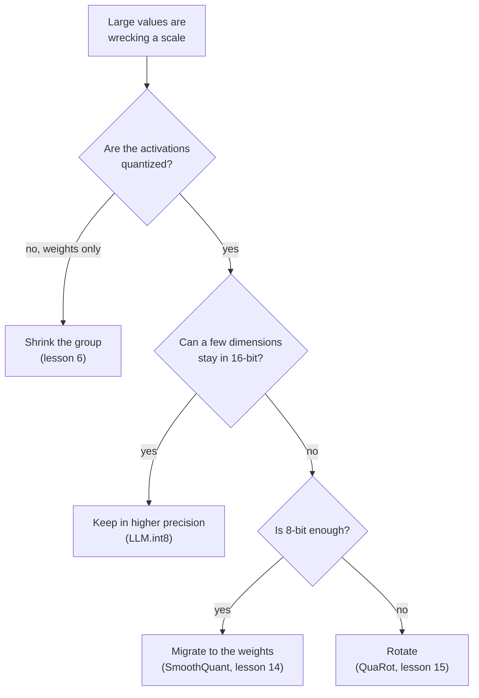

# Lesson 8. Handling Outliers

**Mission link:** Saying which fix applies to a broken int8 LLM means knowing the four ways of getting past an outlier, what each one gives up, and which later lesson teaches it in full.
**Primary source:** [Paper: "LLM.int8(): 8-bit Matrix Multiplication for Transformers at Scale", Dettmers et al., 2022](https://arxiv.org/abs/2208.07339), section 3.2
**Prerequisites:** [Lesson 7](0007-why-llms-have-outliers.md), [Granularity](../GLOSSARY.md), [Rotation](../GLOSSARY.md), [Outlier feature](../GLOSSARY.md)

## Warm-up

1. ▢ Roughly what share of features are outlier features in Dettmers et al., and what happens to perplexity if they are set to zero?

<details markdown="1"><summary>Check</summary>

About 0.1 percent of the features, and perplexity rises by 600 to 1000 percent (lesson 7). Very few values carry a great deal of the model's behaviour.

</details>

2. ▢ Why is clipping those values, as an MSE range search would, the wrong response for an LLM?

<details markdown="1"><summary>Check</summary>

MSE counts every value equally, so clipping a tiny share of values looks cheap, but those values are the important ones (lesson 5). The fix has to keep them, not clamp them.

</details>

3. ▢ At 4 bits with one scale per tensor, one feature of magnitude 60 among values of standard deviation 1: what happens to the normal values?

<details markdown="1"><summary>Check</summary>

The step is 60 / 7 = 8.6, so everything below 4.3 rounds to zero, which is practically every normal value (lesson 7).

</details>

## Know this

### Four ways past an outlier

Every fix answers the same problem from lesson 7: one large value sets a scale that is too coarse for everything near it. They differ in what they change.

| Family | The idea | Where it acts | Taught in |
|---|---|---|---|
| Keep in higher precision | Compute the outlier dimensions in 16-bit and the rest in int8 | The matrix multiplication, outlier dimensions chosen from the activations | This lesson |
| Shrink the group | Give small sets of values their own scale, so an outlier damages only its own set | The granularity of the scales | Lesson 6 |
| Migrate | Divide the outlier channels of the activations by a scale and multiply the matching weights by it | Offline, in the weights and the preceding operation | Lesson 14 |
| Rotate | Multiply by an orthogonal matrix so an outlier is spread across all channels | The weights offline, the activations by the rotation | Lesson 15 |



Read the diagram as a rule of thumb drawn from what each paper targets, not a ranking: the methods overlap, and later lessons give the evidence.

### Keep outliers in higher precision

Dettmers et al. call this mixed-precision decomposition. Take the hidden-state matrix and collect the feature dimensions that contain at least one value with a magnitude above a threshold `α`. They found `α = 6.0` brings the degradation close to zero. The matrix multiplication then splits into two parts: those dimensions are multiplied in 16-bit, and all the others in 8-bit with one scale per row of the activations and per column of the weights, the vector-wise scheme of lesson 6.

```text
Out = sum over outlier dimensions of (X_16bit * W_16bit)  +  scale * sum over the rest of (X_int8 * W_int8)
```

The 16-bit part is small. Up to 13B parameters there are at most 7 outlier dimensions, which the paper says costs about 0.1 percent more memory, and more than 99.9 percent of the values are multiplied in 8-bit. The authors report no degradation up to 175B parameters, and a memory reduction of 1.96 times for BLOOM-176B. The price is mixed-precision work inside one matrix multiplication, and they note that quantization overhead can slow inference for models below 6.7B, with large matrices about twice as fast as 16-bit.

### Shrink the group

Lesson 6's tool. Small groups confine an outlier to its own group, and Dettmers and Zettlemoyer state that both small block size and outlier-dependent quantization improve the precision of outliers ([Dettmers and Zettlemoyer, 2022](https://arxiv.org/abs/2212.09720)). For weights it is the standard answer. For activations it does not follow the axis lesson 7 found: a per-token scale is set by the row, and the outlier feature is in every row. Practice item 6 works through what a group along the feature axis would need.

### Migrate the difficulty

[SmoothQuant](https://arxiv.org/abs/2211.10438) starts from the observation that weights are easy to quantize and activations are not. It migrates the difficulty offline from activations to weights with a mathematically equivalent transformation, enabling 8-bit weights and 8-bit activations. The identity is plain algebra: dividing activation channel `k` by `s[k]` and multiplying row `k` of the weights by `s[k]` leaves the product unchanged. Lesson 14 shows how the scale is chosen. The outlier has not gone away: it now sits in the weights, and Practice item 4 shows how large it becomes there.

### Rotate the outlier away

[QuaRot](https://arxiv.org/abs/2404.00456) rotates the hidden state so that outliers are removed without changing the model's output, and quantizes weights, activations and the KV cache to 4 bits. The identity again is algebra: for an orthogonal matrix `Q`, `X W = (X Q)(Q^T W)`. A dense rotation mixes every channel into every other, so one large channel becomes many moderately large ones. Lesson 15 covers which rotations work and what they cost.

A fifth route lies outside post-training: [Bondarenko et al.](https://arxiv.org/abs/2306.12929) change the attention mechanism during pretraining so heads can do nothing without producing outliers, and they report int8 quantization of the activations without extra effort. That needs the model trained that way, so this track treats it as a reason outliers exist (lesson 7), not as a fix you can apply to a checkpoint.

## Practice

1. ▢ Describe LLM.int8()'s decomposition: how outlier dimensions are chosen, which arithmetic each part uses, and what share of values stays in 8-bit.

<details markdown="1"><summary>Check</summary>

Feature dimensions with at least one value of magnitude 6.0 or more go through a 16-bit matrix multiplication. Every other dimension goes through an 8-bit multiplication with per-row and per-column scales, and the two results are added. More than 99.9 percent of the values are multiplied in 8-bit.

</details>

2. ▢ Which sentence names a family correctly with its mechanism?

    - a) Migration: multiply activations by an orthogonal matrix before rounding
    - b) Rotation: move scale from activation channels into weights offline
    - c) Grouping: store outlier values in a separate sparse file
    - d) Decomposition: keep a few outlier dimensions in 16-bit arithmetic

<details markdown="1"><summary>Check</summary>

**d)** LLM.int8() computes the few outlier dimensions in 16-bit and the rest in int8. (a) and (b) swap the two names: migration moves scale into the weights, and rotation multiplies by an orthogonal matrix. (c) is wrong: grouping gives each small set of values its own scale and stores nothing separately.

</details>

3. ▢ Predict, then run. A 128-token activation matrix has one outlier feature of magnitude about 60, and the weights are ordinary. Before running, predict which of the three schemes has the lowest error in the matrix product at 4 bits, and whether the per-token and per-channel scales beat one scale per tensor.

    ```python
    import numpy as np

    rng = np.random.default_rng(0)
    tokens, features, out = 128, 512, 64
    X = rng.normal(size=(tokens, features))
    X[:, 7] = 60 * rng.uniform(0.8, 1.2, size=tokens)  # outlier feature dimension
    W = rng.normal(size=(features, out)) * 0.05


    def fake_quant(A, axis, bits):
        qmax = 2 ** (bits - 1) - 1
        s = np.abs(A).max(axis=axis, keepdims=True) / qmax
        s = np.where(s == 0, 1.0, s)
        return s * np.clip(np.round(A / s), -qmax, qmax)


    def rel_err(Y_hat, Y):
        return np.linalg.norm(Y_hat - Y) / np.linalg.norm(Y)


    Y = X @ W
    outlier = np.abs(X).max(axis=0) > 6.0  # LLM.int8() threshold on magnitude
    print("outlier feature dimensions:", np.flatnonzero(outlier))
    print("bits  per-tensor  per-token+per-channel  outliers kept in float")
    for bits in (8, 4):
        plain = fake_quant(X, None, bits) @ fake_quant(W, None, bits)
        vector = fake_quant(X, 1, bits) @ fake_quant(W, 0, bits)
        X_rest, W_rest = X[:, ~outlier], W[~outlier]
        split = fake_quant(X_rest, 1, bits) @ fake_quant(W_rest, 0, bits) + X[:, outlier] @ W[outlier]
        print(f"{bits}     {rel_err(plain, Y):.4f}      {rel_err(vector, Y):.4f}                 {rel_err(split, Y):.4f}")
    ```

<details markdown="1"><summary>Hint</summary>

The per-token scale of lesson 6 is the one Dettmers et al.'s vector-wise scheme uses. Ask whether it separates a feature dimension that is large at every token.

</details>

<details markdown="1"><summary>Check</summary>

```text
outlier feature dimensions: [7]
bits  per-tensor  per-token+per-channel  outliers kept in float
8     0.0632      0.0529                 0.0040
4     0.4175      0.4045                 0.0744
```

Keeping the outlier dimension in float is far better at both widths: about 16 times lower error than one scale per tensor at 8 bits and about 5.6 times lower at 4. The per-token and per-channel scales improve on one scale per tensor only slightly, because the outlier is in every row, which is the failure lesson 7 predicted. Even with the split, 4-bit error is 0.074, so the rest of the tensor still pays for the lower precision. The data is synthetic.

</details>

4. ▢ Predict, then run. This applies a migration and a rotation to a tensor with one outlier feature. Before running, predict whether each leaves the product `X @ W` unchanged, where the migrated outlier ends up, and whether the rotation removes it completely.

    ```python
    import numpy as np

    rng = np.random.default_rng(0)
    X = rng.normal(size=(128, 64))
    X[:, 5] *= 50                      # one outlier feature dimension
    W = rng.normal(size=(64, 32)) * 0.1
    Y = X @ W

    # Migrate: divide activation column k by s[k], multiply weight row k by s[k].
    colmax = np.abs(X).max(axis=0)
    s = colmax / np.median(colmax)
    X2, W2 = X / s, W * s[:, None]
    print("migrate: same output?", np.allclose(X2 @ W2, Y))
    print("migrate: max |X|  before", round(np.abs(X).max(), 1), " after", round(np.abs(X2).max(), 1))
    print("migrate: max |W|  before", round(np.abs(W).max(), 2), " after", round(np.abs(W2).max(), 2))

    # Rotate: multiply X by an orthogonal Q and W by Q transposed.
    Q, _ = np.linalg.qr(rng.normal(size=(64, 64)))
    X3, W3 = X @ Q, Q.T @ W
    print("rotate:  same output?", np.allclose(X3 @ W3, Y))
    print("rotate:  max |x| / rms of x  before", round(np.abs(X).max() / np.sqrt(np.mean(X**2)), 1),
          " after", round(np.abs(X3).max() / np.sqrt(np.mean(X3**2)), 1))
    ```

<details markdown="1"><summary>Check</summary>

```text
migrate: same output? True
migrate: max |X|  before 150.7  after 2.7
migrate: max |W|  before 0.35  after 16.54
rotate:  same output? True
rotate:  max |x| / rms of x  before 22.7  after 6.3
```

Both leave the product unchanged. Migration moves the difficulty: the largest activation falls from 150.7 to 2.7 while the largest weight rises from 0.35 to 16.54, so the outlier is now in the weights. Rotation does not remove the large value but shares it out: the ratio of the largest value to the rms falls from 22.7 to 6.3, which is much easier to quantize but not flat. The lessons that follow, 14 and 15, spend their time on choosing `s` and `Q` well.

</details>

5. ▢ Pick a family for each case and say why: (i) 4-bit weights with activations left in 16-bit, (ii) int8 weights and activations on hardware with an int8 matrix-multiply kernel, with outliers up to magnitude 60 in some activation channels, (iii) 4-bit weights and activations.

<details markdown="1"><summary>Check</summary>

(i) Shrink the group: the activations are not quantized, so only the weights need protecting, and small groups confine any outlier. (ii) Either keep the outlier dimensions in 16-bit, as LLM.int8() does, or migrate the difficulty into the weights, as SmoothQuant does for 8-bit weights and activations, depending on whether a mixed-precision kernel is acceptable. (iii) Rotate: of the methods here, QuaRot is the one that targets 4 bits for weights, activations and the KV cache. This is a rule of thumb from what each paper targets, not a measured ranking, and the later stage-5 lessons examine it.

</details>

6. ▢ Reasoning, not a quotation. A team wants "shrink the group" to work on activations. Which axis must the group lie along, and what does it need from the hardware, given what lesson 6 said about scales inside a sum?

<details markdown="1"><summary>Check</summary>

Along the feature axis, for example 32 consecutive features of one token, so that the outlier feature falls inside one group per token instead of inflating the scale of the whole row. Such a scale varies along the summed index of the matrix multiplication, which is the case Nagel et al. say most fixed-point accelerators do not support, so it needs a kernel that handles a different scale per group in the accumulation, or a dequantize-first path. It is the accumulator constraint of lesson 6 again, here from the activation side. This is an inference from the two papers, not a result either states.

</details>

## Real-world reps

- [ ] In the Practice 3 code, change the outlier magnitude from 60 to 8 and rerun. Record at which magnitude keeping the outlier in float stops being worth the extra code at 8 bits, and give the reason in terms of the step size.
- [ ] Choose one open 8-bit or 4-bit checkpoint, read its model card, and name which of the four families its method uses and which it does not.
- [ ] Tomorrow: without notes, draw the decision diagram from memory and write one cost for each of the four families. Then compare with the table above.

## Going further

- [The Quantization Mapping](../reference/quantization-mapping.md)
- [Paper: "LLM.int8(): 8-bit Matrix Multiplication for Transformers at Scale", Dettmers et al., 2022](https://arxiv.org/abs/2208.07339)
- [Paper: "SmoothQuant: Accurate and Efficient Post-Training Quantization for Large Language Models", Xiao et al., 2022](https://arxiv.org/abs/2211.10438)
- [Paper: "QuaRot: Outlier-Free 4-Bit Inference in Rotated LLMs", Ashkboos et al., 2024](https://arxiv.org/abs/2404.00456)
- [Resources](../RESOURCES.md)

---

Not landing? Reread the primary source at the top, since this lesson compresses it and compression is where understanding leaks. Check the [glossary](../GLOSSARY.md) for any term that felt slippery.

If the lesson itself is unclear rather than the material, that is a defect: [open an issue](https://github.com/TokenCemetery/teach/issues).
