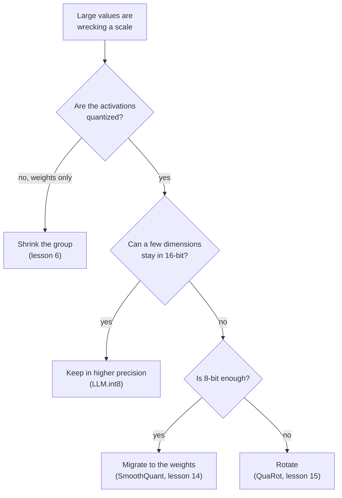

# Lição 8. Lidando com outliers

**Ligação com a missão:** Dizer qual correção se aplica a um LLM em int8 quebrado significa conhecer as quatro maneiras de contornar um outlier, o que cada uma sacrifica e qual lição posterior a ensina por completo.
**Fonte principal:** [Artigo científico: "LLM.int8(): 8-bit Matrix Multiplication for Transformers at Scale", Dettmers et al., 2022](https://arxiv.org/abs/2208.07339), seção 3.2
**Pré-requisitos:** [Lição 7](0007-why-llms-have-outliers.md), [Granularidade](../GLOSSARY.md), [Rotação](../GLOSSARY.md), [Feature outlier](../GLOSSARY.md)

## Aquecimento

1. ▢ Aproximadamente que fração das features são features outliers em Dettmers et al., e o que acontece com a perplexity se elas forem zeradas?

<details markdown="1"><summary>Verificação</summary>

Cerca de 0.1 por cento das features, e a perplexity sobe de 600 a 1000 por cento (lição 7). Pouquíssimos valores carregam muito do comportamento do modelo.

</details>

2. ▢ Por que aplicar clipping a esses valores, como uma busca de faixa por MSE faria, é a resposta errada para um LLM?

<details markdown="1"><summary>Verificação</summary>

O MSE conta todo valor igualmente, então aplicar clipping a uma fração minúscula dos valores parece barato, mas esses valores são os importantes (lição 5). A correção precisa mantê-los, não limitá-los.

</details>

3. ▢ Em 4 bits com uma scale por tensor, uma feature de magnitude 60 entre valores de desvio padrão 1: o que acontece com os valores normais?

<details markdown="1"><summary>Verificação</summary>

O passo é 60 / 7 = 8.6, então tudo abaixo de 4.3 arredonda para zero, o que é praticamente todo valor normal (lição 7).

</details>

## Saiba isto

### Quatro maneiras de contornar um outlier

Toda correção responde ao mesmo problema da lição 7: um valor grande define uma scale grosseira demais para tudo ao redor dele. Elas diferem no que mudam.

| Família | A ideia | Onde atua | Ensinada em |
|---|---|---|---|
| Manter em precisão maior | Calcular as dimensões outliers em 16 bits e o resto em int8 | A multiplicação de matrizes, com as dimensões outliers escolhidas a partir das ativações | Esta lição |
| Diminuir o grupo | Dar a pequenos conjuntos de valores a sua própria scale, de modo que um outlier danifique apenas o seu conjunto | A granularidade das scales | Lição 6 |
| Migrar | Dividir os canais outliers das ativações por uma scale e multiplicar os pesos correspondentes por ela | Offline, nos pesos e na operação anterior | Lição 14 |
| Rotacionar | Multiplicar por uma matriz ortogonal para que um outlier se espalhe por todos os canais | Os pesos offline, as ativações pela rotação | Lição 15 |



Leia o diagrama como uma regra prática tirada do que cada artigo almeja, não como um ranking: os métodos se sobrepõem, e as lições posteriores dão as evidências.

### Manter os outliers em precisão maior

Dettmers et al. chamam isso de decomposição em precisão mista. Tome a matriz de hidden states e colete as dimensões de feature que contêm pelo menos um valor com magnitude acima de um limiar `α`. Eles descobriram que `α = 6.0` leva a degradação para perto de zero. A multiplicação de matrizes então se divide em duas partes: essas dimensões são multiplicadas em 16 bits, e todas as outras em 8 bits com uma scale por linha das ativações e por coluna dos pesos, o esquema vector-wise da lição 6.

```text
Out = sum over outlier dimensions of (X_16bit * W_16bit)  +  scale * sum over the rest of (X_int8 * W_int8)
```

A parte de 16 bits é pequena. Até 13B de parâmetros há no máximo 7 dimensões outliers, o que o artigo diz custar cerca de 0.1 por cento a mais de memória, e mais de 99.9 por cento dos valores são multiplicados em 8 bits. Os autores relatam nenhuma degradação até 175B de parâmetros e uma redução de memória de 1.96 vez para o BLOOM-176B. O preço é o trabalho em precisão mista dentro de uma única multiplicação de matrizes, e eles observam que o overhead de quantização pode deixar a inferência mais lenta em modelos abaixo de 6.7B, com matrizes grandes cerca de duas vezes mais rápidas que em 16 bits.

### Diminuir o grupo

A ferramenta da lição 6. Grupos pequenos confinam um outlier ao seu próprio grupo, e Dettmers e Zettlemoyer afirmam que tanto o tamanho de bloco pequeno quanto a quantização dependente de outliers melhoram a precisão dos outliers ([Dettmers e Zettlemoyer, 2022](https://arxiv.org/abs/2212.09720)). Para os pesos, é a resposta padrão. Para as ativações, ela não segue o eixo que a lição 7 encontrou: uma scale per-token é definida pela linha, e a feature outlier está em toda linha. O item 6 da Prática examina o que um grupo ao longo do eixo das features exigiria.

### Migrar a dificuldade

O [SmoothQuant](https://arxiv.org/abs/2211.10438) parte da observação de que os pesos são fáceis de quantizar e as ativações não. Ele migra a dificuldade offline das ativações para os pesos com uma transformação matematicamente equivalente, viabilizando pesos de 8 bits e ativações de 8 bits. A identidade é álgebra simples: dividir o canal de ativação `k` por `s[k]` e multiplicar a linha `k` dos pesos por `s[k]` deixa o produto inalterado. A lição 14 mostra como a scale é escolhida. O outlier não desapareceu: ele agora está nos pesos, e o item 4 da Prática mostra o quão grande ele fica ali.

### Eliminar o outlier por rotação

O [QuaRot](https://arxiv.org/abs/2404.00456) rotaciona o hidden state de modo que os outliers sejam removidos sem mudar a saída do modelo, e quantiza pesos, ativações e o KV cache para 4 bits. A identidade, de novo, é álgebra: para uma matriz ortogonal `Q`, `X W = (X Q)(Q^T W)`. Uma rotação densa mistura cada canal em todos os outros, então um canal grande se torna muitos canais moderadamente grandes. A lição 15 cobre quais rotações funcionam e o que elas custam.

Um quinto caminho fica fora do post-training: [Bondarenko et al.](https://arxiv.org/abs/2306.12929) mudam o mecanismo de atenção durante o pré-treinamento para que as cabeças possam não fazer nada sem produzir outliers, e relatam quantização int8 das ativações sem esforço extra. Isso exige que o modelo tenha sido treinado assim, então esta trilha o trata como uma razão de os outliers existirem (lição 7), não como uma correção que você possa aplicar a um checkpoint.

## Prática

1. ▢ Descreva a decomposição do LLM.int8(): como as dimensões outliers são escolhidas, qual aritmética cada parte usa e que fração dos valores permanece em 8 bits.

<details markdown="1"><summary>Verificação</summary>

As dimensões de feature com pelo menos um valor de magnitude 6.0 ou mais passam por uma multiplicação de matrizes em 16 bits. Toda outra dimensão passa por uma multiplicação em 8 bits com scales por linha e por coluna, e os dois resultados são somados. Mais de 99.9 por cento dos valores são multiplicados em 8 bits.

</details>

2. ▢ Qual frase nomeia corretamente uma família com o seu mecanismo?

    - a) Migração: multiplicar as ativações por uma matriz ortogonal antes do arredondamento
    - b) Rotação: mover scale dos canais de ativação para os pesos offline
    - c) Agrupamento: armazenar os valores outliers em um arquivo esparso separado
    - d) Decomposição: manter algumas dimensões outliers em aritmética de 16 bits

<details markdown="1"><summary>Verificação</summary>

**d)** O LLM.int8() calcula as poucas dimensões outliers em 16 bits e o resto em int8. (a) e (b) trocam os dois nomes: a migração move scale para os pesos, e a rotação multiplica por uma matriz ortogonal. (c) está errada: o agrupamento dá a cada pequeno conjunto de valores a sua própria scale e não armazena nada separadamente.

</details>

3. ▢ Preveja e depois execute. Uma matriz de ativações de 128 tokens tem uma feature outlier de magnitude cerca de 60, e os pesos são comuns. Antes de executar, preveja qual dos três esquemas tem o menor erro no produto de matrizes em 4 bits e se as scales per-token e per-channel superam uma scale por tensor.

    ```python
    import numpy as np

    rng = np.random.default_rng(0)
    tokens, features, out = 128, 512, 64
    X = rng.normal(size=(tokens, features))
    X[:, 7] = 60 * rng.uniform(0.8, 1.2, size=tokens)  # outlier feature dimension
    W = rng.normal(size=(features, out)) * 0.05


    def fake_quant(A, axis, bits):
        qmax = 2 ** (bits - 1) - 1
        s = np.abs(A).max(axis=axis, keepdims=True) / qmax
        s = np.where(s == 0, 1.0, s)
        return s * np.clip(np.round(A / s), -qmax, qmax)


    def rel_err(Y_hat, Y):
        return np.linalg.norm(Y_hat - Y) / np.linalg.norm(Y)


    Y = X @ W
    outlier = np.abs(X).max(axis=0) > 6.0  # LLM.int8() threshold on magnitude
    print("outlier feature dimensions:", np.flatnonzero(outlier))
    print("bits  per-tensor  per-token+per-channel  outliers kept in float")
    for bits in (8, 4):
        plain = fake_quant(X, None, bits) @ fake_quant(W, None, bits)
        vector = fake_quant(X, 1, bits) @ fake_quant(W, 0, bits)
        X_rest, W_rest = X[:, ~outlier], W[~outlier]
        split = fake_quant(X_rest, 1, bits) @ fake_quant(W_rest, 0, bits) + X[:, outlier] @ W[outlier]
        print(f"{bits}     {rel_err(plain, Y):.4f}      {rel_err(vector, Y):.4f}                 {rel_err(split, Y):.4f}")
    ```

<details markdown="1"><summary>Dica</summary>

A scale per-token da lição 6 é a que o esquema vector-wise de Dettmers et al. usa. Pergunte se ela separa uma dimensão de feature que é grande em todo token.

</details>

<details markdown="1"><summary>Verificação</summary>

```text
outlier feature dimensions: [7]
bits  per-tensor  per-token+per-channel  outliers kept in float
8     0.0632      0.0529                 0.0040
4     0.4175      0.4045                 0.0744
```

Manter a dimensão outlier em float é muito melhor nas duas larguras: cerca de 16 vezes menos erro que uma scale por tensor em 8 bits e cerca de 5.6 vezes menos em 4. As scales per-token e per-channel melhoram só ligeiramente em relação a uma scale por tensor, porque o outlier está em toda linha, que é a falha que a lição 7 previu. Mesmo com a divisão, o erro de 4 bits é 0.074, então o resto do tensor ainda paga pela menor precisão. Os dados são sintéticos.

</details>

4. ▢ Preveja e depois execute. Isto aplica uma migração e uma rotação a um tensor com uma feature outlier. Antes de executar, preveja se cada uma deixa o produto `X @ W` inalterado, onde o outlier migrado acaba e se a rotação o remove por completo.

    ```python
    import numpy as np

    rng = np.random.default_rng(0)
    X = rng.normal(size=(128, 64))
    X[:, 5] *= 50                      # one outlier feature dimension
    W = rng.normal(size=(64, 32)) * 0.1
    Y = X @ W

    # Migrate: divide activation column k by s[k], multiply weight row k by s[k].
    colmax = np.abs(X).max(axis=0)
    s = colmax / np.median(colmax)
    X2, W2 = X / s, W * s[:, None]
    print("migrate: same output?", np.allclose(X2 @ W2, Y))
    print("migrate: max |X|  before", round(np.abs(X).max(), 1), " after", round(np.abs(X2).max(), 1))
    print("migrate: max |W|  before", round(np.abs(W).max(), 2), " after", round(np.abs(W2).max(), 2))

    # Rotate: multiply X by an orthogonal Q and W by Q transposed.
    Q, _ = np.linalg.qr(rng.normal(size=(64, 64)))
    X3, W3 = X @ Q, Q.T @ W
    print("rotate:  same output?", np.allclose(X3 @ W3, Y))
    print("rotate:  max |x| / rms of x  before", round(np.abs(X).max() / np.sqrt(np.mean(X**2)), 1),
          " after", round(np.abs(X3).max() / np.sqrt(np.mean(X3**2)), 1))
    ```

<details markdown="1"><summary>Verificação</summary>

```text
migrate: same output? True
migrate: max |X|  before 150.7  after 2.7
migrate: max |W|  before 0.35  after 16.54
rotate:  same output? True
rotate:  max |x| / rms of x  before 22.7  after 6.3
```

Ambas deixam o produto inalterado. A migração move a dificuldade: a maior ativação cai de 150.7 para 2.7 enquanto o maior peso sobe de 0.35 para 16.54, então o outlier agora está nos pesos. A rotação não remove o valor grande, mas o reparte: a razão entre o maior valor e o rms cai de 22.7 para 6.3, o que é muito mais fácil de quantizar, mas não é plano. As lições que seguem, 14 e 15, gastam o seu tempo em escolher bem `s` e `Q`.

</details>

5. ▢ Escolha uma família para cada caso e diga por quê: (i) pesos de 4 bits com ativações deixadas em 16 bits, (ii) pesos e ativações int8 em hardware com um kernel de multiplicação de matrizes int8, com outliers de magnitude até 60 em alguns canais de ativação, (iii) pesos e ativações de 4 bits.

<details markdown="1"><summary>Verificação</summary>

(i) Diminuir o grupo: as ativações não são quantizadas, então só os pesos precisam de proteção, e grupos pequenos confinam qualquer outlier. (ii) Ou manter as dimensões outliers em 16 bits, como o LLM.int8() faz, ou migrar a dificuldade para os pesos, como o SmoothQuant faz para pesos e ativações de 8 bits, dependendo de um kernel de precisão mista ser aceitável. (iii) Rotacionar: entre os métodos daqui, o QuaRot é o que almeja 4 bits para pesos, ativações e o KV cache. Isso é uma regra prática a partir do que cada artigo almeja, não um ranking medido, e as lições posteriores da etapa 5 o examinam.

</details>

6. ▢ Raciocínio, não uma citação. Uma equipe quer que "diminuir o grupo" funcione nas ativações. Ao longo de qual eixo o grupo precisa ficar, e o que ele exige do hardware, dado o que a lição 6 disse sobre scales dentro de uma soma?

<details markdown="1"><summary>Verificação</summary>

Ao longo do eixo das features, por exemplo 32 features consecutivas de um token, de modo que a feature outlier caia dentro de um grupo por token em vez de inflar a scale da linha inteira. Uma scale assim varia ao longo do índice somado da multiplicação de matrizes, que é o caso que Nagel et al. dizem que a maioria dos aceleradores de ponto fixo não suporta, então ela exige um kernel que trate uma scale diferente por grupo na acumulação, ou um caminho que dequantiza primeiro. É a restrição do acumulador da lição 6 de novo, aqui pelo lado das ativações. Isso é uma inferência a partir dos dois artigos, não um resultado que nenhum deles afirma.

</details>

## Prática no mundo real

- [ ] No código da Prática 3, mude a magnitude do outlier de 60 para 8 e execute de novo. Registre em qual magnitude manter o outlier em float deixa de valer o código extra em 8 bits e dê o motivo em termos do tamanho do passo.
- [ ] Escolha um checkpoint aberto de 8 ou 4 bits, leia o seu model card e nomeie quais das quatro famílias o seu método usa e quais não usa.
- [ ] Amanhã: sem consultar anotações, desenhe o diagrama de decisão de memória e escreva um custo para cada uma das quatro famílias. Depois compare com a tabela acima.

## Para ir além

- [O Mapeamento de Quantização](../reference/quantization-mapping.md)
- [Artigo científico: "LLM.int8(): 8-bit Matrix Multiplication for Transformers at Scale", Dettmers et al., 2022](https://arxiv.org/abs/2208.07339)
- [Artigo científico: "SmoothQuant: Accurate and Efficient Post-Training Quantization for Large Language Models", Xiao et al., 2022](https://arxiv.org/abs/2211.10438)
- [Artigo científico: "QuaRot: Outlier-Free 4-Bit Inference in Rotated LLMs", Ashkboos et al., 2024](https://arxiv.org/abs/2404.00456)
- [Recursos](../RESOURCES.md)

---

Não ficou claro? Releia a fonte principal no topo, já que esta lição a comprime e é na compressão que o entendimento escapa. Consulte o [glossário](../GLOSSARY.md) para qualquer termo que pareceu escorregadio.

Se o problema é a lição em si, e não o material, isso é um defeito: [abra uma issue](https://github.com/TokenCemetery/teach/issues).
