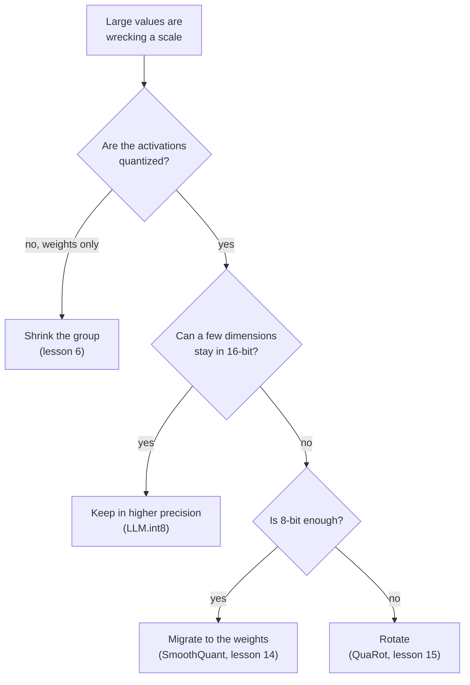

# Урок 8. Работа с выбросами

**Связь с целью курса:** Чтобы сказать, какое исправление применимо к сломанной LLM в int8, нужно знать четыре способа обойти выброс, от чего отказывается каждый из них и какой из последующих уроков учит ему целиком.
**Первоисточник:** [Научная статья: "LLM.int8(): 8-bit Matrix Multiplication for Transformers at Scale", Dettmers et al., 2022](https://arxiv.org/abs/2208.07339), раздел 3.2
**Предварительные требования:** [Урок 7](0007-why-llms-have-outliers.md), [Гранулярность](../GLOSSARY.md), [Поворот](../GLOSSARY.md), [Признак-выброс](../GLOSSARY.md)

## Разминка

1. ▢ Какая примерно доля признаков у Dettmers и соавторов является признаками-выбросами и что происходит с перплексией, если их обнулить?

<details markdown="1"><summary>Проверка</summary>

Около 0,1% признаков, а перплексия растёт на 600-1000% (урок 7). Очень немногие значения несут очень большую часть поведения модели.

</details>

2. ▢ Почему отсечение этих значений, как делает поиск диапазона по MSE, это неверная реакция для LLM?

<details markdown="1"><summary>Проверка</summary>

MSE считает каждое значение одинаково, поэтому отсечение крошечной доли значений выглядит дёшево, но именно эти значения важны (урок 5). Исправление должно сохранить их, а не прижимать.

</details>

3. ▢ В 4 битах с одним масштабом на тензор, одно значение признака величиной 60 среди значений со стандартным отклонением 1: что происходит с нормальными значениями?

<details markdown="1"><summary>Проверка</summary>

Шаг равен 60 / 7 = 8,6, поэтому всё ниже 4,3 округляется до нуля, то есть практически каждое нормальное значение (урок 7).

</details>

## Что нужно знать

### Четыре способа обойти выброс

Каждое исправление отвечает на одну и ту же проблему из урока 7: одно большое значение задаёт масштаб, слишком грубый для всего рядом с ним. Они различаются тем, что меняют.

| Семейство | Идея | Где действует | Где изучается |
|---|---|---|---|
| Оставить в более высокой точности | Считать измерения-выбросы в 16 битах, а остальные в int8 | Умножение матриц, измерения-выбросы выбираются по активациям | Этот урок |
| Уменьшить группу | Дать малым множествам значений собственный масштаб, так что выброс повреждает только своё множество | Гранулярность масштабов | Урок 6 |
| Перенести | Разделить каналы-выбросы активаций на масштаб и умножить на него соответствующие веса | Офлайн, в весах и предшествующей операции | Урок 14 |
| Повернуть | Умножить на ортогональную матрицу, чтобы выброс рассеялся по всем каналам | Веса офлайн, активации поворотом | Урок 15 |



Читайте диаграмму как эмпирическое правило, выведенное из того, на что нацелена каждая статья, а не как рейтинг: методы пересекаются, и свидетельства дают последующие уроки.

### Оставить выбросы в более высокой точности

Dettmers и соавторы называют это декомпозицией со смешанной точностью. Берём матрицу скрытых состояний и собираем измерения признаков, содержащие хотя бы одно значение с величиной выше порога `α`. Они обнаружили, что `α = 6.0` сводит деградацию почти к нулю. Умножение матриц затем делится на две части: эти измерения умножаются в 16 битах, а все остальные в 8 битах с одним масштабом на строку активаций и на столбец весов, по векторной схеме из урока 6.

```text
Out = sum over outlier dimensions of (X_16bit * W_16bit)  +  scale * sum over the rest of (X_int8 * W_int8)
```

16-битная часть мала. До 13 млрд параметров измерений-выбросов не больше 7, что, по словам статьи, стоит около 0,1% дополнительной памяти, а более 99,9% значений умножаются в 8 битах. Авторы сообщают об отсутствии деградации вплоть до 175 млрд параметров и о сокращении памяти в 1,96 раза для BLOOM-176B. Цена это работа со смешанной точностью внутри одного умножения матриц, и они отмечают, что накладные расходы квантизации могут замедлить инференс моделей меньше 6,7 млрд, при том что большие матрицы примерно вдвое быстрее, чем в 16 битах.

### Уменьшить группу

Инструмент урока 6. Малые группы ограничивают выброс его собственной группой, и Dettmers и Zettlemoyer утверждают, что и малый размер блока, и квантизация с учётом выбросов повышают точность выбросов ([Dettmers and Zettlemoyer, 2022](https://arxiv.org/abs/2212.09720)). Для весов это стандартный ответ. Для активаций он не следует оси, которую нашёл урок 7: масштаб per-token задаётся строкой, а признак-выброс есть в каждой строке. Упражнение 6 практики разбирает, что нужно для группы вдоль оси признаков.

### Перенести сложность

[SmoothQuant](https://arxiv.org/abs/2211.10438) исходит из наблюдения, что веса квантизовать легко, а активации нет. Он переносит сложность офлайн из активаций в веса математически эквивалентным преобразованием, делая возможными 8-битные веса и 8-битные активации. Тождество это простая алгебра: деление канала активации `k` на `s[k]` и умножение строки `k` весов на `s[k]` оставляет произведение неизменным. Урок 14 показывает, как выбирается масштаб. Выброс никуда не делся: теперь он в весах, а упражнение 4 практики показывает, насколько большим он там становится.

### Повернуть выброс прочь

[QuaRot](https://arxiv.org/abs/2404.00456) поворачивает скрытое состояние так, что выбросы убираются без изменения выхода модели, и квантизует веса, активации и KV-кеш в 4 бита. Тождество снова алгебраическое: для ортогональной матрицы `Q` верно `X W = (X Q)(Q^T W)`. Плотный поворот смешивает каждый канал с каждым другим, так что один большой канал превращается во множество умеренно больших. Урок 15 рассматривает, какие повороты работают и чего они стоят.

Пятый путь лежит вне посттренировочной квантизации: [Bondarenko и соавторы](https://arxiv.org/abs/2306.12929) меняют механизм внимания во время предобучения, чтобы головы могли ничего не делать, не порождая выбросов, и сообщают о квантизации активаций в int8 без дополнительных усилий. Для этого модель нужно так обучить, поэтому этот курс рассматривает его как причину существования выбросов (урок 7), а не как исправление, которое можно применить к чекпоинту.

## Практика

1. ▢ Опишите декомпозицию LLM.int8(): как выбираются измерения-выбросы, какую арифметику использует каждая часть и какая доля значений остаётся в 8 битах.

<details markdown="1"><summary>Проверка</summary>

Измерения признаков, у которых есть хотя бы одно значение величиной 6,0 или больше, проходят через 16-битное умножение матриц. Каждое другое измерение проходит через 8-битное умножение с масштабами по строкам и по столбцам, и два результата складываются. Более 99,9% значений умножаются в 8 битах.

</details>

2. ▢ Какое предложение правильно называет семейство вместе с его механизмом?

    - a) Перенос: умножить активации на ортогональную матрицу перед округлением
    - b) Поворот: офлайн перенести масштаб из каналов активаций в веса
    - c) Группировка: хранить значения-выбросы в отдельном разреженном файле
    - d) Декомпозиция: оставить несколько измерений-выбросов в 16-битной арифметике

<details markdown="1"><summary>Проверка</summary>

**d)** LLM.int8() вычисляет немногие измерения-выбросы в 16 битах, а остальные в int8. В (a) и (b) названия перепутаны: перенос передаёт масштаб в веса, а поворот умножает на ортогональную матрицу. (c) неверно: группировка даёт каждому малому множеству значений собственный масштаб и ничего не хранит отдельно.

</details>

3. ▢ Предскажите, затем запустите. В матрице активаций на 128 токенов есть один признак-выброс величиной около 60, а веса обычные. Перед запуском предскажите, у какой из трёх схем самая малая ошибка в произведении матриц в 4 битах и побеждают ли масштабы per-token и per-channel один масштаб на тензор.

    ```python
    import numpy as np

    rng = np.random.default_rng(0)
    tokens, features, out = 128, 512, 64
    X = rng.normal(size=(tokens, features))
    X[:, 7] = 60 * rng.uniform(0.8, 1.2, size=tokens)  # outlier feature dimension
    W = rng.normal(size=(features, out)) * 0.05


    def fake_quant(A, axis, bits):
        qmax = 2 ** (bits - 1) - 1
        s = np.abs(A).max(axis=axis, keepdims=True) / qmax
        s = np.where(s == 0, 1.0, s)
        return s * np.clip(np.round(A / s), -qmax, qmax)


    def rel_err(Y_hat, Y):
        return np.linalg.norm(Y_hat - Y) / np.linalg.norm(Y)


    Y = X @ W
    outlier = np.abs(X).max(axis=0) > 6.0  # LLM.int8() threshold on magnitude
    print("outlier feature dimensions:", np.flatnonzero(outlier))
    print("bits  per-tensor  per-token+per-channel  outliers kept in float")
    for bits in (8, 4):
        plain = fake_quant(X, None, bits) @ fake_quant(W, None, bits)
        vector = fake_quant(X, 1, bits) @ fake_quant(W, 0, bits)
        X_rest, W_rest = X[:, ~outlier], W[~outlier]
        split = fake_quant(X_rest, 1, bits) @ fake_quant(W_rest, 0, bits) + X[:, outlier] @ W[outlier]
        print(f"{bits}     {rel_err(plain, Y):.4f}      {rel_err(vector, Y):.4f}                 {rel_err(split, Y):.4f}")
    ```

<details markdown="1"><summary>Подсказка</summary>

Масштаб per-token из урока 6 это тот, который использует векторная схема Dettmers и соавторов. Спросите, отделяет ли он измерение признака, которое велико на каждом токене.

</details>

<details markdown="1"><summary>Проверка</summary>

```text
outlier feature dimensions: [7]
bits  per-tensor  per-token+per-channel  outliers kept in float
8     0.0632      0.0529                 0.0040
4     0.4175      0.4045                 0.0744
```

Оставить измерение-выброс в формате с плавающей точкой гораздо лучше при обеих разрядностях: ошибка примерно в 16 раз ниже, чем с одним масштабом на тензор, в 8 битах и примерно в 5,6 раза ниже в 4 битах. Масштабы per-token и per-channel лишь слегка улучшают результат одного масштаба на тензор, потому что выброс есть в каждой строке, а это именно тот отказ, который предсказал урок 7. Даже при разделении 4-битная ошибка равна 0,074, так что остальной тензор всё равно платит за пониженную точность. Данные синтетические.

</details>

4. ▢ Предскажите, затем запустите. Код применяет перенос и поворот к тензору с одним признаком-выбросом. Перед запуском предскажите, оставляет ли каждый из них произведение `X @ W` неизменным, где оказывается перенесённый выброс и убирает ли поворот его полностью.

    ```python
    import numpy as np

    rng = np.random.default_rng(0)
    X = rng.normal(size=(128, 64))
    X[:, 5] *= 50                      # one outlier feature dimension
    W = rng.normal(size=(64, 32)) * 0.1
    Y = X @ W

    # Migrate: divide activation column k by s[k], multiply weight row k by s[k].
    colmax = np.abs(X).max(axis=0)
    s = colmax / np.median(colmax)
    X2, W2 = X / s, W * s[:, None]
    print("migrate: same output?", np.allclose(X2 @ W2, Y))
    print("migrate: max |X|  before", round(np.abs(X).max(), 1), " after", round(np.abs(X2).max(), 1))
    print("migrate: max |W|  before", round(np.abs(W).max(), 2), " after", round(np.abs(W2).max(), 2))

    # Rotate: multiply X by an orthogonal Q and W by Q transposed.
    Q, _ = np.linalg.qr(rng.normal(size=(64, 64)))
    X3, W3 = X @ Q, Q.T @ W
    print("rotate:  same output?", np.allclose(X3 @ W3, Y))
    print("rotate:  max |x| / rms of x  before", round(np.abs(X).max() / np.sqrt(np.mean(X**2)), 1),
          " after", round(np.abs(X3).max() / np.sqrt(np.mean(X3**2)), 1))
    ```

<details markdown="1"><summary>Проверка</summary>

```text
migrate: same output? True
migrate: max |X|  before 150.7  after 2.7
migrate: max |W|  before 0.35  after 16.54
rotate:  same output? True
rotate:  max |x| / rms of x  before 22.7  after 6.3
```

Оба оставляют произведение неизменным. Перенос перекладывает сложность: наибольшая активация падает со 150,7 до 2,7, а наибольший вес растёт с 0,35 до 16,54, так что выброс теперь в весах. Поворот не убирает большое значение, а делит его: отношение наибольшего значения к rms падает с 22,7 до 6,3, что гораздо легче квантизовать, но это не ровно. Следующие уроки, 14 и 15, тратят своё время на то, чтобы хорошо выбирать `s` и `Q`.

</details>

5. ▢ Выберите семейство для каждого случая и скажите почему: (i) 4-битные веса с активациями, оставленными в 16 битах, (ii) веса и активации в int8 на оборудовании с ядром умножения матриц в int8, с выбросами величиной до 60 в некоторых каналах активаций, (iii) 4-битные веса и активации.

<details markdown="1"><summary>Проверка</summary>

(i) Уменьшить группу: активации не квантизуются, поэтому защитить нужно только веса, а малые группы ограничивают любой выброс. (ii) Либо оставить измерения-выбросы в 16 битах, как делает LLM.int8(), либо перенести сложность в веса, как делает SmoothQuant для 8-битных весов и активаций, в зависимости от того, приемлемо ли ядро со смешанной точностью. (iii) Повернуть: из методов здесь QuaRot нацелен на 4 бита для весов, активаций и KV-кеша. Это эмпирическое правило из того, на что нацелена каждая статья, а не измеренный рейтинг, и его рассматривают последующие уроки этапа 5.

</details>

6. ▢ Рассуждение, а не цитата. Команда хочет, чтобы «уменьшить группу» работало на активациях. Вдоль какой оси должна лежать группа и что ей нужно от оборудования, учитывая сказанное в уроке 6 о масштабах внутри суммы?

<details markdown="1"><summary>Проверка</summary>

Вдоль оси признаков, например 32 подряд идущих признака одного токена, так что признак-выброс попадает в одну группу на токен, а не раздувает масштаб всей строки. Такой масштаб меняется вдоль индекса суммирования умножения матриц, а это тот случай, который, по словам Nagel и соавторов, большинство ускорителей с фиксированной точкой не поддерживает, так что нужно ядро, обрабатывающее разный масштаб на группу при накоплении, или путь с деквантизацией сначала. Это снова ограничение аккумулятора из урока 6, здесь со стороны активаций. Это вывод из двух статей, а не результат, который заявляет какая-либо из них.

</details>

## Практика в реальной работе

- [ ] В коде упражнения 3 практики измените величину выброса с 60 на 8 и запустите снова. Запишите, при какой величине сохранение выброса в формате с плавающей точкой перестаёт стоить дополнительного кода в 8 битах, и дайте причину через размер шага.
- [ ] Выберите один открытый 8- или 4-битный чекпоинт, прочитайте его карточку модели и назовите, какие из четырёх семейств использует его метод, а какие нет.
- [ ] Завтра, без заметок, нарисуйте диаграмму решений по памяти и запишите по одной цене для каждого из четырёх семейств. Затем сравните с таблицей выше.

## Что почитать дальше

- [Отображение квантизации](../reference/quantization-mapping.md)
- [Научная статья: "LLM.int8(): 8-bit Matrix Multiplication for Transformers at Scale", Dettmers et al., 2022](https://arxiv.org/abs/2208.07339)
- [Научная статья: "SmoothQuant: Accurate and Efficient Post-Training Quantization for Large Language Models", Xiao et al., 2022](https://arxiv.org/abs/2211.10438)
- [Научная статья: "QuaRot: Outlier-Free 4-Bit Inference in Rotated LLMs", Ashkboos et al., 2024](https://arxiv.org/abs/2404.00456)
- [Ресурсы](../RESOURCES.md)

---

Не доходит? Перечитайте первоисточник в начале: этот урок его сжимает, а при сжатии понимание как раз и теряется. Загляните в [глоссарий](../GLOSSARY.md), если какой-то термин показался скользким.

Если неясен сам урок, а не материал, это дефект: [откройте issue](https://github.com/TokenCemetery/teach/issues).
