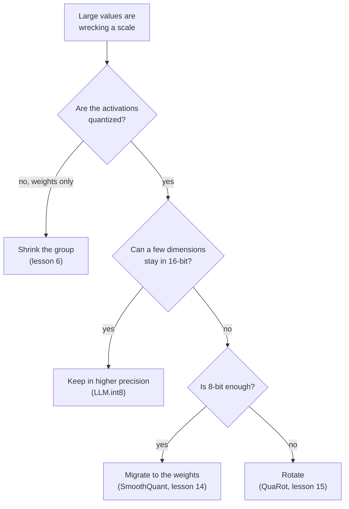

# 第 8 课：处理离群值

**使命关联:** 要说清哪种修复办法适用于一个出了问题的 int8 LLM，就得知道越过离群值的四种办法，每一种放弃了什么，以及哪一课把它讲透了。
**主要来源:** [论文：“LLM.int8(): 8-bit Matrix Multiplication for Transformers at Scale”，Dettmers 等，2022](https://arxiv.org/abs/2208.07339)，第 3.2 节
**前置知识:** [第 7 课](0007-why-llms-have-outliers.md)、[量化粒度](../GLOSSARY.md)、[旋转](../GLOSSARY.md)、[离群特征](../GLOSSARY.md)

## 热身

1. ▢ 在 Dettmers 等人的研究中，离群特征大约占特征的多大比例？把它们置零，困惑度会怎样？

<details markdown="1"><summary>检查</summary>

约占特征的 0.1%，困惑度上升 600% 到 1000%（第 7 课）。极少数的值承载着模型的大量行为。

</details>

2. ▢ 为什么像 MSE 范围搜索那样把这些值截断，对 LLM 来说是错误的应对？

<details markdown="1"><summary>检查</summary>

MSE 对每个值一视同仁，所以截断极小一部分值看起来很便宜，但这些值恰恰是重要的值（第 5 课）。修复办法必须保住它们，而不是把它们钳制掉。

</details>

3. ▢ 在 4 位、整个张量一个缩放因子的情况下，有一个幅值为 60 的特征，其余的值标准差为 1：正常的值会怎样？

<details markdown="1"><summary>检查</summary>

步长是 60 / 7 = 8.6，所以小于 4.3 的一切都舍入成零，这实际上就是每一个正常值（第 7 课）。

</details>

## 要点

### 越过离群值的四种办法

每一种修复办法回答的都是第 7 课的同一个问题：一个大值设定了一个对它附近的一切来说都太粗的缩放因子。它们的区别在于改动了什么。

| 类别 | 思路 | 作用在哪里 | 在哪一课讲 |
|---|---|---|---|
| 保留在更高精度 | 离群维度用 16 位计算，其余用 int8 | 矩阵乘法，离群维度根据激活值选出 | 本课 |
| 缩小分组 | 给小的值集合各自的缩放因子，使离群值只损害它自己所在的集合 | 缩放因子的粒度 | 第 6 课 |
| 迁移 | 把激活值的离群通道除以一个缩放因子，把对应的权重乘以它 | 离线进行，作用在权重和前一个运算上 | 第 14 课 |
| 旋转 | 乘以一个正交矩阵，使离群值分散到所有通道上 | 权重离线处理，激活值通过旋转来处理 | 第 15 课 |



请把这张图读作根据各篇论文所针对的目标得出的经验法则，而不是排名：这些方法互有重叠，后面的课会给出证据。

### 把离群值保留在更高精度

Dettmers 等人把这称为混合精度分解。取隐藏状态矩阵，把其中至少含有一个幅值超过阈值 `α` 的值的那些特征维度收集起来。他们发现 `α = 6.0` 能让性能下降接近于零。于是矩阵乘法被分成两部分：这些维度用 16 位相乘，所有其他维度用 8 位相乘，激活值每一行一个缩放因子，权重每一列一个缩放因子，也就是第 6 课的向量级方案。

```text
Out = sum over outlier dimensions of (X_16bit * W_16bit)  +  scale * sum over the rest of (X_int8 * W_int8)
```

16 位的那一部分很小。直到 13B 参数，最多有 7 个离群维度，论文说这只多花约 0.1% 的内存，超过 99.9% 的值是以 8 位相乘的。作者报告，直到 175B 参数都没有性能下降，BLOOM-176B 的内存减少为原来的 1/1.96。代价是在一次矩阵乘法内部要做混合精度的工作，他们指出，对 6.7B 以下的模型，量化的开销可能拖慢推理，而大矩阵的速度约为 16 位的两倍。

### 缩小分组

这是第 6 课的工具。小分组把离群值限制在它自己的组里，Dettmers 与 Zettlemoyer 指出，小的块大小和依赖离群值的量化，都能提高离群值的精度（[Dettmers 与 Zettlemoyer，2022](https://arxiv.org/abs/2212.09720)）。对权重来说，这是标准答案。对激活值来说，它没有沿着第 7 课所发现的那根轴：逐 token 的缩放因子由行决定，而离群特征存在于每一行。练习第 6 题会推演沿特征轴的分组需要什么。

### 迁移难度

[SmoothQuant](https://arxiv.org/abs/2211.10438) 的出发点是这样的观察：权重容易量化，激活值不容易。它通过一个数学上等价的变换，离线地把难度从激活值迁移到权重上，从而使 8 位权重和 8 位激活值成为可能。这个恒等式就是普通的代数：把激活值的通道 `k` 除以 `s[k]`，把权重的第 `k` 行乘以 `s[k]`，乘积保持不变。第 14 课展示缩放因子怎么选。离群值并没有消失：它现在位于权重中，练习第 4 题展示了它在那里变得有多大。

### 把离群值旋转掉

[QuaRot](https://arxiv.org/abs/2404.00456) 旋转隐藏状态，在不改变模型输出的前提下去掉离群值，并把权重、激活值和 KV 缓存都量化到 4 位。恒等式仍然是代数：对一个正交矩阵 `Q`，`X W = (X Q)(Q^T W)`。稠密的旋转把每个通道混进其他每个通道，所以一个大的通道变成许多中等大小的通道。第 15 课讲哪些旋转有效，以及它们的代价。

还有第五条路在训练后的范围之外：[Bondarenko 等人](https://arxiv.org/abs/2306.12929)在预训练期间改变注意力机制，使注意力头可以什么都不做，而不产生离群值，并报告说激活值的 int8 量化无需额外的功夫。这需要模型是那样训练出来的，所以本系列把它当作离群值存在的一个原因（第 7 课），而不是你能用在一个检查点上的修复办法。

## 练习

1. ▢ 描述 LLM.int8() 的分解：离群维度是怎么选出来的，两个部分各用什么算术，以及有多大比例的值留在 8 位。

<details markdown="1"><summary>检查</summary>

至少含有一个幅值在 6.0 以上的值的特征维度，走 16 位矩阵乘法。其他每个维度走 8 位乘法，带逐行和逐列的缩放因子，然后把两个结果相加。超过 99.9% 的值是以 8 位相乘的。

</details>

2. ▢ 哪一句话把一个类别与它的机制正确地对应起来了？

    - a) 迁移：舍入之前把激活值乘以一个正交矩阵
    - b) 旋转：离线把缩放因子从激活值通道转移到权重中
    - c) 分组：把离群值存在一个单独的稀疏文件里
    - d) 分解：让少数几个离群维度保持 16 位算术

<details markdown="1"><summary>检查</summary>

**d)** LLM.int8() 用 16 位计算少数几个离群维度，其余的用 int8。(a) 和 (b) 把两个名字对调了：迁移是把缩放因子转移到权重中，旋转是乘以一个正交矩阵。(c) 是错的：分组是给每个小的值集合各自的缩放因子，并不单独存储任何东西。

</details>

3. ▢ 先预测，再运行。一个 128 个 token 的激活值矩阵有一个离群特征，幅值约为 60，权重则很普通。运行之前，先预测三种方案中，哪一种在 4 位时矩阵乘积的误差最低，以及逐 token 和逐通道的缩放因子是否优于整个张量一个缩放因子。

    ```python
    import numpy as np

    rng = np.random.default_rng(0)
    tokens, features, out = 128, 512, 64
    X = rng.normal(size=(tokens, features))
    X[:, 7] = 60 * rng.uniform(0.8, 1.2, size=tokens)  # outlier feature dimension
    W = rng.normal(size=(features, out)) * 0.05


    def fake_quant(A, axis, bits):
        qmax = 2 ** (bits - 1) - 1
        s = np.abs(A).max(axis=axis, keepdims=True) / qmax
        s = np.where(s == 0, 1.0, s)
        return s * np.clip(np.round(A / s), -qmax, qmax)


    def rel_err(Y_hat, Y):
        return np.linalg.norm(Y_hat - Y) / np.linalg.norm(Y)


    Y = X @ W
    outlier = np.abs(X).max(axis=0) > 6.0  # LLM.int8() threshold on magnitude
    print("outlier feature dimensions:", np.flatnonzero(outlier))
    print("bits  per-tensor  per-token+per-channel  outliers kept in float")
    for bits in (8, 4):
        plain = fake_quant(X, None, bits) @ fake_quant(W, None, bits)
        vector = fake_quant(X, 1, bits) @ fake_quant(W, 0, bits)
        X_rest, W_rest = X[:, ~outlier], W[~outlier]
        split = fake_quant(X_rest, 1, bits) @ fake_quant(W_rest, 0, bits) + X[:, outlier] @ W[outlier]
        print(f"{bits}     {rel_err(plain, Y):.4f}      {rel_err(vector, Y):.4f}                 {rel_err(split, Y):.4f}")
    ```

<details markdown="1"><summary>提示</summary>

第 6 课的逐 token 缩放因子，就是 Dettmers 等人的向量级方案所用的那个。想想它能否把一个在每个 token 上都很大的特征维度分隔开。

</details>

<details markdown="1"><summary>检查</summary>

```text
outlier feature dimensions: [7]
bits  per-tensor  per-token+per-channel  outliers kept in float
8     0.0632      0.0529                 0.0040
4     0.4175      0.4045                 0.0744
```

把离群维度保留为浮点，在两种位宽下都好得多：8 位时误差比整个张量一个缩放因子低约 16 倍，4 位时低约 5.6 倍。逐 token 和逐通道的缩放因子比整个张量一个缩放因子只好一点点，因为离群值存在于每一行，这正是第 7 课预言的失败。即使做了拆分，4 位的误差仍有 0.074，所以张量的其余部分还是要为较低的精度付出代价。数据是合成的。

</details>

4. ▢ 先预测，再运行。这段代码对一个带有一个离群特征的张量，分别做了一次迁移和一次旋转。运行之前，先预测两者是否都保持乘积 `X @ W` 不变，被迁移的离群值最终落在哪里，以及旋转是否把它完全去掉了。

    ```python
    import numpy as np

    rng = np.random.default_rng(0)
    X = rng.normal(size=(128, 64))
    X[:, 5] *= 50                      # one outlier feature dimension
    W = rng.normal(size=(64, 32)) * 0.1
    Y = X @ W

    # Migrate: divide activation column k by s[k], multiply weight row k by s[k].
    colmax = np.abs(X).max(axis=0)
    s = colmax / np.median(colmax)
    X2, W2 = X / s, W * s[:, None]
    print("migrate: same output?", np.allclose(X2 @ W2, Y))
    print("migrate: max |X|  before", round(np.abs(X).max(), 1), " after", round(np.abs(X2).max(), 1))
    print("migrate: max |W|  before", round(np.abs(W).max(), 2), " after", round(np.abs(W2).max(), 2))

    # Rotate: multiply X by an orthogonal Q and W by Q transposed.
    Q, _ = np.linalg.qr(rng.normal(size=(64, 64)))
    X3, W3 = X @ Q, Q.T @ W
    print("rotate:  same output?", np.allclose(X3 @ W3, Y))
    print("rotate:  max |x| / rms of x  before", round(np.abs(X).max() / np.sqrt(np.mean(X**2)), 1),
          " after", round(np.abs(X3).max() / np.sqrt(np.mean(X3**2)), 1))
    ```

<details markdown="1"><summary>检查</summary>

```text
migrate: same output? True
migrate: max |X|  before 150.7  after 2.7
migrate: max |W|  before 0.35  after 16.54
rotate:  same output? True
rotate:  max |x| / rms of x  before 22.7  after 6.3
```

两者都保持乘积不变。迁移转移了难度：最大的激活值从 150.7 降到 2.7，而最大的权重从 0.35 升到 16.54，所以离群值现在在权重里。旋转并没有去掉那个大值，而是把它分摊了出去：最大值与均方根之比从 22.7 降到 6.3，这要容易量化得多，但并不平坦。后面的第 14 和第 15 课，把精力花在如何选好 `s` 和 `Q` 上。

</details>

5. ▢ 为下面每一种情形选一个类别并说明理由：(i) 4 位权重，激活值保持 16 位；(ii) 在有 int8 矩阵乘法内核的硬件上用 int8 权重和激活值，某些激活值通道里有幅值高达 60 的离群值；(iii) 4 位的权重和激活值。

<details markdown="1"><summary>检查</summary>

(i) 缩小分组：激活值没有被量化，所以只有权重需要保护，小分组能限制任何离群值。(ii) 要么像 LLM.int8() 那样把离群维度保留在 16 位，要么像 SmoothQuant 对 8 位权重和激活值所做的那样，把难度迁移到权重中，取决于能否接受混合精度的内核。(iii) 旋转：在这几种方法里，QuaRot 是以权重、激活值和 KV 缓存的 4 位为目标的那一个。这是根据各篇论文的目标得出的经验法则，不是度量出来的排名，后面第 5 阶段的课会对它加以检验。

</details>

6. ▢ 这是推理题，不是引文。一个团队想让“缩小分组”对激活值也起作用。分组必须沿着哪根轴，根据第 6 课说的求和内部的缩放因子，它对硬件有什么要求？

<details markdown="1"><summary>检查</summary>

沿着特征轴，例如一个 token 的连续 32 个特征为一组，这样离群特征在每个 token 里只落进一个组，而不是把整行的缩放因子撑大。这样的缩放因子沿着矩阵乘法的被求和下标变化，这正是 Nagel 等人说大多数定点加速器都不支持的情形，所以它需要一个能在累加中处理每组不同缩放因子的内核，或者一条先反量化的路径。这又是第 6 课的累加器约束，只是这次是从激活值一侧看。这是根据两篇论文做出的推断，不是任何一篇所陈述的结果。

</details>

## 实战练习

- [ ] 在练习第 3 题的代码中，把离群值的幅值从 60 改成 8，重新运行。记录在 8 位下，幅值降到多少时，把离群值保留为浮点就不再值得多写那些代码，并用步长来说明理由。
- [ ] 选一个开源的 8 位或 4 位检查点，读它的模型卡，说出它的方法用了四类办法中的哪一类，没有用哪一类。
- [ ] 明天：不看笔记，凭记忆画出决策图，并为四类办法各写一个代价。然后与上面的表对照。

## 延伸阅读

- [量化映射](../reference/quantization-mapping.md)
- [论文：“LLM.int8(): 8-bit Matrix Multiplication for Transformers at Scale”，Dettmers 等，2022](https://arxiv.org/abs/2208.07339)
- [论文：“SmoothQuant: Accurate and Efficient Post-Training Quantization for Large Language Models”，Xiao 等，2022](https://arxiv.org/abs/2211.10438)
- [论文：“QuaRot: Outlier-Free 4-Bit Inference in Rotated LLMs”，Ashkboos 等，2024](https://arxiv.org/abs/2404.00456)
- [资源](../RESOURCES.md)

---

没学明白？请重读顶部的主要来源，因为本课是对它的压缩，而理解正是在压缩中流失的。如果有哪个术语觉得含糊，可以查看[术语表](../GLOSSARY.md)。

如果问题出在课程本身，而不是学习材料，那就是一个缺陷：[提交 issue](https://github.com/TokenCemetery/teach/issues)。
