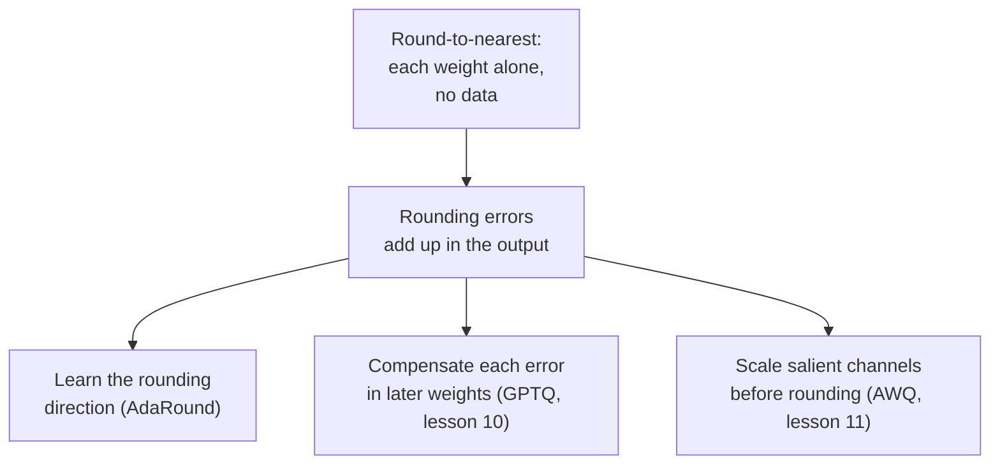

# Lección 9. Round-to-nearest

**Vínculo con la misión:** Todo método post-entrenamiento de esta etapa se juzga frente a round-to-nearest, así que saber exactamente qué hace, y por qué su error es mayor de lo necesario, es lo que da sentido a GPTQ y AWQ.
**Fuente principal:** [Paper: "Up or Down? Adaptive Rounding for Post-Training Quantization", Nagel et al., 2020](https://arxiv.org/abs/2004.10568), sección 2
**Requisitos previos:** [Lección 8](0008-handling-outliers.md), [Round-to-nearest](../GLOSSARY.md), [Tamaño de grupo](../GLOSSARY.md), [Error de redondeo](../GLOSSARY.md)

## Calentamiento

1. ▢ Para un valor dentro del rango de recorte, ¿cuán grande puede ser el error de redondeo de round-to-nearest, medido en scales?

<details markdown="1"><summary>Comprobación</summary>

Como mucho medio scale, porque el nivel más cercano de la rejilla nunca está a más de medio paso. El error de recorte es otra cosa y puede ser mucho mayor.

</details>

2. ▢ ¿Por qué reducir el tamaño de grupo reduce el error de redondeo, y qué cuesta?

<details markdown="1"><summary>Comprobación</summary>

Menos pesos comparten un scale, así que un peso grande estira el paso para menos vecinos y los pesos típicos caen en una rejilla más fina. El costo es que hay más scales que almacenar, lo que sube los bits efectivos por peso.

</details>

3. ▢ La lección 7 dijo que un valor enorme arruina el scale de un tensor. ¿Qué elección de granularidad limita el daño al menor conjunto de valores?

<details markdown="1"><summary>Comprobación</summary>

Per-group, porque el valor grande solo fija el scale de su propio grupo. Per-channel lo limita a un canal, per-tensor lo extiende a todo.

</details>

## Qué debes saber

### Qué hace round-to-nearest

**Round-to-nearest** (RTN) es el cuantizador de las lecciones 4 a 6 aplicado a cada peso sin añadir nada más. Para cada grupo de pesos elige un scale, normalmente a partir del mayor valor absoluto del grupo, divide cada peso por él, redondea al entero más cercano, hace clamp y almacena el entero. En tiempo de ejecución el kernel vuelve a multiplicar por el scale. Ese es todo el método: solo lee los pesos, no necesita datos y cada peso se redondea sin mirar a ningún otro peso.

Esa simplicidad es la razón de que sea el método por defecto. El paper de GPTQ describe RTN como el método elegido en trabajos anteriores sobre modelos de lenguaje muy grandes, porque su tiempo de ejecución escala bien con el tamaño del modelo ([Frantar et al., 2022](https://arxiv.org/abs/2210.17323)). Es también el baseline con el que se compara todo otro método de esta etapa.

### Cómo se comporta al bajar el ancho de bits

Cada bit que quitas duplica aproximadamente el paso entre niveles, así que el mayor error de redondeo posible se duplica aproximadamente también. A 8 bits el paso es diminuto y el error se pierde en el propio ruido del modelo: el paper de GPTQ señala que los métodos post-entrenamiento anteriores seguían siendo precisos a 8 bits y no por debajo. A 4 bits la pérdida se ve, y a 3 bits puede ser fatal.

El baseline de RTN del paper de GPTQ usa un scale por fila de salida (per-channel). Perplexity en WikiText-2, menor es mejor, para tres modelos OPT ([Tabla 3](https://arxiv.org/abs/2210.17323)):

| Modelo OPT | 16 bits | RTN, 4 bits | RTN, 3 bits |
|---|---|---|---|
| 6.7B | 10.86 | 12.10 | 5,800 |
| 13B | 10.13 | 11.32 | 3,400 |
| 175B | 8.34 | 10.54 | 7,300 |

La columna de 4 bits se resbala 1 o 2 puntos. La columna de 3 bits ha colapsado: una perplexity de miles significa que el modelo ya no funciona. El paper de AWQ muestra qué cambia un tamaño de grupo pequeño. Con grupos de 128 pesos RTN es, en palabras de sus autores, bastante fuerte, y Llama-2 7B pasa de 5.47 a 16 bits a 5.73 a 4 bits y 6.66 a 3 bits ([Lin et al., 2023](https://arxiv.org/abs/2306.00978), Tabla 4). Son modelos distintos de los de la tabla de arriba, así que compara la forma y no los números: RTN per-channel a 3 bits falla estrepitosamente, RTN per-group a 3 bits queda dañado pero vivo. El intercambio de la lección 6 entre tamaño de grupo y bits almacenados hace aquí un trabajo real.

### Por qué lo más cercano no es el mejor redondeo

Round-to-nearest minimiza el error de cada peso. Lo que importa es el error de la salida de la capa, y no son lo mismo. Nagel et al. desarrollan el aumento de la pérdida al perturbar los pesos en `dw`, y el término principal es `dw^T H dw`, donde `H` es la segunda derivada de la pérdida. Sus términos diagonales dependen solo de cuán grande es la perturbación de cada peso, y para ellos el redondeo al más cercano es óptimo. Sus términos fuera de la diagonal dependen de los signos de pares de perturbaciones: dos errores de signo opuesto pueden cancelarse, dos del mismo signo pueden sumarse. El redondeo al más cercano ignora esos términos, "lo que a menudo lo hace subóptimo" en sus palabras.

Lo muestran directamente. Cuantizaron solo la primera capa de ResNet18 a 4 bits, sortearon 100 redondeos aleatorios hacia arriba o hacia abajo y encontraron que 48 de ellos superaban al redondeo al más cercano. El redondeo al más cercano obtuvo un 52.29% en ImageNet y el mejor de los cien obtuvo un 63.06% ([Tabla 1](https://arxiv.org/abs/2004.10568)). Para una capa de LLM ocurre lo mismo de forma concreta. La salida es `W X`, las entradas de `X` están correlacionadas entre features, y por tanto los errores en los pesos que multiplican features correlacionadas pueden disponerse para cancelarse. Si redondeas cada peso por su cuenta, renuncias a esa cancelación.



AdaRound aprende la elección de arriba o abajo con una optimización por capa, que según los autores de GPTQ necesita muchos más pasos de gradiente que su método y por tanto es más costosa a escala de LLM. El resto de esta etapa son tres respuestas a la flecha que sale de la segunda caja.

## Práctica

1. ▢ Un grupo de 128 pesos tiene un mayor valor absoluto de 0.6, y lo cuantizas de forma simétrica a 4 bits con niveles enteros de -7 a 7. ¿Cuál es el scale, y cuál es el mayor error de redondeo posible para un peso dentro del rango?

<details markdown="1"><summary>Comprobación</summary>

Scale = 0.6 / 7 = 0.0857. El mayor error de redondeo es medio scale, 0.0429. Un peso de 0.20 se divide en 2.33, se redondea a 2 y se almacena como 0.1714, un error de 0.0286, dentro de la cota.

</details>

2. ▢ ¿Por qué round-to-nearest aguanta a 8 bits pero se resbala a 4?

    - a) Los pesos de ocho bits se quedan en punto flotante, así que nunca se redondean
    - b) Menos bits eliminan los outliers, así que los scales de grupo se vuelven mucho más ajustados
    - c) Cada bit quitado duplica aproximadamente el paso, y crece el error de redondeo
    - d) Los kernels de cuatro bits descuantizan despacio, y eso se nota como pérdida de perplexity

<details markdown="1"><summary>Comprobación</summary>

**c)** La rejilla tiene la mitad de niveles por cada bit quitado, así que el paso y el error de redondeo en el peor caso se duplican aproximadamente cada vez, y de 8 a 4 bits son cuatro duplicaciones. (a) es incorrecta porque los pesos enteros de 8 bits se redondean igual que los de 4 bits, solo que en una rejilla mucho más fina. (b) es incorrecta porque quitar bits no elimina los outliers; fijan el scale igualmente. (d) es incorrecta porque la velocidad del kernel cambia lo rápido que corre el modelo, no la perplexity que obtiene.

</details>

3. ▢ Predice y luego ejecuta. Esto cuantiza una matriz de pesos aleatoria con round-to-nearest en grupos de 128 y mide el error relativo de la salida de la capa `W X`. Predice cómo se compara el error a 4 bits con el de 8 bits, y el de 3 bits con el de 4 bits, usando solo el número de niveles enteros a cada lado del cero (127, 7 y 3).

    ```python
    import numpy as np

    rng = np.random.default_rng(0)
    W = rng.standard_normal((256, 512))
    X = rng.standard_normal((512, 1024))
    group = 128

    def rtn(W, bits, group):
        qmax = 2 ** (bits - 1) - 1
        Wg = W.reshape(W.shape[0], -1, group)
        scale = np.abs(Wg).max(axis=2, keepdims=True) / qmax
        q = np.clip(np.round(Wg / scale), -qmax, qmax)
        return (q * scale).reshape(W.shape)

    ref = W @ X
    for bits in (8, 4, 3):
        Q = rtn(W, bits, group)
        err = np.linalg.norm(ref - Q @ X) / np.linalg.norm(ref)
        print(f"{bits} bits: relative output error {err:.4f}")
    ```

<details markdown="1"><summary>Pista</summary>

El scale es el mayor valor del grupo dividido por el número de niveles a un lado del cero, y el error de redondeo es proporcional al scale.

</details>

<details markdown="1"><summary>Comprobación</summary>

```text
8 bits: relative output error 0.0065
4 bits: relative output error 0.1179
3 bits: relative output error 0.2753
```

El error crece unas 18 veces de 8 a 4 bits y unas 2.3 veces de 4 a 3 bits. Son las razones de los tamaños de paso: 127 / 7 = 18.1 y 7 / 3 = 2.3. Cada bit no es una duplicación exacta porque una rejilla simétrica conserva un nivel menos que 2^bits a cada lado, pero la regla se cumple: el error sigue al paso. Los últimos bits son los caros.

</details>

4. ▢ Predice y luego ejecuta. Una fila de pesos, una rejilla de 3 bits y entradas cuyas features están correlacionadas. El código sortea 2000 redondeos aleatorios hacia arriba o hacia abajo, cada peso redondeado hacia arriba con una probabilidad igual a su parte fraccionaria, y cuenta cuántos dan un error de salida menor que el redondeo al más cercano. Predice si son ninguno, unos pocos o muchos.

    ```python
    import numpy as np

    rng = np.random.default_rng(0)
    d, n = 64, 2048
    mix = rng.standard_normal((d, d)) / np.sqrt(d)
    X = mix @ rng.standard_normal((d, n)) + 0.8 * rng.standard_normal((1, n))
    w = rng.standard_normal(d)

    qmax = 3
    scale = np.abs(w).max() / qmax
    t = w / scale
    nearest = np.round(t) * scale

    def out_err(q):
        return np.linalg.norm(w @ X - q @ X)

    base = out_err(nearest)
    better, best = 0, base
    for _ in range(2000):
        pick_up = rng.random(d) < (t - np.floor(t))
        q = (np.floor(t) + pick_up) * scale
        e = out_err(q)
        better += e < base
        best = min(best, e)
    print(f"nearest: {base:.2f}")
    print(f"draws better than nearest: {better} of 2000")
    print(f"best draw: {best:.2f}")
    ```

<details markdown="1"><summary>Pista</summary>

Nagel et al. encontraron que 48 de 100 redondeos estocásticos superaban al más cercano en una capa de ResNet18.

</details>

<details markdown="1"><summary>Comprobación</summary>

```text
nearest: 124.30
draws better than nearest: 919 of 2000
best draw: 75.34
```

Muchos: 919 de 2000, cerca del 46%, que se hace eco de los 48 de 100 del paper. El mejor sorteo reduce el error de salida en cerca de un 40% frente al redondeo al más cercano, con la misma rejilla y los mismos pesos. El más cercano es óptimo para cada peso por separado, pero las entradas están correlacionadas, así que algunas combinaciones de errores de redondeo se cancelan en `w X` y el redondeo al más cercano no puede encontrarlas.

</details>

5. ▢ Un colega cuantiza un modelo OPT de 13B a 4 bits con round-to-nearest per-channel, ve que la perplexity pasa de 10.13 a 11.32, y dice que 3 bits debería quedar cerca de 12.5 porque es un bit menos. Usando la tabla de arriba, ¿qué falla en esa extrapolación?

<details markdown="1"><summary>Comprobación</summary>

La pérdida no es lineal en los bits. El mismo método a 3 bits dio una perplexity de unos 3,400 para ese modelo en el paper de GPTQ, un colapso y no un resbalón de 1 punto. Cada bit quitado duplica aproximadamente el paso, y pasado cierto punto el modelo deja de funcionar. Mide con el ancho de bits que pretendes desplegar.

</details>

## Prácticas en el mundo real

- [ ] Ejecuta el fragmento del ejercicio 3 de la práctica solo con 4 bits y tamaños de grupo 32, 128 y 512 (512 es la fila completa). Anota el error de cada uno y di por qué tamaño de grupo pagarías el almacenamiento.
- [ ] Carga una capa lineal de un modelo abierto pequeño con Transformers, cuantiza su peso con round-to-nearest a 4 bits y grupos de 128, y compara el error relativo de los pesos con el error relativo de la salida de la capa sobre activaciones capturadas con un forward hook en una frase. Anota cuál es mayor.
- [ ] Mañana: sin apuntes, escribe los pasos de round-to-nearest para un grupo, y una frase sobre por qué el error de salida no es simplemente la suma de los errores de los pesos.

## Para profundizar

- [Métodos PTQ de pesos](../reference/weight-ptq-methods.md)
- [Paper: "GPTQ: Accurate Post-Training Quantization for Generative Pre-trained Transformers", Frantar et al., 2022](https://arxiv.org/abs/2210.17323), las filas de RTN de las Tablas 3 y 5
- [Paper: "AWQ: Activation-aware Weight Quantization for LLM Compression and Acceleration", Lin et al., 2023](https://arxiv.org/abs/2306.00978), Tabla 4 para RTN con grupos de 128
- [Recursos](../RESOURCES.md)

---

¿No termina de quedar claro? Vuelve a leer la fuente primaria de arriba, ya que esta lección la comprime y en la compresión es donde se escapa la comprensión. Consulta el [glosario](../GLOSSARY.md) por si algún término te resultó resbaladizo.

Si lo poco claro es la propia lección y no el material, eso es un defecto: [abre un issue](https://github.com/TokenCemetery/teach/issues).
