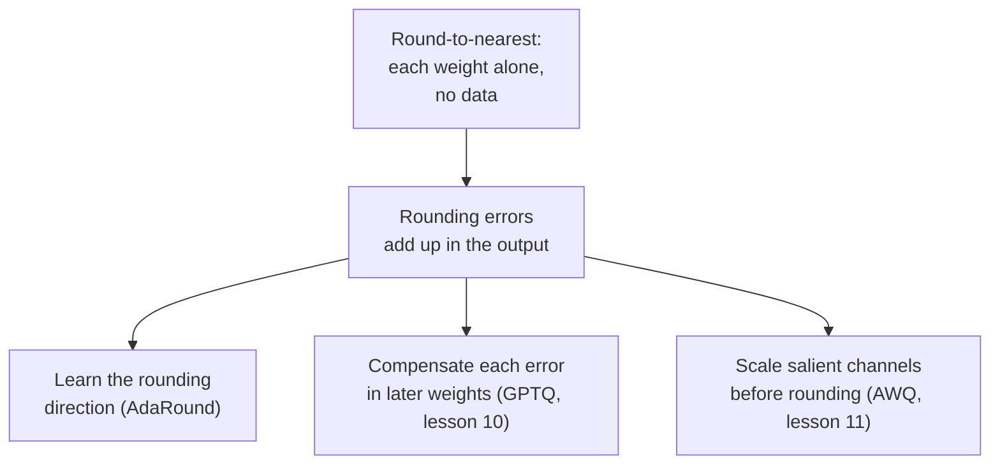

# Leçon 9. Arrondi au plus proche

**Lien avec la mission :** Toute méthode post-entraînement de cette étape se juge par rapport à l'arrondi au plus proche, donc savoir exactement ce qu'il fait, et pourquoi son erreur est plus grande que nécessaire, est ce qui donne un sens à GPTQ et à AWQ.
**Source primaire :** [Article : "Up or Down? Adaptive Rounding for Post-Training Quantization", Nagel et al., 2020](https://arxiv.org/abs/2004.10568), section 2
**Prérequis :** [Leçon 8](0008-handling-outliers.md), [Arrondi au plus proche](../GLOSSARY.md), [Taille de groupe](../GLOSSARY.md), [Erreur d'arrondi](../GLOSSARY.md)

## Échauffement

1. ▢ Pour une valeur à l'intérieur de la plage d'écrêtage, quelle peut être l'erreur d'arrondi de l'arrondi au plus proche, mesurée en scales ?

<details markdown="1"><summary>Vérifier</summary>

Au plus un demi-scale, parce que le niveau de grille le plus proche n'est jamais à plus d'un demi-pas. L'erreur d'écrêtage est une chose distincte et peut être bien plus grande.

</details>

2. ▢ Pourquoi réduire la taille de groupe réduit-il l'erreur d'arrondi, et que cela coûte-t-il ?

<details markdown="1"><summary>Vérifier</summary>

Moins de poids partagent un scale, donc un grand poids étire le pas pour moins de voisins et les poids typiques tombent sur une grille plus fine. Le coût est davantage de scales à stocker, ce qui augmente les bits effectifs par poids.

</details>

3. ▢ La leçon 7 disait qu'une seule valeur énorme ruine le scale d'un tenseur. Quel choix de granularité limite les dégâts au plus petit ensemble de valeurs ?

<details markdown="1"><summary>Vérifier</summary>

Le par-groupe, parce que la grande valeur ne fixe que le scale de son propre groupe. Le par-canal les limite à un canal, le par-tenseur les répand sur tout.

</details>

## À savoir

### Ce que fait l'arrondi au plus proche

L'**arrondi au plus proche** (RTN) est le quantificateur des leçons 4 à 6 appliqué à chaque poids sans rien ajouter. Pour chaque groupe de poids, il choisit un scale, en général d'après la plus grande valeur absolue du groupe, divise chaque poids par lui, arrondit à l'entier le plus proche, écrête, et stocke l'entier. À l'exécution, le kernel remultiplie par le scale. C'est toute la méthode : elle ne lit que les poids, n'a besoin d'aucune donnée, et chaque poids est arrondi sans regarder aucun autre poids.

Cette simplicité explique qu'elle soit la valeur par défaut. L'article GPTQ décrit le RTN comme la méthode retenue par les travaux antérieurs sur les très grands modèles de langage, parce que son temps d'exécution passe bien à l'échelle avec la taille du modèle ([Frantar et al., 2022](https://arxiv.org/abs/2210.17323)). C'est aussi la référence à laquelle toutes les autres méthodes de cette étape sont comparées.

### Comment il se comporte quand la largeur en bits baisse

Chaque bit retiré double à peu près le pas entre niveaux, donc la plus grande erreur d'arrondi possible double à peu près aussi. En 8 bits, le pas est minuscule et l'erreur se perd dans le bruit propre du modèle : l'article GPTQ note que les méthodes post-entraînement antérieures restaient précises en 8 bits et pas en dessous. En 4 bits, la perte est visible, et en 3 bits elle peut être fatale.

La référence RTN de l'article GPTQ utilise un scale par ligne de sortie (par canal). Perplexity sur WikiText-2, plus bas est mieux, pour trois modèles OPT ([tableau 3](https://arxiv.org/abs/2210.17323)) :

| Modèle OPT | 16 bits | RTN, 4 bits | RTN, 3 bits |
|---|---|---|---|
| 6.7B | 10.86 | 12.10 | 5,800 |
| 13B | 10.13 | 11.32 | 3,400 |
| 175B | 8.34 | 10.54 | 7,300 |

La colonne 4 bits décroche de 1 à 2 points. La colonne 3 bits s'est effondrée : une perplexity de plusieurs milliers veut dire que le modèle ne fonctionne plus. L'article AWQ montre ce que change une petite taille de groupe. Avec des groupes de 128 poids, le RTN est, selon ses auteurs, assez solide, et Llama-2 7B passe de 5.47 en 16 bits à 5.73 en 4 bits et 6.66 en 3 bits ([Lin et al., 2023](https://arxiv.org/abs/2306.00978), tableau 4). Ce sont des modèles différents de ceux du tableau ci-dessus, donc comparez la forme et pas les chiffres : le RTN par canal en 3 bits échoue lourdement, le RTN par groupe en 3 bits est abîmé mais vivant. L'échange de la leçon 6 entre taille de groupe et bits stockés joue ici un vrai rôle.

### Pourquoi le plus proche n'est pas le meilleur arrondi

L'arrondi au plus proche minimise l'erreur de chaque poids. Ce qui compte, c'est l'erreur de la sortie de la couche, et ce n'est pas la même chose. Nagel et al. développent l'augmentation de la loss quand on perturbe les poids de `dw`, et le terme dominant est `dw^T H dw`, où `H` est la dérivée seconde de la loss. Ses termes diagonaux ne dépendent que de la grandeur de la perturbation de chaque poids, et pour ceux-là l'arrondi au plus proche est optimal. Ses termes hors diagonale dépendent des signes de paires de perturbations : deux erreurs de signes opposés peuvent s'annuler, deux erreurs de même signe peuvent s'ajouter. L'arrondi au plus proche ignore ces termes, « ce qui le rend souvent sous-optimal » (« making it often sub-optimal ») selon leurs mots.

Ils le montrent directement. Ils ont quantifié en 4 bits seulement la première couche de ResNet18, tiré 100 arrondis aléatoires vers le haut ou vers le bas, et constaté que 48 d'entre eux battaient l'arrondi au plus proche. L'arrondi au plus proche a obtenu 52.29 % sur ImageNet et le meilleur des cent a obtenu 63.06 % ([tableau 1](https://arxiv.org/abs/2004.10568)). Pour une couche de LLM, la même chose vaut sous une forme concrète. La sortie est `W X`, les entrées de `X` sont corrélées entre features, et donc les erreurs des poids qui multiplient des features corrélées peuvent être arrangées pour s'annuler. Arrondissez chaque poids isolément et vous renoncez à cette annulation.



AdaRound apprend le choix haut ou bas avec une optimisation par couche, qui, notent les auteurs de GPTQ, demande bien plus de pas de gradient que leur méthode et est donc plus coûteuse à l'échelle des LLM. Le reste de cette étape, ce sont trois réponses à la flèche qui sort de la deuxième case.

## Pratique

1. ▢ Un groupe de 128 poids a pour plus grande valeur absolue 0.6, et vous le quantifiez symétriquement en 4 bits avec des niveaux entiers de -7 à 7. Quel est le scale, et quelle est la plus grande erreur d'arrondi possible pour un poids dans la plage ?

<details markdown="1"><summary>Vérifier</summary>

Scale = 0.6 / 7 = 0.0857. La plus grande erreur d'arrondi est un demi-scale, 0.0429. Un poids de 0.20 se divise en 2.33, est arrondi à 2 et est stocké comme 0.1714, soit une erreur de 0.0286, dans la borne.

</details>

2. ▢ Pourquoi l'arrondi au plus proche tient-il en 8 bits mais décroche-t-il en 4 ?

    - a) Les poids en huit bits restent en virgule flottante, donc ils ne sont jamais arrondis
    - b) Moins de bits suppriment les outliers, donc les scales de groupe deviennent bien plus serrés
    - c) Chaque bit retiré double à peu près le pas, ce qui fait croître l'erreur d'arrondi
    - d) Les kernels en quatre bits déquantifient lentement, ce qui se voit en perte de perplexity

<details markdown="1"><summary>Vérifier</summary>

**c)** La grille a deux fois moins de niveaux pour chaque bit retiré, donc le pas et l'erreur d'arrondi au pire cas doublent à peu près à chaque fois, et passer de 8 à 4 bits fait quatre doublements. (a) est faux parce que les poids entiers en 8 bits sont arrondis comme ceux en 4 bits, seulement sur une grille bien plus fine. (b) est faux parce que retirer des bits ne supprime pas les outliers ; ils fixent le scale quoi qu'il arrive. (d) est faux parce que la vitesse du kernel change la rapidité du modèle, pas la perplexity qu'il obtient.

</details>

3. ▢ Prédisez, puis exécutez. Ce code quantifie une matrice de poids aléatoire avec l'arrondi au plus proche par groupes de 128 et mesure l'erreur relative de la sortie `W X` de la couche. Prédisez comment l'erreur en 4 bits se compare à celle en 8 bits, et celle en 3 bits à celle en 4 bits, en n'utilisant que le nombre de niveaux entiers de chaque côté de zéro (127, 7 et 3).

    ```python
    import numpy as np

    rng = np.random.default_rng(0)
    W = rng.standard_normal((256, 512))
    X = rng.standard_normal((512, 1024))
    group = 128

    def rtn(W, bits, group):
        qmax = 2 ** (bits - 1) - 1
        Wg = W.reshape(W.shape[0], -1, group)
        scale = np.abs(Wg).max(axis=2, keepdims=True) / qmax
        q = np.clip(np.round(Wg / scale), -qmax, qmax)
        return (q * scale).reshape(W.shape)

    ref = W @ X
    for bits in (8, 4, 3):
        Q = rtn(W, bits, group)
        err = np.linalg.norm(ref - Q @ X) / np.linalg.norm(ref)
        print(f"{bits} bits: relative output error {err:.4f}")
    ```

<details markdown="1"><summary>Indice</summary>

Le scale est la plus grande valeur du groupe divisée par le nombre de niveaux d'un côté de zéro, et l'erreur d'arrondi est proportionnelle au scale.

</details>

<details markdown="1"><summary>Vérifier</summary>

```text
8 bits: relative output error 0.0065
4 bits: relative output error 0.1179
3 bits: relative output error 0.2753
```

L'erreur est multipliée par environ 18 de 8 à 4 bits et par environ 2.3 de 4 à 3 bits. Ce sont les rapports des tailles de pas : 127 / 7 = 18.1 et 7 / 3 = 2.3. Chaque bit n'est pas un doublement net parce qu'une grille symétrique garde un niveau de moins que 2^bits de chaque côté, mais la règle tient : l'erreur suit le pas. Les derniers bits sont les coûteux.

</details>

4. ▢ Prédisez, puis exécutez. Une ligne de poids, une grille de 3 bits, et des entrées dont les features sont corrélées. Le code tire 2000 arrondis aléatoires vers le haut ou le bas, chaque poids étant arrondi vers le haut avec une probabilité égale à sa partie fractionnaire, et compte combien donnent une erreur de sortie plus petite que l'arrondi au plus proche. Prédisez si c'est aucun, quelques-uns ou beaucoup.

    ```python
    import numpy as np

    rng = np.random.default_rng(0)
    d, n = 64, 2048
    mix = rng.standard_normal((d, d)) / np.sqrt(d)
    X = mix @ rng.standard_normal((d, n)) + 0.8 * rng.standard_normal((1, n))
    w = rng.standard_normal(d)

    qmax = 3
    scale = np.abs(w).max() / qmax
    t = w / scale
    nearest = np.round(t) * scale

    def out_err(q):
        return np.linalg.norm(w @ X - q @ X)

    base = out_err(nearest)
    better, best = 0, base
    for _ in range(2000):
        pick_up = rng.random(d) < (t - np.floor(t))
        q = (np.floor(t) + pick_up) * scale
        e = out_err(q)
        better += e < base
        best = min(best, e)
    print(f"nearest: {base:.2f}")
    print(f"draws better than nearest: {better} of 2000")
    print(f"best draw: {best:.2f}")
    ```

<details markdown="1"><summary>Indice</summary>

Nagel et al. ont trouvé que 48 arrondis stochastiques sur 100 battaient le plus proche sur une couche de ResNet18.

</details>

<details markdown="1"><summary>Vérifier</summary>

```text
nearest: 124.30
draws better than nearest: 919 of 2000
best draw: 75.34
```

Beaucoup : 919 sur 2000, soit environ 46 %, ce qui fait écho aux 48 sur 100 de l'article. Le meilleur tirage réduit l'erreur de sortie d'environ 40 % par rapport à l'arrondi au plus proche, avec la même grille et les mêmes poids. Le plus proche est optimal pour chaque poids isolé, mais les entrées sont corrélées, donc certaines combinaisons d'erreurs d'arrondi s'annulent dans `w X` et l'arrondi au plus proche ne peut pas les trouver.

</details>

5. ▢ Un collègue quantifie un modèle OPT de 13B en 4 bits avec un RTN par canal, voit la perplexity passer de 10.13 à 11.32, et dit que le 3 bits devrait tomber vers 12.5 parce que c'est un bit de moins. D'après le tableau ci-dessus, qu'est-ce qui cloche dans cette extrapolation ?

<details markdown="1"><summary>Vérifier</summary>

La perte n'est pas linéaire en bits. La même méthode en 3 bits a donné une perplexity d'environ 3,400 pour ce modèle dans l'article GPTQ, un effondrement et non un décrochage d'un point. Chaque bit retiré double à peu près le pas, et passé un certain point le modèle cesse de fonctionner. Mesurez à la largeur en bits que vous comptez livrer.

</details>

## Exercices en situation réelle

- [ ] Exécutez l'extrait de l'exercice 3 de la pratique avec 4 bits seulement et des tailles de groupe de 32, 128 et 512 (512 est la ligne entière). Notez l'erreur de chacune et dites pour quelle taille de groupe vous paieriez le stockage.
- [ ] Chargez une couche linéaire d'un petit modèle ouvert avec Transformers, quantifiez son poids avec l'arrondi au plus proche en 4 bits et des groupes de 128, et comparez l'erreur relative des poids à l'erreur relative de la sortie de la couche sur des activations capturées avec un forward hook sur une phrase. Notez laquelle est la plus grande.
- [ ] Demain : sans notes, écrivez les étapes de l'arrondi au plus proche pour un groupe, et une phrase sur la raison pour laquelle l'erreur de sortie n'est pas simplement la somme des erreurs de poids.

## Pour aller plus loin

- [Méthodes PTQ pour les poids](../reference/weight-ptq-methods.md)
- [Article : "GPTQ: Accurate Post-Training Quantization for Generative Pre-trained Transformers", Frantar et al., 2022](https://arxiv.org/abs/2210.17323), les lignes RTN des tableaux 3 et 5
- [Article : "AWQ: Activation-aware Weight Quantization for LLM Compression and Acceleration", Lin et al., 2023](https://arxiv.org/abs/2306.00978), tableau 4 pour le RTN avec des groupes de 128
- [Ressources](../RESOURCES.md)

---

Ça ne passe pas ? Relisez la source primaire en haut de page, car cette leçon la condense et c'est dans la condensation que la compréhension s'échappe. Consultez le [glossaire](../GLOSSARY.md) pour tout terme qui vous a paru glissant.

Si c'est la leçon elle-même qui n'est pas claire plutôt que la matière, c'est un défaut : [ouvrez une issue](https://github.com/TokenCemetery/teach/issues).
