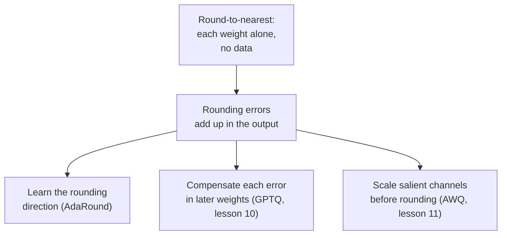

# पाठ 9. Round-to-Nearest

**मिशन से संबंध:** इस चरण का हर post-training method round-to-nearest के मुक़ाबले परखा जाता है, इसलिए ठीक-ठीक जानना कि वह क्या करता है, और उसकी error ज़रूरत से ज़्यादा क्यों है, यही GPTQ और AWQ को समझ में आने लायक़ बनाता है।
**मुख्य स्रोत:** [पेपर: "Up or Down? Adaptive Rounding for Post-Training Quantization", Nagel et al., 2020](https://arxiv.org/abs/2004.10568), section 2
**पूर्व-आवश्यकताएँ:** [पाठ 8](0008-handling-outliers.md), [Round-to-nearest](../GLOSSARY.md), [Group size](../GLOSSARY.md), [Rounding error](../GLOSSARY.md)

## वार्म-अप

1. ▢ Clipping range के भीतर की value के लिए, round-to-nearest की rounding error scales में नापने पर कितनी बड़ी हो सकती है?

<details markdown="1"><summary>जाँचें</summary>

ज़्यादा से ज़्यादा आधा scale, क्योंकि सबसे नज़दीकी grid level कभी आधे step से ज़्यादा दूर नहीं होता। Clipping error अलग चीज़ है और बहुत बड़ी हो सकती है।

</details>

2. ▢ Group size घटाने से rounding error क्यों घटती है, और उसकी क्या क़ीमत है?

<details markdown="1"><summary>जाँचें</summary>

कम weights एक scale साझा करते हैं, इसलिए एक बड़ा weight कम पड़ोसियों के लिए step खींचता है और आम weights बारीक grid पर गिरते हैं। क़ीमत यह है कि store करने को ज़्यादा scales हैं, जिससे effective bits per weight बढ़ते हैं।

</details>

3. ▢ पाठ 7 ने कहा था कि एक विशाल value tensor का scale बिगाड़ देती है। Granularity का कौन-सा चुनाव नुक़सान को values के सबसे छोटे सेट तक सीमित करता है?

<details markdown="1"><summary>जाँचें</summary>

Per-group, क्योंकि बड़ी value सिर्फ़ अपने group का scale तय करती है। Per-channel उसे एक channel तक सीमित करता है, per-tensor उसे सब पर फैला देता है।

</details>

## यह जानें

### Round-to-nearest क्या करता है

**Round-to-nearest** (RTN) पाठ 4 से 6 का वही quantizer है जो हर weight पर बिना और कुछ जोड़े लगाया जाता है। Weights के हर group के लिए वह एक scale चुनता है, आम तौर पर group की सबसे बड़ी absolute value से, हर weight को उससे भाग देता है, सबसे नज़दीकी integer पर round करता है, clamp करता है, और integer store करता है। Run time पर kernel वापस scale से गुणा करता है। बस यही पूरा method है: वह सिर्फ़ weights पढ़ता है, उसे data नहीं चाहिए, और हर weight किसी दूसरे weight को देखे बिना round होता है।

यही सादगी उसे default बनाती है। GPTQ पेपर RTN को बहुत बड़े language models पर पहले के काम में पसंदीदा method बताता है, क्योंकि उसका runtime model के आकार के साथ अच्छी तरह scale होता है ([Frantar et al., 2022](https://arxiv.org/abs/2210.17323))। यह वह baseline भी है जिससे इस चरण का हर दूसरा method तुलना किया जाता है।

### Bit width घटने पर यह कैसे बर्ताव करता है

हर हटाया गया bit levels के बीच के step को लगभग दुगुना कर देता है, इसलिए सबसे बड़ी संभव rounding error भी लगभग दुगुनी हो जाती है। 8 bits पर step नन्हा है और error model के अपने noise में खो जाती है: GPTQ पेपर ध्यान दिलाता है कि पहले के post-training methods 8 bits पर सटीक रहे और उससे नीचे नहीं। 4 bits पर नुक़सान दिखता है, और 3 bits पर घातक हो सकता है।

GPTQ पेपर का RTN baseline हर output row के लिए एक scale (per-channel) इस्तेमाल करता है। तीन OPT models के लिए WikiText-2 पर perplexity, जितनी कम उतना बेहतर ([Table 3](https://arxiv.org/abs/2210.17323)):

| OPT model | 16-bit | RTN, 4 bits | RTN, 3 bits |
|---|---|---|---|
| 6.7B | 10.86 | 12.10 | 5,800 |
| 13B | 10.13 | 11.32 | 3,400 |
| 175B | 8.34 | 10.54 | 7,300 |

4-bit वाला column 1 से 2 अंक फिसलता है। 3-bit वाला column ढह चुका है: हज़ारों में perplexity का मतलब है कि model अब काम नहीं करता। AWQ पेपर दिखाता है कि छोटा group size क्या बदलता है। 128 weights के groups के साथ RTN, उसके लेखकों के शब्दों में, काफ़ी मज़बूत है, और Llama-2 7B 16 bits पर 5.47 से 4 bits पर 5.73 और 3 bits पर 6.66 पर जाता है ([Lin et al., 2023](https://arxiv.org/abs/2306.00978), Table 4)। ये ऊपर की table से अलग models हैं, इसलिए आकार की तुलना करें, संख्याओं की नहीं: 3 bits पर per-channel RTN बुरी तरह विफल होता है, 3 bits पर per-group RTN बिगड़ा हुआ पर जीवित है। पाठ 6 का group size और store किए गए bits के बीच का सौदा यहाँ असली काम कर रहा है।

### Nearest सबसे अच्छी rounding क्यों नहीं है

Round-to-nearest हर weight की error को न्यूनतम करता है। जो मायने रखता है वह layer के output की error है, और वे एक चीज़ नहीं हैं। Nagel et al. weights को `dw` से perturb करने पर loss में वृद्धि का विस्तार करते हैं, और प्रमुख term `dw^T H dw` है, जहाँ `H` loss का दूसरा derivative है। उसके diagonal terms सिर्फ़ इस पर निर्भर करते हैं कि हर weight का perturbation कितना बड़ा है, और उनके लिए nearest rounding इष्टतम है। उसके off-diagonal terms perturbations के जोड़ों के signs पर निर्भर करते हैं: विपरीत sign की दो errors एक-दूसरे को काट सकती हैं, एक ही sign की दो जुड़ सकती हैं। Nearest rounding उन terms को अनदेखा करती है, उनके शब्दों में "उसे अक्सर sub-optimal बनाते हुए"।

वे इसे सीधे दिखाते हैं। उन्होंने ResNet18 की सिर्फ़ पहली layer को 4 bits पर quantize किया, 100 random up-or-down roundings खींचीं, और पाया कि उनमें से 48 nearest rounding को हरा देती हैं। Nearest ने ImageNet पर 52.29% पाया और सौ में से सबसे अच्छी ने 63.06% ([Table 1](https://arxiv.org/abs/2004.10568))। LLM layer के लिए यही बात ठोस रूप में लागू होती है। Output `W X` है, `X` के inputs features के पार correlated हैं, और इसलिए correlated features को गुणा करने वाले weights की errors को इस तरह सजाया जा सकता है कि वे एक-दूसरे को काट दें। हर weight को अकेले round करें और आप वह कटाव छोड़ देते हैं।



AdaRound up-or-down का चुनाव हर layer के optimisation से सीखता है, जिसके बारे में GPTQ के लेखक कहते हैं कि वह उनके method से कहीं ज़्यादा gradient steps लेता है और इसलिए LLM के पैमाने पर महँगा है। इस चरण का बाक़ी हिस्सा दूसरे box से निकलने वाले तीर के तीन उत्तर हैं।

## अभ्यास

1. ▢ 128 weights के group की सबसे बड़ी absolute value 0.6 है, और आप उसे -7 से 7 तक integer levels के साथ symmetric रूप से 4 bits पर quantize करते हैं। Scale क्या है, और range के भीतर के weight के लिए सबसे बड़ी संभव rounding error क्या है?

<details markdown="1"><summary>जाँचें</summary>

Scale = 0.6 / 7 = 0.0857। सबसे बड़ी rounding error आधा scale है, 0.0429। 0.20 का weight भाग देने पर 2.33 होता है, 2 पर round होता है और 0.1714 के रूप में store होता है, यानी 0.0286 की error, सीमा के भीतर।

</details>

2. ▢ Round-to-nearest 8 bits पर क्यों टिकता है पर 4 पर क्यों फिसलता है?

    - a) आठ-bit weights floating point में रहते हैं, इसलिए वे कभी round नहीं होते
    - b) कम bits outliers हटा देते हैं, इसलिए group scales कहीं कसे हो जाते हैं
    - c) हर हटाया गया bit step को लगभग दुगुना करता है, जिससे rounding error बढ़ती है
    - d) चार-bit kernels धीरे dequantize करते हैं, जो perplexity की हानि के रूप में दिखता है

<details markdown="1"><summary>जाँचें</summary>

**c)** हर हटाए गए bit पर grid में आधे levels रह जाते हैं, इसलिए step और सबसे ख़राब हालत की rounding error हर बार लगभग दुगुनी होती है, और 8 से 4 bits चार दुगुने हैं। (a) ग़लत है क्योंकि 8-bit integer weights भी 4-bit की तरह round होते हैं, बस कहीं बारीक grid पर। (b) ग़लत है क्योंकि bits हटाने से outliers नहीं हटते; वे हर हाल में scale तय करते हैं। (d) ग़लत है क्योंकि kernel की गति इसे बदलती है कि model कितना तेज़ चलता है, इसे नहीं कि उसकी perplexity क्या आती है।

</details>

3. ▢ पहले अनुमान लगाएँ, फिर चलाएँ। यह एक random weight matrix को 128 के groups में round-to-nearest से quantize करता है और layer के output `W X` की सापेक्ष error नापता है। अनुमान लगाएँ कि 4 bits पर error 8 bits से कैसे तुलना में है, और 3 bits पर 4 bits से, सिर्फ़ शून्य के हर तरफ़ integer levels की संख्या (127, 7 और 3) का इस्तेमाल करके।

    ```python
    import numpy as np

    rng = np.random.default_rng(0)
    W = rng.standard_normal((256, 512))
    X = rng.standard_normal((512, 1024))
    group = 128

    def rtn(W, bits, group):
        qmax = 2 ** (bits - 1) - 1
        Wg = W.reshape(W.shape[0], -1, group)
        scale = np.abs(Wg).max(axis=2, keepdims=True) / qmax
        q = np.clip(np.round(Wg / scale), -qmax, qmax)
        return (q * scale).reshape(W.shape)

    ref = W @ X
    for bits in (8, 4, 3):
        Q = rtn(W, bits, group)
        err = np.linalg.norm(ref - Q @ X) / np.linalg.norm(ref)
        print(f"{bits} bits: relative output error {err:.4f}")
    ```

<details markdown="1"><summary>संकेत</summary>

Scale group की सबसे बड़ी value को शून्य के एक तरफ़ के levels की संख्या से भाग देने पर बनता है, और rounding error scale के अनुपात में होती है।

</details>

<details markdown="1"><summary>जाँचें</summary>

```text
8 bits: relative output error 0.0065
4 bits: relative output error 0.1179
3 bits: relative output error 0.2753
```

Error 8 से 4 bits पर लगभग 18 गुना बढ़ती है और 4 से 3 bits पर लगभग 2.3 गुना। ये step sizes के अनुपात हैं: 127 / 7 = 18.1 और 7 / 3 = 2.3। हर bit साफ़ दुगुना नहीं होता क्योंकि symmetric grid हर तरफ़ 2^bits से एक level कम रखती है, पर नियम टिकता है: error step का पीछा करती है। आख़िरी bits महँगे हैं।

</details>

4. ▢ पहले अनुमान लगाएँ, फिर चलाएँ। Weights की एक row, 3-bit grid, और ऐसे inputs जिनके features correlated हैं। Code 2000 random up-or-down roundings खींचता है, जहाँ हर weight ऊपर round होने की संभावना उसके भिन्नात्मक हिस्से के बराबर है, और गिनता है कि कितनी nearest पर round करने से छोटी output error देती हैं। अनुमान लगाएँ कि यह कोई नहीं, कुछ, या कई है।

    ```python
    import numpy as np

    rng = np.random.default_rng(0)
    d, n = 64, 2048
    mix = rng.standard_normal((d, d)) / np.sqrt(d)
    X = mix @ rng.standard_normal((d, n)) + 0.8 * rng.standard_normal((1, n))
    w = rng.standard_normal(d)

    qmax = 3
    scale = np.abs(w).max() / qmax
    t = w / scale
    nearest = np.round(t) * scale

    def out_err(q):
        return np.linalg.norm(w @ X - q @ X)

    base = out_err(nearest)
    better, best = 0, base
    for _ in range(2000):
        pick_up = rng.random(d) < (t - np.floor(t))
        q = (np.floor(t) + pick_up) * scale
        e = out_err(q)
        better += e < base
        best = min(best, e)
    print(f"nearest: {base:.2f}")
    print(f"draws better than nearest: {better} of 2000")
    print(f"best draw: {best:.2f}")
    ```

<details markdown="1"><summary>संकेत</summary>

Nagel et al. ने पाया कि ResNet18 की एक layer पर 100 में से 48 stochastic roundings nearest को हरा देती हैं।

</details>

<details markdown="1"><summary>जाँचें</summary>

```text
nearest: 124.30
draws better than nearest: 919 of 2000
best draw: 75.34
```

कई: 2000 में से 919, लगभग 46%, जो पेपर के 100 में से 48 की गूँज है। सबसे अच्छी draw उसी grid और उन्हीं weights के साथ nearest rounding के मुक़ाबले output error को लगभग 40% घटा देती है। Nearest हर weight के लिए अकेले इष्टतम है पर inputs correlated हैं, इसलिए rounding errors के कुछ संयोजन `w X` में एक-दूसरे को काट देते हैं और nearest rounding उन्हें खोज नहीं सकती।

</details>

5. ▢ कोई साथी 13B OPT model को per-channel round-to-nearest से 4 bits पर quantize करता है, perplexity को 10.13 से 11.32 पर जाते देखता है, और कहता है कि 3 bits लगभग 12.5 के पास आने चाहिए क्योंकि वह एक bit कम है। ऊपर की table का इस्तेमाल करके बताएँ कि उस अनुमान में क्या ग़लत है।

<details markdown="1"><summary>जाँचें</summary>

नुक़सान bits में रैखिक नहीं है। उसी method ने GPTQ पेपर में उस model के लिए 3 bits पर लगभग 3,400 की perplexity दी, जो ढह जाना है, 1 अंक की फिसलन नहीं। हर हटाया गया bit step को लगभग दुगुना करता है, और किसी बिंदु के बाद model काम करना बंद कर देता है। उस bit width पर मापें जिस पर आप शिप करने वाले हैं।

</details>

## असली दुनिया का अभ्यास

- [ ] अभ्यास 3 का snippet सिर्फ़ 4 bits और group sizes 32, 128 और 512 (512 पूरी row है) के साथ चलाएँ। हर एक की error दर्ज करें और बताएँ कि storage की क़ीमत आप किस group size के लिए चुकाएँगे।
- [ ] Transformers से किसी छोटे open model की एक linear layer load करें, उसके weight को 4 bits पर और 128 के groups में round-to-nearest से quantize करें, और weights की सापेक्ष error की तुलना layer के output की सापेक्ष error से करें, एक वाक्य पर forward hook से पकड़ी गई activations पर। लिख लें कि कौन-सी बड़ी है।
- [ ] कल: बिना नोट्स के एक group के लिए round-to-nearest के चरण लिखें, और एक वाक्य लिखें कि output error सीधे weight errors का योग क्यों नहीं है।

## आगे बढ़ने के लिए

- [Weight PTQ Methods शीट](../reference/weight-ptq-methods.md)
- [पेपर: "GPTQ: Accurate Post-Training Quantization for Generative Pre-trained Transformers", Frantar et al., 2022](https://arxiv.org/abs/2210.17323), Tables 3 और 5 की RTN पंक्तियाँ
- [पेपर: "AWQ: Activation-aware Weight Quantization for LLM Compression and Acceleration", Lin et al., 2023](https://arxiv.org/abs/2306.00978), 128 के groups वाले RTN के लिए Table 4
- [संसाधन](../RESOURCES.md)

---

बात नहीं बन रही? ऊपर दिए मुख्य स्रोत को दोबारा पढ़ें, क्योंकि यह पाठ उसे संक्षिप्त करता है और समझ संक्षेप में ही रिसती है। जो शब्द फिसलन भरा लगे, उसके लिए [शब्दावली](../GLOSSARY.md) देखें।

अगर दिक़्क़त सामग्री की नहीं बल्कि पाठ की ही है, तो वह एक खोट है: [issue खोलें](https://github.com/TokenCemetery/teach/issues)।
