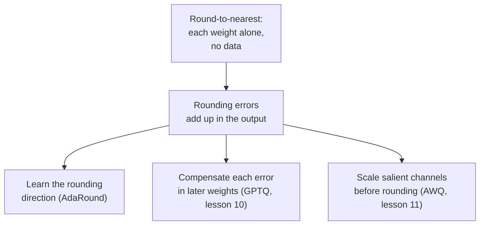

# Lesson 9. Round-to-Nearest

**Mission link:** Every post-training method in this stage is judged against round-to-nearest, so knowing exactly what it does, and why its error is larger than it needs to be, is what makes GPTQ and AWQ make sense.
**Primary source:** [Paper: "Up or Down? Adaptive Rounding for Post-Training Quantization", Nagel et al., 2020](https://arxiv.org/abs/2004.10568), section 2
**Prerequisites:** [Lesson 8](0008-handling-outliers.md), [Round-to-nearest](../GLOSSARY.md), [Group size](../GLOSSARY.md), [Rounding error](../GLOSSARY.md)

## Warm-up

1. ▢ For a value inside the clipping range, how large can the rounding error of round-to-nearest be, measured in scales?

<details markdown="1"><summary>Check</summary>

At most half a scale, because the nearest grid level is never more than half a step away. Clipping error is a separate thing and can be much larger.

</details>

2. ▢ Why does shrinking the group size reduce rounding error, and what does it cost?

<details markdown="1"><summary>Check</summary>

Fewer weights share one scale, so one large weight stretches the step for fewer neighbours and typical weights land on a finer grid. The cost is more scales to store, which raises the effective bits per weight.

</details>

3. ▢ Lesson 7 said one huge value ruins a tensor's scale. Which choice of granularity limits the damage to the smallest set of values?

<details markdown="1"><summary>Check</summary>

Per-group, because the large value only sets the scale of its own group. Per-channel limits it to one channel, per-tensor spreads it over everything.

</details>

## Know this

### What round-to-nearest does

**Round-to-nearest** (RTN) is the quantizer from lessons 4 to 6 applied to every weight with nothing else added. For each group of weights it picks a scale, usually from the group's largest absolute value, divides each weight by it, rounds to the nearest integer, clamps, and stores the integer. At run time the kernel multiplies back by the scale. That is the whole method: it reads only the weights, it needs no data, and each weight is rounded without looking at any other weight.

That simplicity is why it is the default. The GPTQ paper describes RTN as the method of choice in earlier work on very large language models, because its runtime scales well with model size ([Frantar et al., 2022](https://arxiv.org/abs/2210.17323)). It is also the baseline every other method in this stage is compared with.

### How it behaves as the bit width drops

Each bit you remove roughly doubles the step between levels, so the largest possible rounding error roughly doubles too. At 8 bits the step is tiny and the error vanishes into the model's own noise: the GPTQ paper notes that earlier post-training methods remained accurate at 8 bits and not below it. At 4 bits the loss is visible, and at 3 bits it can be fatal.

The GPTQ paper's RTN baseline uses one scale per output row (per-channel). Perplexity on WikiText-2, lower is better, for three OPT models ([Table 3](https://arxiv.org/abs/2210.17323)):

| OPT model | 16-bit | RTN, 4 bits | RTN, 3 bits |
|---|---|---|---|
| 6.7B | 10.86 | 12.10 | 5,800 |
| 13B | 10.13 | 11.32 | 3,400 |
| 175B | 8.34 | 10.54 | 7,300 |

The 4-bit column slips by 1 to 2 points. The 3-bit column has collapsed: a perplexity in the thousands means the model no longer works. The AWQ paper shows what a small group size changes. With groups of 128 weights RTN is, in its authors' words, quite strong, and Llama-2 7B goes from 5.47 at 16 bits to 5.73 at 4 bits and 6.66 at 3 bits ([Lin et al., 2023](https://arxiv.org/abs/2306.00978), Table 4). Those are different models from the table above, so compare the shape and not the numbers: per-channel RTN at 3 bits fails badly, per-group RTN at 3 bits is damaged but alive. Lesson 6's trade between group size and stored bits is doing real work here.

### Why nearest is not the best rounding

Round-to-nearest minimises the error of each weight. What matters is the error of the layer's output, and those are not the same thing. Nagel et al. expand the increase in loss from perturbing the weights by `dw`, and the leading term is `dw^T H dw`, where `H` is the second derivative of the loss. Its diagonal terms depend only on how large each weight's perturbation is, and for those nearest rounding is optimal. Its off-diagonal terms depend on the signs of pairs of perturbations: two errors of opposite sign can cancel, two of the same sign can add. Nearest rounding ignores those terms, "making it often sub-optimal" in their words.

They show it directly. They quantized only the first layer of ResNet18 to 4 bits, drew 100 random up-or-down roundings, and found that 48 of them beat nearest rounding. Nearest scored 52.29% on ImageNet and the best of the hundred scored 63.06% ([Table 1](https://arxiv.org/abs/2004.10568)). For an LLM layer the same thing holds in a concrete form. The output is `W X`, the inputs in `X` are correlated across features, and so the errors in the weights that multiply correlated features can be arranged to cancel. Round each weight on its own and you give up that cancellation.



AdaRound learns the up-or-down choice with an optimisation per layer, which the GPTQ authors note takes many more gradient steps than their method and so is costlier at LLM scale. The rest of this stage is three answers to the arrow out of the second box.

## Practice

1. ▢ A group of 128 weights has largest absolute value 0.6, and you quantize it symmetrically to 4 bits with integer levels from -7 to 7. What is the scale, and what is the largest possible rounding error for a weight inside the range?

<details markdown="1"><summary>Check</summary>

Scale = 0.6 / 7 = 0.0857. The largest rounding error is half a scale, 0.0429. A weight of 0.20 divides to 2.33, rounds to 2 and is stored as 0.1714, an error of 0.0286, inside the bound.

</details>

2. ▢ Why does round-to-nearest hold up at 8 bits but slip at 4?

    - a) Eight-bit weights stay in floating point, so they never round
    - b) Fewer bits remove outliers, so group scales become much tighter
    - c) Each removed bit roughly doubles the step, growing rounding error
    - d) Four-bit kernels dequantize slowly, which shows up as perplexity loss

<details markdown="1"><summary>Check</summary>

**c)** The grid has half as many levels for every bit removed, so the step and the worst-case rounding error roughly double each time, and 8 to 4 bits is four doublings. (a) is wrong because 8-bit integer weights are rounded just like 4-bit ones, only on a much finer grid. (b) is wrong because removing bits does not remove outliers; they set the scale regardless. (d) is wrong because kernel speed changes how fast the model runs, not what perplexity it scores.

</details>

3. ▢ Predict, then run. This quantizes a random weight matrix with round-to-nearest in groups of 128 and measures the relative error of the layer's output `W X`. Predict how the error at 4 bits compares with 8 bits, and at 3 bits with 4 bits, using only the number of integer levels on each side of zero (127, 7 and 3).

    ```python
    import numpy as np

    rng = np.random.default_rng(0)
    W = rng.standard_normal((256, 512))
    X = rng.standard_normal((512, 1024))
    group = 128

    def rtn(W, bits, group):
        qmax = 2 ** (bits - 1) - 1
        Wg = W.reshape(W.shape[0], -1, group)
        scale = np.abs(Wg).max(axis=2, keepdims=True) / qmax
        q = np.clip(np.round(Wg / scale), -qmax, qmax)
        return (q * scale).reshape(W.shape)

    ref = W @ X
    for bits in (8, 4, 3):
        Q = rtn(W, bits, group)
        err = np.linalg.norm(ref - Q @ X) / np.linalg.norm(ref)
        print(f"{bits} bits: relative output error {err:.4f}")
    ```

<details markdown="1"><summary>Hint</summary>

The scale is the group's largest value divided by the number of levels on one side of zero, and rounding error is proportional to the scale.

</details>

<details markdown="1"><summary>Check</summary>

```text
8 bits: relative output error 0.0065
4 bits: relative output error 0.1179
3 bits: relative output error 0.2753
```

The error grows by about 18 times from 8 to 4 bits and by about 2.3 times from 4 to 3 bits. Those are the ratios of the step sizes: 127 / 7 = 18.1 and 7 / 3 = 2.3. Each bit is not a clean doubling because a symmetric grid keeps one fewer level than 2^bits on each side, but the rule holds: the error tracks the step. The last bits are the expensive ones.

</details>

4. ▢ Predict, then run. One row of weights, 3-bit grid, and inputs whose features are correlated. The code draws 2000 random up-or-down roundings, each weight rounded up with probability equal to its fractional part, and counts how many give a smaller output error than rounding to nearest. Predict whether that is none, a few, or many.

    ```python
    import numpy as np

    rng = np.random.default_rng(0)
    d, n = 64, 2048
    mix = rng.standard_normal((d, d)) / np.sqrt(d)
    X = mix @ rng.standard_normal((d, n)) + 0.8 * rng.standard_normal((1, n))
    w = rng.standard_normal(d)

    qmax = 3
    scale = np.abs(w).max() / qmax
    t = w / scale
    nearest = np.round(t) * scale

    def out_err(q):
        return np.linalg.norm(w @ X - q @ X)

    base = out_err(nearest)
    better, best = 0, base
    for _ in range(2000):
        pick_up = rng.random(d) < (t - np.floor(t))
        q = (np.floor(t) + pick_up) * scale
        e = out_err(q)
        better += e < base
        best = min(best, e)
    print(f"nearest: {base:.2f}")
    print(f"draws better than nearest: {better} of 2000")
    print(f"best draw: {best:.2f}")
    ```

<details markdown="1"><summary>Hint</summary>

Nagel et al. found 48 of 100 stochastic roundings beat nearest on a ResNet18 layer.

</details>

<details markdown="1"><summary>Check</summary>

```text
nearest: 124.30
draws better than nearest: 919 of 2000
best draw: 75.34
```

Many: 919 of 2000, about 46%, which echoes the 48 of 100 in the paper. The best draw cuts the output error by about 40% against nearest rounding, using the same grid and the same weights. Nearest is optimal for each weight alone but the inputs are correlated, so some combinations of rounding errors cancel in `w X` and nearest rounding cannot find them.

</details>

5. ▢ A colleague quantizes a 13B OPT model to 4 bits with per-channel round-to-nearest, sees perplexity go from 10.13 to 11.32, and says 3 bits should land near 12.5 because it is one bit less. Using the table above, what is wrong with that extrapolation?

<details markdown="1"><summary>Check</summary>

The loss is not linear in bits. The same method at 3 bits gave a perplexity of about 3,400 for that model in the GPTQ paper, a collapse and not a 1-point slip. Each removed bit roughly doubles the step, and past some point the model stops working. Measure at the bit width you intend to ship.

</details>

## Real-world reps

- [ ] Run the snippet in practice item 3 with 4 bits only and group sizes 32, 128 and 512 (512 is the full row). Record the error for each and say which group size you would pay the storage for.
- [ ] Load one linear layer of a small open model with Transformers, quantize its weight with round-to-nearest at 4 bits and groups of 128, and compare the relative error of the weights with the relative error of the layer's output on activations captured with a forward hook on one sentence. Write down which is larger.
- [ ] Tomorrow: without notes, write the steps of round-to-nearest for one group, and one sentence on why the output error is not simply the sum of the weight errors.

## Going further

- [Weight PTQ Methods](../reference/weight-ptq-methods.md)
- [Paper: "GPTQ: Accurate Post-Training Quantization for Generative Pre-trained Transformers", Frantar et al., 2022](https://arxiv.org/abs/2210.17323), the RTN rows of Tables 3 and 5
- [Paper: "AWQ: Activation-aware Weight Quantization for LLM Compression and Acceleration", Lin et al., 2023](https://arxiv.org/abs/2306.00978), Table 4 for RTN with groups of 128
- [Resources](../RESOURCES.md)

---

Not landing? Reread the primary source at the top, since this lesson compresses it and compression is where understanding leaks. Check the [glossary](../GLOSSARY.md) for any term that felt slippery.

If the lesson itself is unclear rather than the material, that is a defect: [open an issue](https://github.com/TokenCemetery/teach/issues).
