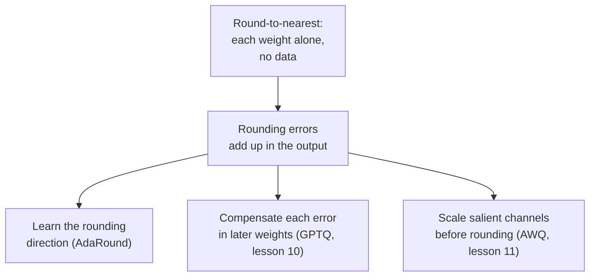

# Lição 9. Round-to-nearest

**Ligação com a missão:** Todo método post-training desta etapa é julgado contra o round-to-nearest, então saber exatamente o que ele faz, e por que o seu erro é maior do que precisa ser, é o que dá sentido ao GPTQ e ao AWQ.
**Fonte principal:** [Artigo científico: "Up or Down? Adaptive Rounding for Post-Training Quantization", Nagel et al., 2020](https://arxiv.org/abs/2004.10568), seção 2
**Pré-requisitos:** [Lição 8](0008-handling-outliers.md), [Round-to-nearest](../GLOSSARY.md), [Tamanho do grupo](../GLOSSARY.md), [Erro de arredondamento](../GLOSSARY.md)

## Aquecimento

1. ▢ Para um valor dentro da faixa de clipping, quão grande pode ser o erro de arredondamento do round-to-nearest, medido em scales?

<details markdown="1"><summary>Verificação</summary>

No máximo meia scale, porque o nível da grade mais próximo nunca está a mais de meio passo de distância. O erro de clipping é outra coisa e pode ser muito maior.

</details>

2. ▢ Por que diminuir o tamanho do grupo reduz o erro de arredondamento, e o que isso custa?

<details markdown="1"><summary>Verificação</summary>

Menos pesos compartilham uma scale, então um peso grande estica o passo para menos vizinhos e os pesos típicos caem em uma grade mais fina. O custo é ter mais scales para armazenar, o que aumenta os bits efetivos por peso.

</details>

3. ▢ A lição 7 disse que um único valor enorme arruína a scale de um tensor. Qual escolha de granularidade limita o dano ao menor conjunto de valores?

<details markdown="1"><summary>Verificação</summary>

Per-group, porque o valor grande só define a scale do seu próprio grupo. O per-channel o limita a um canal, e o per-tensor o espalha por tudo.

</details>

## Saiba isto

### O que o round-to-nearest faz

O **round-to-nearest** (RTN) é o quantizador das lições 4 a 6 aplicado a cada peso sem mais nada acrescentado. Para cada grupo de pesos, ele escolhe uma scale, geralmente a partir do maior valor absoluto do grupo, divide cada peso por ela, arredonda para o inteiro mais próximo, aplica clamping e armazena o inteiro. Em tempo de execução, o kernel multiplica de volta pela scale. Esse é o método inteiro: ele lê apenas os pesos, não precisa de dados, e cada peso é arredondado sem olhar para nenhum outro peso.

Essa simplicidade é o motivo de ele ser o padrão. O artigo do GPTQ descreve o RTN como o método de escolha em trabalhos anteriores sobre modelos de linguagem muito grandes, porque o seu tempo de execução escala bem com o tamanho do modelo ([Frantar et al., 2022](https://arxiv.org/abs/2210.17323)). Ele também é o baseline com o qual todo outro método desta etapa é comparado.

### Como ele se comporta conforme a largura em bits cai

Cada bit que você remove aproximadamente dobra o passo entre os níveis, então o maior erro de arredondamento possível também aproximadamente dobra. Em 8 bits o passo é minúsculo e o erro some no próprio ruído do modelo: o artigo do GPTQ observa que os métodos post-training anteriores continuavam acurados em 8 bits e não abaixo disso. Em 4 bits a perda é visível, e em 3 bits pode ser fatal.

O baseline RTN do artigo do GPTQ usa uma scale por linha de saída (per-channel). Perplexity no WikiText-2, quanto menor melhor, para três modelos OPT ([Tabela 3](https://arxiv.org/abs/2210.17323)):

| Modelo OPT | 16 bits | RTN, 4 bits | RTN, 3 bits |
|---|---|---|---|
| 6.7B | 10.86 | 12.10 | 5.800 |
| 13B | 10.13 | 11.32 | 3.400 |
| 175B | 8.34 | 10.54 | 7.300 |

A coluna de 4 bits escorrega de 1 a 2 pontos. A coluna de 3 bits colapsou: uma perplexity na casa dos milhares significa que o modelo não funciona mais. O artigo do AWQ mostra o que um tamanho de grupo pequeno muda. Com grupos de 128 pesos, o RTN é, nas palavras dos autores, bastante forte, e o Llama-2 7B vai de 5.47 em 16 bits para 5.73 em 4 bits e 6.66 em 3 bits ([Lin et al., 2023](https://arxiv.org/abs/2306.00978), Tabela 4). São modelos diferentes dos da tabela acima, então compare a forma e não os números: o RTN per-channel em 3 bits falha feio, o RTN per-group em 3 bits fica danificado, mas vivo. A troca da lição 6 entre tamanho do grupo e bits armazenados está fazendo trabalho de verdade aqui.

### Por que o mais próximo não é o melhor arredondamento

O round-to-nearest minimiza o erro de cada peso. O que importa é o erro da saída da camada, e essas não são a mesma coisa. Nagel et al. expandem o aumento da loss ao perturbar os pesos por `dw`, e o termo dominante é `dw^T H dw`, em que `H` é a derivada segunda da loss. Os termos da sua diagonal dependem apenas de quão grande é a perturbação de cada peso, e para esses o arredondamento para o mais próximo é ótimo. Os termos fora da diagonal dependem dos sinais de pares de perturbações: dois erros de sinais opostos podem se cancelar, dois de mesmo sinal podem se somar. O arredondamento para o mais próximo ignora esses termos, "tornando-o muitas vezes subótimo", nas palavras deles.

Eles mostram isso diretamente. Quantizaram só a primeira camada da ResNet18 para 4 bits, sortearam 100 arredondamentos aleatórios para cima ou para baixo e descobriram que 48 deles superavam o arredondamento para o mais próximo. O mais próximo marcou 52.29% no ImageNet e o melhor dos cem marcou 63.06% ([Tabela 1](https://arxiv.org/abs/2004.10568)). Para uma camada de LLM, a mesma coisa vale de forma concreta. A saída é `W X`, as entradas em `X` são correlacionadas entre as features, e assim os erros nos pesos que multiplicam features correlacionadas podem ser arranjados para se cancelar. Arredonde cada peso por conta própria e você abre mão desse cancelamento.



O AdaRound aprende a escolha entre para cima e para baixo com uma otimização por camada, que os autores do GPTQ observam exigir muito mais passos de gradiente que o método deles e, portanto, ser mais cara na escala de LLMs. O resto desta etapa são três respostas à seta que sai da segunda caixa.

## Prática

1. ▢ Um grupo de 128 pesos tem maior valor absoluto 0.6, e você o quantiza de forma simétrica para 4 bits com níveis inteiros de -7 a 7. Qual é a scale, e qual é o maior erro de arredondamento possível para um peso dentro da faixa?

<details markdown="1"><summary>Verificação</summary>

Scale = 0.6 / 7 = 0.0857. O maior erro de arredondamento é meia scale, 0.0429. Um peso de 0.20 dividido dá 2.33, arredonda para 2 e é armazenado como 0.1714, um erro de 0.0286, dentro do limite.

</details>

2. ▢ Por que o round-to-nearest se sustenta em 8 bits mas escorrega em 4?

    - a) Pesos de oito bits ficam em ponto flutuante, então nunca arredondam
    - b) Menos bits removem outliers, então as scales dos grupos ficam muito mais apertadas
    - c) Cada bit removido aproximadamente dobra o passo, aumentando o erro de arredondamento
    - d) Kernels de quatro bits dequantizam devagar, o que aparece como perda de perplexity

<details markdown="1"><summary>Verificação</summary>

**c)** A grade tem metade dos níveis a cada bit removido, então o passo e o erro de arredondamento no pior caso aproximadamente dobram a cada vez, e de 8 para 4 bits são quatro dobramentos. (a) está errada porque pesos inteiros de 8 bits são arredondados exatamente como os de 4 bits, só que em uma grade muito mais fina. (b) está errada porque remover bits não remove outliers; eles definem a scale de qualquer forma. (d) está errada porque a velocidade do kernel muda a rapidez com que o modelo roda, não a perplexity que ele marca.

</details>

3. ▢ Preveja e depois execute. Isto quantiza uma matriz de pesos aleatória com round-to-nearest em grupos de 128 e mede o erro relativo da saída `W X` da camada. Preveja como o erro em 4 bits se compara ao de 8 bits, e o de 3 bits ao de 4 bits, usando apenas o número de níveis inteiros de cada lado do zero (127, 7 e 3).

    ```python
    import numpy as np

    rng = np.random.default_rng(0)
    W = rng.standard_normal((256, 512))
    X = rng.standard_normal((512, 1024))
    group = 128

    def rtn(W, bits, group):
        qmax = 2 ** (bits - 1) - 1
        Wg = W.reshape(W.shape[0], -1, group)
        scale = np.abs(Wg).max(axis=2, keepdims=True) / qmax
        q = np.clip(np.round(Wg / scale), -qmax, qmax)
        return (q * scale).reshape(W.shape)

    ref = W @ X
    for bits in (8, 4, 3):
        Q = rtn(W, bits, group)
        err = np.linalg.norm(ref - Q @ X) / np.linalg.norm(ref)
        print(f"{bits} bits: relative output error {err:.4f}")
    ```

<details markdown="1"><summary>Dica</summary>

A scale é o maior valor do grupo dividido pelo número de níveis de um lado do zero, e o erro de arredondamento é proporcional à scale.

</details>

<details markdown="1"><summary>Verificação</summary>

```text
8 bits: relative output error 0.0065
4 bits: relative output error 0.1179
3 bits: relative output error 0.2753
```

O erro cresce cerca de 18 vezes de 8 para 4 bits e cerca de 2.3 vezes de 4 para 3 bits. Essas são as razões dos tamanhos de passo: 127 / 7 = 18.1 e 7 / 3 = 2.3. Cada bit não é um dobramento exato porque uma grade simétrica mantém um nível a menos que 2^bits de cada lado, mas a regra vale: o erro acompanha o passo. Os últimos bits são os caros.

</details>

4. ▢ Preveja e depois execute. Uma linha de pesos, grade de 3 bits e entradas cujas features são correlacionadas. O código sorteia 2000 arredondamentos aleatórios para cima ou para baixo, cada peso arredondado para cima com probabilidade igual à sua parte fracionária, e conta quantos dão um erro de saída menor que o arredondamento para o mais próximo. Preveja se isso é nenhum, alguns ou muitos.

    ```python
    import numpy as np

    rng = np.random.default_rng(0)
    d, n = 64, 2048
    mix = rng.standard_normal((d, d)) / np.sqrt(d)
    X = mix @ rng.standard_normal((d, n)) + 0.8 * rng.standard_normal((1, n))
    w = rng.standard_normal(d)

    qmax = 3
    scale = np.abs(w).max() / qmax
    t = w / scale
    nearest = np.round(t) * scale

    def out_err(q):
        return np.linalg.norm(w @ X - q @ X)

    base = out_err(nearest)
    better, best = 0, base
    for _ in range(2000):
        pick_up = rng.random(d) < (t - np.floor(t))
        q = (np.floor(t) + pick_up) * scale
        e = out_err(q)
        better += e < base
        best = min(best, e)
    print(f"nearest: {base:.2f}")
    print(f"draws better than nearest: {better} of 2000")
    print(f"best draw: {best:.2f}")
    ```

<details markdown="1"><summary>Dica</summary>

Nagel et al. descobriram que 48 de 100 arredondamentos estocásticos superavam o mais próximo em uma camada da ResNet18.

</details>

<details markdown="1"><summary>Verificação</summary>

```text
nearest: 124.30
draws better than nearest: 919 of 2000
best draw: 75.34
```

Muitos: 919 de 2000, cerca de 46%, o que ecoa os 48 de 100 do artigo. O melhor sorteio reduz o erro de saída em cerca de 40% em relação ao arredondamento para o mais próximo, usando a mesma grade e os mesmos pesos. O mais próximo é ótimo para cada peso isoladamente, mas as entradas são correlacionadas, então algumas combinações de erros de arredondamento se cancelam em `w X` e o arredondamento para o mais próximo não consegue encontrá-las.

</details>

5. ▢ Um colega quantiza um modelo OPT de 13B para 4 bits com round-to-nearest per-channel, vê a perplexity ir de 10.13 para 11.32 e diz que 3 bits deveria cair perto de 12.5, porque é um bit a menos. Usando a tabela acima, o que há de errado nessa extrapolação?

<details markdown="1"><summary>Verificação</summary>

A perda não é linear em bits. O mesmo método em 3 bits deu uma perplexity de cerca de 3.400 para esse modelo no artigo do GPTQ, um colapso e não um escorregão de 1 ponto. Cada bit removido aproximadamente dobra o passo, e a partir de certo ponto o modelo para de funcionar. Meça na largura em bits que você pretende entregar.

</details>

## Prática no mundo real

- [ ] Execute o trecho do item 3 da prática só com 4 bits e tamanhos de grupo 32, 128 e 512 (512 é a linha inteira). Registre o erro de cada um e diga por qual tamanho de grupo você pagaria o armazenamento.
- [ ] Carregue uma camada linear de um modelo aberto pequeno com o Transformers, quantize o seu peso com round-to-nearest em 4 bits e grupos de 128 e compare o erro relativo dos pesos com o erro relativo da saída da camada em ativações capturadas com um forward hook em uma frase. Anote qual é maior.
- [ ] Amanhã: sem consultar anotações, escreva os passos do round-to-nearest para um grupo e uma frase sobre por que o erro de saída não é simplesmente a soma dos erros dos pesos.

## Para ir além

- [Métodos de PTQ de Pesos](../reference/weight-ptq-methods.md)
- [Artigo científico: "GPTQ: Accurate Post-Training Quantization for Generative Pre-trained Transformers", Frantar et al., 2022](https://arxiv.org/abs/2210.17323), as linhas de RTN das Tabelas 3 e 5
- [Artigo científico: "AWQ: Activation-aware Weight Quantization for LLM Compression and Acceleration", Lin et al., 2023](https://arxiv.org/abs/2306.00978), Tabela 4 para o RTN com grupos de 128
- [Recursos](../RESOURCES.md)

---

Não ficou claro? Releia a fonte principal no topo, já que esta lição a comprime e é na compressão que o entendimento escapa. Consulte o [glossário](../GLOSSARY.md) para qualquer termo que pareceu escorregadio.

Se o problema é a lição em si, e não o material, isso é um defeito: [abra uma issue](https://github.com/TokenCemetery/teach/issues).
