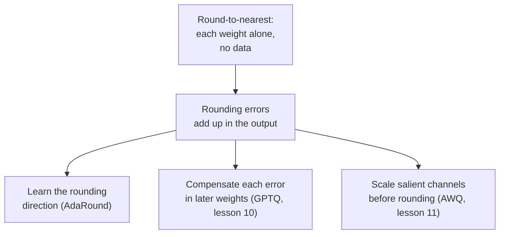

# Урок 9. Округление к ближайшему

**Связь с целью курса:** Каждый посттренировочный метод этого этапа оценивают относительно округления к ближайшему, поэтому знание того, что именно оно делает и почему его ошибка больше, чем должна быть, как раз и делает осмысленными GPTQ и AWQ.
**Первоисточник:** [Научная статья: "Up or Down? Adaptive Rounding for Post-Training Quantization", Nagel et al., 2020](https://arxiv.org/abs/2004.10568), раздел 2
**Предварительные требования:** [Урок 8](0008-handling-outliers.md), [Округление к ближайшему](../GLOSSARY.md), [Размер группы](../GLOSSARY.md), [Ошибка округления](../GLOSSARY.md)

## Разминка

1. ▢ Насколько велика может быть ошибка округления к ближайшему для значения внутри диапазона отсечения, измеряя в масштабах?

<details markdown="1"><summary>Проверка</summary>

Не более половины масштаба, потому что ближайший уровень сетки никогда не бывает дальше чем на полшага. Ошибка отсечения это отдельная вещь и может быть гораздо больше.

</details>

2. ▢ Почему уменьшение размера группы снижает ошибку округления и чего это стоит?

<details markdown="1"><summary>Проверка</summary>

Меньше весов делят один масштаб, поэтому один большой вес растягивает шаг для меньшего числа соседей, а типичные веса попадают на более мелкую сетку. Цена это больше масштабов для хранения, что повышает эффективное число бит на вес.

</details>

3. ▢ Урок 7 говорил, что одно огромное значение портит масштаб тензора. Какой выбор гранулярности ограничивает ущерб наименьшим множеством значений?

<details markdown="1"><summary>Проверка</summary>

Per-group, потому что большое значение задаёт масштаб только своей группы. Per-channel ограничивает его одним каналом, а per-tensor распространяет на всё.

</details>

## Что нужно знать

### Что делает округление к ближайшему

**Округление к ближайшему** (RTN) это квантизатор из уроков с 4 по 6, применённый к каждому весу без чего-либо ещё. Для каждой группы весов он выбирает масштаб, обычно по наибольшему абсолютному значению группы, делит на него каждый вес, округляет до ближайшего целого, прижимает и хранит целое число. Во время выполнения ядро умножает обратно на масштаб. Это весь метод: он читает только веса, ему не нужны данные, и каждый вес округляется без оглядки на другие веса.

Эта простота и делает его вариантом по умолчанию. Статья о GPTQ описывает RTN как метод, выбранный в более ранних работах по очень большим языковым моделям, потому что его время работы хорошо масштабируется с размером модели ([Frantar et al., 2022](https://arxiv.org/abs/2210.17323)). Он же служит базовым уровнем, с которым сравнивают каждый другой метод этого этапа.

### Как он ведёт себя при падении разрядности

Каждый убранный бит примерно удваивает шаг между уровнями, поэтому наибольшая возможная ошибка округления тоже примерно удваивается. В 8 битах шаг крошечный, и ошибка тонет в собственном шуме модели: статья о GPTQ отмечает, что более ранние посттренировочные методы оставались точными на 8 битах и не ниже. В 4 битах потеря заметна, а в 3 битах может быть фатальной.

Базовый RTN в статье о GPTQ использует один масштаб на выходную строку (per-channel). Перплексия на WikiText-2, чем меньше, тем лучше, для трёх моделей OPT ([таблица 3](https://arxiv.org/abs/2210.17323)):

| Модель OPT | 16 бит | RTN, 4 бита | RTN, 3 бита |
|---|---|---|---|
| 6,7 млрд | 10,86 | 12,10 | 5800 |
| 13 млрд | 10,13 | 11,32 | 3400 |
| 175 млрд | 8,34 | 10,54 | 7300 |

Столбец с 4 битами сдаёт на 1-2 пункта. Столбец с 3 битами рухнул: перплексия в тысячах означает, что модель больше не работает. Статья об AWQ показывает, что меняет малый размер группы. С группами по 128 весов RTN, по словам её авторов, довольно силён, и Llama-2 7B идёт от 5,47 в 16 битах к 5,73 в 4 битах и 6,66 в 3 битах ([Lin et al., 2023](https://arxiv.org/abs/2306.00978), таблица 4). Это другие модели, чем в таблице выше, поэтому сравнивайте форму, а не числа: per-channel RTN в 3 битах проваливается сильно, а per-group RTN в 3 битах повреждён, но жив. Компромисс урока 6 между размером группы и хранимыми битами здесь делает настоящую работу.

### Почему ближайшее не лучшее округление

Округление к ближайшему минимизирует ошибку каждого веса. Важна ошибка выхода слоя, а это не одно и то же. Nagel и соавторы раскладывают прирост потерь от возмущения весов на `dw`, и главный член это `dw^T H dw`, где `H` это вторая производная потерь. Его диагональные члены зависят только от размера возмущения каждого веса, и для них округление к ближайшему оптимально. Его недиагональные члены зависят от знаков пар возмущений: две ошибки противоположных знаков могут взаимно погаситься, две одного знака могут сложиться. Округление к ближайшему их игнорирует, «делая его зачастую неоптимальным», по их словам.

Они показывают это напрямую. Они квантизовали в 4 бита только первый слой ResNet18, нарисовали 100 случайных округлений вверх или вниз и обнаружили, что 48 из них лучше округления к ближайшему. Округление к ближайшему дало 52,29% на ImageNet, а лучшее из ста дало 63,06% ([таблица 1](https://arxiv.org/abs/2004.10568)). Для слоя LLM то же верно в конкретной форме. Выход это `W X`, входы в `X` коррелированы между признаками, и потому ошибки в весах, умножающих коррелированные признаки, можно расположить так, чтобы они гасились. Округлите каждый вес сам по себе, и вы отказываетесь от этого гашения.



AdaRound обучает выбор «вверх или вниз» оптимизацией на каждый слой, которая, как отмечают авторы GPTQ, требует гораздо больше шагов градиента, чем их метод, и потому дороже в масштабе LLM. Остальная часть этого этапа это три ответа на стрелку из второго блока.

## Практика

1. ▢ У группы из 128 весов наибольшее абсолютное значение 0,6, и вы квантизуете её симметрично в 4 бита с целыми уровнями от -7 до 7. Чему равен масштаб и какова наибольшая возможная ошибка округления для веса внутри диапазона?

<details markdown="1"><summary>Проверка</summary>

Масштаб = 0,6 / 7 = 0,0857. Наибольшая ошибка округления равна половине масштаба, 0,0429. Вес 0,20 делится в 2,33, округляется до 2 и хранится как 0,1714, ошибка 0,0286, в пределах границы.

</details>

2. ▢ Почему округление к ближайшему держится на 8 битах, но сдаёт на 4?

    - a) 8-битные веса остаются в формате с плавающей точкой, поэтому никогда не округляются
    - b) Меньше бит убирает выбросы, поэтому масштабы групп становятся гораздо точнее
    - c) Каждый убранный бит примерно удваивает шаг, увеличивая ошибку округления
    - d) 4-битные ядра деквантизуют медленно, что проявляется как потеря перплексии

<details markdown="1"><summary>Проверка</summary>

**c)** На каждый убранный бит сетка получает вдвое меньше уровней, поэтому шаг и наихудшая ошибка округления каждый раз примерно удваиваются, а от 8 до 4 бит это четыре удвоения. (a) неверно, потому что 8-битные целочисленные веса округляются так же, как 4-битные, только на гораздо более мелкой сетке. (b) неверно, потому что убирание бит не убирает выбросы; они задают масштаб в любом случае. (d) неверно, потому что скорость ядра меняет то, как быстро работает модель, а не то, какую перплексию она показывает.

</details>

3. ▢ Предскажите, затем запустите. Код квантизует случайную матрицу весов округлением к ближайшему группами по 128 и измеряет относительную ошибку выхода слоя `W X`. Предскажите, как ошибка в 4 битах соотносится с 8 битами, а в 3 битах с 4 битами, используя только число целых уровней с каждой стороны от нуля (127, 7 и 3).

    ```python
    import numpy as np

    rng = np.random.default_rng(0)
    W = rng.standard_normal((256, 512))
    X = rng.standard_normal((512, 1024))
    group = 128

    def rtn(W, bits, group):
        qmax = 2 ** (bits - 1) - 1
        Wg = W.reshape(W.shape[0], -1, group)
        scale = np.abs(Wg).max(axis=2, keepdims=True) / qmax
        q = np.clip(np.round(Wg / scale), -qmax, qmax)
        return (q * scale).reshape(W.shape)

    ref = W @ X
    for bits in (8, 4, 3):
        Q = rtn(W, bits, group)
        err = np.linalg.norm(ref - Q @ X) / np.linalg.norm(ref)
        print(f"{bits} bits: relative output error {err:.4f}")
    ```

<details markdown="1"><summary>Подсказка</summary>

Масштаб это наибольшее значение группы, делённое на число уровней с одной стороны от нуля, а ошибка округления пропорциональна масштабу.

</details>

<details markdown="1"><summary>Проверка</summary>

```text
8 bits: relative output error 0.0065
4 bits: relative output error 0.1179
3 bits: relative output error 0.2753
```

Ошибка растёт примерно в 18 раз от 8 к 4 битам и примерно в 2,3 раза от 4 к 3. Это отношения размеров шага: 127 / 7 = 18,1 и 7 / 3 = 2,3. Каждый бит не даёт чистого удвоения, потому что симметричная сетка сохраняет на один уровень меньше, чем 2^bits, с каждой стороны, но правило выполняется: ошибка следует за шагом. Последние биты самые дорогие.

</details>

4. ▢ Предскажите, затем запустите. Одна строка весов, 3-битная сетка и входы с коррелированными признаками. Код рисует 2000 случайных округлений вверх или вниз, где каждый вес округляется вверх с вероятностью, равной его дробной части, и считает, сколько из них дают меньшую ошибку выхода, чем округление к ближайшему. Предскажите, будет ли таких ни одного, немного или много.

    ```python
    import numpy as np

    rng = np.random.default_rng(0)
    d, n = 64, 2048
    mix = rng.standard_normal((d, d)) / np.sqrt(d)
    X = mix @ rng.standard_normal((d, n)) + 0.8 * rng.standard_normal((1, n))
    w = rng.standard_normal(d)

    qmax = 3
    scale = np.abs(w).max() / qmax
    t = w / scale
    nearest = np.round(t) * scale

    def out_err(q):
        return np.linalg.norm(w @ X - q @ X)

    base = out_err(nearest)
    better, best = 0, base
    for _ in range(2000):
        pick_up = rng.random(d) < (t - np.floor(t))
        q = (np.floor(t) + pick_up) * scale
        e = out_err(q)
        better += e < base
        best = min(best, e)
    print(f"nearest: {base:.2f}")
    print(f"draws better than nearest: {better} of 2000")
    print(f"best draw: {best:.2f}")
    ```

<details markdown="1"><summary>Подсказка</summary>

Nagel и соавторы обнаружили, что 48 из 100 стохастических округлений побеждают округление к ближайшему на слое ResNet18.

</details>

<details markdown="1"><summary>Проверка</summary>

```text
nearest: 124.30
draws better than nearest: 919 of 2000
best draw: 75.34
```

Много: 919 из 2000, около 46%, что перекликается с 48 из 100 в статье. Лучшее выпадение сокращает ошибку выхода примерно на 40% относительно округления к ближайшему, на той же сетке и с теми же весами. Ближайшее оптимально для каждого веса в отдельности, но входы коррелированы, поэтому некоторые сочетания ошибок округления гасятся в `w X`, а округление к ближайшему найти их не может.

</details>

5. ▢ Коллега квантизует модель OPT на 13 млрд в 4 бита per-channel-округлением к ближайшему, видит, что перплексия идёт с 10,13 до 11,32, и говорит, что 3 бита должны дать около 12,5, потому что это на один бит меньше. Что не так с этой экстраполяцией, если смотреть на таблицу выше?

<details markdown="1"><summary>Проверка</summary>

Потеря не линейна по битам. Тот же метод в 3 битах дал перплексию около 3400 для этой модели в статье о GPTQ, это обвал, а не сдвиг на 1 пункт. Каждый убранный бит примерно удваивает шаг, и после некоторой точки модель перестаёт работать. Измеряйте на той разрядности, которую собираетесь выпускать.

</details>

## Практика в реальной работе

- [ ] Запустите фрагмент из упражнения 3 практики только с 4 битами и размерами групп 32, 128 и 512 (512 это вся строка). Запишите ошибку для каждого и скажите, за какой размер группы вы заплатили бы местом хранения.
- [ ] Загрузите один линейный слой небольшой открытой модели через Transformers, квантизуйте его вес округлением к ближайшему в 4 бита группами по 128 и сравните относительную ошибку весов с относительной ошибкой выхода слоя на активациях, перехваченных прямым хуком на одном предложении. Запишите, какая из них больше.
- [ ] Завтра, без заметок, запишите шаги округления к ближайшему для одной группы и одно предложение о том, почему ошибка выхода не равна просто сумме ошибок весов.

## Что почитать дальше

- [Методы PTQ для весов](../reference/weight-ptq-methods.md)
- [Научная статья: "GPTQ: Accurate Post-Training Quantization for Generative Pre-trained Transformers", Frantar et al., 2022](https://arxiv.org/abs/2210.17323), строки RTN в таблицах 3 и 5
- [Научная статья: "AWQ: Activation-aware Weight Quantization for LLM Compression and Acceleration", Lin et al., 2023](https://arxiv.org/abs/2306.00978), таблица 4 для RTN с группами по 128
- [Ресурсы](../RESOURCES.md)

---

Не доходит? Перечитайте первоисточник в начале: этот урок его сжимает, а при сжатии понимание как раз и теряется. Загляните в [глоссарий](../GLOSSARY.md), если какой-то термин показался скользким.

Если неясен сам урок, а не материал, это дефект: [откройте issue](https://github.com/TokenCemetery/teach/issues).
