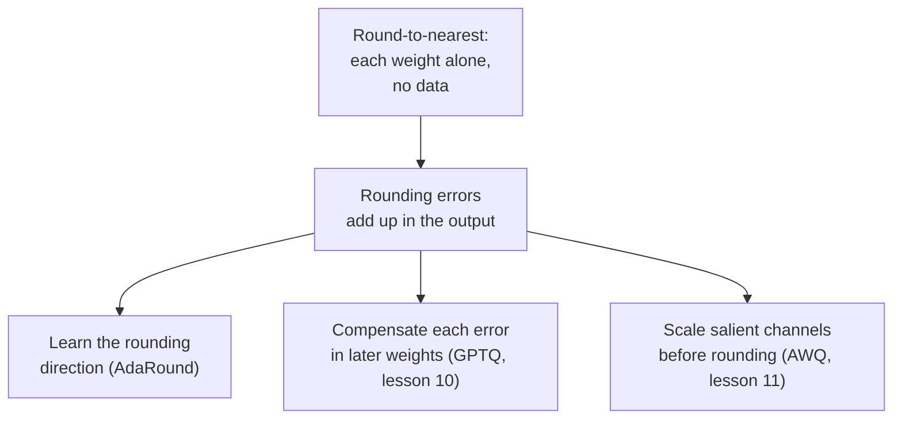

# 第 9 课：就近舍入

**使命关联:** 这一阶段的每一种训练后方法，都是拿就近舍入作基准来评判的，所以确切地知道它做了什么，以及它的误差为什么比必要的还大，才能让 GPTQ 和 AWQ 说得通。
**主要来源:** [论文：“Up or Down? Adaptive Rounding for Post-Training Quantization”，Nagel 等，2020](https://arxiv.org/abs/2004.10568)，第 2 节
**前置知识:** [第 8 课](0008-handling-outliers.md)、[就近舍入](../GLOSSARY.md)、[分组大小](../GLOSSARY.md)、[舍入误差](../GLOSSARY.md)

## 热身

1. ▢ 对截断范围之内的一个值，就近舍入的舍入误差最大能有多大，以缩放因子为单位？

<details markdown="1"><summary>检查</summary>

最多半个缩放因子，因为最近的网格档位离它从不超过半个步长。截断误差是另一回事，可以大得多。

</details>

2. ▢ 为什么缩小分组大小能减少舍入误差？它的代价是什么？

<details markdown="1"><summary>检查</summary>

共用一个缩放因子的权重变少了，所以一个大权重拉伸步长，影响的邻居更少，典型的权重落在更细的网格上。代价是要存更多的缩放因子，这会提高每个权重的有效位数。

</details>

3. ▢ 第 7 课说，一个巨大的值会毁掉整个张量的缩放因子。哪种粒度的选择，能把损害限制在最小的值集合里？

<details markdown="1"><summary>检查</summary>

逐组，因为那个大值只决定它自己所在组的缩放因子。逐通道把它限制在一个通道里，逐张量则把它摊到所有东西上。

</details>

## 要点

### 就近舍入做了什么

**就近舍入**（RTN）就是第 4 到第 6 课的那个量化器，应用到每个权重上，什么都不额外加。对每一组权重，它选一个缩放因子（通常取该组的最大绝对值），把每个权重除以它，舍入到最近的整数，钳制，然后存下这个整数。运行时，内核再乘回缩放因子。这就是整个方法：它只读权重，不需要数据，每个权重的舍入都不看其他任何权重。

正因为这么简单，它才是默认选择。GPTQ 论文把 RTN 描述为早期超大语言模型工作中的首选方法，因为它的运行时间随模型规模的扩展性很好（[Frantar 等，2022](https://arxiv.org/abs/2210.17323)）。它也是这一阶段其他每一种方法所对照的基线。

### 位宽下降时它的表现

每去掉一位，档位之间的步长大致翻倍，所以最大可能的舍入误差也大致翻倍。在 8 位时步长很小，误差淹没在模型自身的噪声里：GPTQ 论文指出，早期的训练后方法在 8 位时仍然准确，再往下就不行了。在 4 位时，损失已经看得出来，到 3 位时可能是致命的。

GPTQ 论文的 RTN 基线每个输出行用一个缩放因子（逐通道）。以下是三个 OPT 模型在 WikiText-2 上的困惑度，越低越好（[表 3](https://arxiv.org/abs/2210.17323)）：

| OPT 模型 | 16 位 | RTN，4 位 | RTN，3 位 |
|---|---|---|---|
| 6.7B | 10.86 | 12.10 | 5,800 |
| 13B | 10.13 | 11.32 | 3,400 |
| 175B | 8.34 | 10.54 | 7,300 |

4 位那一列下滑了 1 到 2 个点。3 位那一列已经崩溃：困惑度达到几千，意味着模型已经不能用了。AWQ 论文展示了小的分组大小改变了什么。以 128 个权重为一组，RTN 用它的作者的话说相当强，Llama-2 7B 从 16 位时的 5.47，变成 4 位时的 5.73 和 3 位时的 6.66（[Lin 等，2023](https://arxiv.org/abs/2306.00978)，表 4）。这些是与上表不同的模型，所以请比较形态而不是数字：3 位的逐通道 RTN 惨败，3 位的逐组 RTN 受了损伤，但还活着。第 6 课所讲的分组大小与存储位数之间的权衡，在这里真正起了作用。

### 为什么最近的并不是最好的舍入

就近舍入把每个权重的误差降到最小。要紧的是这一层输出的误差，而这两者并不是一回事。Nagel 等人把扰动权重 `dw` 所带来的损失增量展开，其领头项是 `dw^T H dw`，其中 `H` 是损失的二阶导数。它的对角项只取决于每个权重的扰动有多大，对这些项而言，就近舍入是最优的。它的非对角项则取决于成对扰动的符号：两个符号相反的误差可以抵消，两个符号相同的则会叠加。就近舍入忽略这些项，用他们的话说是“使它常常并非最优”。

他们直接做了展示。他们只把 ResNet18 的第一层量化到 4 位，随机抽取了 100 种向上或向下的舍入，发现其中有 48 种胜过就近舍入。就近舍入在 ImageNet 上得分 52.29%，一百种里最好的得分 63.06%（[表 1](https://arxiv.org/abs/2004.10568)）。对一个 LLM 层，同样的事情以具体的形式成立。输出是 `W X`，`X` 中的各输入在特征之间是相关的，所以乘以相关特征的那些权重上的误差，可以被安排成互相抵消。把每个权重各自单独舍入，就放弃了这种抵消。



AdaRound 用逐层的优化来学习向上还是向下的选择，GPTQ 的作者指出，这比他们的方法需要多得多的梯度步，所以在 LLM 的规模上代价更高。这一阶段的其余部分，就是对第二个框之后那个箭头的三种回答。

## 练习

1. ▢ 一组 128 个权重，最大绝对值为 0.6，你用 -7 到 7 的整数档位把它对称地量化到 4 位。缩放因子是多少？范围之内的权重，最大可能的舍入误差是多少？

<details markdown="1"><summary>检查</summary>

缩放因子 = 0.6 / 7 = 0.0857。最大的舍入误差是半个缩放因子，即 0.0429。一个 0.20 的权重除以缩放因子得 2.33，舍入为 2，存储为 0.1714，误差为 0.0286，在界限之内。

</details>

2. ▢ 为什么就近舍入在 8 位时站得住，在 4 位时却不行了？

    - a) 八位权重保持浮点，所以从不舍入
    - b) 位数更少会去掉离群值，所以分组缩放因子变得紧得多
    - c) 每去掉一位，步长大致翻倍，舍入误差随之增大
    - d) 四位内核的反量化很慢，表现为困惑度的损失

<details markdown="1"><summary>检查</summary>

**c)** 每去掉一位，网格的档位就少一半，所以步长和最坏情况下的舍入误差每次大致翻倍，从 8 位到 4 位是四次翻倍。(a) 是错的，因为 8 位整数权重和 4 位的一样要舍入，只是在细得多的网格上。(b) 是错的，因为去掉位数并不会去掉离群值，不管怎样它们都决定缩放因子。(d) 是错的，因为内核速度改变的是模型跑得多快，而不是它得到的困惑度。

</details>

3. ▢ 先预测，再运行。这段代码对一个随机的权重矩阵，以 128 个为一组做就近舍入，并度量该层输出 `W X` 的相对误差。只用零两侧各自的整数档位数（127、7 和 3），预测 4 位时的误差与 8 位相比如何，3 位时与 4 位相比如何。

    ```python
    import numpy as np

    rng = np.random.default_rng(0)
    W = rng.standard_normal((256, 512))
    X = rng.standard_normal((512, 1024))
    group = 128

    def rtn(W, bits, group):
        qmax = 2 ** (bits - 1) - 1
        Wg = W.reshape(W.shape[0], -1, group)
        scale = np.abs(Wg).max(axis=2, keepdims=True) / qmax
        q = np.clip(np.round(Wg / scale), -qmax, qmax)
        return (q * scale).reshape(W.shape)

    ref = W @ X
    for bits in (8, 4, 3):
        Q = rtn(W, bits, group)
        err = np.linalg.norm(ref - Q @ X) / np.linalg.norm(ref)
        print(f"{bits} bits: relative output error {err:.4f}")
    ```

<details markdown="1"><summary>提示</summary>

缩放因子是该组最大值除以零一侧的档位数，而舍入误差与缩放因子成正比。

</details>

<details markdown="1"><summary>检查</summary>

```text
8 bits: relative output error 0.0065
4 bits: relative output error 0.1179
3 bits: relative output error 0.2753
```

从 8 位到 4 位，误差增长约 18 倍，从 4 位到 3 位增长约 2.3 倍。这就是步长之比：127 / 7 = 18.1，7 / 3 = 2.3。每一位并不是干净的翻倍，因为对称网格在每侧比 2^bits 少一个档位，但规律成立：误差跟着步长走。最后几位是最贵的。

</details>

4. ▢ 先预测，再运行。一行权重，3 位网格，输入的各特征之间是相关的。代码抽取了 2000 次随机的向上或向下舍入，每个权重向上舍入的概率等于它的小数部分，并统计有多少次给出比就近舍入更小的输出误差。预测这个数是零、几次，还是很多次。

    ```python
    import numpy as np

    rng = np.random.default_rng(0)
    d, n = 64, 2048
    mix = rng.standard_normal((d, d)) / np.sqrt(d)
    X = mix @ rng.standard_normal((d, n)) + 0.8 * rng.standard_normal((1, n))
    w = rng.standard_normal(d)

    qmax = 3
    scale = np.abs(w).max() / qmax
    t = w / scale
    nearest = np.round(t) * scale

    def out_err(q):
        return np.linalg.norm(w @ X - q @ X)

    base = out_err(nearest)
    better, best = 0, base
    for _ in range(2000):
        pick_up = rng.random(d) < (t - np.floor(t))
        q = (np.floor(t) + pick_up) * scale
        e = out_err(q)
        better += e < base
        best = min(best, e)
    print(f"nearest: {base:.2f}")
    print(f"draws better than nearest: {better} of 2000")
    print(f"best draw: {best:.2f}")
    ```

<details markdown="1"><summary>提示</summary>

Nagel 等人发现，在 ResNet18 的一层上，100 次随机舍入中有 48 次胜过就近舍入。

</details>

<details markdown="1"><summary>检查</summary>

```text
nearest: 124.30
draws better than nearest: 919 of 2000
best draw: 75.34
```

很多次：2000 次中有 919 次，约 46%，与论文中 100 次里 48 次相呼应。用同样的网格和同样的权重，最好的一次抽样把输出误差比就近舍入降低了约 40%。就近舍入对每个权重单独来看是最优的，但输入是相关的，所以有些舍入误差的组合会在 `w X` 中互相抵消，而就近舍入找不到它们。

</details>

5. ▢ 一位同事用逐通道就近舍入把一个 13B 的 OPT 模型量化到 4 位，看到困惑度从 10.13 变成 11.32，于是说 3 位应该落在 12.5 附近，因为只少了一位。用上面的表来看，这个外推错在哪里？

<details markdown="1"><summary>检查</summary>

损失与位数并不成线性关系。在 GPTQ 论文里，同一种方法在 3 位时，该模型的困惑度约为 3,400，那是崩溃，而不是 1 个点的下滑。每去掉一位，步长大致翻倍，过了某个点，模型就不再能用。要在你打算上线的位宽上去测。

</details>

## 实战练习

- [ ] 只用 4 位，运行练习第 3 题的代码片段，分组大小取 32、128 和 512（512 是整行）。记录每种的误差，并说你愿意为哪种分组大小付出存储的代价。
- [ ] 用 Transformers 加载一个小型开源模型的一个线性层，用 4 位、128 个一组的就近舍入量化它的权重，并比较权重的相对误差，与该层输出的相对误差，后者的激活值是对一个句子用前向钩子捕获的。写下哪一个更大。
- [ ] 明天：不看笔记，写出对一组权重做就近舍入的步骤，并用一句话说明输出误差为什么不是权重误差的简单求和。

## 延伸阅读

- [权重训练后量化方法](../reference/weight-ptq-methods.md)
- [论文：“GPTQ: Accurate Post-Training Quantization for Generative Pre-trained Transformers”，Frantar 等，2022](https://arxiv.org/abs/2210.17323)，表 3 和表 5 中的 RTN 各行
- [论文：“AWQ: Activation-aware Weight Quantization for LLM Compression and Acceleration”，Lin 等，2023](https://arxiv.org/abs/2306.00978)，表 4 中以 128 为一组的 RTN
- [资源](../RESOURCES.md)

---

没学明白？请重读顶部的主要来源，因为本课是对它的压缩，而理解正是在压缩中流失的。如果有哪个术语觉得含糊，可以查看[术语表](../GLOSSARY.md)。

如果问题出在课程本身，而不是学习材料，那就是一个缺陷：[提交 issue](https://github.com/TokenCemetery/teach/issues)。
