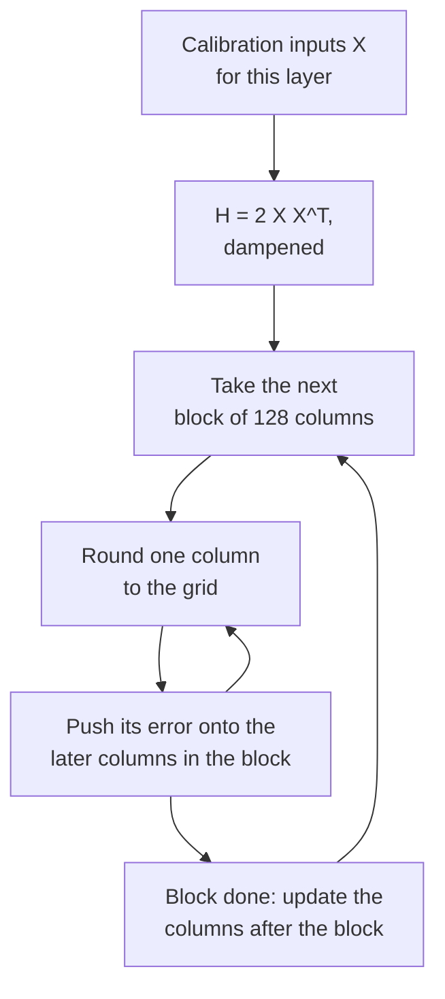

# Lección 10. GPTQ

**Vínculo con la misión:** GPTQ es el primer método que hace utilizables los pesos de 3 y 4 bits de un modelo grande, y la manera en que lo logra, gastando cada error de redondeo en los pesos que aún faltan, es la idea que necesitas para leer cualquier método posterior que use datos de calibración.
**Fuente principal:** [Paper: "GPTQ: Accurate Post-Training Quantization for Generative Pre-trained Transformers", Frantar et al., 2022](https://arxiv.org/abs/2210.17323), secciones 3 y 4
**Requisitos previos:** [Lección 9](0009-round-to-nearest.md), [GPTQ](../GLOSSARY.md), [Calibration set](../GLOSSARY.md), [Granularidad](../GLOSSARY.md)

## Calentamiento

1. ▢ La lección 9 mostró que 919 de 2000 redondeos aleatorios superaban a round-to-nearest en la salida de una capa. ¿Qué ignora round-to-nearest que esos redondeos aprovecharon?

<details markdown="1"><summary>Comprobación</summary>

Los términos cruzados entre pesos: la salida es `W X`, las entradas están correlacionadas entre features, así que los errores de redondeo de distintos pesos pueden cancelarse o sumarse. El redondeo al más cercano minimiza el error propio de cada peso y nunca mira los pares.

</details>

2. ▢ Una matriz de pesos de 4096 por 4096 se cuantiza con un scale por fila de salida, y luego con grupos de 128 a lo largo de cada fila. ¿Cuántos scales almacena cada una?

<details markdown="1"><summary>Comprobación</summary>

4,096 para per-channel (uno por fila) y 4,096 × 4,096 / 128 = 131,072 para grupos de 128. Per-group almacena 32 veces más scales, que es lo que la lección 6 puso en cifras en bits por peso.

</details>

## Qué debes saber

### El objetivo: igualar la salida de la capa, no sus pesos

GPTQ trata cada capa lineal por separado. Toma un conjunto pequeño de entradas de calibración, pásalas por el modelo y recoge la entrada `X` de esta capa. El objetivo son los pesos cuantizados `Ŵ` que mantienen la salida de la capa lo más cerca posible de la original, escrito en el paper como `argmin || W X - Ŵ X ||^2`. Es la visión del error de salida de la lección 9 convertida en un objetivo, y nunca pregunta si algún peso individual se redondeó bien.

El error cuadrático se descompone en una suma sobre las filas de `W`, una por canal de salida, así que cada fila es un problema independiente. Para una fila el error es cuadrático en los pesos, y su segunda derivada es `H = 2 X X^T`, la **Hessiana**. Tiene una fila y una columna por cada feature de entrada, y es la misma para todas las filas de la capa. Su diagonal dice cuánta energía lleva cada feature de entrada. Sus entradas fuera de la diagonal dicen qué features se mueven juntas, que es exactamente donde los errores de los pesos pueden cancelarse.

### El linaje: de Optimal Brain Surgeon a GPTQ

La idea es más antigua que los LLM. Optimal Brain Compression, de Frantar y Alistarh, extendió el marco clásico de Optimal Brain Surgeon de LeCun, Denker y Solla (1990) para cubrir la cuantización a la escala de las redes modernas ([Frantar and Alistarh, 2022](https://arxiv.org/abs/2208.11580)). Su cuantizador, el Optimal Brain Quantizer (OBQ), trabaja con una fila cada vez, cuantiza un peso cada vez y, tras cada uno, actualiza todos los pesos aún no cuantizados para compensar el error que acaba de cometerse. Según el paper de GPTQ, elige a continuación el peso que cuesta menos error extra y actualiza los demás con:

```text
chosen weight   q = argmin over q of (quant(w_q) - w_q)^2 / Hinv[q, q]
update of rest  delta = -(w_q - quant(w_q)) / Hinv[q, q] * Hinv[:, q]
```

Aquí `Hinv` es la inversa de la Hessiana sobre los pesos aún sin cuantizar. Lee la actualización en palabras: el error de redondeo del peso que acaba de fijarse, escalado por cuán correlacionado está con él cada peso restante, se empuja sobre los pesos restantes, de modo que la salida de la capa se mueva lo menos posible. El método es exacto y muy lento. GPTQ conserva la actualización y cambia cómo se calcula.

### Tres cambios que lo hacen escalar

1. **Cualquier orden fijo es casi igual de bueno.** OBQ elige el siguiente peso de forma voraz. Los autores de GPTQ encontraron que esto supera a un orden arbitrario solo ligeramente, sobre todo en capas grandes. Así que GPTQ cuantiza las columnas de cada fila en el mismo orden, de izquierda a derecha. Como `H` depende solo de las entradas, una actualización de la inversa por columna sirve entonces a todas las filas a la vez, y el costo baja de `O(d_row * d_col^3)` a `O(max(d_row * d_col^2, d_col^3))`, un ahorro de un factor igual a la menor dimensión.
2. **Actualizaciones perezosas por lotes.** Actualizar toda una matriz por cada columna hace unas pocas operaciones por entrada y está limitado por el ancho de banda de memoria, no por la aritmética. El redondeo de una columna depende solo de las actualizaciones hechas a esa columna, así que GPTQ procesa 128 columnas a la vez, mantiene sus actualizaciones dentro del bloque y aplica el efecto al resto de las columnas una vez terminado el bloque.
3. **Cholesky.** Actualizar repetidamente la inversa acumula error numérico, y en modelos grandes la matriz puede volverse indefinida, lo que envía las actualizaciones en direcciones equivocadas. GPTQ suma una pequeña constante a la diagonal de `H`, el 1% de su promedio, y precalcula las filas de la inversa que necesita a partir de una descomposición de Cholesky.

El bucle, para una capa:

```text
H = 2 X X^T, with 1% of its mean diagonal added; Hinv = Cholesky factor of H^-1
for each column i, left to right:
    q_i = quant(w_i)                          round the column to the grid
    e   = (w_i - q_i) / Hinv[i, i]
    w_j = w_j - e * Hinv[i, j]   for every later column j
```



### Qué lee y qué cuesta

Los datos de calibración del paper son 128 segmentos aleatorios de 2048 tokens del dataset C4, texto web genérico, así que GPTQ no ve datos de ninguna tarea. El paper maneja un bloque de Transformer cada vez en la GPU: acumula la `H` de cada capa, cuantiza y luego envía las entradas del bloque por el bloque ya cuantizado para alimentar al siguiente, de modo que las capas posteriores se ajustan a las entradas que de verdad verán. El paper usa una rejilla estándar por fila fijada antes de que empiece el bucle; con grupos, la rejilla de cada grupo se elige cuando el bucle llega a él, a partir de los pesos ya actualizados.

En OPT-175B el resumen informa de cuantización en aproximadamente cuatro horas de GPU, a 3 o 4 bits por peso con una pérdida de accuracy despreciable, y la documentación de Transformers repite esa cifra para una A100. Perplexity en WikiText-2 para OPT-175B, de la Tabla 3 del paper: 16 bits 8.34, GPTQ a 4 bits 8.37 frente a 10.54 de round-to-nearest, GPTQ a 3 bits 8.68 frente a 7,300. El paper observa además que los modelos más grandes suelen ser más fáciles de cuantizar, con OPT-66B como excepción.

### Act-order

Una adición no está en el paper sino en el código de los autores. La opción `--act-order` cuantiza las columnas en orden decreciente de tamaño de activación, lo que el código implementa ordenando las columnas por la diagonal de `H`, de mayor a menor, de modo que las columnas que ven las mayores entradas se redondean primero. El README del repositorio informa de que arregla un mal resultado en LLaMA 7B (de 7.15 a 6.09 de perplexity en WikiText-2) y en el modelo con outliers OPT-66B a 3 bits (de 14.16 a 9.95) ([IST-DASLab/gptq](https://github.com/IST-DASLab/gptq)). El README describe también una opción `--static-groups`, añadida para que act-order no necesite cambios en la inferencia que puedan causar una ralentización. llm-compressor lista la calibración con act-order como soportada ([llm-compressor](https://github.com/vllm-project/llm-compressor)).

## Práctica

1. ▢ Una capa tiene 4096 features de entrada y 11008 filas de salida, y se calibra con los 128 segmentos de 2048 tokens del paper. ¿Qué forma tiene `H`, cuántas filas de pesos la comparten y cuántos tokens de calibración la construyeron?

<details markdown="1"><summary>Comprobación</summary>

`H` es de 4096 por 4096, una fila y una columna por cada feature de entrada. Las 11008 filas la comparten, porque depende solo de las entradas. Se construyó con 128 × 2048 = 262,144 tokens. Ni el número de filas de salida ni el de tokens cambian su forma.

</details>

2. ▢ De la Tabla 3 del paper, OPT-6.7B a 4 bits tiene una perplexity en WikiText-2 de 10.86 a 16 bits, 12.10 con round-to-nearest y 11.39 con GPTQ. Para OPT-175B las cifras son 8.34, 10.54 y 8.37. ¿Qué parte de la pérdida de perplexity de round-to-nearest recupera GPTQ en cada uno, y qué dice eso sobre el tamaño?

<details markdown="1"><summary>Comprobación</summary>

OPT-6.7B: (12.10 - 11.39) / (12.10 - 10.86) = 0.71 / 1.24, cerca del 57%. OPT-175B: (10.54 - 8.37) / (10.54 - 8.34) = 2.17 / 2.20, cerca del 99%. GPTQ ayuda en todos los tamaños aquí y cierra casi por completo la brecha a 175B, en línea con la observación del paper de que los modelos más grandes suelen ser más fáciles de cuantizar.

</details>

3. ▢ ¿Por qué puede GPTQ redondear las columnas de todas las filas en el mismo orden y compartir una actualización de la inversa por columna?

    - a) El orden de las filas nunca importa al redondeo, así que se pueden omitir las actualizaciones
    - b) La Hessiana inversa depende solo de las entradas, así que las filas la comparten
    - c) La Hessiana es diagonal en la práctica, así que los errores se quedan en su sitio
    - d) Los factores de Cholesky son baratos, así que cada fila recibe su propia Hessiana

<details markdown="1"><summary>Comprobación</summary>

**b)** `H = 2 X X^T` se construye con las entradas de la capa y es idéntica para todas las filas de `W`, así que actualizar su inversa una vez por columna sirve a todas las filas, que es el ahorro de un factor igual a la menor dimensión en el tiempo de ejecución. (a) es incorrecta porque las actualizaciones son el método. (c) es incorrecta porque las entradas fuera de la diagonal son lo que permite que un peso absorba el error de otro. (d) es incorrecta porque hay una sola Hessiana por capa, no una por fila.

</details>

4. ▢ Predice y luego ejecuta. Una rejilla de 3 bits con un scale fijo por fila, entradas cuyas features están correlacionadas y un bucle compacto de GPTQ sin el procesamiento por bloques. Predice si el error relativo de salida de GPTQ resulta menor que el de round-to-nearest, y en aproximadamente cuánto.

    ```python
    import numpy as np

    rng = np.random.default_rng(0)
    rows, cols, n = 64, 128, 1024
    correlated = True
    mix = rng.standard_normal((cols, cols)) / np.sqrt(cols)
    if correlated:
        X = mix @ rng.standard_normal((cols, n)) + 0.8 * rng.standard_normal((1, n))
    else:
        X = rng.standard_normal((cols, n))
    W = rng.standard_normal((rows, cols))
    qmax = 3
    scale = np.abs(W).max(axis=1) / qmax

    def quant(w, s):
        return np.clip(np.round(w / s), -qmax, qmax) * s

    def gptq(W, X):
        W = W.copy()
        H = 2 * X @ X.T
        H += 0.01 * np.mean(np.diag(H)) * np.eye(H.shape[0])
        U = np.linalg.cholesky(np.linalg.inv(H)).T
        Q = np.zeros_like(W)
        for i in range(W.shape[1]):
            Q[:, i] = quant(W[:, i], scale)
            err = (W[:, i] - Q[:, i]) / U[i, i]
            W[:, i + 1:] -= np.outer(err, U[i, i + 1:])
        return Q

    def out_err(Q):
        return np.linalg.norm(W @ X - Q @ X) / np.linalg.norm(W @ X)

    print(f"RTN : relative output error {out_err(quant(W, scale[:, None])):.4f}")
    print(f"GPTQ: relative output error {out_err(gptq(W, X)):.4f}")
    ```

<details markdown="1"><summary>Pista</summary>

Ambos usan la misma rejilla, así que GPTQ no puede mejorar el redondeo de ningún peso individual. Pregúntate adónde más podría ir su error.

</details>

<details markdown="1"><summary>Comprobación</summary>

```text
RTN : relative output error 0.2679
GPTQ: relative output error 0.1596
```

GPTQ reduce el error de salida en cerca de un 40% sobre la misma rejilla. Los pesos individuales no se redondean mejor, y muchos se redondean peor, pero el error de cada columna se ha empujado sobre las columnas posteriores, que están correlacionadas con ella, así que la salida de la capa acaba más cerca.

</details>

5. ▢ Predice y luego ejecuta. Pon `correlated = False` en el fragmento de arriba, de modo que las entradas sean features independientes de igual varianza. Predice qué pasa con la ventaja de GPTQ.

<details markdown="1"><summary>Pista</summary>

Mira cómo es `H` cuando las features no se mueven juntas, y qué aportaban las entradas fuera de la diagonal.

</details>

<details markdown="1"><summary>Comprobación</summary>

```text
RTN : relative output error 0.2680
GPTQ: relative output error 0.2595
```

La ventaja casi desaparece. Con entradas independientes `H` es casi diagonal, así que hay poca correlación a lo largo de la cual empujar el error, y redondear cada peso por su cuenta se acerca a lo que la capa puede hacer. La ganancia de GPTQ viene de la estructura de `X`, y por eso se benefician las activaciones reales, que están fuertemente correlacionadas.

</details>

6. ▢ Un revisor escribe: "GPTQ mejora a round-to-nearest eligiendo un scale mejor para cada peso". ¿Qué falla en esa frase?

<details markdown="1"><summary>Comprobación</summary>

El paper supone que la rejilla de cuantización se fija antes de que empiece el proceso, así que GPTQ no elige mejores scales. Cambia los valores de los pesos aún no cuantizados, de modo que cuando se redondean sobre la misma rejilla el error de salida de la capa sea menor. Con grupos, el scale de cada grupo se calcula cuando el bucle llega a él, a partir de los pesos actualizados.

</details>

## Prácticas en el mundo real

- [ ] Abre las Tablas 3 y 5 del paper. Para dos tamaños de OPT a tu elección, calcula la parte de la pérdida de perplexity de round-to-nearest que GPTQ recupera a 3 bits, y anota a qué tamaño golpea más fuerte el colapso de round-to-nearest a 3 bits.
- [ ] Ejecuta el fragmento del ejercicio 4 de la práctica con `n = 64`, menos muestras que las 128 features de entrada, y predice antes de ejecutar si GPTQ sigue superando a round-to-nearest. Evalúa con muestras nuevas para ser justo, y guarda el resultado para la lección 12.
- [ ] Mañana: sin apuntes, escribe el bucle de GPTQ para una capa en cinco líneas, y nombra los tres cambios que llevaron la idea de OBQ de las redes pequeñas a 175B parámetros.

## Para profundizar

- [Métodos PTQ de pesos](../reference/weight-ptq-methods.md)
- [Paper: "Optimal Brain Compression", Frantar and Alistarh, 2022](https://arxiv.org/abs/2208.11580), para el método exacto que GPTQ aproxima
- [Docs: "GPTQ", Hugging Face Transformers](https://huggingface.co/docs/transformers/main/en/quantization/gptq), para ejecutarlo mediante `GPTQConfig`
- [Repo: IST-DASLab/gptq](https://github.com/IST-DASLab/gptq), para act-order en código
- Inferencia: [Cuantización al servir](../../inference/reference/quantization-at-serve-time.md), para ver cómo se sirve un checkpoint de GPTQ
- [Recursos](../RESOURCES.md)

---

¿No termina de quedar claro? Vuelve a leer la fuente primaria de arriba, ya que esta lección la comprime y en la compresión es donde se escapa la comprensión. Consulta el [glosario](../GLOSSARY.md) por si algún término te resultó resbaladizo.

Si lo poco claro es la propia lección y no el material, eso es un defecto: [abre un issue](https://github.com/TokenCemetery/teach/issues).
