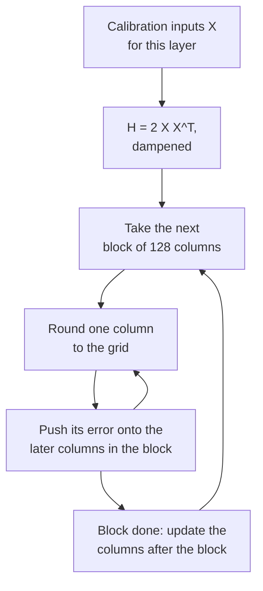

# Leçon 10. GPTQ

**Lien avec la mission :** GPTQ est la première méthode qui rend utilisables les poids en 3 et 4 bits d'un grand modèle, et la façon dont elle y parvient, en dépensant chaque erreur d'arrondi sur les poids à venir, est l'idée qu'il vous faut pour lire toute méthode ultérieure qui utilise des données de calibration.
**Source primaire :** [Article : "GPTQ: Accurate Post-Training Quantization for Generative Pre-trained Transformers", Frantar et al., 2022](https://arxiv.org/abs/2210.17323), sections 3 et 4
**Prérequis :** [Leçon 9](0009-round-to-nearest.md), [GPTQ](../GLOSSARY.md), [Calibration set](../GLOSSARY.md), [Granularité](../GLOSSARY.md)

## Échauffement

1. ▢ La leçon 9 a montré que 919 arrondis aléatoires sur 2000 battent l'arrondi au plus proche sur la sortie d'une couche. Qu'est-ce que l'arrondi au plus proche ignore que ces arrondis ont exploité ?

<details markdown="1"><summary>Vérifier</summary>

Les termes croisés entre poids : la sortie est `W X`, les entrées sont corrélées entre features, donc les erreurs d'arrondi de différents poids peuvent s'annuler ou s'ajouter. L'arrondi au plus proche minimise l'erreur propre de chaque poids et ne regarde jamais les paires.

</details>

2. ▢ Une matrice de poids de 4096 par 4096 est quantifiée avec un scale par ligne de sortie, puis avec des groupes de 128 le long de chaque ligne. Combien de scales chacune stocke-t-elle ?

<details markdown="1"><summary>Vérifier</summary>

4,096 pour le par-canal (un par ligne) et 4,096 × 4,096 / 128 = 131,072 pour des groupes de 128. Le par-groupe stocke 32 fois plus de scales, ce que la leçon 6 a chiffré en bits par poids.

</details>

## À savoir

### L'objectif : égaler la sortie de la couche, pas ses poids

GPTQ traite chaque couche linéaire isolément. Prenez un petit ensemble d'entrées de calibration, passez-les dans le modèle et collectez l'entrée `X` de cette couche. Le but est d'obtenir les poids quantifiés `Ŵ` qui gardent la sortie de la couche le plus près possible de l'originale, écrit dans l'article `argmin || W X - Ŵ X ||^2`. C'est le point de vue de l'erreur de sortie de la leçon 9 transformé en objectif, et il ne demande jamais si un poids isolé a été bien arrondi.

L'erreur quadratique se découpe en une somme sur les lignes de `W`, une par canal de sortie, donc chaque ligne est un problème indépendant. Pour une ligne, l'erreur est quadratique en les poids, et sa dérivée seconde est `H = 2 X X^T`, la **hessienne**. Elle a une ligne et une colonne par feature d'entrée, et elle est la même pour chaque ligne de la couche. Sa diagonale dit quelle énergie porte chaque feature d'entrée. Ses entrées hors diagonale disent quelles features varient ensemble, ce qui est précisément là où les erreurs de poids peuvent s'annuler.

### La filiation : d'Optimal Brain Surgeon à GPTQ

L'idée est plus ancienne que les LLM. Optimal Brain Compression de Frantar et Alistarh a étendu le cadre classique d'Optimal Brain Surgeon de LeCun, Denker et Solla (1990) pour couvrir la quantification à l'échelle des réseaux modernes ([Frantar et Alistarh, 2022](https://arxiv.org/abs/2208.11580)). Son quantificateur, l'Optimal Brain Quantizer (OBQ), travaille sur une ligne à la fois, quantifie un poids à la fois, et après chacun met à jour tous les poids pas encore quantifiés pour compenser l'erreur qu'il vient de faire. Selon l'article GPTQ, il choisit ensuite le poids qui coûte le moins d'erreur supplémentaire et met à jour les autres avec :

```text
chosen weight   q = argmin over q of (quant(w_q) - w_q)^2 / Hinv[q, q]
update of rest  delta = -(w_q - quant(w_q)) / Hinv[q, q] * Hinv[:, q]
```

Ici `Hinv` est l'inverse de la hessienne sur les poids encore non quantifiés. Lisez la mise à jour en mots : l'erreur d'arrondi du poids qui vient d'être fixé, pondérée par la corrélation de chaque poids restant avec lui, est reportée sur les poids restants, de sorte que la sortie de la couche bouge le moins possible. La méthode est exacte et très lente. GPTQ garde la mise à jour et change la façon de la calculer.

### Trois changements qui permettent le passage à l'échelle

1. **N'importe quel ordre fixe est presque aussi bon.** OBQ choisit le poids suivant de façon gloutonne. Les auteurs de GPTQ ont constaté que cela ne bat un ordre arbitraire que légèrement, surtout sur les grandes couches. GPTQ quantifie donc les colonnes de chaque ligne dans le même ordre, de gauche à droite. Comme `H` ne dépend que des entrées, une seule mise à jour de l'inverse par colonne sert alors toutes les lignes à la fois, et le coût passe de `O(d_row * d_col^3)` à `O(max(d_row * d_col^2, d_col^3))`, soit une économie d'un facteur égal à la plus petite dimension.
2. **Mises à jour paresseuses par lots.** Mettre à jour toute une matrice pour chaque colonne fait quelques opérations par entrée et est limité par la bande passante mémoire, pas par l'arithmétique. L'arrondi d'une colonne ne dépend que des mises à jour faites sur cette colonne, donc GPTQ traite 128 colonnes à la fois, garde leurs mises à jour à l'intérieur du bloc, et applique l'effet aux colonnes restantes une fois le bloc terminé.
3. **Cholesky.** Mettre à jour l'inverse à répétition accumule de l'erreur numérique, et sur les gros modèles la matrice peut devenir indéfinie, ce qui envoie les mises à jour dans de mauvaises directions. GPTQ ajoute une petite constante à la diagonale de `H`, 1 % de sa moyenne, et précalcule les lignes de l'inverse dont il a besoin à partir d'une décomposition de Cholesky.

La boucle, pour une couche :

```text
H = 2 X X^T, with 1% of its mean diagonal added; Hinv = Cholesky factor of H^-1
for each column i, left to right:
    q_i = quant(w_i)                          round the column to the grid
    e   = (w_i - q_i) / Hinv[i, i]
    w_j = w_j - e * Hinv[i, j]   for every later column j
```



### Ce qu'il lit, et ce qu'il coûte

Les données de calibration de l'article sont 128 segments aléatoires de 2048 tokens du jeu de données C4, du texte web générique, donc GPTQ ne voit aucune donnée de tâche. L'article traite un bloc Transformer à la fois sur le GPU : il accumule le `H` de chaque couche, quantifie, puis envoie les entrées du bloc à travers le bloc déjà quantifié pour alimenter le suivant, de sorte que les couches ultérieures sont ajustées aux entrées qu'elles verront réellement. L'article utilise une grille standard par ligne fixée avant le début de la boucle ; avec des groupes, la grille de chaque groupe est choisie quand la boucle l'atteint, à partir des poids alors mis à jour.

Sur OPT-175B, le résumé rapporte une quantification en environ quatre heures de GPU, à 3 ou 4 bits par poids avec une perte de précision négligeable, et la documentation de Transformers reprend ce chiffre pour un A100. Perplexity sur WikiText-2 pour OPT-175B, d'après le tableau 3 de l'article : 16 bits 8.34, GPTQ en 4 bits 8.37 contre 10.54 pour l'arrondi au plus proche, GPTQ en 3 bits 8.68 contre 7,300. L'article observe aussi que les grands modèles sont en général plus faciles à quantifier, OPT-66B faisant exception.

### Act-order

Un ajout ne figure pas dans l'article mais dans le code des auteurs. L'option `--act-order` quantifie les colonnes par taille d'activation décroissante, ce que le code met en œuvre en triant les colonnes selon la diagonale de `H`, la plus grande d'abord, de sorte que les colonnes qui voient les plus grandes entrées sont arrondies en premier. Le README du dépôt rapporte qu'elle corrige un mauvais résultat sur LLaMA 7B (7.15 à 6.09 de perplexity sur WikiText-2) et sur le modèle à outliers OPT-66B en 3 bits (14.16 à 9.95) ([IST-DASLab/gptq](https://github.com/IST-DASLab/gptq)). Le README décrit aussi une option `--static-groups`, ajoutée pour que l'act-order n'exige aucun changement d'inférence susceptible de causer un ralentissement. llm-compressor liste la calibration act-order comme prise en charge ([llm-compressor](https://github.com/vllm-project/llm-compressor)).

## Pratique

1. ▢ Une couche a 4096 features d'entrée et 11008 lignes de sortie, et est calibrée avec les 128 segments de 2048 tokens de l'article. Quelle est la forme de `H`, combien de lignes de poids la partagent, et combien de tokens de calibration l'ont construite ?

<details markdown="1"><summary>Vérifier</summary>

`H` fait 4096 par 4096, une ligne et une colonne par feature d'entrée. Les 11008 lignes la partagent, parce qu'elle ne dépend que des entrées. Elle a été construite à partir de 128 × 2048 = 262,144 tokens. Ni le nombre de lignes de sortie ni le nombre de tokens ne change sa forme.

</details>

2. ▢ D'après le tableau 3 de l'article, OPT-6.7B en 4 bits a une perplexity sur WikiText-2 de 10.86 en 16 bits, 12.10 avec l'arrondi au plus proche et 11.39 avec GPTQ. Pour OPT-175B, les chiffres sont 8.34, 10.54 et 8.37. Quelle part de la perte de perplexity de l'arrondi au plus proche GPTQ regagne-t-il dans chacun, et que cela dit-il de la taille ?

<details markdown="1"><summary>Vérifier</summary>

OPT-6.7B : (12.10 - 11.39) / (12.10 - 10.86) = 0.71 / 1.24, environ 57 %. OPT-175B : (10.54 - 8.37) / (10.54 - 8.34) = 2.17 / 2.20, environ 99 %. GPTQ aide à chaque taille ici et comble presque l'écart à 175B, en accord avec la remarque de l'article selon laquelle les grands modèles sont en général plus faciles à quantifier.

</details>

3. ▢ Pourquoi GPTQ peut-il arrondir les colonnes de chaque ligne dans le même ordre et partager une seule mise à jour de l'inverse par colonne ?

    - a) L'ordre des lignes n'importe jamais à l'arrondi, donc on peut sauter les mises à jour
    - b) L'inverse de la hessienne ne dépend que des entrées, donc les lignes le partagent
    - c) La hessienne est diagonale en pratique, donc les erreurs restent en place
    - d) Les facteurs de Cholesky sont bon marché, donc chaque ligne a sa propre hessienne

<details markdown="1"><summary>Vérifier</summary>

**b)** `H = 2 X X^T` est construite à partir des entrées de la couche et est identique pour chaque ligne de `W`, donc mettre à jour son inverse une fois par colonne sert toutes les lignes, ce qui est l'économie d'un facteur égal à la plus petite dimension dans le temps d'exécution. (a) est faux parce que les mises à jour sont la méthode. (c) est faux parce que les entrées hors diagonale sont ce qui permet à un poids d'absorber l'erreur d'un autre. (d) est faux parce qu'il n'y a qu'une hessienne par couche, pas une par ligne.

</details>

4. ▢ Prédisez, puis exécutez. Une grille de 3 bits avec un scale fixe par ligne, des entrées dont les features sont corrélées, et une boucle GPTQ compacte sans le traitement par blocs. Prédisez si l'erreur de sortie relative de GPTQ ressort plus basse que celle de l'arrondi au plus proche, et de combien à peu près.

    ```python
    import numpy as np

    rng = np.random.default_rng(0)
    rows, cols, n = 64, 128, 1024
    correlated = True
    mix = rng.standard_normal((cols, cols)) / np.sqrt(cols)
    if correlated:
        X = mix @ rng.standard_normal((cols, n)) + 0.8 * rng.standard_normal((1, n))
    else:
        X = rng.standard_normal((cols, n))
    W = rng.standard_normal((rows, cols))
    qmax = 3
    scale = np.abs(W).max(axis=1) / qmax

    def quant(w, s):
        return np.clip(np.round(w / s), -qmax, qmax) * s

    def gptq(W, X):
        W = W.copy()
        H = 2 * X @ X.T
        H += 0.01 * np.mean(np.diag(H)) * np.eye(H.shape[0])
        U = np.linalg.cholesky(np.linalg.inv(H)).T
        Q = np.zeros_like(W)
        for i in range(W.shape[1]):
            Q[:, i] = quant(W[:, i], scale)
            err = (W[:, i] - Q[:, i]) / U[i, i]
            W[:, i + 1:] -= np.outer(err, U[i, i + 1:])
        return Q

    def out_err(Q):
        return np.linalg.norm(W @ X - Q @ X) / np.linalg.norm(W @ X)

    print(f"RTN : relative output error {out_err(quant(W, scale[:, None])):.4f}")
    print(f"GPTQ: relative output error {out_err(gptq(W, X)):.4f}")
    ```

<details markdown="1"><summary>Indice</summary>

Les deux utilisent la même grille, donc GPTQ ne peut améliorer l'arrondi d'aucun poids isolé. Demandez-vous où son erreur pourrait aller ailleurs.

</details>

<details markdown="1"><summary>Vérifier</summary>

```text
RTN : relative output error 0.2679
GPTQ: relative output error 0.1596
```

GPTQ réduit l'erreur de sortie d'environ 40 % sur la même grille. Les poids pris individuellement ne sont pas mieux arrondis, et beaucoup le sont moins bien, mais l'erreur de chaque colonne a été reportée sur les colonnes suivantes, qui lui sont corrélées, donc la sortie de la couche finit plus proche.

</details>

5. ▢ Prédisez, puis exécutez. Mettez `correlated = False` dans l'extrait ci-dessus, pour que les entrées soient des features indépendantes de même variance. Prédisez ce qui arrive à l'avantage de GPTQ.

<details markdown="1"><summary>Indice</summary>

Regardez à quoi ressemble `H` quand les features ne varient pas ensemble, et ce que fournissaient les entrées hors diagonale.

</details>

<details markdown="1"><summary>Vérifier</summary>

```text
RTN : relative output error 0.2680
GPTQ: relative output error 0.2595
```

L'avantage disparaît presque. Avec des entrées indépendantes, `H` est proche d'une matrice diagonale, donc il y a peu de corrélation le long de laquelle pousser l'erreur, et arrondir chaque poids isolément est proche de ce que la couche peut faire. Le gain de GPTQ vient de la structure de `X`, ce qui explique que les vraies activations, fortement corrélées, en profitent.

</details>

6. ▢ Un relecteur écrit : « GPTQ améliore l'arrondi au plus proche en choisissant un meilleur scale pour chaque poids. » Qu'est-ce qui cloche dans cette phrase ?

<details markdown="1"><summary>Vérifier</summary>

L'article suppose que la grille de quantification est fixée avant le début du processus, donc GPTQ ne choisit pas de meilleurs scales. Il change les valeurs des poids pas encore quantifiés, pour que, lorsqu'ils sont arrondis sur la même grille, l'erreur de sortie de la couche soit plus petite. Avec des groupes, le scale de chaque groupe est calculé quand la boucle l'atteint, à partir des poids mis à jour.

</details>

## Exercices en situation réelle

- [ ] Ouvrez les tableaux 3 et 5 de l'article. Pour deux tailles d'OPT de votre choix, calculez la part de la perte de perplexity de l'arrondi au plus proche que GPTQ récupère en 3 bits, et notez quelle taille subit le plus durement l'effondrement de l'arrondi au plus proche en 3 bits.
- [ ] Exécutez l'extrait de l'exercice 4 de la pratique avec `n = 64`, moins d'échantillons que les 128 features d'entrée, et prédisez avant d'exécuter si GPTQ bat encore l'arrondi au plus proche. Évaluez sur des échantillons neufs pour être équitable, et gardez le résultat pour la leçon 12.
- [ ] Demain : sans notes, écrivez la boucle GPTQ pour une couche en cinq lignes, et nommez les trois changements qui ont fait passer l'idée d'OBQ des petits réseaux à 175B paramètres.

## Pour aller plus loin

- [Méthodes PTQ pour les poids](../reference/weight-ptq-methods.md)
- [Article : "Optimal Brain Compression", Frantar et Alistarh, 2022](https://arxiv.org/abs/2208.11580), pour la méthode exacte que GPTQ approche
- [Doc : "GPTQ", Hugging Face Transformers](https://huggingface.co/docs/transformers/main/en/quantization/gptq), pour l'exécuter avec `GPTQConfig`
- [Dépôt : IST-DASLab/gptq](https://github.com/IST-DASLab/gptq), pour l'act-order dans le code
- Inférence : [Quantification au moment du serving](../../inference/reference/quantization-at-serve-time.md), pour voir comment un checkpoint GPTQ est servi
- [Ressources](../RESOURCES.md)

---

Ça ne passe pas ? Relisez la source primaire en haut de page, car cette leçon la condense et c'est dans la condensation que la compréhension s'échappe. Consultez le [glossaire](../GLOSSARY.md) pour tout terme qui vous a paru glissant.

Si c'est la leçon elle-même qui n'est pas claire plutôt que la matière, c'est un défaut : [ouvrez une issue](https://github.com/TokenCemetery/teach/issues).
