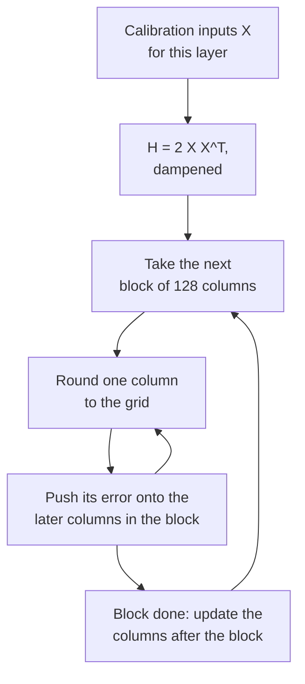

# पाठ 10. GPTQ

**मिशन से संबंध:** GPTQ पहला method है जो बड़े model के 3 और 4-bit weights को इस्तेमाल के लायक़ बनाता है, और जिस तरह वह यह करता है, यानी हर rounding error को आने वाले weights पर खर्च करके, वही विचार है जो आपको calibration data इस्तेमाल करने वाले किसी भी बाद के method को पढ़ने के लिए चाहिए।
**मुख्य स्रोत:** [पेपर: "GPTQ: Accurate Post-Training Quantization for Generative Pre-trained Transformers", Frantar et al., 2022](https://arxiv.org/abs/2210.17323), sections 3 और 4
**पूर्व-आवश्यकताएँ:** [पाठ 9](0009-round-to-nearest.md), [GPTQ](../GLOSSARY.md), [Calibration set](../GLOSSARY.md), [Granularity](../GLOSSARY.md)

## वार्म-अप

1. ▢ पाठ 9 ने दिखाया कि 2000 में से 919 random roundings layer के output पर round-to-nearest को हरा देती हैं। Round-to-nearest वह क्या अनदेखा करता है जिसका उन roundings ने फ़ायदा उठाया?

<details markdown="1"><summary>जाँचें</summary>

Weights के बीच के cross terms: output `W X` है, inputs features के पार correlated हैं, इसलिए अलग-अलग weights की rounding errors एक-दूसरे को काट या जोड़ सकती हैं। Nearest rounding हर weight की अपनी error को न्यूनतम करती है और जोड़ों को कभी नहीं देखती।

</details>

2. ▢ 4096 गुणा 4096 की weight matrix को पहले हर output row के एक scale के साथ, फिर हर row के साथ 128 के groups के साथ quantize किया जाता है। हर एक कितने scales store करता है?

<details markdown="1"><summary>जाँचें</summary>

Per-channel के लिए 4,096 (हर row का एक) और 128 के groups के लिए 4,096 × 4,096 / 128 = 131,072। Per-group 32 गुना ज़्यादा scales store करता है, जिसकी क़ीमत पाठ 6 ने bits per weight में आँकी थी।

</details>

## यह जानें

### Objective: layer का output मिलाएँ, उसके weights नहीं

GPTQ हर linear layer को अलग से देखता है। Calibration inputs का छोटा सेट लें, उन्हें model से गुज़ारें, और इस layer का input `X` इकट्ठा करें। लक्ष्य वे quantized weights `Ŵ` हैं जो layer के output को मूल के सबसे क़रीब रखें, जिसे पेपर में `argmin || W X - Ŵ X ||^2` लिखा गया है। यह पाठ 9 का output-error वाला नज़रिया है जिसे objective बना दिया गया है, और यह कभी नहीं पूछता कि कोई एक weight अच्छी तरह round हुआ या नहीं।

Squared error `W` की rows पर योग में बँट जाती है, हर output channel के लिए एक, इसलिए हर row एक स्वतंत्र समस्या है। एक row के लिए error weights में द्विघात है, और उसका दूसरा derivative `H = 2 X X^T` है, यानी **Hessian**। उसमें हर input feature के लिए एक row और एक column है, और वह layer की हर row के लिए एक ही है। उसका diagonal बताता है कि हर input feature कितनी ऊर्जा ढोता है। उसकी off-diagonal entries बताती हैं कि कौन-से features साथ-साथ बदलते हैं, जो ठीक वही जगह है जहाँ weight errors एक-दूसरे को काट सकती हैं।

### वंशावली: Optimal Brain Surgeon से GPTQ तक

यह विचार LLMs से पुराना है। Frantar और Alistarh के Optimal Brain Compression ने LeCun, Denker और Solla (1990) के क्लासिक Optimal Brain Surgeon ढाँचे को आधुनिक networks के पैमाने पर quantization तक बढ़ाया ([Frantar and Alistarh, 2022](https://arxiv.org/abs/2208.11580))। उसका quantizer, Optimal Brain Quantizer (OBQ), एक बार में एक row पर काम करता है, एक बार में एक weight quantize करता है, और हर एक के बाद अभी quantize न हुए सभी weights को अभी की गई error की भरपाई के लिए update करता है। GPTQ पेपर के अनुसार, वह अगला वह weight चुनता है जिसकी अतिरिक्त error की क़ीमत सबसे कम हो और बाक़ियों को इससे update करता है:

```text
chosen weight   q = argmin over q of (quant(w_q) - w_q)^2 / Hinv[q, q]
update of rest  delta = -(w_q - quant(w_q)) / Hinv[q, q] * Hinv[:, q]
```

यहाँ `Hinv` उन weights पर Hessian का inverse है जो अभी quantize नहीं हुए। Update को शब्दों में पढ़ें: जो weight अभी तय हुआ उसकी rounding error, इससे scale होकर कि हर बचा हुआ weight उससे कितना correlated है, बचे हुए weights पर धकेल दी जाती है, ताकि layer का output जितना हो सके कम हिले। Method सटीक है और बहुत धीमा। GPTQ update को रखता है और बदल देता है कि उसे कैसे compute किया जाता है।

### तीन बदलाव जो इसे scale करते हैं

1. **कोई भी तय क्रम लगभग उतना ही अच्छा है।** OBQ अगला weight लालची ढंग से चुनता है। GPTQ के लेखकों ने पाया कि यह किसी मनमाने क्रम को सिर्फ़ थोड़ा-सा हराता है, ख़ासकर बड़ी layers पर। इसलिए GPTQ हर row के columns को एक ही क्रम में, बाएँ से दाएँ, quantize करता है। क्योंकि `H` सिर्फ़ inputs पर निर्भर करता है, हर column के लिए एक inverse update तब सारी rows की एक साथ सेवा करता है, और लागत `O(d_row * d_col^3)` से घटकर `O(max(d_row * d_col^2, d_col^3))` हो जाती है, यानी छोटी dimension के गुणक की बचत।
2. **Lazy batch updates।** हर column के लिए पूरी matrix को update करना हर entry पर कुछ ही operations करता है और arithmetic से नहीं बल्कि memory bandwidth से सीमित होता है। किसी column की rounding सिर्फ़ उस column पर किए गए updates पर निर्भर करती है, इसलिए GPTQ एक बार में 128 columns प्रोसेस करता है, उनके updates block के भीतर रखता है, और block पूरा होने पर बाक़ी columns पर उसका असर लागू करता है।
3. **Cholesky।** Inverse को बार-बार update करने से संख्यात्मक error जमा होती है, और बड़े models पर matrix indefinite हो सकती है, जो updates को ग़लत दिशाओं में भेजती है। GPTQ `H` के diagonal में एक छोटा constant जोड़ता है, उसके औसत का 1%, और inverse की जो rows उसे चाहिए उन्हें Cholesky decomposition से पहले से compute कर लेता है।

एक layer के लिए loop:

```text
H = 2 X X^T, with 1% of its mean diagonal added; Hinv = Cholesky factor of H^-1
for each column i, left to right:
    q_i = quant(w_i)                          round the column to the grid
    e   = (w_i - q_i) / Hinv[i, i]
    w_j = w_j - e * Hinv[i, j]   for every later column j
```



### यह क्या पढ़ता है, और इसकी क्या लागत है

पेपर में calibration data C4 dataset के 128 random 2048-token segments हैं, यानी आम web text, इसलिए GPTQ कोई task data नहीं देखता। पेपर GPU पर एक बार में एक Transformer block सँभालता है: वह हर layer का `H` जमा करता है, quantize करता है, और फिर block के inputs को पहले से quantize हो चुके block से गुज़ारकर अगले को देता है, ताकि बाद की layers उन inputs के हिसाब से fit हों जो वे सचमुच देखेंगी। पेपर loop शुरू होने से पहले तय किया हुआ मानक per-row grid इस्तेमाल करता है; groups के साथ, हर group की grid तब चुनी जाती है जब loop उस तक पहुँचता है, तब के update हुए weights से।

OPT-175B पर abstract लगभग चार GPU घंटों में quantization बताता है, प्रति weight 3 या 4 bits पर नगण्य accuracy हानि के साथ, और Transformers का दस्तावेज़ A100 के लिए वही संख्या दोहराता है। OPT-175B की WikiText-2 perplexity, पेपर की Table 3 से: 16-bit 8.34, 4 bits पर GPTQ 8.37 जबकि round-to-nearest का 10.54, 3 bits पर GPTQ 8.68 जबकि 7,300। पेपर यह भी देखता है कि बड़े models आम तौर पर quantize करने में आसान हैं, OPT-66B एक अपवाद के साथ।

### Act-order

एक जोड़ पेपर में नहीं बल्कि लेखकों के code में है। `--act-order` option columns को activation के घटते आकार के क्रम में quantize करता है, जिसे code `H` के diagonal पर columns को सबसे बड़े पहले sort करके लागू करता है, ताकि जो columns सबसे बड़े inputs देखते हैं वे पहले round हों। Repository की README बताती है कि यह LLaMA 7B पर एक ख़राब नतीजा (7.15 से 6.09 WikiText-2 perplexity) और 3 bits पर outlier वाले OPT-66B model पर (14.16 से 9.95) ठीक कर देता है ([IST-DASLab/gptq](https://github.com/IST-DASLab/gptq))। README एक `--static-groups` option का भी वर्णन करती है, जो इसलिए जोड़ा गया कि act-order को inference में ऐसे बदलाव न चाहिए जो धीमापन ला सकें। llm-compressor act-order calibration को supported बताता है ([llm-compressor](https://github.com/vllm-project/llm-compressor))।

## अभ्यास

1. ▢ किसी layer में 4096 input features और 11008 output rows हैं, और उसे पेपर के 2048 tokens के 128 segments से calibrate किया गया है। `H` का आकार क्या है, कितनी rows के weights उसे साझा करते हैं, और कितने calibration tokens ने उसे बनाया?

<details markdown="1"><summary>जाँचें</summary>

`H` 4096 गुना 4096 है, हर input feature के लिए एक row और column। सभी 11008 rows उसे साझा करती हैं, क्योंकि वह सिर्फ़ inputs पर निर्भर करता है। वह 128 × 2048 = 262,144 tokens से बना था। न output rows की संख्या उसका आकार बदलती है, न tokens की।

</details>

2. ▢ पेपर की Table 3 से, 4 bits पर OPT-6.7B की WikiText-2 perplexity 16 bits पर 10.86 है, round-to-nearest के साथ 12.10 और GPTQ के साथ 11.39। OPT-175B के लिए संख्याएँ 8.34, 10.54 और 8.37 हैं। हर एक में GPTQ round-to-nearest की perplexity हानि का कितना हिस्सा वापस जीतता है, और यह आकार के बारे में क्या बताता है?

<details markdown="1"><summary>जाँचें</summary>

OPT-6.7B: (12.10 - 11.39) / (12.10 - 10.86) = 0.71 / 1.24, लगभग 57%। OPT-175B: (10.54 - 8.37) / (10.54 - 8.34) = 2.17 / 2.20, लगभग 99%। GPTQ यहाँ हर आकार पर मदद करता है और 175B पर फ़ासला लगभग बंद कर देता है, पेपर की इस टिप्पणी के अनुरूप कि बड़े models आम तौर पर quantize करने में आसान हैं।

</details>

3. ▢ GPTQ हर row के columns को एक ही क्रम में round करके हर column के लिए एक साझा inverse update क्यों कर सकता है?

    - a) Row का क्रम rounding के लिए कभी मायने नहीं रखता, इसलिए updates छोड़े जा सकते हैं
    - b) Inverse Hessian सिर्फ़ inputs पर निर्भर करता है, इसलिए rows उसे साझा करती हैं
    - c) व्यवहार में Hessian diagonal होता है, इसलिए errors अपनी जगह रहती हैं
    - d) Cholesky factors सस्ते हैं, इसलिए हर row को अपना Hessian मिलता है

<details markdown="1"><summary>जाँचें</summary>

**b)** `H = 2 X X^T` layer inputs से बनता है और `W` की हर row के लिए एक जैसा है, इसलिए उसके inverse को हर column के लिए एक बार update करना सारी rows की सेवा करता है, जो runtime में छोटी dimension के गुणक वाली बचत है। (a) ग़लत है क्योंकि updates ही method हैं। (c) ग़लत है क्योंकि off-diagonal entries ही एक weight को दूसरे की error सोखने देती हैं। (d) ग़लत है क्योंकि हर layer के लिए एक ही Hessian है, हर row के लिए एक नहीं।

</details>

4. ▢ पहले अनुमान लगाएँ, फिर चलाएँ। हर row के एक तय scale वाली 3-bit grid, ऐसे inputs जिनके features correlated हैं, और block batching के बिना एक संक्षिप्त GPTQ loop। अनुमान लगाएँ कि क्या GPTQ की सापेक्ष output error round-to-nearest से कम आती है, और लगभग कितनी।

    ```python
    import numpy as np

    rng = np.random.default_rng(0)
    rows, cols, n = 64, 128, 1024
    correlated = True
    mix = rng.standard_normal((cols, cols)) / np.sqrt(cols)
    if correlated:
        X = mix @ rng.standard_normal((cols, n)) + 0.8 * rng.standard_normal((1, n))
    else:
        X = rng.standard_normal((cols, n))
    W = rng.standard_normal((rows, cols))
    qmax = 3
    scale = np.abs(W).max(axis=1) / qmax

    def quant(w, s):
        return np.clip(np.round(w / s), -qmax, qmax) * s

    def gptq(W, X):
        W = W.copy()
        H = 2 * X @ X.T
        H += 0.01 * np.mean(np.diag(H)) * np.eye(H.shape[0])
        U = np.linalg.cholesky(np.linalg.inv(H)).T
        Q = np.zeros_like(W)
        for i in range(W.shape[1]):
            Q[:, i] = quant(W[:, i], scale)
            err = (W[:, i] - Q[:, i]) / U[i, i]
            W[:, i + 1:] -= np.outer(err, U[i, i + 1:])
        return Q

    def out_err(Q):
        return np.linalg.norm(W @ X - Q @ X) / np.linalg.norm(W @ X)

    print(f"RTN : relative output error {out_err(quant(W, scale[:, None])):.4f}")
    print(f"GPTQ: relative output error {out_err(gptq(W, X)):.4f}")
    ```

<details markdown="1"><summary>संकेत</summary>

दोनों एक ही grid इस्तेमाल करते हैं, इसलिए GPTQ किसी एक weight की rounding बेहतर नहीं कर सकता। पूछें कि उसकी error और कहाँ जा सकती है।

</details>

<details markdown="1"><summary>जाँचें</summary>

```text
RTN : relative output error 0.2679
GPTQ: relative output error 0.1596
```

GPTQ उसी grid पर output error को लगभग 40% घटा देता है। अलग-अलग weights बेहतर round नहीं होते, और कई तो बदतर round होते हैं, पर हर column की error बाद के columns पर धकेल दी गई है, जो उससे correlated हैं, इसलिए layer का output क़रीब आ जाता है।

</details>

5. ▢ पहले अनुमान लगाएँ, फिर चलाएँ। ऊपर के snippet में `correlated = False` कर दें, ताकि inputs बराबर variance वाले स्वतंत्र features हों। अनुमान लगाएँ कि GPTQ के फ़ायदे का क्या होता है।

<details markdown="1"><summary>संकेत</summary>

देखें कि जब features साथ-साथ नहीं बदलते तो `H` कैसा दिखता है, और off-diagonal entries क्या दे रही थीं।

</details>

<details markdown="1"><summary>जाँचें</summary>

```text
RTN : relative output error 0.2680
GPTQ: relative output error 0.2595
```

फ़ायदा लगभग ग़ायब हो जाता है। स्वतंत्र inputs के साथ `H` diagonal के क़रीब है, इसलिए error को आगे धकेलने के लिए बहुत कम correlation है, और हर weight को अकेले round करना उसके क़रीब है जो layer कर सकती है। GPTQ का फ़ायदा `X` की बनावट से आता है, इसीलिए असली activations, जो मज़बूती से correlated हैं, उससे लाभ पाती हैं।

</details>

6. ▢ कोई समीक्षक लिखता है: "GPTQ हर weight के लिए बेहतर scale चुनकर round-to-nearest से बेहतर है।" उस वाक्य में क्या ग़लत है?

<details markdown="1"><summary>जाँचें</summary>

पेपर मानता है कि quantization grid प्रक्रिया शुरू होने से पहले तय है, इसलिए GPTQ बेहतर scales नहीं चुनता। वह अभी quantize न हुए weights की values बदलता है, ताकि जब वे उसी grid पर round हों तो layer की output error छोटी हो। Groups के साथ, हर group का scale तब compute होता है जब loop उस तक पहुँचता है, update हुए weights से।

</details>

## असली दुनिया का अभ्यास

- [ ] पेपर की Table 3 और Table 5 खोलें। अपनी पसंद के दो OPT आकारों के लिए, गिनें कि 3 bits पर GPTQ round-to-nearest की perplexity हानि का कितना हिस्सा वापस पाता है, और ध्यान दें कि 3-bit round-to-nearest का ढहना किस आकार पर सबसे ज़्यादा चोट करता है।
- [ ] अभ्यास 4 का snippet `n = 64` के साथ चलाएँ, यानी 128 input features से कम samples, और चलाने से पहले अनुमान लगाएँ कि क्या GPTQ फिर भी round-to-nearest को हराता है। निष्पक्ष होने के लिए नए samples पर evaluate करें, और नतीजा पाठ 12 के लिए रख लें।
- [ ] कल: बिना नोट्स के एक layer के लिए GPTQ loop पाँच lines में लिखें, और वे तीन बदलाव बताएँ जो OBQ के विचार को छोटे networks से 175B parameters तक ले गए।

## आगे बढ़ने के लिए

- [Weight PTQ Methods शीट](../reference/weight-ptq-methods.md)
- [पेपर: "Optimal Brain Compression", Frantar and Alistarh, 2022](https://arxiv.org/abs/2208.11580), उस सटीक method के लिए जिसका GPTQ सन्निकटन है
- [दस्तावेज़: "GPTQ", Hugging Face Transformers](https://huggingface.co/docs/transformers/main/en/quantization/gptq), उसे `GPTQConfig` से चलाने के लिए
- [Repo: IST-DASLab/gptq](https://github.com/IST-DASLab/gptq), code में act-order के लिए
- [Inference: Serve Time पर Quantization](../../inference/reference/quantization-at-serve-time.md), यह देखने के लिए कि GPTQ checkpoint कैसे serve होता है
- [संसाधन](../RESOURCES.md)

---

बात नहीं बन रही? ऊपर दिए मुख्य स्रोत को दोबारा पढ़ें, क्योंकि यह पाठ उसे संक्षिप्त करता है और समझ संक्षेप में ही रिसती है। जो शब्द फिसलन भरा लगे, उसके लिए [शब्दावली](../GLOSSARY.md) देखें।

अगर दिक़्क़त सामग्री की नहीं बल्कि पाठ की ही है, तो वह एक खोट है: [issue खोलें](https://github.com/TokenCemetery/teach/issues)।
