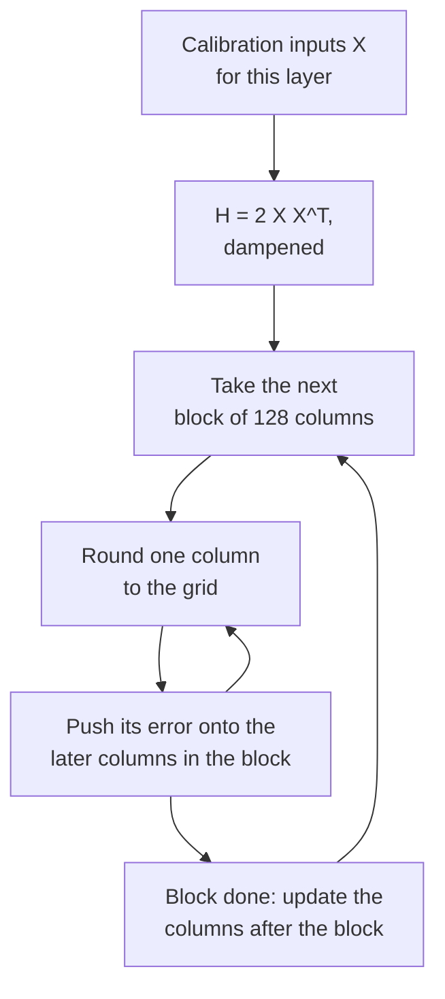

# Lesson 10. GPTQ

**Mission link:** GPTQ is the first method that makes 3 and 4-bit weights of a large model usable, and the way it does it, by spending each rounding error on the weights still to come, is the idea you need to read any later method that uses calibration data.
**Primary source:** [Paper: "GPTQ: Accurate Post-Training Quantization for Generative Pre-trained Transformers", Frantar et al., 2022](https://arxiv.org/abs/2210.17323), sections 3 and 4
**Prerequisites:** [Lesson 9](0009-round-to-nearest.md), [GPTQ](../GLOSSARY.md), [Calibration set](../GLOSSARY.md), [Granularity](../GLOSSARY.md)

## Warm-up

1. ▢ Lesson 9 showed that 919 of 2000 random roundings beat round-to-nearest on a layer's output. What does round-to-nearest ignore that those roundings exploited?

<details markdown="1"><summary>Check</summary>

The cross terms between weights: the output is `W X`, inputs are correlated across features, so rounding errors in different weights can cancel or add. Nearest rounding minimises each weight's own error and never looks at the pairs.

</details>

2. ▢ A 4096 by 4096 weight matrix is quantized with one scale per output row, and then with groups of 128 along each row. How many scales does each store?

<details markdown="1"><summary>Check</summary>

4,096 for per-channel (one per row) and 4,096 × 4,096 / 128 = 131,072 for groups of 128. Per-group stores 32 times as many scales, which is what lesson 6 priced in bits per weight.

</details>

## Know this

### The objective: match the layer's output, not its weights

GPTQ treats each linear layer on its own. Take a small set of calibration inputs, run them through the model, and collect the input `X` to this layer. The goal is the quantized weights `Ŵ` that keep the layer's output closest to the original, written in the paper as `argmin || W X - Ŵ X ||^2`. This is the output-error view from lesson 9 made into an objective, and it never asks whether any single weight was rounded well.

The squared error splits into a sum over the rows of `W`, one per output channel, so each row is an independent problem. For one row the error is quadratic in the weights, and its second derivative is `H = 2 X X^T`, the **Hessian**. It has one row and one column per input feature, and it is the same for every row of the layer. Its diagonal says how much energy each input feature carries. Its off-diagonal entries say which features move together, which is exactly where weight errors can cancel.

### The lineage: from Optimal Brain Surgeon to GPTQ

The idea is older than LLMs. Frantar and Alistarh's Optimal Brain Compression extended the classical Optimal Brain Surgeon framework of LeCun, Denker and Solla (1990) to cover quantization at the scale of modern networks ([Frantar and Alistarh, 2022](https://arxiv.org/abs/2208.11580)). Its quantizer, the Optimal Brain Quantizer (OBQ), works on one row at a time, quantizes one weight at a time, and after each one updates all the not-yet-quantized weights to compensate for the error just made. Per the GPTQ paper, it picks the weight that costs the least extra error next and updates the others with:

```text
chosen weight   q = argmin over q of (quant(w_q) - w_q)^2 / Hinv[q, q]
update of rest  delta = -(w_q - quant(w_q)) / Hinv[q, q] * Hinv[:, q]
```

Here `Hinv` is the inverse of the Hessian over the weights still unquantized. Read the update in words: the rounding error of the weight just fixed, scaled by how correlated each remaining weight is with it, is pushed onto the remaining weights, so the layer's output moves as little as possible. The method is exact and very slow. GPTQ keeps the update and changes how it is computed.

### Three changes that make it scale

1. **Any fixed order is nearly as good.** OBQ chooses the next weight greedily. The GPTQ authors found that this beats an arbitrary order only slightly, especially on large layers. So GPTQ quantizes every row's columns in the same order, left to right. Because `H` depends only on the inputs, one inverse update per column then serves all rows at once, and the cost falls from `O(d_row * d_col^3)` to `O(max(d_row * d_col^2, d_col^3))`, a saving of a factor of the smaller dimension.
2. **Lazy batch updates.** Updating a whole matrix for each column does a few operations per entry and is limited by memory bandwidth, not arithmetic. A column's rounding depends only on updates made to that column, so GPTQ processes 128 columns at a time, keeps their updates inside the block, and applies the effect to the remaining columns once the block is done.
3. **Cholesky.** Repeatedly updating the inverse accumulates numerical error, and on big models the matrix can become indefinite, which sends the updates in wrong directions. GPTQ adds a small constant to the diagonal of `H`, 1% of its average, and precomputes the rows of the inverse it needs from a Cholesky decomposition.

The loop, for one layer:

```text
H = 2 X X^T, with 1% of its mean diagonal added; Hinv = Cholesky factor of H^-1
for each column i, left to right:
    q_i = quant(w_i)                          round the column to the grid
    e   = (w_i - q_i) / Hinv[i, i]
    w_j = w_j - e * Hinv[i, j]   for every later column j
```



### What it reads, and what it costs

The calibration data in the paper is 128 random 2048-token segments from the C4 dataset, generic web text, so GPTQ sees no task data. The paper handles one Transformer block at a time on the GPU: it accumulates each layer's `H`, quantizes, and then sends the block's inputs through the already quantized block to feed the next one, so later layers are fitted to the inputs they will really see. The paper uses a standard per-row grid fixed before the loop starts; with groups, each group's grid is chosen when the loop reaches it, from the then-updated weights.

On OPT-175B the abstract reports quantization in approximately four GPU hours, at 3 or 4 bits per weight with negligible accuracy loss, and the Transformers documentation repeats that figure for an A100. WikiText-2 perplexity for OPT-175B, from the paper's Table 3: 16-bit 8.34, GPTQ at 4 bits 8.37 against 10.54 for round-to-nearest, GPTQ at 3 bits 8.68 against 7,300. The paper also observes that larger models are generally easier to quantize, with OPT-66B an exception.

### Act-order

One addition is not in the paper but in the authors' code. The `--act-order` option quantizes columns in order of decreasing activation size, which the code implements by sorting the columns by the diagonal of `H`, largest first, so the columns that see the largest inputs are rounded first. The repository's README reports that it fixes a bad result on LLaMA 7B (7.15 to 6.09 WikiText-2 perplexity) and on the OPT-66B outlier model at 3 bits (14.16 to 9.95) ([IST-DASLab/gptq](https://github.com/IST-DASLab/gptq)). The README also describes a `--static-groups` option, added so that act-order needs no inference changes that may cause a slowdown. llm-compressor lists act-order calibration as supported ([llm-compressor](https://github.com/vllm-project/llm-compressor)).

## Practice

1. ▢ A layer has 4096 input features and 11008 output rows, and is calibrated with the paper's 128 segments of 2048 tokens. What shape is `H`, how many rows of weights share it, and how many calibration tokens built it?

<details markdown="1"><summary>Check</summary>

`H` is 4096 by 4096, one row and column per input feature. All 11008 rows share it, because it depends only on the inputs. It was built from 128 × 2048 = 262,144 tokens. Neither the number of output rows nor the number of tokens changes its shape.

</details>

2. ▢ From the paper's Table 3, OPT-6.7B at 4 bits has WikiText-2 perplexity 10.86 at 16 bits, 12.10 with round-to-nearest and 11.39 with GPTQ. For OPT-175B the figures are 8.34, 10.54 and 8.37. What share of round-to-nearest's perplexity loss does GPTQ win back in each, and what does that say about size?

<details markdown="1"><summary>Check</summary>

OPT-6.7B: (12.10 - 11.39) / (12.10 - 10.86) = 0.71 / 1.24, about 57%. OPT-175B: (10.54 - 8.37) / (10.54 - 8.34) = 2.17 / 2.20, about 99%. GPTQ helps at every size here and nearly closes the gap at 175B, in line with the paper's remark that larger models are generally easier to quantize.

</details>

3. ▢ Why can GPTQ round the columns of every row in the same order and share one inverse update per column?

    - a) Row order never matters to rounding, so updates can be skipped
    - b) The inverse Hessian depends on inputs only, so rows share it
    - c) The Hessian is diagonal in practice, so errors stay in place
    - d) Cholesky factors are cheap, so every row gets its own Hessian

<details markdown="1"><summary>Check</summary>

**b)** `H = 2 X X^T` is built from the layer inputs and is identical for every row of `W`, so updating its inverse once per column serves all rows, which is the factor-of-the-smaller-dimension saving in runtime. (a) is wrong because the updates are the method. (c) is wrong because the off-diagonal entries are what let one weight absorb another's error. (d) is wrong because there is only one Hessian per layer, not one per row.

</details>

4. ▢ Predict, then run. A 3-bit grid with one fixed scale per row, inputs whose features are correlated, and a compact GPTQ loop without the block batching. Predict whether GPTQ's relative output error comes out lower than round-to-nearest's, and by roughly how much.

    ```python
    import numpy as np

    rng = np.random.default_rng(0)
    rows, cols, n = 64, 128, 1024
    correlated = True
    mix = rng.standard_normal((cols, cols)) / np.sqrt(cols)
    if correlated:
        X = mix @ rng.standard_normal((cols, n)) + 0.8 * rng.standard_normal((1, n))
    else:
        X = rng.standard_normal((cols, n))
    W = rng.standard_normal((rows, cols))
    qmax = 3
    scale = np.abs(W).max(axis=1) / qmax

    def quant(w, s):
        return np.clip(np.round(w / s), -qmax, qmax) * s

    def gptq(W, X):
        W = W.copy()
        H = 2 * X @ X.T
        H += 0.01 * np.mean(np.diag(H)) * np.eye(H.shape[0])
        U = np.linalg.cholesky(np.linalg.inv(H)).T
        Q = np.zeros_like(W)
        for i in range(W.shape[1]):
            Q[:, i] = quant(W[:, i], scale)
            err = (W[:, i] - Q[:, i]) / U[i, i]
            W[:, i + 1:] -= np.outer(err, U[i, i + 1:])
        return Q

    def out_err(Q):
        return np.linalg.norm(W @ X - Q @ X) / np.linalg.norm(W @ X)

    print(f"RTN : relative output error {out_err(quant(W, scale[:, None])):.4f}")
    print(f"GPTQ: relative output error {out_err(gptq(W, X)):.4f}")
    ```

<details markdown="1"><summary>Hint</summary>

Both use the same grid, so GPTQ cannot make any single weight's rounding better. Ask where else its error could go.

</details>

<details markdown="1"><summary>Check</summary>

```text
RTN : relative output error 0.2679
GPTQ: relative output error 0.1596
```

GPTQ cuts the output error by about 40% on the same grid. Individual weights are rounded no better, and many are rounded worse, but each column's error has been pushed onto the later columns, which are correlated with it, so the layer's output ends up closer.

</details>

5. ▢ Predict, then run. Set `correlated = False` in the snippet above, so the inputs are independent features of equal variance. Predict what happens to GPTQ's advantage.

<details markdown="1"><summary>Hint</summary>

Look at what `H` looks like when features do not move together, and what the off-diagonal entries were providing.

</details>

<details markdown="1"><summary>Check</summary>

```text
RTN : relative output error 0.2680
GPTQ: relative output error 0.2595
```

The advantage almost disappears. With independent inputs `H` is close to diagonal, so there is little correlation to push error along, and rounding each weight alone is close to what the layer can do. GPTQ's gain comes from the structure in `X`, which is why real activations, which are strongly correlated, benefit.

</details>

6. ▢ A reviewer writes: "GPTQ improves on round-to-nearest by choosing a better scale for each weight." What is wrong with that sentence?

<details markdown="1"><summary>Check</summary>

The paper assumes the quantization grid is fixed before the process starts, so GPTQ does not choose better scales. It changes the values of the weights not yet quantized, so that when they are rounded onto the same grid the layer's output error is smaller. With groups, the scale of each group is computed when the loop reaches it, from the updated weights.

</details>

## Real-world reps

- [ ] Open the paper's Table 3 and Table 5. For two OPT sizes of your choice, compute the share of round-to-nearest's perplexity loss that GPTQ recovers at 3 bits, and note which size the 3-bit round-to-nearest collapse hits hardest.
- [ ] Run the snippet in practice item 4 with `n = 64`, fewer samples than the 128 input features, and predict before running whether GPTQ still beats round-to-nearest. Evaluate on fresh samples to be fair, and keep the result for lesson 12.
- [ ] Tomorrow: without notes, write the GPTQ loop for one layer in five lines, and name the three changes that took OBQ's idea from small networks to 175B parameters.

## Going further

- [Weight PTQ Methods](../reference/weight-ptq-methods.md)
- [Paper: "Optimal Brain Compression", Frantar and Alistarh, 2022](https://arxiv.org/abs/2208.11580), for the exact method GPTQ approximates
- [Docs: "GPTQ", Hugging Face Transformers](https://huggingface.co/docs/transformers/main/en/quantization/gptq), for running it through `GPTQConfig`
- [Repo: IST-DASLab/gptq](https://github.com/IST-DASLab/gptq), for act-order in code
- [Inference: Quantization at Serve Time](../../inference/reference/quantization-at-serve-time.md), for how a GPTQ checkpoint is served
- [Resources](../RESOURCES.md)

---

Not landing? Reread the primary source at the top, since this lesson compresses it and compression is where understanding leaks. Check the [glossary](../GLOSSARY.md) for any term that felt slippery.

If the lesson itself is unclear rather than the material, that is a defect: [open an issue](https://github.com/TokenCemetery/teach/issues).
