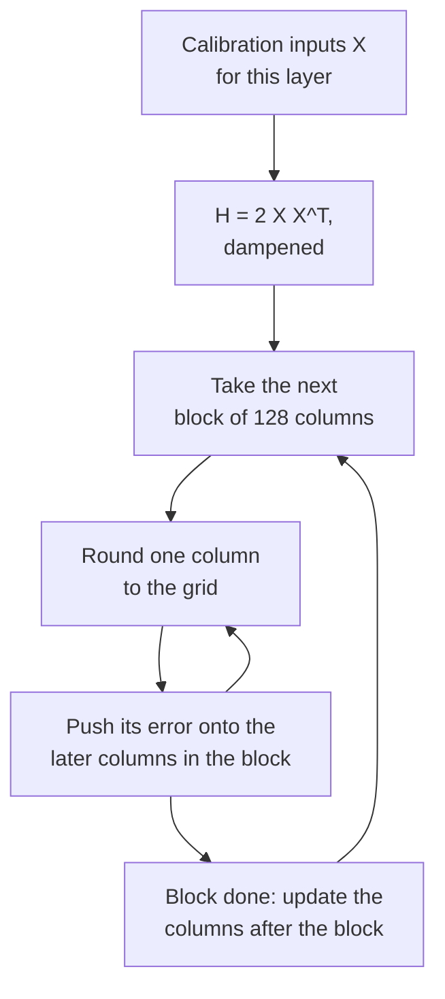

# Lição 10. GPTQ

**Ligação com a missão:** O GPTQ é o primeiro método que torna utilizáveis pesos de 3 e 4 bits de um modelo grande, e a forma como ele faz isso, gastando cada erro de arredondamento nos pesos que ainda virão, é a ideia de que você precisa para ler qualquer método posterior que use dados de calibração.
**Fonte principal:** [Artigo científico: "GPTQ: Accurate Post-Training Quantization for Generative Pre-trained Transformers", Frantar et al., 2022](https://arxiv.org/abs/2210.17323), seções 3 e 4
**Pré-requisitos:** [Lição 9](0009-round-to-nearest.md), [GPTQ](../GLOSSARY.md), [Calibration set](../GLOSSARY.md), [Granularidade](../GLOSSARY.md)

## Aquecimento

1. ▢ A lição 9 mostrou que 919 de 2000 arredondamentos aleatórios superam o round-to-nearest na saída de uma camada. O que o round-to-nearest ignora que esses arredondamentos exploraram?

<details markdown="1"><summary>Verificação</summary>

Os termos cruzados entre os pesos: a saída é `W X`, as entradas são correlacionadas entre as features, então erros de arredondamento em pesos diferentes podem se cancelar ou se somar. O arredondamento para o mais próximo minimiza o erro de cada peso e nunca olha para os pares.

</details>

2. ▢ Uma matriz de pesos de 4096 por 4096 é quantizada com uma scale por linha de saída e depois com grupos de 128 ao longo de cada linha. Quantas scales cada uma armazena?

<details markdown="1"><summary>Verificação</summary>

4.096 para per-channel (uma por linha) e 4.096 × 4.096 / 128 = 131.072 para grupos de 128. O per-group armazena 32 vezes mais scales, que é o que a lição 6 precificou em bits por peso.

</details>

## Saiba isto

### O objetivo: igualar a saída da camada, não os seus pesos

O GPTQ trata cada camada linear por conta própria. Tome um pequeno conjunto de entradas de calibração, passe-o pelo modelo e colete a entrada `X` desta camada. O objetivo são os pesos quantizados `Ŵ` que mantêm a saída da camada o mais próxima possível da original, escrito no artigo como `argmin || W X - Ŵ X ||^2`. Essa é a visão do erro de saída da lição 9 transformada em objetivo, e ela nunca pergunta se algum peso isolado foi bem arredondado.

O erro quadrático se divide em uma soma sobre as linhas de `W`, uma por canal de saída, então cada linha é um problema independente. Para uma linha, o erro é quadrático nos pesos, e a sua derivada segunda é `H = 2 X X^T`, a **Hessiana**. Ela tem uma linha e uma coluna por feature de entrada, e é a mesma para toda linha da camada. A sua diagonal diz quanta energia cada feature de entrada carrega. As suas entradas fora da diagonal dizem quais features se movem juntas, que é exatamente onde os erros dos pesos podem se cancelar.

### A linhagem: do Optimal Brain Surgeon ao GPTQ

A ideia é mais antiga que os LLMs. O Optimal Brain Compression de Frantar e Alistarh estendeu o framework clássico do Optimal Brain Surgeon de LeCun, Denker e Solla (1990) para cobrir a quantização na escala das redes modernas ([Frantar e Alistarh, 2022](https://arxiv.org/abs/2208.11580)). O seu quantizador, o Optimal Brain Quantizer (OBQ), trabalha em uma linha por vez, quantiza um peso por vez e, depois de cada um, atualiza todos os pesos ainda não quantizados para compensar o erro que acabou de cometer. Segundo o artigo do GPTQ, ele escolhe a seguir o peso que custa menos erro extra e atualiza os outros com:

```text
chosen weight   q = argmin over q of (quant(w_q) - w_q)^2 / Hinv[q, q]
update of rest  delta = -(w_q - quant(w_q)) / Hinv[q, q] * Hinv[:, q]
```

Aqui `Hinv` é a inversa da Hessiana sobre os pesos ainda não quantizados. Leia a atualização em palavras: o erro de arredondamento do peso que acabou de ser fixado, escalado pelo quanto cada peso restante é correlacionado com ele, é empurrado para os pesos restantes, de modo que a saída da camada se mova o mínimo possível. O método é exato e muito lento. O GPTQ mantém a atualização e muda a forma como ela é calculada.

### Três mudanças que o fazem escalar

1. **Qualquer ordem fixa é quase tão boa.** O OBQ escolhe o próximo peso de forma gulosa. Os autores do GPTQ descobriram que isso supera uma ordem arbitrária apenas ligeiramente, especialmente em camadas grandes. Então o GPTQ quantiza as colunas de toda linha na mesma ordem, da esquerda para a direita. Como `H` depende apenas das entradas, uma atualização da inversa por coluna serve a todas as linhas de uma vez, e o custo cai de `O(d_row * d_col^3)` para `O(max(d_row * d_col^2, d_col^3))`, uma economia de um fator igual à menor dimensão.
2. **Atualizações lazy em batch.** Atualizar uma matriz inteira a cada coluna faz poucas operações por entrada e é limitado pela largura de banda de memória, não pela aritmética. O arredondamento de uma coluna depende apenas das atualizações feitas nessa coluna, então o GPTQ processa 128 colunas por vez, mantém as atualizações delas dentro do bloco e aplica o efeito nas colunas restantes quando o bloco termina.
3. **Cholesky.** Atualizar repetidamente a inversa acumula erro numérico, e em modelos grandes a matriz pode se tornar indefinida, o que manda as atualizações em direções erradas. O GPTQ soma uma pequena constante à diagonal de `H`, 1% da sua média, e pré-calcula as linhas da inversa de que precisa a partir de uma decomposição de Cholesky.

O loop, para uma camada:

```text
H = 2 X X^T, with 1% of its mean diagonal added; Hinv = Cholesky factor of H^-1
for each column i, left to right:
    q_i = quant(w_i)                          round the column to the grid
    e   = (w_i - q_i) / Hinv[i, i]
    w_j = w_j - e * Hinv[i, j]   for every later column j
```



### O que ele lê e o que custa

Os dados de calibração no artigo são 128 segmentos aleatórios de 2048 tokens do dataset C4, texto genérico da web, então o GPTQ não vê dados de tarefa. O artigo trata um bloco do Transformer por vez na GPU: ele acumula o `H` de cada camada, quantiza e depois envia as entradas do bloco pelo bloco já quantizado para alimentar o próximo, de modo que as camadas posteriores sejam ajustadas às entradas que realmente verão. O artigo usa uma grade padrão por linha fixada antes de o loop começar; com grupos, a grade de cada grupo é escolhida quando o loop chega a ele, a partir dos pesos então atualizados.

No OPT-175B, o resumo do artigo relata quantização em aproximadamente quatro horas de GPU, em 3 ou 4 bits por peso com perda de acurácia desprezível, e a documentação do Transformers repete esse número para uma A100. Perplexity no WikiText-2 para o OPT-175B, da Tabela 3 do artigo: 16 bits 8.34, GPTQ em 4 bits 8.37 contra 10.54 do round-to-nearest, GPTQ em 3 bits 8.68 contra 7.300. O artigo também observa que modelos maiores são geralmente mais fáceis de quantizar, com o OPT-66B como exceção.

### Act-order

Uma adição não está no artigo, mas no código dos autores. A opção `--act-order` quantiza as colunas em ordem decrescente de tamanho da ativação, o que o código implementa ordenando as colunas pela diagonal de `H`, a maior primeiro, de modo que as colunas que veem as maiores entradas sejam arredondadas primeiro. O README do repositório relata que isso corrige um mau resultado no LLaMA 7B (de 7.15 para 6.09 de perplexity no WikiText-2) e no modelo outlier OPT-66B em 3 bits (de 14.16 para 9.95) ([IST-DASLab/gptq](https://github.com/IST-DASLab/gptq)). O README também descreve uma opção `--static-groups`, acrescentada para que o act-order não precise de mudanças na inferência que possam causar lentidão. O llm-compressor lista a calibração com act-order como suportada ([llm-compressor](https://github.com/vllm-project/llm-compressor)).

## Prática

1. ▢ Uma camada tem 4096 features de entrada e 11008 linhas de saída, e é calibrada com os 128 segmentos de 2048 tokens do artigo. Qual é o shape de `H`, quantas linhas de pesos o compartilham e quantos tokens de calibração o construíram?

<details markdown="1"><summary>Verificação</summary>

`H` é 4096 por 4096, uma linha e uma coluna por feature de entrada. Todas as 11008 linhas o compartilham, porque ele depende apenas das entradas. Ele foi construído a partir de 128 × 2048 = 262.144 tokens. Nem o número de linhas de saída nem o de tokens muda o seu shape.

</details>

2. ▢ Da Tabela 3 do artigo, o OPT-6.7B em 4 bits tem perplexity no WikiText-2 de 10.86 em 16 bits, 12.10 com round-to-nearest e 11.39 com GPTQ. Para o OPT-175B os números são 8.34, 10.54 e 8.37. Que fração da perda de perplexity do round-to-nearest o GPTQ recupera em cada um, e o que isso diz sobre o tamanho?

<details markdown="1"><summary>Verificação</summary>

OPT-6.7B: (12.10 - 11.39) / (12.10 - 10.86) = 0.71 / 1.24, cerca de 57%. OPT-175B: (10.54 - 8.37) / (10.54 - 8.34) = 2.17 / 2.20, cerca de 99%. O GPTQ ajuda em todo tamanho aqui e quase fecha a diferença em 175B, de acordo com a observação do artigo de que modelos maiores são geralmente mais fáceis de quantizar.

</details>

3. ▢ Por que o GPTQ pode arredondar as colunas de toda linha na mesma ordem e compartilhar uma única atualização da inversa por coluna?

    - a) A ordem das linhas nunca importa para o arredondamento, então as atualizações podem ser puladas
    - b) A Hessiana inversa depende apenas das entradas, então as linhas a compartilham
    - c) A Hessiana é diagonal na prática, então os erros ficam no lugar
    - d) Fatores de Cholesky são baratos, então cada linha recebe a sua própria Hessiana

<details markdown="1"><summary>Verificação</summary>

**b)** `H = 2 X X^T` é construída a partir das entradas da camada e é idêntica para toda linha de `W`, então atualizar a sua inversa uma vez por coluna serve a todas as linhas, que é a economia de um fator igual à menor dimensão no tempo de execução. (a) está errada porque as atualizações são o método. (c) está errada porque as entradas fora da diagonal é que permitem a um peso absorver o erro de outro. (d) está errada porque há uma só Hessiana por camada, não uma por linha.

</details>

4. ▢ Preveja e depois execute. Uma grade de 3 bits com uma scale fixa por linha, entradas cujas features são correlacionadas e um loop compacto de GPTQ sem o batching por blocos. Preveja se o erro relativo de saída do GPTQ sai menor que o do round-to-nearest e em quanto, aproximadamente.

    ```python
    import numpy as np

    rng = np.random.default_rng(0)
    rows, cols, n = 64, 128, 1024
    correlated = True
    mix = rng.standard_normal((cols, cols)) / np.sqrt(cols)
    if correlated:
        X = mix @ rng.standard_normal((cols, n)) + 0.8 * rng.standard_normal((1, n))
    else:
        X = rng.standard_normal((cols, n))
    W = rng.standard_normal((rows, cols))
    qmax = 3
    scale = np.abs(W).max(axis=1) / qmax

    def quant(w, s):
        return np.clip(np.round(w / s), -qmax, qmax) * s

    def gptq(W, X):
        W = W.copy()
        H = 2 * X @ X.T
        H += 0.01 * np.mean(np.diag(H)) * np.eye(H.shape[0])
        U = np.linalg.cholesky(np.linalg.inv(H)).T
        Q = np.zeros_like(W)
        for i in range(W.shape[1]):
            Q[:, i] = quant(W[:, i], scale)
            err = (W[:, i] - Q[:, i]) / U[i, i]
            W[:, i + 1:] -= np.outer(err, U[i, i + 1:])
        return Q

    def out_err(Q):
        return np.linalg.norm(W @ X - Q @ X) / np.linalg.norm(W @ X)

    print(f"RTN : relative output error {out_err(quant(W, scale[:, None])):.4f}")
    print(f"GPTQ: relative output error {out_err(gptq(W, X)):.4f}")
    ```

<details markdown="1"><summary>Dica</summary>

Ambos usam a mesma grade, então o GPTQ não consegue melhorar o arredondamento de nenhum peso isolado. Pergunte para onde mais o seu erro poderia ir.

</details>

<details markdown="1"><summary>Verificação</summary>

```text
RTN : relative output error 0.2679
GPTQ: relative output error 0.1596
```

O GPTQ reduz o erro de saída em cerca de 40% na mesma grade. Os pesos individuais não são arredondados melhor, e muitos são arredondados pior, mas o erro de cada coluna foi empurrado para as colunas posteriores, que são correlacionadas com ela, então a saída da camada acaba mais próxima.

</details>

5. ▢ Preveja e depois execute. Defina `correlated = False` no trecho acima, de modo que as entradas sejam features independentes de mesma variância. Preveja o que acontece com a vantagem do GPTQ.

<details markdown="1"><summary>Dica</summary>

Olhe como `H` fica quando as features não se movem juntas e o que as entradas fora da diagonal estavam fornecendo.

</details>

<details markdown="1"><summary>Verificação</summary>

```text
RTN : relative output error 0.2680
GPTQ: relative output error 0.2595
```

A vantagem quase desaparece. Com entradas independentes, `H` fica perto de diagonal, então há pouca correlação por onde empurrar o erro, e arredondar cada peso isoladamente é perto do que a camada consegue fazer. O ganho do GPTQ vem da estrutura em `X`, e é por isso que ativações reais, que são fortemente correlacionadas, se beneficiam.

</details>

6. ▢ Um revisor escreve: "O GPTQ melhora o round-to-nearest escolhendo uma scale melhor para cada peso." O que há de errado nessa frase?

<details markdown="1"><summary>Verificação</summary>

O artigo pressupõe que a grade de quantização é fixada antes de o processo começar, então o GPTQ não escolhe scales melhores. Ele muda os valores dos pesos ainda não quantizados, de modo que, quando eles são arredondados na mesma grade, o erro de saída da camada seja menor. Com grupos, a scale de cada grupo é calculada quando o loop chega a ele, a partir dos pesos atualizados.

</details>

## Prática no mundo real

- [ ] Abra a Tabela 3 e a Tabela 5 do artigo. Para dois tamanhos de OPT à sua escolha, calcule a fração da perda de perplexity do round-to-nearest que o GPTQ recupera em 3 bits e anote qual tamanho o colapso do round-to-nearest de 3 bits atinge com mais força.
- [ ] Execute o trecho do item 4 da prática com `n = 64`, menos amostras que as 128 features de entrada, e preveja antes de executar se o GPTQ ainda supera o round-to-nearest. Avalie em amostras novas para ser justo e guarde o resultado para a lição 12.
- [ ] Amanhã: sem consultar anotações, escreva o loop do GPTQ para uma camada em cinco linhas e nomeie as três mudanças que levaram a ideia do OBQ de redes pequenas a 175B de parâmetros.

## Para ir além

- [Métodos de PTQ de Pesos](../reference/weight-ptq-methods.md)
- [Artigo científico: "Optimal Brain Compression", Frantar e Alistarh, 2022](https://arxiv.org/abs/2208.11580), para o método exato que o GPTQ aproxima
- [Docs: "GPTQ", Hugging Face Transformers](https://huggingface.co/docs/transformers/main/en/quantization/gptq), para rodá-lo pelo `GPTQConfig`
- [Repositório: IST-DASLab/gptq](https://github.com/IST-DASLab/gptq), para o act-order em código
- [Inferência: Quantização no Serving](../../inference/reference/quantization-at-serve-time.md), para ver como um checkpoint GPTQ é servido
- [Recursos](../RESOURCES.md)

---

Não ficou claro? Releia a fonte principal no topo, já que esta lição a comprime e é na compressão que o entendimento escapa. Consulte o [glossário](../GLOSSARY.md) para qualquer termo que pareceu escorregadio.

Se o problema é a lição em si, e não o material, isso é um defeito: [abra uma issue](https://github.com/TokenCemetery/teach/issues).
