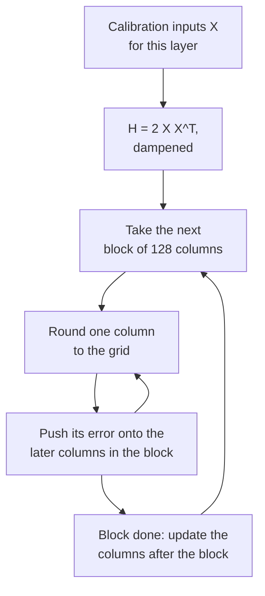

# Урок 10. GPTQ

**Связь с целью курса:** GPTQ это первый метод, который делает 3- и 4-битные веса большой модели пригодными к использованию, а способ, которым он это делает, то есть трата каждой ошибки округления на веса, которые ещё впереди, это идея, нужная, чтобы прочитать любой последующий метод с калибровочными данными.
**Первоисточник:** [Научная статья: "GPTQ: Accurate Post-Training Quantization for Generative Pre-trained Transformers", Frantar et al., 2022](https://arxiv.org/abs/2210.17323), разделы 3 и 4
**Предварительные требования:** [Урок 9](0009-round-to-nearest.md), [GPTQ](../GLOSSARY.md), [Калибровочный набор](../GLOSSARY.md), [Гранулярность](../GLOSSARY.md)

## Разминка

1. ▢ Урок 9 показал, что 919 из 2000 случайных округлений побеждают округление к ближайшему по выходу слоя. Что округление к ближайшему игнорирует и что эти округления использовали?

<details markdown="1"><summary>Проверка</summary>

Перекрёстные члены между весами: выход это `W X`, входы коррелированы между признаками, поэтому ошибки округления в разных весах могут гаситься или складываться. Округление к ближайшему минимизирует собственную ошибку каждого веса и никогда не смотрит на пары.

</details>

2. ▢ Матрица весов 4096 на 4096 квантизуется с одним масштабом на выходную строку, а затем группами по 128 вдоль каждой строки. Сколько масштабов хранит каждый вариант?

<details markdown="1"><summary>Проверка</summary>

4096 для per-channel (по одному на строку) и 4096 × 4096 / 128 = 131 072 для групп по 128. Per-group хранит в 32 раза больше масштабов, что оценил урок 6 в битах на вес.

</details>

## Что нужно знать

### Цель: совпасть с выходом слоя, а не с его весами

GPTQ рассматривает каждый линейный слой отдельно. Берётся небольшой набор калибровочных входов, пропускается через модель, и собирается вход `X` этого слоя. Цель это квантизованные веса `Ŵ`, сохраняющие выход слоя как можно ближе к исходному, что в статье записано как `argmin || W X - Ŵ X ||^2`. Это взгляд на ошибку выхода из урока 9, превращённый в целевую функцию, и он никогда не спрашивает, хорошо ли округлён какой-либо отдельный вес.

Квадратичная ошибка раскладывается в сумму по строкам `W`, по одной на выходной канал, так что каждая строка это независимая задача. Для одной строки ошибка квадратична по весам, и её вторая производная это `H = 2 X X^T`, **гессиан**. У него одна строка и один столбец на входной признак, и он один и тот же для каждой строки слоя. Его диагональ говорит, сколько энергии несёт каждый входной признак. Его внедиагональные элементы говорят, какие признаки изменяются вместе, а именно там ошибки весов могут гаситься.

### Родословная: от Optimal Brain Surgeon к GPTQ

Идея старше LLM. Optimal Brain Compression Frantar и Alistarh расширила классическую схему Optimal Brain Surgeon LeCun, Denker и Solla (1990) на квантизацию в масштабе современных сетей ([Frantar and Alistarh, 2022](https://arxiv.org/abs/2208.11580)). Её квантизатор, Optimal Brain Quantizer (OBQ), работает с одной строкой за раз, квантизует один вес за раз и после каждого обновляет все ещё не квантизованные веса, компенсируя только что допущенную ошибку. По статье о GPTQ он выбирает вес, который дальше стоит наименьшей дополнительной ошибки, и обновляет остальные так:

```text
chosen weight   q = argmin over q of (quant(w_q) - w_q)^2 / Hinv[q, q]
update of rest  delta = -(w_q - quant(w_q)) / Hinv[q, q] * Hinv[:, q]
```

Здесь `Hinv` это обратный гессиан по ещё не квантизованным весам. Прочитайте обновление словами: ошибка округления только что зафиксированного веса, умноженная на то, насколько каждый оставшийся вес коррелирует с ним, перекладывается на оставшиеся веса, так что выход слоя сдвигается как можно меньше. Метод точный и очень медленный. GPTQ сохраняет обновление и меняет способ его вычисления.

### Три изменения, которые позволяют масштабироваться

1. **Любой фиксированный порядок почти так же хорош.** OBQ выбирает следующий вес жадно. Авторы GPTQ обнаружили, что это лишь немного лучше произвольного порядка, особенно на больших слоях. Поэтому GPTQ квантизует столбцы каждой строки в одном и том же порядке, слева направо. Поскольку `H` зависит только от входов, одно обновление обратной матрицы на столбец обслуживает затем все строки сразу, и стоимость падает с `O(d_row * d_col^3)` до `O(max(d_row * d_col^2, d_col^3))`, то есть экономия в меньшее из двух измерений раз.
2. **Ленивые пакетные обновления.** Обновление всей матрицы на каждый столбец делает по несколько операций на элемент и упирается в пропускную способность памяти, а не в арифметику. Округление столбца зависит только от обновлений, сделанных в этом столбце, поэтому GPTQ обрабатывает по 128 столбцов за раз, держит их обновления внутри блока и применяет эффект к остальным столбцам, когда блок закончен.
3. **Холецкий.** Многократное обновление обратной матрицы накапливает численную ошибку, а на больших моделях матрица может стать неопределённой, из-за чего обновления идут в неверных направлениях. GPTQ добавляет к диагонали `H` небольшую константу, 1% её среднего, и заранее вычисляет нужные ему строки обратной матрицы из разложения Холецкого.

Цикл для одного слоя:

```text
H = 2 X X^T, with 1% of its mean diagonal added; Hinv = Cholesky factor of H^-1
for each column i, left to right:
    q_i = quant(w_i)                          round the column to the grid
    e   = (w_i - q_i) / Hinv[i, i]
    w_j = w_j - e * Hinv[i, j]   for every later column j
```



### Что он читает и чего это стоит

Калибровочные данные в статье это 128 случайных сегментов по 2048 токенов из датасета C4, обычного веб-текста, так что GPTQ не видит данных задачи. Статья обрабатывает по одному блоку трансформера за раз на GPU: накапливает `H` каждого слоя, квантизует, а затем пропускает входы блока через уже квантизованный блок, чтобы питать следующий, так что более поздние слои подгоняются под входы, которые они действительно увидят. Статья использует стандартную сетку per-row, зафиксированную до начала цикла; с группами сетка каждой группы выбирается, когда цикл до неё доходит, по обновлённым к тому моменту весам.

На OPT-175B аннотация сообщает о квантизации примерно за четыре часа GPU, при 3 или 4 битах на вес с пренебрежимой потерей точности, и документация Transformers повторяет эту цифру для A100. Перплексия на WikiText-2 для OPT-175B по таблице 3 статьи: 16 бит 8,34, GPTQ в 4 битах 8,37 против 10,54 у округления к ближайшему, GPTQ в 3 битах 8,68 против 7300. Статья также наблюдает, что большие модели в целом проще квантизовать, причём OPT-66B исключение.

### Act-order

Одно дополнение есть не в статье, а в коде авторов. Опция `--act-order` квантизует столбцы в порядке убывания размера активаций, что код реализует сортировкой столбцов по диагонали `H`, наибольшие первыми, так что столбцы, видящие наибольшие входы, округляются первыми. README репозитория сообщает, что это исправляет плохой результат на LLaMA 7B (перплексия на WikiText-2 с 7,15 до 6,09) и на модели OPT-66B с выбросами в 3 битах (с 14,16 до 9,95) ([IST-DASLab/gptq](https://github.com/IST-DASLab/gptq)). README также описывает опцию `--static-groups`, добавленную для того, чтобы act-order не требовал изменений инференса, которые могут привести к замедлению. llm-compressor указывает калибровку с act-order как поддерживаемую ([llm-compressor](https://github.com/vllm-project/llm-compressor)).

## Практика

1. ▢ У слоя 4096 входных признаков и 11008 выходных строк, и он калибруется 128 сегментами статьи по 2048 токенов. Какова форма `H`, сколько строк весов её делят и сколько калибровочных токенов её построили?

<details markdown="1"><summary>Проверка</summary>

`H` имеет форму 4096 на 4096, по одной строке и одному столбцу на входной признак. Её делят все 11008 строк, потому что она зависит только от входов. Она построена из 128 × 2048 = 262 144 токенов. Ни число выходных строк, ни число токенов не меняют её форму.

</details>

2. ▢ По таблице 3 статьи у OPT-6.7B в 4 битах перплексия на WikiText-2 равна 10,86 в 16 битах, 12,10 с округлением к ближайшему и 11,39 с GPTQ. Для OPT-175B цифры 8,34, 10,54 и 8,37. Какую долю потери перплексии округления к ближайшему GPTQ отыгрывает в каждом случае и что это говорит о размере?

<details markdown="1"><summary>Проверка</summary>

OPT-6.7B: (12,10 - 11,39) / (12,10 - 10,86) = 0,71 / 1,24, около 57%. OPT-175B: (10,54 - 8,37) / (10,54 - 8,34) = 2,17 / 2,20, около 99%. GPTQ помогает на каждом размере и почти закрывает разрыв на 175 млрд, в соответствии с замечанием статьи о том, что большие модели в целом проще квантизовать.

</details>

3. ▢ Почему GPTQ может округлять столбцы каждой строки в одном и том же порядке и делить одно обновление обратной матрицы на столбец?

    - a) Порядок строк никогда не влияет на округление, поэтому обновления можно пропустить
    - b) Обратный гессиан зависит только от входов, поэтому строки делят его
    - c) На практике гессиан диагонален, поэтому ошибки остаются на месте
    - d) Множители Холецкого дёшевы, поэтому у каждой строки свой гессиан

<details markdown="1"><summary>Проверка</summary>

**b)** `H = 2 X X^T` строится из входов слоя и одинаков для каждой строки `W`, поэтому однократное обновление его обратной матрицы на столбец обслуживает все строки, а это и есть экономия в меньшее измерение раз во времени работы. (a) неверно, потому что обновления и есть метод. (c) неверно, потому что именно внедиагональные элементы позволяют одному весу поглотить ошибку другого. (d) неверно, потому что на слой приходится один гессиан, а не по одному на строку.

</details>

4. ▢ Предскажите, затем запустите. 3-битная сетка с одним фиксированным масштабом на строку, входы с коррелированными признаками и компактный цикл GPTQ без пакетирования блоками. Предскажите, окажется ли относительная ошибка выхода GPTQ ниже, чем у округления к ближайшему, и примерно насколько.

    ```python
    import numpy as np

    rng = np.random.default_rng(0)
    rows, cols, n = 64, 128, 1024
    correlated = True
    mix = rng.standard_normal((cols, cols)) / np.sqrt(cols)
    if correlated:
        X = mix @ rng.standard_normal((cols, n)) + 0.8 * rng.standard_normal((1, n))
    else:
        X = rng.standard_normal((cols, n))
    W = rng.standard_normal((rows, cols))
    qmax = 3
    scale = np.abs(W).max(axis=1) / qmax

    def quant(w, s):
        return np.clip(np.round(w / s), -qmax, qmax) * s

    def gptq(W, X):
        W = W.copy()
        H = 2 * X @ X.T
        H += 0.01 * np.mean(np.diag(H)) * np.eye(H.shape[0])
        U = np.linalg.cholesky(np.linalg.inv(H)).T
        Q = np.zeros_like(W)
        for i in range(W.shape[1]):
            Q[:, i] = quant(W[:, i], scale)
            err = (W[:, i] - Q[:, i]) / U[i, i]
            W[:, i + 1:] -= np.outer(err, U[i, i + 1:])
        return Q

    def out_err(Q):
        return np.linalg.norm(W @ X - Q @ X) / np.linalg.norm(W @ X)

    print(f"RTN : relative output error {out_err(quant(W, scale[:, None])):.4f}")
    print(f"GPTQ: relative output error {out_err(gptq(W, X)):.4f}")
    ```

<details markdown="1"><summary>Подсказка</summary>

Оба используют одну и ту же сетку, поэтому GPTQ не может улучшить округление какого-либо отдельного веса. Спросите, куда ещё могла бы уйти его ошибка.

</details>

<details markdown="1"><summary>Проверка</summary>

```text
RTN : relative output error 0.2679
GPTQ: relative output error 0.1596
```

GPTQ сокращает ошибку выхода примерно на 40% на той же сетке. Отдельные веса округляются не лучше, а многие хуже, но ошибка каждого столбца перенесена на более поздние столбцы, которые с ним коррелируют, поэтому выход слоя оказывается ближе.

</details>

5. ▢ Предскажите, затем запустите. Установите `correlated = False` в фрагменте выше, чтобы входы были независимыми признаками равной дисперсии. Предскажите, что произойдёт с преимуществом GPTQ.

<details markdown="1"><summary>Подсказка</summary>

Посмотрите, как выглядит `H`, когда признаки не изменяются вместе, и что давали внедиагональные элементы.

</details>

<details markdown="1"><summary>Проверка</summary>

```text
RTN : relative output error 0.2680
GPTQ: relative output error 0.2595
```

Преимущество почти исчезает. При независимых входах `H` близка к диагональной, так что корреляции, вдоль которой можно перекладывать ошибку, мало, а округление каждого веса по отдельности близко к тому, что слой вообще может сделать. Выигрыш GPTQ идёт от структуры в `X`, поэтому реальные активации, которые сильно коррелированы, от него выигрывают.

</details>

6. ▢ Рецензент пишет: «GPTQ улучшает округление к ближайшему, выбирая лучший масштаб для каждого веса». Что не так с этим предложением?

<details markdown="1"><summary>Проверка</summary>

Статья предполагает, что сетка квантизации фиксируется до начала процесса, поэтому GPTQ не выбирает лучшие масштабы. Он меняет значения ещё не квантизованных весов, так что при их округлении на ту же сетку ошибка выхода слоя оказывается меньше. С группами масштаб каждой группы вычисляется, когда цикл до неё доходит, по обновлённым весам.

</details>

## Практика в реальной работе

- [ ] Откройте таблицы 3 и 5 статьи. Для двух размеров OPT на ваш выбор посчитайте долю потери перплексии округления к ближайшему, которую GPTQ возвращает в 3 битах, и отметьте, на какой размер обвал 3-битного округления к ближайшему ударяет сильнее всего.
- [ ] Запустите фрагмент из упражнения 4 практики с `n = 64`, то есть с меньшим числом образцов, чем 128 входных признаков, и предскажите до запуска, побеждает ли GPTQ по-прежнему округление к ближайшему. Для честности оцените на свежих образцах и сохраните результат для урока 12.
- [ ] Завтра, без заметок, запишите цикл GPTQ для одного слоя в пять строк и назовите три изменения, которые перенесли идею OBQ с малых сетей на 175 млрд параметров.

## Что почитать дальше

- [Методы PTQ для весов](../reference/weight-ptq-methods.md)
- [Научная статья: "Optimal Brain Compression", Frantar and Alistarh, 2022](https://arxiv.org/abs/2208.11580), о точном методе, который приближает GPTQ
- [Документация: "GPTQ", Hugging Face Transformers](https://huggingface.co/docs/transformers/main/en/quantization/gptq), о запуске через `GPTQConfig`
- [Репозиторий: IST-DASLab/gptq](https://github.com/IST-DASLab/gptq), об act-order в коде
- [Инференс: Квантизация при обслуживании](../../inference/reference/quantization-at-serve-time.md), о том, как обслуживается чекпоинт GPTQ
- [Ресурсы](../RESOURCES.md)

---

Не доходит? Перечитайте первоисточник в начале: этот урок его сжимает, а при сжатии понимание как раз и теряется. Загляните в [глоссарий](../GLOSSARY.md), если какой-то термин показался скользким.

Если неясен сам урок, а не материал, это дефект: [откройте issue](https://github.com/TokenCemetery/teach/issues).
