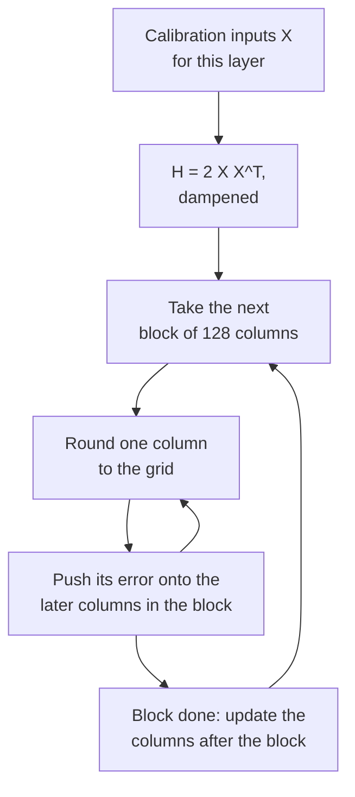

# 第 10 课：GPTQ

**使命关联:** GPTQ 是第一个让大模型的 3 位和 4 位权重变得可用的方法，而它的做法，即把每一次舍入误差花在后面还没量化的权重上，正是你要读懂后面任何一种使用校准数据的方法所需要的思路。
**主要来源:** [论文：“GPTQ: Accurate Post-Training Quantization for Generative Pre-trained Transformers”，Frantar 等，2022](https://arxiv.org/abs/2210.17323)，第 3 节和第 4 节
**前置知识:** [第 9 课](0009-round-to-nearest.md)、[GPTQ](../GLOSSARY.md)、[校准集](../GLOSSARY.md)、[量化粒度](../GLOSSARY.md)

## 热身

1. ▢ 第 9 课展示了，在一层的输出上，2000 次随机舍入中有 919 次胜过就近舍入。就近舍入忽略了什么，而那些舍入利用了它？

<details markdown="1"><summary>检查</summary>

权重之间的交叉项：输出是 `W X`，输入的各特征之间是相关的，所以不同权重上的舍入误差可以抵消，也可以叠加。就近舍入把每个权重自己的误差降到最小，从不去看成对的情形。

</details>

2. ▢ 一个 4096 乘 4096 的权重矩阵，先按每个输出行一个缩放因子来量化，再按沿每一行以 128 个为一组来量化。两种方式各存多少个缩放因子？

<details markdown="1"><summary>检查</summary>

逐通道（每行一个）是 4,096 个，以 128 个为一组是 4,096 × 4,096 / 128 = 131,072 个。逐组存的缩放因子是它的 32 倍，这就是第 6 课以每个权重多少位来标价的东西。

</details>

## 要点

### 目标：匹配这一层的输出，而不是它的权重

GPTQ 把每个线性层单独看待。取一小批校准输入，让它们跑过模型，收集这一层的输入 `X`。目标是找到量化后的权重 `Ŵ`，使这一层的输出与原来的最接近，论文中写作 `argmin || W X - Ŵ X ||^2`。这就是第 9 课的输出误差观点，被做成了一个目标，它从来不问某一个权重有没有被舍入好。

平方误差可以拆成对 `W` 的各行求和，每个输出通道一行，所以每一行都是一个独立的问题。对一行来说，误差是权重的二次函数，它的二阶导数是 `H = 2 X X^T`，即**海森矩阵**。它的每个输入特征占一行一列，并且对这一层的每一行都相同。它的对角线说明每个输入特征带有多少能量。它的非对角项说明哪些特征会一起变化，这恰恰是权重误差可以抵消的地方。

### 来龙去脉：从 Optimal Brain Surgeon 到 GPTQ

这个思路比 LLM 古老得多。Frantar 与 Alistarh 的 Optimal Brain Compression，把 LeCun、Denker 和 Solla（1990）的经典 Optimal Brain Surgeon 框架，扩展到可以覆盖现代网络规模的量化（[Frantar 与 Alistarh，2022](https://arxiv.org/abs/2208.11580)）。它的量化器 Optimal Brain Quantizer（OBQ）一次处理一行，一次量化一个权重，每量化一个，就更新所有尚未量化的权重，来补偿刚刚产生的误差。据 GPTQ 论文所述，它挑出下一个额外误差最小的权重，并用下式更新其余的权重：

```text
chosen weight   q = argmin over q of (quant(w_q) - w_q)^2 / Hinv[q, q]
update of rest  delta = -(w_q - quant(w_q)) / Hinv[q, q] * Hinv[:, q]
```

这里 `Hinv` 是对仍未量化的权重所取的海森矩阵的逆。把这个更新用文字读一遍：刚刚定下来的那个权重的舍入误差，按每个剩余权重与它的相关程度加以缩放，推到剩余的权重上，使这一层的输出改变得尽可能小。这个方法是精确的，而且非常慢。GPTQ 保留了这个更新，改变的是计算它的方式。

### 让它能扩展的三个改动

1. **任何固定的顺序都几乎一样好**。OBQ 是贪心地选下一个权重。GPTQ 的作者发现，这只比任意顺序略好一点，在大的层上尤其如此。所以 GPTQ 对每一行的各列都按同样的顺序量化，从左到右。由于 `H` 只取决于输入，每一列做一次逆的更新，就能同时服务所有行，开销从 `O(d_row * d_col^3)` 降到 `O(max(d_row * d_col^2, d_col^3))`，节省的倍数是较小的那个维度。
2. **惰性批量更新**。对每一列都更新整个矩阵，每个元素只做几次运算，受内存带宽限制，而不是受算术限制。一列的舍入只取决于对这一列做过的更新，所以 GPTQ 一次处理 128 列，把它们的更新保留在块内，等块处理完之后，再把效果应用到其余的列上。
3. **Cholesky**。反复更新逆矩阵会累积数值误差，在大模型上，这个矩阵可能变成不定的，使更新朝错误的方向走。GPTQ 在 `H` 的对角线上加一个很小的常数，取其平均值的 1%，并根据 Cholesky 分解预先算出它需要的逆矩阵的各行。

一层的循环如下：

```text
H = 2 X X^T, with 1% of its mean diagonal added; Hinv = Cholesky factor of H^-1
for each column i, left to right:
    q_i = quant(w_i)                          round the column to the grid
    e   = (w_i - q_i) / Hinv[i, i]
    w_j = w_j - e * Hinv[i, j]   for every later column j
```



### 它读取什么，花费什么

论文中的校准数据是来自 C4 数据集的 128 个随机的 2048 token 片段，那是通用的网页文本，所以 GPTQ 看不到任何任务数据。论文在 GPU 上一次处理一个 Transformer 块：它累积每一层的 `H`，进行量化，然后把这个块的输入送过已经量化好的块，去喂给下一个块，使后面的层是拟合它们将真正看到的输入。论文使用的是在循环开始之前就固定好的标准逐行网格；有分组时，每个组的网格是在循环走到它的时候，根据当时已更新的权重来选定的。

在 OPT-175B 上，摘要报告了大约四个 GPU 小时的量化时间，每个权重 3 位或 4 位，精度损失可以忽略，Transformers 的文档对 A100 也重复了这个数字。OPT-175B 在 WikiText-2 上的困惑度，来自论文的表 3：16 位是 8.34，GPTQ 4 位是 8.37，就近舍入是 10.54，GPTQ 3 位是 8.68，就近舍入是 7,300。论文还观察到，更大的模型通常更容易量化，OPT-66B 是个例外。

### Act-order

有一项补充不在论文里，而在作者的代码里。`--act-order` 选项按激活值从大到小的顺序来量化各列，代码的实现是按 `H` 的对角线把各列从大到小排序，所以看到最大输入的那些列最先被舍入。仓库的 README 报告说，它修复了 LLaMA 7B 上的一个糟糕结果（WikiText-2 困惑度从 7.15 降到 6.09），以及 OPT-66B 这个离群值模型在 3 位时的结果（从 14.16 降到 9.95）（[IST-DASLab/gptq](https://github.com/IST-DASLab/gptq)）。README 还描述了一个 `--static-groups` 选项，加它是为了让 act-order 不需要改动推理，从而避免可能造成的减速。llm-compressor 把 act-order 校准列为受支持的功能（[llm-compressor](https://github.com/vllm-project/llm-compressor)）。

## 练习

1. ▢ 一个层有 4096 个输入特征和 11008 个输出行，用论文中 128 个 2048 token 的片段来校准。`H` 是什么形状？有多少行权重共用它？它是由多少个校准 token 构造出来的？

<details markdown="1"><summary>检查</summary>

`H` 是 4096 乘 4096，每个输入特征占一行一列。全部 11008 行共用它，因为它只取决于输入。它由 128 × 2048 = 262,144 个 token 构造而成。输出行数和 token 数都不会改变它的形状。

</details>

2. ▢ 来自论文的表 3，OPT-6.7B 在 4 位时，WikiText-2 困惑度在 16 位时是 10.86，就近舍入是 12.10，GPTQ 是 11.39。对 OPT-175B，这几个数字是 8.34、10.54 和 8.37。在这两种情形下，GPTQ 各挽回了就近舍入的困惑度损失的多大比例？这对规模说明了什么？

<details markdown="1"><summary>检查</summary>

OPT-6.7B：(12.10 - 11.39) / (12.10 - 10.86) = 0.71 / 1.24，约 57%。OPT-175B：(10.54 - 8.37) / (10.54 - 8.34) = 2.17 / 2.20，约 99%。GPTQ 在这里每个规模上都有帮助，在 175B 上几乎把差距补平了，这与论文所说更大的模型通常更容易量化相吻合。

</details>

3. ▢ 为什么 GPTQ 可以对每一行都按相同的顺序舍入各列，并且每一列只共用一次逆的更新？

    - a) 行的顺序对舍入从来无关紧要，所以更新可以跳过
    - b) 海森矩阵的逆只取决于输入，所以各行共用它
    - c) 海森矩阵在实践中是对角的，所以误差留在原地
    - d) Cholesky 因子很便宜，所以每一行都有自己的海森矩阵

<details markdown="1"><summary>检查</summary>

**b)** `H = 2 X X^T` 由这一层的输入构造，对 `W` 的每一行都相同，所以每一列只更新一次它的逆，就能服务所有行，这就是运行时间上节省较小维度那么多倍的来源。(a) 是错的，因为更新就是这个方法本身。(c) 是错的，因为非对角项才是让一个权重能吸收另一个权重的误差的东西。(d) 是错的，因为每一层只有一个海森矩阵，而不是每行一个。

</details>

4. ▢ 先预测，再运行。一个 3 位网格，每行一个固定的缩放因子，输入的各特征相关，外加一个没有分块批处理的精简版 GPTQ 循环。预测 GPTQ 的相对输出误差是否比就近舍入的低，大约低多少。

    ```python
    import numpy as np

    rng = np.random.default_rng(0)
    rows, cols, n = 64, 128, 1024
    correlated = True
    mix = rng.standard_normal((cols, cols)) / np.sqrt(cols)
    if correlated:
        X = mix @ rng.standard_normal((cols, n)) + 0.8 * rng.standard_normal((1, n))
    else:
        X = rng.standard_normal((cols, n))
    W = rng.standard_normal((rows, cols))
    qmax = 3
    scale = np.abs(W).max(axis=1) / qmax

    def quant(w, s):
        return np.clip(np.round(w / s), -qmax, qmax) * s

    def gptq(W, X):
        W = W.copy()
        H = 2 * X @ X.T
        H += 0.01 * np.mean(np.diag(H)) * np.eye(H.shape[0])
        U = np.linalg.cholesky(np.linalg.inv(H)).T
        Q = np.zeros_like(W)
        for i in range(W.shape[1]):
            Q[:, i] = quant(W[:, i], scale)
            err = (W[:, i] - Q[:, i]) / U[i, i]
            W[:, i + 1:] -= np.outer(err, U[i, i + 1:])
        return Q

    def out_err(Q):
        return np.linalg.norm(W @ X - Q @ X) / np.linalg.norm(W @ X)

    print(f"RTN : relative output error {out_err(quant(W, scale[:, None])):.4f}")
    print(f"GPTQ: relative output error {out_err(gptq(W, X)):.4f}")
    ```

<details markdown="1"><summary>提示</summary>

两者用的是同一个网格，所以 GPTQ 不可能让任何单个权重的舍入变得更好。想想它的误差还能去哪里。

</details>

<details markdown="1"><summary>检查</summary>

```text
RTN : relative output error 0.2679
GPTQ: relative output error 0.1596
```

在同一个网格上，GPTQ 把输出误差降低了约 40%。单个权重的舍入并没有更好，许多还更差，但每一列的误差被推到了与它相关的后面的列上，所以这一层的输出最终更接近了。

</details>

5. ▢ 先预测，再运行。把上面代码片段里的 `correlated = False`，使输入成为方差相等的独立特征。预测 GPTQ 的优势会怎样。

<details markdown="1"><summary>提示</summary>

看看当特征不会一起变化时，`H` 是什么样子，以及非对角项原本提供的是什么。

</details>

<details markdown="1"><summary>检查</summary>

```text
RTN : relative output error 0.2680
GPTQ: relative output error 0.2595
```

优势几乎消失了。输入相互独立时，`H` 接近对角，所以几乎没有相关性可以用来传递误差，把每个权重单独舍入，就已接近这一层所能做到的。GPTQ 的收益来自 `X` 中的结构，这就是为什么真实的激活值（它们高度相关）能从中受益。

</details>

6. ▢ 一位评审者写道：“GPTQ 通过为每个权重选择更好的缩放因子，改进了就近舍入。”这句话错在哪里？

<details markdown="1"><summary>检查</summary>

论文假定量化网格在过程开始之前就固定了，所以 GPTQ 并没有选择更好的缩放因子。它改变的是尚未量化的权重的值，这样当它们被舍入到同一个网格上时，这一层的输出误差更小。有分组时，每个组的缩放因子是在循环走到它的时候，根据已更新的权重算出来的。

</details>

## 实战练习

- [ ] 打开论文的表 3 和表 5。对你选的两个 OPT 规模，算出 GPTQ 在 3 位时挽回了就近舍入困惑度损失的多大比例，并注意 3 位的就近舍入崩溃对哪个规模打击最重。
- [ ] 用 `n = 64`（比 128 个输入特征还少的样本数）运行练习第 4 题的代码片段，并在运行之前先预测 GPTQ 是否仍然胜过就近舍入。为公平起见，用新鲜的样本来评估，并保留结果留给第 12 课。
- [ ] 明天：不看笔记，用五行写出一层的 GPTQ 循环，并说出把 OBQ 的思路从小网络带到 175B 参数的那三个改动。

## 延伸阅读

- [权重训练后量化方法](../reference/weight-ptq-methods.md)
- [论文：“Optimal Brain Compression”，Frantar 与 Alistarh，2022](https://arxiv.org/abs/2208.11580)，GPTQ 所近似的那个精确方法
- [文档：“GPTQ”，Hugging Face Transformers](https://huggingface.co/docs/transformers/main/en/quantization/gptq)，讲如何通过 `GPTQConfig` 运行它
- [仓库：IST-DASLab/gptq](https://github.com/IST-DASLab/gptq)，act-order 的代码
- [推理：服务时量化](../../inference/reference/quantization-at-serve-time.md)，GPTQ 检查点是怎样提供服务的
- [资源](../RESOURCES.md)

---

没学明白？请重读顶部的主要来源，因为本课是对它的压缩，而理解正是在压缩中流失的。如果有哪个术语觉得含糊，可以查看[术语表](../GLOSSARY.md)。

如果问题出在课程本身，而不是学习材料，那就是一个缺陷：[提交 issue](https://github.com/TokenCemetery/teach/issues)。
