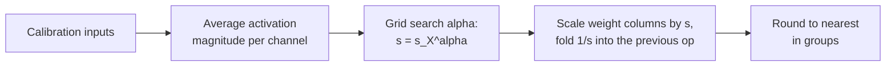

# Lección 11. AWQ

**Vínculo con la misión:** AWQ llega a buenos pesos de 4 bits por un camino distinto al de GPTQ: sin actualizar pesos, solo con un scale por canal hallado a partir de las activaciones, así que conocer ambos te permite decir qué protege cada uno y qué arriesga.
**Fuente principal:** [Paper: "AWQ: Activation-aware Weight Quantization for LLM Compression and Acceleration", Lin et al., 2023](https://arxiv.org/abs/2306.00978), sección 3
**Requisitos previos:** [Lección 10](0010-gptq.md), [Cuantización solo de pesos](../GLOSSARY.md), [Tamaño de grupo](../GLOSSARY.md), [Activación](../GLOSSARY.md)

## Calentamiento

1. ▢ La lección 8 nombró cuatro familias de soluciones para los outliers: mantenerlos en alta precisión, reducir el grupo, migrarlos o rotarlos para dispersarlos. ¿Qué familia es "multiplicar un canal de pesos por `s` y dividir la activación correspondiente por `s`"?

<details markdown="1"><summary>Comprobación</summary>

Migrar. El producto no cambia, así que la transformación es exacta antes de redondear, y la dificultad pasa de un operando al otro.

</details>

2. ▢ ¿Qué lee GPTQ de su calibration set, y qué hace con ello?

<details markdown="1"><summary>Comprobación</summary>

Las entradas de cada capa, con las que construye `H = 2 X X^T`. Usa `H` para empujar el error de redondeo de cada columna sobre las columnas aún no cuantizadas. Cambia los valores de los pesos sobre la marcha.

</details>

3. ▢ Un grupo de pesos tiene un valor diez veces mayor que el resto. Usando la lección 6, ¿qué pasa con el paso para los demás pesos?

<details markdown="1"><summary>Comprobación</summary>

El scale sale del mayor valor, así que el paso es diez veces más grueso de lo que necesitan los pesos típicos, y la mayoría se redondea sobre muy pocos niveles.

</details>

## Qué debes saber

### No todos los pesos importan por igual

AWQ parte de una observación: una pequeña fracción de los pesos, del 0.1% al 1%, importa mucho más que el resto, y saltarse su cuantización cierra buena parte de la brecha. La evidencia del paper es sobre OPT-6.7B a 3 bits con grupos de 128 ([Tabla 1](https://arxiv.org/abs/2306.00978)):

| Pesos mantenidos en 16 bits (1%) | Perplexity en WikiText |
|---|---|
| Ninguno, round-to-nearest simple | 23.54 |
| Elegidos al azar | 24.23 |
| Elegidos por la magnitud del peso | 22.37 |
| Elegidos por la magnitud de la activación | 11.39 |

El modelo de 16 bits obtiene 10.86. Elegir los pesos a proteger por su propio tamaño casi no hace nada, y elegirlos al azar no hace nada. Elegirlos por el tamaño de la activación con la que se encuentran recupera casi todo. Una columna de pesos que multiplica una feature de entrada sistemáticamente grande contribuye mucho a cada salida, así que el error de redondeo en ella se multiplica por esa entrada grande. Los autores plantean la hipótesis de que las features de entrada de mayor magnitud son más importantes, y esta tabla es su respaldo. Esto conecta con la lección 7: los canales de activación grandes son los que te dicen qué pesos proteger.

### La precisión mixta funciona y no se puede desplegar

Mantener el 1% de los pesos en 16 bits es la solución obvia, y funciona: la tabla de arriba muestra una perplexity de 11.39 frente a 23.54 de round-to-nearest. Pero el paper califica el formato de precisión mixta de poco eficiente para el hardware. El costo es fácil de ver: una matriz que intercala unos pocos canales de 16 bits entre canales de 3 o 4 bits necesita dos tipos de datos dentro de un kernel en lugar de un único formato empaquetado. La pregunta de AWQ es cómo conseguir la misma protección sin cambiar el formato.

### Escalar el canal en su lugar

Cuantizar con un scale, según la Ecuación 1 del paper, es `Q(w) = Delta * Round(w / Delta)` con `Delta = max(|w|) / 2^(N-1)` para `N` bits. Ahora multiplica un peso por `s > 1` y divide su entrada por `s`, lo que deja el producto sin cambios antes de redondear:

```text
error of  Q(w) x            =  Delta  * RoundErr(w / Delta)   * x
error of  Q(w s) (x / s)    =  Delta' * RoundErr(w s / Delta') * x * (1 / s)
```

Los autores midieron tres cosas. El error de redondeo `RoundErr` no cambia; su promedio es de cerca de 0.25 de paso en ambos casos. Escalar hacia arriba un peso rara vez cambia el mayor valor del grupo, así que `Delta'` es casi `Delta`. Y `Delta` y `x` se almacenan en 16 bits, así que no llevan error de cuantización. El error del canal escalado es por tanto el error anterior por aproximadamente `1 / s`. Un canal saliente escalado por 2 se redondea con cerca de la mitad del error relativo, y ningún peso cambia de formato.

Hay un límite. Escalar demasiado cambia el mayor valor del grupo, lo que sube `Delta` para los demás canales del grupo. En OPT-6.7B con el 1% de los canales escalados, el paper informa de una perplexity de 23.54 con `s = 1`, 11.92 con `s = 2` y 12.36 con `s = 4`. Con `s = 4` el paso creció para el 21.2% de los canales, así que los canales no salientes perdieron más de lo que ganaron los salientes. El mejor `s` es un intercambio, hallado por búsqueda.

### Elegir los scales

AWQ no elige el 1% y un `s` fijo. Busca sobre un único hiperparámetro. Con `s_X` el promedio de la magnitud de activación de cada canal de entrada en el calibration set, el scale de cada canal es:

```text
s = s_X ^ alpha        alpha searched on a grid over [0, 1]
choose alpha to minimise  || Q(W diag(s)) (diag(s)^-1 X) - W X ||
```

Con `alpha = 0` no se escala nada y esto es round-to-nearest. Con `alpha = 1` los canales se escalan en proporción a su activación, la opción más agresiva del espacio de búsqueda. El paper usa una rejilla de 20 valores, un calibration set tomado del Pile y grupos de 128, y además aplica un recorte de pesos elegido para minimizar el MSE de cuantización. La división por `s` suele poder fusionarse en el operador anterior, así que el checkpoint almacena pesos ordinarios de 4 bits y la inferencia tiene poco nuevo que calcular. Los pesos se redondean luego al más cercano sobre la rejilla escalada.



De aquí se siguen dos propiedades, y ambas son afirmaciones de los autores. La búsqueda nunca hace backpropagation y nunca resuelve una regresión: la única estadística de los datos que conserva es una media por canal, más una comparación de salidas de la capa para elegir `alpha`. Los autores argumentan que por eso sobreajusta menos el calibration set que un método que reconstruye salidas, algo que pone a prueba la lección 12.

### Cómo se compara

En Llama-2 7B con grupos de 128, la Tabla 4 del paper da una perplexity en WikiText de 5.47 a 16 bits. A 4 bits, round-to-nearest obtiene 5.73, GPTQ 5.69, AWQ 5.60. A 3 bits, round-to-nearest 6.66, GPTQ 6.43, AWQ 6.24. Son ejecuciones de los propios autores, y las diferencias a 4 bits son pequeñas. Los autores informan además de que AWQ es ortogonal a GPTQ y de que combinarlos mejora el caso extremo de 2 bits. Un contraste aproximado con la lección 10: GPTQ cambia los pesos a posteriori para cancelar cada error de redondeo. AWQ cambia la rejilla sobre la que se redondean los pesos, de antemano, de modo que los canales importantes tengan menos error que cancelar. Los checkpoints de AWQ registran esto en su configuración: la documentación de Transformers muestra `quant_method` awq, `bits` 4, `group_size` 128 y `zero_point` true ([documentación](https://huggingface.co/docs/transformers/main/en/quantization/awq)).

## Práctica

1. ▢ En una frase cada uno, ¿qué le hace GPTQ a los pesos, qué les hace AWQ, y cuál se ejecuta antes de redondear?

<details markdown="1"><summary>Comprobación</summary>

GPTQ redondea las columnas en orden y actualiza los pesos aún no cuantizados para cancelar cada error, así que actúa durante el redondeo. AWQ escala hacia arriba los canales de entrada salientes de los pesos, con el scale inverso en la activación, así que actúa antes del redondeo y luego redondea al más cercano.

</details>

2. ▢ Un canal saliente se escala por `s = 2` y el mayor valor del grupo no cambia. ¿En qué factor cambia el error relativo de redondeo de ese canal? El paper midió 0.519 para el 1% de los canales con `s = 2`. ¿Por qué no es exactamente tu respuesta?

<details markdown="1"><summary>Comprobación</summary>

Se reduce a la mitad, un factor de 0.5, porque el error es el anterior por `1 / s`. El promedio medido de 0.519 es algo mayor porque el paso `Delta'` crece un poco: el promedio de `Delta' / Delta` en la Tabla 2 es 1.038 con `s = 2`, y 1.038 / 2 = 0.519.

</details>

3. ▢ Cuatro canales de entrada tienen magnitudes de activación promedio de 0.1, 0.4, 0.9 y 1.6. ¿Cuáles son los scales `s = s_X^alpha` con `alpha = 0` y con `alpha = 1`, y cuál es round-to-nearest?

<details markdown="1"><summary>Comprobación</summary>

Con `alpha = 0`, todos los scales son 1 (cualquier número elevado a 0), así que nada cambia: es round-to-nearest. Con `alpha = 1`, los scales son 0.1, 0.4, 0.9 y 1.6, que reparten los canales en la razón completa de sus activaciones. Con `alpha = 0.5` serían de unos 0.32, 0.63, 0.95 y 1.26, una razón de 4 entre el mayor y el menor en lugar de 16.

</details>

4. ▢ ¿Por qué AWQ escala los canales salientes en lugar de mantener el 1% superior en 16 bits, cuando la versión de 16 bits obtiene buenos resultados?

    - a) Las columnas fp16 necesitan backpropagation a través del paso de redondeo cada vez
    - b) Los canales salientes se eligen por el tamaño del peso, no por el de la activación
    - c) La precisión mixta es imposible porque los kernels rechazan todos los pesos de 16 bits
    - d) Una matriz que mezcla dos tipos de datos es ineficiente de calcular en el hardware

<details markdown="1"><summary>Comprobación</summary>

**d)** El paper califica el formato de precisión mixta de poco eficiente para el hardware, aunque su perplexity es buena (11.39 en la Tabla 1). Escalar conserva un único formato empaquetado. (a) es incorrecta porque en ninguno de los dos interviene la backpropagation. (b) es incorrecta porque la Tabla 1 muestra que el tamaño del peso es el criterio malo y el de la activación el bueno. (c) es incorrecta porque la precisión mixta sí corre; es lenta y torpe, no imposible.

</details>

5. ▢ Predice y luego ejecuta. Una matriz de pesos aleatoria, grupos de 3 bits de 128 y activaciones en las que 5 de 512 canales (cerca del 1%) son 20 veces mayores. El código puntúa round-to-nearest, luego tres valores de `alpha`, y luego busca entre 21 valores de `alpha`. Predice si `alpha = 1` supera a `alpha = 0`, y si el mejor `alpha` está cerca de 0, cerca de 0.5 o cerca de 1.

    ```python
    import numpy as np

    rng = np.random.default_rng(0)
    out_f, in_f, n, group, bits = 256, 512, 1024, 128, 3
    W = rng.standard_normal((out_f, in_f))
    chan = np.ones(in_f)
    chan[rng.choice(in_f, size=5, replace=False)] = 20.0
    X = chan[:, None] * rng.standard_normal((in_f, n))
    s_x = np.abs(X).mean(axis=1)

    def rtn(W):
        qmax = 2 ** (bits - 1) - 1
        Wg = W.reshape(W.shape[0], -1, group)
        scale = np.abs(Wg).max(axis=2, keepdims=True) / qmax
        return (np.clip(np.round(Wg / scale), -qmax, qmax) * scale).reshape(W.shape)

    ref = W @ X
    def err(Wq):
        return np.linalg.norm(ref - Wq @ X) / np.linalg.norm(ref)

    print(f"RTN: {err(rtn(W)):.4f}")
    best = None
    for alpha in np.linspace(0, 1, 21):
        s = s_x ** alpha
        e = err(rtn(W * s) / s)
        if best is None or e < best[1]:
            best = (alpha, e)
        if alpha in (0.0, 0.5, 1.0):
            print(f"  alpha {alpha:.2f}: {e:.4f}")
    print(f"best alpha {best[0]:.2f}, error {best[1]:.4f}")
    ```

<details markdown="1"><summary>Pista</summary>

Recuerda el resultado del paper con `s = 4`: más escalado no siempre es mejor.

</details>

<details markdown="1"><summary>Comprobación</summary>

```text
RTN: 0.2741
  alpha 0.00: 0.2741
  alpha 0.50: 0.2161
  alpha 1.00: 0.3889
best alpha 0.30, error 0.1712
```

`alpha = 1` es peor que no hacer nada (0.3889 frente a 0.2741): escalar en plena proporción a las activaciones estira tanto los mayores valores de los grupos que los demás canales pierden precisión. Un valor intermedio, aquí 0.30, reduce el error en cerca de un 38%. Este ejemplo de juguete no tiene la estructura de un modelo real, así que el mejor `alpha` no es una predicción para una capa real, pero la forma de la curva es lo importante: un intercambio con un óptimo interior.

</details>

6. ▢ Un compañero dice "AWQ encuentra los pesos importantes buscando los pesos mayores". Corrígelo con un número de esta lección.

<details markdown="1"><summary>Comprobación</summary>

AWQ mira las activaciones, no los pesos. En la Tabla 1 con OPT-6.7B a 3 bits, proteger el 1% de los canales elegidos por la magnitud del peso dio una perplexity de 22.37, apenas mejor que los 23.54 de round-to-nearest, mientras que el mismo 1% elegido por la magnitud de la activación dio 11.39.

</details>

## Prácticas en el mundo real

- [ ] Cambia `size=5` por `size=50` en el fragmento del ejercicio 5 de la práctica, lo que hace grandes a cerca del 10% de los canales, y predice primero si la ganancia de buscar `alpha` se reduce o crece. Anota el mejor `alpha` y el error.
- [ ] Abre el `config.json` de cualquier modelo cuantizado con AWQ en el Hugging Face Hub y encuentra `quant_method`, `bits`, `group_size` y `zero_point`. Calcula sus bits efectivos por peso si el scale del grupo es de 16 bits.
- [ ] Mañana: sin apuntes, escribe `s = s_X^alpha`, di qué significan `alpha = 0` y `alpha = 1`, y explica por qué la división por `s` no cuesta nada en la inferencia.

## Para profundizar

- [Métodos PTQ de pesos](../reference/weight-ptq-methods.md)
- [Docs: "AWQ", Hugging Face Transformers](https://huggingface.co/docs/transformers/main/en/quantization/awq), para cargar un checkpoint de AWQ
- [Repo: llm-compressor, vLLM project](https://github.com/vllm-project/llm-compressor), para aplicar AWQ con una receta
- Inferencia: [Cuantización al servir](../../inference/reference/quantization-at-serve-time.md), para ver cómo se sirve un checkpoint de AWQ
- [Recursos](../RESOURCES.md)

---

¿No termina de quedar claro? Vuelve a leer la fuente primaria de arriba, ya que esta lección la comprime y en la compresión es donde se escapa la comprensión. Consulta el [glosario](../GLOSSARY.md) por si algún término te resultó resbaladizo.

Si lo poco claro es la propia lección y no el material, eso es un defecto: [abre un issue](https://github.com/TokenCemetery/teach/issues).
