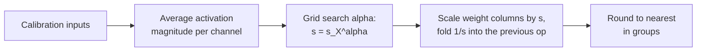

# Leçon 11. AWQ

**Lien avec la mission :** AWQ obtient de bons poids en 4 bits par une autre voie que GPTQ : aucune mise à jour des poids, seulement un scale par canal trouvé à partir des activations, donc connaître les deux vous permet de dire ce que chacune protège et ce qu'elle risque.
**Source primaire :** [Article : "AWQ: Activation-aware Weight Quantization for LLM Compression and Acceleration", Lin et al., 2023](https://arxiv.org/abs/2306.00978), section 3
**Prérequis :** [Leçon 10](0010-gptq.md), [Quantification weight-only](../GLOSSARY.md), [Taille de groupe](../GLOSSARY.md), [Activation](../GLOSSARY.md)

## Échauffement

1. ▢ La leçon 8 a nommé quatre familles de parades aux outliers : les garder en haute précision, réduire le groupe, les migrer ou les faire pivoter. Laquelle est « multiplier un canal de poids par `s` et diviser l'activation correspondante par `s` » ?

<details markdown="1"><summary>Vérifier</summary>

Migrer. Le produit est inchangé, donc la transformation est exacte avant l'arrondi, et la difficulté passe d'un opérande à l'autre.

</details>

2. ▢ Que lit GPTQ dans son calibration set, et qu'en fait-il ?

<details markdown="1"><summary>Vérifier</summary>

Les entrées de chaque couche, à partir desquelles il construit `H = 2 X X^T`. Il utilise `H` pour reporter l'erreur d'arrondi de chaque colonne sur les colonnes pas encore quantifiées. Il change les valeurs des poids au fur et à mesure.

</details>

3. ▢ Un groupe de poids a une valeur dix fois plus grande que les autres. D'après la leçon 6, que devient le pas pour les autres poids ?

<details markdown="1"><summary>Vérifier</summary>

Le scale vient de la plus grande valeur, donc le pas est dix fois plus grossier que ce dont ont besoin les poids typiques, et la plupart d'entre eux sont arrondis sur très peu de niveaux.

</details>

## À savoir

### Tous les poids ne comptent pas autant

AWQ part d'une observation : une petite fraction des poids, 0.1 % à 1 %, compte bien plus que le reste, et ne pas les quantifier comble une grande partie de l'écart. La preuve de l'article porte sur OPT-6.7B en 3 bits avec des groupes de 128 ([tableau 1](https://arxiv.org/abs/2306.00978)) :

| Poids gardés en 16 bits (1 %) | Perplexity WikiText |
|---|---|
| Aucun, arrondi au plus proche simple | 23.54 |
| Choisis au hasard | 24.23 |
| Choisis par grandeur du poids | 22.37 |
| Choisis par grandeur de l'activation | 11.39 |

Le modèle en 16 bits obtient 10.86. Choisir les poids à protéger par leur propre taille ne fait presque rien, et choisir au hasard ne fait rien. Choisir selon la taille de l'activation qu'ils rencontrent récupère presque tout. Une colonne de poids qui multiplie une feature d'entrée systématiquement grande contribue beaucoup à chaque sortie, donc l'erreur d'arrondi qu'elle porte est multipliée par cette grande entrée. Les auteurs font l'hypothèse que les features d'entrée de plus grande grandeur sont plus importantes, et ce tableau est ce qui l'étaye. Cela rejoint la leçon 7 : les grands canaux d'activation sont ceux qui vous disent quels poids garder.

### La précision mixte fonctionne et ne peut pas être livrée

Garder 1 % des poids en 16 bits est la parade évidente, et elle fonctionne : le tableau ci-dessus montre 11.39 de perplexity contre 23.54 pour l'arrondi au plus proche. Mais l'article juge le format en précision mixte peu efficace sur le plan matériel. Le coût est facile à voir : une matrice qui entrelace quelques canaux en 16 bits parmi des canaux en 3 ou 4 bits demande deux types de données dans un seul kernel au lieu d'un seul format empaqueté. La question d'AWQ est de savoir comment obtenir la même protection sans changer le format.

### Mettre le canal à l'échelle à la place

Quantifier avec un scale, d'après l'équation 1 de l'article, c'est `Q(w) = Delta * Round(w / Delta)` avec `Delta = max(|w|) / 2^(N-1)` pour `N` bits. Multipliez maintenant un poids par `s > 1` et divisez son entrée par `s`, ce qui laisse le produit inchangé avant l'arrondi :

```text
error of  Q(w) x            =  Delta  * RoundErr(w / Delta)   * x
error of  Q(w s) (x / s)    =  Delta' * RoundErr(w s / Delta') * x * (1 / s)
```

Les auteurs ont mesuré trois choses. L'erreur d'arrondi `RoundErr` ne change pas ; sa moyenne est d'environ 0.25 pas dans les deux cas. Mettre un poids à l'échelle supérieure change rarement la plus grande valeur du groupe, donc `Delta'` est presque `Delta`. Et `Delta` et `x` sont stockés en 16 bits, donc ils ne portent aucune erreur de quantification. L'erreur du canal mis à l'échelle est donc l'ancienne erreur multipliée par environ `1 / s`. Un canal saillant mis à l'échelle de 2 est arrondi avec environ la moitié de l'erreur relative, et aucun poids ne change de format.

Il y a une limite. Mettre trop à l'échelle change la plus grande valeur du groupe, ce qui augmente `Delta` pour les autres canaux du groupe. Sur OPT-6.7B avec 1 % des canaux mis à l'échelle, l'article rapporte une perplexity de 23.54 à `s = 1`, 11.92 à `s = 2` et 12.36 à `s = 4`. À `s = 4`, le pas a grandi pour 21.2 % des canaux, donc les canaux non saillants ont perdu plus que les saillants n'ont gagné. Le meilleur `s` est un compromis, trouvé par recherche.

### Choisir les scales

AWQ ne choisit pas 1 % et un `s` fixe. Il cherche sur un seul hyperparamètre. Avec `s_X` la grandeur moyenne d'activation de chaque canal d'entrée sur le calibration set, le scale de chaque canal est :

```text
s = s_X ^ alpha        alpha searched on a grid over [0, 1]
choose alpha to minimise  || Q(W diag(s)) (diag(s)^-1 X) - W X ||
```

À `alpha = 0`, rien n'est mis à l'échelle et c'est l'arrondi au plus proche. À `alpha = 1`, les canaux sont mis à l'échelle proportionnellement à leur activation, le choix le plus agressif de l'espace de recherche. L'article utilise une grille de 20 valeurs, un calibration set tiré du Pile et des groupes de 128, et applique aussi un écrêtage des poids choisi pour minimiser la MSE de quantification. La division par `s` peut en général être fusionnée dans l'opérateur précédent, donc le checkpoint stocke des poids ordinaires en 4 bits et l'inférence a peu de nouveau à calculer. Les poids sont ensuite arrondis au plus proche sur la grille mise à l'échelle.



Deux propriétés en découlent, et ce sont deux affirmations des auteurs. La recherche ne rétropropage jamais et ne résout jamais de régression : la seule statistique de données qu'elle conserve est une moyenne par canal, plus une comparaison des sorties de couche pour choisir `alpha`. Les auteurs soutiennent que c'est pourquoi elle surajuste moins le calibration set qu'une méthode qui reconstruit les sorties, ce que teste la leçon 12.

### Comment elle se compare

Sur Llama-2 7B avec des groupes de 128, le tableau 4 de l'article donne une perplexity WikiText de 5.47 en 16 bits. En 4 bits, l'arrondi au plus proche obtient 5.73, GPTQ 5.69, AWQ 5.60. En 3 bits, arrondi au plus proche 6.66, GPTQ 6.43, AWQ 6.24. Ce sont les propres exécutions des auteurs, et les écarts en 4 bits sont petits. Les auteurs rapportent aussi qu'AWQ est orthogonal à GPTQ et que les combiner améliore le réglage extrême en 2 bits. Un contraste approximatif avec la leçon 10 : GPTQ change les poids après coup pour annuler chaque erreur d'arrondi. AWQ change la grille sur laquelle les poids sont arrondis, au préalable, pour que les canaux importants aient moins d'erreur à annuler. Les checkpoints AWQ l'enregistrent dans leur config : la documentation de Transformers montre `quant_method` awq, `bits` 4, `group_size` 128 et `zero_point` true ([Doc](https://huggingface.co/docs/transformers/main/en/quantization/awq)).

## Pratique

1. ▢ En une phrase chacune, que fait GPTQ aux poids, que fait AWQ, et lequel s'exécute avant l'arrondi ?

<details markdown="1"><summary>Vérifier</summary>

GPTQ arrondit les colonnes dans l'ordre et met à jour les poids pas encore quantifiés pour annuler chaque erreur, donc il agit pendant l'arrondi. AWQ met à l'échelle supérieure les canaux d'entrée saillants des poids, avec le scale inverse sur l'activation, donc il agit avant l'arrondi puis arrondit au plus proche.

</details>

2. ▢ Un canal saillant est mis à l'échelle de `s = 2` et la plus grande valeur du groupe ne change pas. De quel facteur l'erreur d'arrondi relative de ce canal change-t-elle ? L'article a mesuré 0.519 pour 1 % des canaux à `s = 2`. Pourquoi n'est-ce pas exactement votre réponse ?

<details markdown="1"><summary>Vérifier</summary>

Elle est divisée par deux, un facteur 0.5, parce que l'erreur est l'ancienne multipliée par `1 / s`. La moyenne mesurée de 0.519 est un peu plus haute parce que le pas `Delta'` grandit un peu : le `Delta' / Delta` moyen du tableau 2 est 1.038 à `s = 2`, et 1.038 / 2 = 0.519.

</details>

3. ▢ Quatre canaux d'entrée ont des grandeurs d'activation moyennes de 0.1, 0.4, 0.9 et 1.6. Quels sont les scales `s = s_X^alpha` à `alpha = 0` et à `alpha = 1`, et lequel est l'arrondi au plus proche ?

<details markdown="1"><summary>Vérifier</summary>

À `alpha = 0`, chaque scale vaut 1 (tout nombre à la puissance 0), donc rien ne change : c'est l'arrondi au plus proche. À `alpha = 1`, les scales sont 0.1, 0.4, 0.9 et 1.6, ce qui étale les canaux dans le rapport complet de leurs activations. À `alpha = 0.5`, ils seraient d'environ 0.32, 0.63, 0.95 et 1.26, un rapport de 4 entre le plus grand et le plus petit au lieu de 16.

</details>

4. ▢ Pourquoi AWQ met-il à l'échelle les canaux saillants au lieu de garder les 1 % du haut en 16 bits, alors que la version en 16 bits obtient un bon score ?

    - a) Les colonnes fp16 exigent à chaque fois une rétropropagation à travers l'étape d'arrondi
    - b) Les canaux saillants sont choisis par taille de poids, pas par activation
    - c) La précision mixte est impossible parce que les kernels rejettent tous les poids en 16 bits
    - d) Une matrice qui mélange deux types de données est inefficace à calculer sur le matériel

<details markdown="1"><summary>Vérifier</summary>

**d)** L'article juge le format en précision mixte peu efficace sur le plan matériel, alors que sa perplexity est bonne (11.39 au tableau 1). La mise à l'échelle garde un seul format empaqueté. (a) est faux parce qu'aucune rétropropagation n'intervient dans l'un ni dans l'autre. (b) est faux parce que le tableau 1 montre que la taille du poids est le mauvais critère et la taille de l'activation le bon. (c) est faux parce que la précision mixte tourne ; elle est lente et malcommode, pas impossible.

</details>

5. ▢ Prédisez, puis exécutez. Une matrice de poids aléatoire, des groupes de 128 en 3 bits, et des activations dont 5 canaux sur 512 (environ 1 %) sont 20 fois plus grands. Le code note l'arrondi au plus proche, puis trois valeurs de `alpha`, puis cherche sur 21 valeurs de `alpha`. Prédisez si `alpha = 1` bat `alpha = 0`, et si le meilleur `alpha` est près de 0, près de 0.5 ou près de 1.

    ```python
    import numpy as np

    rng = np.random.default_rng(0)
    out_f, in_f, n, group, bits = 256, 512, 1024, 128, 3
    W = rng.standard_normal((out_f, in_f))
    chan = np.ones(in_f)
    chan[rng.choice(in_f, size=5, replace=False)] = 20.0
    X = chan[:, None] * rng.standard_normal((in_f, n))
    s_x = np.abs(X).mean(axis=1)

    def rtn(W):
        qmax = 2 ** (bits - 1) - 1
        Wg = W.reshape(W.shape[0], -1, group)
        scale = np.abs(Wg).max(axis=2, keepdims=True) / qmax
        return (np.clip(np.round(Wg / scale), -qmax, qmax) * scale).reshape(W.shape)

    ref = W @ X
    def err(Wq):
        return np.linalg.norm(ref - Wq @ X) / np.linalg.norm(ref)

    print(f"RTN: {err(rtn(W)):.4f}")
    best = None
    for alpha in np.linspace(0, 1, 21):
        s = s_x ** alpha
        e = err(rtn(W * s) / s)
        if best is None or e < best[1]:
            best = (alpha, e)
        if alpha in (0.0, 0.5, 1.0):
            print(f"  alpha {alpha:.2f}: {e:.4f}")
    print(f"best alpha {best[0]:.2f}, error {best[1]:.4f}")
    ```

<details markdown="1"><summary>Indice</summary>

Rappelez-vous le résultat de l'article à `s = 4` : mettre davantage à l'échelle n'est pas toujours mieux.

</details>

<details markdown="1"><summary>Vérifier</summary>

```text
RTN: 0.2741
  alpha 0.00: 0.2741
  alpha 0.50: 0.2161
  alpha 1.00: 0.3889
best alpha 0.30, error 0.1712
```

`alpha = 1` est pire que ne rien faire (0.3889 contre 0.2741) : mettre à l'échelle en pleine proportion des activations étire tant les plus grandes valeurs des groupes que les autres canaux perdent en précision. Une valeur intermédiaire, ici 0.30, réduit l'erreur d'environ 38 %. Ce jouet n'a pas la structure d'un vrai modèle, donc le meilleur `alpha` n'est pas une prédiction pour une vraie couche, mais la forme de la courbe est le point : un compromis avec un optimum intérieur.

</details>

6. ▢ Un coéquipier dit « AWQ trouve les poids importants en cherchant les plus grands poids ». Corrigez-le avec un chiffre de cette leçon.

<details markdown="1"><summary>Vérifier</summary>

AWQ regarde les activations, pas les poids. Au tableau 1, sur OPT-6.7B en 3 bits, protéger 1 % des canaux choisis par grandeur du poids a donné une perplexity de 22.37, à peine meilleure que l'arrondi au plus proche à 23.54, alors que les mêmes 1 % choisis par grandeur d'activation ont donné 11.39.

</details>

## Exercices en situation réelle

- [ ] Changez `size=5` en `size=50` dans l'extrait de l'exercice 5 de la pratique, ce qui rend environ 10 % des canaux grands, et prédisez d'abord si le gain de la recherche de `alpha` diminue ou augmente. Notez le meilleur `alpha` et l'erreur.
- [ ] Ouvrez le `config.json` d'un modèle quantifié en AWQ sur le Hugging Face Hub et trouvez `quant_method`, `bits`, `group_size` et `zero_point`. Calculez ses bits effectifs par poids si le scale de groupe est sur 16 bits.
- [ ] Demain : sans notes, écrivez `s = s_X^alpha`, dites ce que signifient `alpha = 0` et `alpha = 1`, et expliquez pourquoi la division par `s` ne coûte rien à l'inférence.

## Pour aller plus loin

- [Méthodes PTQ pour les poids](../reference/weight-ptq-methods.md)
- [Doc : "AWQ", Hugging Face Transformers](https://huggingface.co/docs/transformers/main/en/quantization/awq), pour charger un checkpoint AWQ
- [Dépôt : llm-compressor, projet vLLM](https://github.com/vllm-project/llm-compressor), pour appliquer AWQ avec une recette
- Inférence : [Quantification au moment du serving](../../inference/reference/quantization-at-serve-time.md), pour voir comment un checkpoint AWQ est servi
- [Ressources](../RESOURCES.md)

---

Ça ne passe pas ? Relisez la source primaire en haut de page, car cette leçon la condense et c'est dans la condensation que la compréhension s'échappe. Consultez le [glossaire](../GLOSSARY.md) pour tout terme qui vous a paru glissant.

Si c'est la leçon elle-même qui n'est pas claire plutôt que la matière, c'est un défaut : [ouvrez une issue](https://github.com/TokenCemetery/teach/issues).
