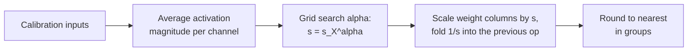

# पाठ 11. AWQ

**मिशन से संबंध:** AWQ अच्छे 4-bit weights तक GPTQ से अलग रास्ते से पहुँचता है: कोई weight update नहीं, सिर्फ़ activations से मिला हर channel का एक scale, इसलिए दोनों को जानने से आप बता सकते हैं कि हर एक क्या बचाता है और किस चीज़ का जोखिम लेता है।
**मुख्य स्रोत:** [पेपर: "AWQ: Activation-aware Weight Quantization for LLM Compression and Acceleration", Lin et al., 2023](https://arxiv.org/abs/2306.00978), section 3
**पूर्व-आवश्यकताएँ:** [पाठ 10](0010-gptq.md), [Weight-only quantization](../GLOSSARY.md), [Group size](../GLOSSARY.md), [Activation](../GLOSSARY.md)

## वार्म-अप

1. ▢ पाठ 8 ने outlier इलाज के चार परिवार गिनाए: उन्हें ऊँची precision में रखना, group छोटा करना, उन्हें migrate करना, या rotate करके हटा देना। "Weight channel को `s` से गुणा करो और संबंधित activation को `s` से भाग दो" कौन-सा परिवार है?

<details markdown="1"><summary>जाँचें</summary>

Migrate। गुणनफल नहीं बदलता, इसलिए रूपांतरण rounding से पहले सटीक है, और कठिनाई एक operand से दूसरे में चली जाती है।

</details>

2. ▢ GPTQ अपने calibration set से क्या पढ़ता है, और उसके साथ क्या करता है?

<details markdown="1"><summary>जाँचें</summary>

हर layer के inputs, जिनसे वह `H = 2 X X^T` बनाता है। वह `H` का इस्तेमाल हर column की rounding error को अभी quantize न हुए columns पर धकेलने में करता है। वह चलते-चलते weight values बदलता है।

</details>

3. ▢ किसी weight group में एक value बाक़ी से दस गुना बड़ी है। पाठ 6 का इस्तेमाल करके बताएँ कि बाक़ी weights के step का क्या होता है।

<details markdown="1"><summary>जाँचें</summary>

Scale सबसे बड़ी value से आता है, इसलिए step आम weights की ज़रूरत से दस गुना मोटा हो जाता है, और उनमें से ज़्यादातर बहुत कम levels पर round होते हैं।

</details>

## यह जानें

### सभी weights बराबर मायने नहीं रखते

AWQ एक अवलोकन से शुरू होता है: weights का छोटा हिस्सा, 0.1% से 1%, बाक़ी से कहीं ज़्यादा मायने रखता है, और उनका quantization छोड़ देने से फ़ासले का बड़ा हिस्सा भर जाता है। पेपर का सबूत 128 के groups के साथ 3 bits पर OPT-6.7B पर है ([Table 1](https://arxiv.org/abs/2306.00978)):

| 16-bit में रखे गए weights (1%) | WikiText perplexity |
|---|---|
| कोई नहीं, सादा round-to-nearest | 23.54 |
| Random चुने गए | 24.23 |
| Weight magnitude से चुने गए | 22.37 |
| Activation magnitude से चुने गए | 11.39 |

16-bit model का score 10.86 है। बचाने वाले weights को उनके अपने आकार से चुनना लगभग कुछ नहीं करता, और random चुनना कुछ नहीं करता। जिस activation से वे मिलते हैं उसके आकार से चुनना लगभग सब कुछ वापस ले आता है। जो weight column किसी लगातार बड़े input feature को गुणा करता है वह हर output में बहुत योगदान देता है, इसलिए उसमें rounding error उस बड़े input से गुणा हो जाती है। लेखक परिकल्पना करते हैं कि बड़ी magnitude वाले input features ज़्यादा ज़रूरी हैं, और यह table उसका समर्थन है। यह पाठ 7 से जुड़ता है: बड़े activation channels ही बताते हैं कि किन weights की रखवाली करनी है।

### Mixed precision काम करती है और शिप नहीं हो सकती

Weights का 1% 16-bit में रखना साफ़ इलाज है, और वह काम करता है: ऊपर की table round-to-nearest के 23.54 के मुक़ाबले 11.39 perplexity दिखाती है। पर पेपर mixed-precision format को hardware-efficient नहीं कहता। क़ीमत देखना आसान है: जिस matrix में 3 या 4-bit वाले channels के बीच कुछ 16-bit channels पिरोए हों उसे एक packed format की जगह एक kernel के भीतर दो data types चाहिए। AWQ का सवाल यह है कि format बदले बिना वही सुरक्षा कैसे मिले।

### इसके बजाय channel को scale करें

Scale के साथ quantize करना, पेपर के Equation 1 से, `N` bits के लिए `Delta = max(|w|) / 2^(N-1)` के साथ `Q(w) = Delta * Round(w / Delta)` है। अब किसी weight को `s > 1` से गुणा करें और उसके input को `s` से भाग दें, जो rounding से पहले गुणनफल को वही रखता है:

```text
error of  Q(w) x            =  Delta  * RoundErr(w / Delta)   * x
error of  Q(w s) (x / s)    =  Delta' * RoundErr(w s / Delta') * x * (1 / s)
```

लेखकों ने तीन चीज़ें मापीं। Rounding error `RoundErr` नहीं बदलती; उसका औसत दोनों तरह लगभग एक step का 0.25 है। एक weight को ऊपर scale करने से group की सबसे बड़ी value शायद ही बदलती है, इसलिए `Delta'` लगभग `Delta` ही है। और `Delta` और `x` 16-bit में store हैं, इसलिए उनमें कोई quantization error नहीं है। इसलिए scale किए हुए channel की error पुरानी error गुणा लगभग `1 / s` है। 2 से scale किया गया salient channel लगभग आधी सापेक्ष error के साथ round होता है, और किसी weight का format नहीं बदलता।

एक सीमा है। ज़्यादा scale करने से group की सबसे बड़ी value बदल जाती है, जो group के दूसरे channels के लिए `Delta` बढ़ा देती है। 1% channels scale करने पर OPT-6.7B पर, पेपर `s = 1` पर 23.54, `s = 2` पर 11.92 और `s = 4` पर 12.36 की perplexity बताता है। `s = 4` पर 21.2% channels के लिए step बढ़ा, इसलिए non-salient channels ने salient channels के पाने से ज़्यादा खोया। सबसे अच्छा `s` एक सौदा है, जो search से मिलता है।

### Scales चुनना

AWQ 1% और तय `s` नहीं चुनता। वह एक अकेले hyperparameter पर search करता है। `s_X` को calibration set पर हर input channel की औसत activation magnitude मानें, तो हर channel का scale है:

```text
s = s_X ^ alpha        alpha searched on a grid over [0, 1]
choose alpha to minimise  || Q(W diag(s)) (diag(s)^-1 X) - W X ||
```

`alpha = 0` पर कुछ scale नहीं होता और यह round-to-nearest है। `alpha = 1` पर channels अपनी activation के अनुपात में scale होते हैं, जो search space का सबसे आक्रामक चुनाव है। पेपर 20 values की grid, Pile से लिया गया calibration set, और 128 के groups इस्तेमाल करता है, और वह weight clipping भी लगाता है जो quantization MSE को न्यूनतम करने के लिए चुनी जाती है। `s` से भाग को आम तौर पर पिछले operator में मिलाया जा सकता है, इसलिए checkpoint सामान्य 4-bit weights store करता है और inference को compute करने के लिए कुछ नया नहीं मिलता। फिर weights scale की हुई grid पर nearest तक round होते हैं।



दो गुण निकलते हैं, और दोनों लेखकों के दावे हैं। Search कभी backpropagate नहीं करता और कभी regression हल नहीं करता: जो एकमात्र data statistic वह रखता है वह हर channel का mean है, साथ में `alpha` चुनने के लिए layer outputs की तुलना। लेखक तर्क देते हैं कि इसीलिए वह calibration set पर उस method से कम overfit करता है जो outputs का पुनर्निर्माण करता है, जिसे पाठ 12 परखता है।

### यह कैसे तुलना में है

128 के groups के साथ Llama-2 7B पर, पेपर की Table 4 16-bit पर WikiText perplexity 5.47 देती है। 4 bits पर, round-to-nearest 5.73, GPTQ 5.69, AWQ 5.60 पाता है। 3 bits पर, round-to-nearest 6.66, GPTQ 6.43, AWQ 6.24। ये लेखकों के अपने runs हैं, और 4 bits पर अंतर छोटे हैं। लेखक यह भी बताते हैं कि AWQ, GPTQ के साथ orthogonal है और दोनों को मिलाने से चरम 2-bit setting सुधरती है। पाठ 10 से मोटा फ़र्क़: GPTQ बाद में weights बदलता है ताकि हर rounding error कटे। AWQ पहले से उस grid को बदलता है जिस पर weights round होते हैं, ताकि ज़रूरी channels में काटने के लिए कम error हो। AWQ checkpoints इसे अपने config में दर्ज करते हैं: Transformers का दस्तावेज़ `quant_method` awq, `bits` 4, `group_size` 128 और `zero_point` true दिखाता है ([दस्तावेज़](https://huggingface.co/docs/transformers/main/en/quantization/awq))।

## अभ्यास

1. ▢ एक-एक वाक्य में बताएँ कि GPTQ weights के साथ क्या करता है, AWQ क्या करता है, और कौन-सा rounding से पहले चलता है?

<details markdown="1"><summary>जाँचें</summary>

GPTQ columns को क्रम से round करता है और अभी quantize न हुए weights को हर error काटने के लिए update करता है, इसलिए वह rounding के दौरान काम करता है। AWQ weights के salient input channels को ऊपर scale करता है, activation पर उलटे scale के साथ, इसलिए वह rounding से पहले काम करता है और फिर nearest तक round करता है।

</details>

2. ▢ किसी salient channel को `s = 2` से scale किया जाता है और group की सबसे बड़ी value नहीं बदलती। उस channel की सापेक्ष rounding error किस गुणक से बदलती है? पेपर ने `s = 2` पर 1% channels के लिए 0.519 मापा। वह ठीक आपका उत्तर क्यों नहीं है?

<details markdown="1"><summary>जाँचें</summary>

वह आधी हो जाती है, यानी 0.5 का गुणक, क्योंकि error पुरानी error गुणा `1 / s` है। मापा गया औसत 0.519 थोड़ा ज़्यादा है क्योंकि step `Delta'` थोड़ा बढ़ता है: Table 2 में औसत `Delta' / Delta` `s = 2` पर 1.038 है, और 1.038 / 2 = 0.519।

</details>

3. ▢ चार input channels की औसत activation magnitudes 0.1, 0.4, 0.9 और 1.6 हैं। `alpha = 0` और `alpha = 1` पर scales `s = s_X^alpha` क्या हैं, और उनमें से कौन-सा round-to-nearest है?

<details markdown="1"><summary>जाँचें</summary>

`alpha = 0` पर हर scale 1 है (कोई भी संख्या घात 0 पर), इसलिए कुछ नहीं बदलता: यह round-to-nearest है। `alpha = 1` पर scales 0.1, 0.4, 0.9 और 1.6 हैं, जो channels को उनकी activations के पूरे अनुपात में फैलाते हैं। `alpha = 0.5` पर वे लगभग 0.32, 0.63, 0.95 और 1.26 होते, यानी सबसे बड़े और सबसे छोटे के बीच 16 की जगह 4 का अनुपात।

</details>

4. ▢ जब 16-bit वाला version अच्छा score करता है, तब AWQ ऊपर के 1% को 16-bit में रखने की जगह salient channels को scale क्यों करता है?

    - a) Fp16 columns को हर बार rounding step के आर-पार backpropagation चाहिए
    - b) Salient channels activation से नहीं, weight के आकार से चुने जाते हैं
    - c) Mixed precision असंभव है क्योंकि kernels सारे 16-bit weights ठुकरा देते हैं
    - d) दो data types मिलाने वाली matrix को compute करना hardware के लिए अकुशल है

<details markdown="1"><summary>जाँचें</summary>

**d)** पेपर mixed-precision format को hardware-efficient नहीं कहता, जबकि उसकी perplexity ठीक है (Table 1 में 11.39)। Scaling एक packed format रखती है। (a) ग़लत है क्योंकि किसी में भी backpropagation शामिल नहीं है। (b) ग़लत है क्योंकि Table 1 दिखाती है कि weight का आकार ख़राब कसौटी है और activation का आकार अच्छी। (c) ग़लत है क्योंकि mixed precision चलती है; वह धीमी और बेढंगी है, असंभव नहीं।

</details>

5. ▢ पहले अनुमान लगाएँ, फिर चलाएँ। एक random weight matrix, 128 के 3-bit groups, और ऐसी activations जिनमें 512 में से 5 channels (लगभग 1%) 20 गुना बड़े हैं। Code round-to-nearest का score करता है, फिर `alpha` की तीन values का, फिर `alpha` की 21 values पर search करता है। अनुमान लगाएँ कि क्या `alpha = 1`, `alpha = 0` को हराता है, और क्या सबसे अच्छा `alpha` 0 के पास है, 0.5 के पास या 1 के पास।

    ```python
    import numpy as np

    rng = np.random.default_rng(0)
    out_f, in_f, n, group, bits = 256, 512, 1024, 128, 3
    W = rng.standard_normal((out_f, in_f))
    chan = np.ones(in_f)
    chan[rng.choice(in_f, size=5, replace=False)] = 20.0
    X = chan[:, None] * rng.standard_normal((in_f, n))
    s_x = np.abs(X).mean(axis=1)

    def rtn(W):
        qmax = 2 ** (bits - 1) - 1
        Wg = W.reshape(W.shape[0], -1, group)
        scale = np.abs(Wg).max(axis=2, keepdims=True) / qmax
        return (np.clip(np.round(Wg / scale), -qmax, qmax) * scale).reshape(W.shape)

    ref = W @ X
    def err(Wq):
        return np.linalg.norm(ref - Wq @ X) / np.linalg.norm(ref)

    print(f"RTN: {err(rtn(W)):.4f}")
    best = None
    for alpha in np.linspace(0, 1, 21):
        s = s_x ** alpha
        e = err(rtn(W * s) / s)
        if best is None or e < best[1]:
            best = (alpha, e)
        if alpha in (0.0, 0.5, 1.0):
            print(f"  alpha {alpha:.2f}: {e:.4f}")
    print(f"best alpha {best[0]:.2f}, error {best[1]:.4f}")
    ```

<details markdown="1"><summary>संकेत</summary>

`s = 4` पर पेपर का नतीजा याद करें: ज़्यादा scaling हमेशा बेहतर नहीं होती।

</details>

<details markdown="1"><summary>जाँचें</summary>

```text
RTN: 0.2741
  alpha 0.00: 0.2741
  alpha 0.50: 0.2161
  alpha 1.00: 0.3889
best alpha 0.30, error 0.1712
```

`alpha = 1` कुछ न करने से बदतर है (0.3889 बनाम 0.2741): activations के पूरे अनुपात में scale करना groups की सबसे बड़ी values को इतना खींच देता है कि दूसरे channels की precision चली जाती है। बीच की value, यहाँ 0.30, error को लगभग 38% घटा देती है। इस खिलौने में असली model की बनावट नहीं है, इसलिए सबसे अच्छा `alpha` असली layer के लिए भविष्यवाणी नहीं है, पर curve का आकार ही असल बात है: भीतर इष्टतम बिंदु वाला सौदा।

</details>

6. ▢ कोई साथी कहता है "AWQ ज़रूरी weights को सबसे बड़े weights खोजकर ढूँढता है"। इस पाठ की एक संख्या से उसे सुधारें।

<details markdown="1"><summary>जाँचें</summary>

AWQ activations को देखता है, weights को नहीं। 3 bits पर OPT-6.7B की Table 1 में, weight magnitude से चुने गए 1% channels की सुरक्षा ने perplexity 22.37 दी, जो round-to-nearest के 23.54 से बस थोड़ी बेहतर है, जबकि activation magnitude से चुने गए वही 1% ने 11.39 दी।

</details>

## असली दुनिया का अभ्यास

- [ ] अभ्यास 5 के snippet में `size=5` को `size=50` कर दें, जिससे लगभग 10% channels बड़े हो जाते हैं, और पहले अनुमान लगाएँ कि `alpha` पर search का फ़ायदा घटता है या बढ़ता है। सबसे अच्छा `alpha` और error दर्ज करें।
- [ ] Hugging Face Hub पर किसी भी AWQ-quantized model का `config.json` खोलें और `quant_method`, `bits`, `group_size` और `zero_point` खोजें। अगर group scale 16-bit है तो उसके effective bits per weight निकालें।
- [ ] कल: बिना नोट्स के `s = s_X^alpha` लिखें, बताएँ कि `alpha = 0` और `alpha = 1` का क्या मतलब है, और समझाएँ कि `s` से भाग की inference में कोई क़ीमत क्यों नहीं है।

## आगे बढ़ने के लिए

- [Weight PTQ Methods शीट](../reference/weight-ptq-methods.md)
- [दस्तावेज़: "AWQ", Hugging Face Transformers](https://huggingface.co/docs/transformers/main/en/quantization/awq), AWQ checkpoint load करने के लिए
- [Repo: llm-compressor, vLLM project](https://github.com/vllm-project/llm-compressor), recipe के साथ AWQ लगाने के लिए
- [Inference: Serve Time पर Quantization](../../inference/reference/quantization-at-serve-time.md), यह देखने के लिए कि AWQ checkpoint कैसे serve होता है
- [संसाधन](../RESOURCES.md)

---

बात नहीं बन रही? ऊपर दिए मुख्य स्रोत को दोबारा पढ़ें, क्योंकि यह पाठ उसे संक्षिप्त करता है और समझ संक्षेप में ही रिसती है। जो शब्द फिसलन भरा लगे, उसके लिए [शब्दावली](../GLOSSARY.md) देखें।

अगर दिक़्क़त सामग्री की नहीं बल्कि पाठ की ही है, तो वह एक खोट है: [issue खोलें](https://github.com/TokenCemetery/teach/issues)।
