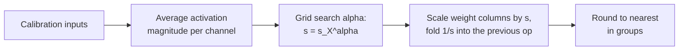

# Lesson 11. AWQ

**Mission link:** AWQ reaches good 4-bit weights by a different route from GPTQ: no weight updates, only a scale per channel found from activations, so knowing both lets you say what each one protects and what it risks.
**Primary source:** [Paper: "AWQ: Activation-aware Weight Quantization for LLM Compression and Acceleration", Lin et al., 2023](https://arxiv.org/abs/2306.00978), section 3
**Prerequisites:** [Lesson 10](0010-gptq.md), [Weight-only quantization](../GLOSSARY.md), [Group size](../GLOSSARY.md), [Activation](../GLOSSARY.md)

## Warm-up

1. ▢ Lesson 8 named four families of outlier fix: keep them in high precision, shrink the group, migrate them, or rotate them away. Which family is "multiply a weight channel by `s` and divide the matching activation by `s`"?

<details markdown="1"><summary>Check</summary>

Migrate. The product is unchanged, so the transformation is exact before rounding, and the difficulty moves from one operand to the other.

</details>

2. ▢ What does GPTQ read from its calibration set, and what does it do with it?

<details markdown="1"><summary>Check</summary>

The inputs to each layer, from which it builds `H = 2 X X^T`. It uses `H` to push each column's rounding error onto the columns not yet quantized. It changes the weight values as it goes.

</details>

3. ▢ A weight group has one value ten times larger than the rest. Using lesson 6, what happens to the step for the other weights?

<details markdown="1"><summary>Check</summary>

The scale comes from the largest value, so the step is ten times coarser than the typical weights need, and most of them round onto very few levels.

</details>

## Know this

### Not all weights matter equally

AWQ starts from an observation: a small fraction of weights, 0.1% to 1%, matter far more than the rest, and skipping their quantization closes much of the gap. The paper's evidence is on OPT-6.7B at 3 bits with groups of 128 ([Table 1](https://arxiv.org/abs/2306.00978)):

| Weights kept in 16-bit (1%) | WikiText perplexity |
|---|---|
| None, plain round-to-nearest | 23.54 |
| Chosen at random | 24.23 |
| Chosen by weight magnitude | 22.37 |
| Chosen by activation magnitude | 11.39 |

The 16-bit model scores 10.86. Choosing the weights to protect by their own size does almost nothing, and choosing by random does nothing. Choosing by the size of the activation they meet recovers almost everything. A weight column that multiplies a consistently large input feature contributes a lot to every output, so rounding error in it is multiplied by that large input. The authors hypothesise that input features with larger magnitudes are more important, and this table is the support for it. This connects to lesson 7: the large activation channels are the ones that tell you which weights to guard.

### Mixed precision works and cannot ship

Keeping 1% of the weights in 16-bit is the obvious fix, and it works: the table above shows 11.39 perplexity against 23.54 for round-to-nearest. But the paper calls the mixed-precision format not hardware-efficient. The cost is easy to see: a matrix that interleaves a few 16-bit channels among 3 or 4-bit ones needs two data types inside one kernel instead of one packed format. AWQ's question is how to get the same protection without changing the format.

### Scale the channel instead

Quantizing with a scale, from the paper's Equation 1, is `Q(w) = Delta * Round(w / Delta)` with `Delta = max(|w|) / 2^(N-1)` for `N` bits. Now multiply a weight by `s > 1` and divide its input by `s`, which leaves the product unchanged before rounding:

```text
error of  Q(w) x            =  Delta  * RoundErr(w / Delta)   * x
error of  Q(w s) (x / s)    =  Delta' * RoundErr(w s / Delta') * x * (1 / s)
```

The authors measured three things. The rounding error `RoundErr` does not change; its average is about 0.25 of a step either way. Scaling up one weight rarely changes the group's largest value, so `Delta'` is almost `Delta`. And `Delta` and `x` are stored in 16-bit, so they carry no quantization error. The error of the scaled channel is therefore the old error times about `1 / s`. A salient channel scaled by 2 is rounded with about half the relative error, and no weight changes format.

There is a limit. Scaling too much changes the group's largest value, which raises `Delta` for the other channels in the group. On OPT-6.7B with 1% of channels scaled, the paper reports perplexity of 23.54 at `s = 1`, 11.92 at `s = 2` and 12.36 at `s = 4`. At `s = 4` the step grew for 21.2% of the channels, so the non-salient channels lost more than the salient ones gained. The best `s` is a trade, found by search.

### Choosing the scales

AWQ does not pick 1% and a fixed `s`. It searches over a single hyperparameter. With `s_X` the average activation magnitude of each input channel on the calibration set, the scale of each channel is:

```text
s = s_X ^ alpha        alpha searched on a grid over [0, 1]
choose alpha to minimise  || Q(W diag(s)) (diag(s)^-1 X) - W X ||
```

At `alpha = 0` nothing is scaled and this is round-to-nearest. At `alpha = 1` channels are scaled in proportion to their activation, the most aggressive choice in the search space. The paper uses a grid of 20 values, a calibration set drawn from the Pile, and groups of 128, and it also applies weight clipping chosen to minimise the quantization MSE. The division by `s` can usually be fused into the previous operator, so the checkpoint stores ordinary 4-bit weights and inference has little new to compute. The weights are then rounded to nearest on the scaled grid.



Two properties follow, and both are claims the authors make. The search never backpropagates and never solves a regression: the only data statistic it keeps is a mean per channel, plus a comparison of layer outputs to choose `alpha`. The authors argue this is why it overfits the calibration set less than a method that reconstructs outputs, which lesson 12 tests.

### How it compares

On Llama-2 7B with groups of 128, the paper's Table 4 gives WikiText perplexity 5.47 at 16-bit. At 4 bits, round-to-nearest scores 5.73, GPTQ 5.69, AWQ 5.60. At 3 bits, round-to-nearest 6.66, GPTQ 6.43, AWQ 6.24. These are the authors' own runs, and the gaps at 4 bits are small. The authors also report that AWQ is orthogonal to GPTQ and that combining them improves the extreme 2-bit setting. A rough contrast with lesson 10: GPTQ changes the weights after the fact to cancel each rounding error. AWQ changes the grid the weights are rounded on, beforehand, so the important channels have less error to cancel. AWQ checkpoints record this in their config: the Transformers documentation shows `quant_method` awq, `bits` 4, `group_size` 128 and `zero_point` true ([Docs](https://huggingface.co/docs/transformers/main/en/quantization/awq)).

## Practice

1. ▢ In one sentence each, what does GPTQ do to the weights, and what does AWQ do, and which one runs before rounding?

<details markdown="1"><summary>Check</summary>

GPTQ rounds columns in order and updates the not-yet-quantized weights to cancel each error, so it acts during rounding. AWQ scales salient input channels of the weights up, with the inverse scale on the activation, so it acts before rounding and then rounds to nearest.

</details>

2. ▢ A salient channel is scaled by `s = 2` and the group's largest value does not change. By what factor does that channel's relative rounding error change? The paper measured 0.519 for 1% of channels at `s = 2`. Why is it not exactly your answer?

<details markdown="1"><summary>Check</summary>

It halves, a factor of 0.5, because the error is the old one times `1 / s`. The measured average of 0.519 is slightly higher because the step `Delta'` grows a little: the average `Delta' / Delta` in Table 2 is 1.038 at `s = 2`, and 1.038 / 2 = 0.519.

</details>

3. ▢ Four input channels have average activation magnitudes of 0.1, 0.4, 0.9 and 1.6. What are the scales `s = s_X^alpha` at `alpha = 0` and at `alpha = 1`, and which one is round-to-nearest?

<details markdown="1"><summary>Check</summary>

At `alpha = 0`, every scale is 1 (any number to the power 0), so nothing changes: this is round-to-nearest. At `alpha = 1`, the scales are 0.1, 0.4, 0.9 and 1.6, spreading the channels in the full ratio of their activations. At `alpha = 0.5` they would be about 0.32, 0.63, 0.95 and 1.26, a ratio of 4 between the largest and smallest instead of 16.

</details>

4. ▢ Why does AWQ scale the salient channels instead of keeping the top 1% in 16-bit, when the 16-bit version scores well?

    - a) Fp16 columns need backpropagation through the rounding step each time
    - b) Salient channels are picked by weight size, not by activation
    - c) Mixed precision is impossible because kernels reject all 16-bit weights
    - d) A matrix mixing two data types is hardware-inefficient to compute

<details markdown="1"><summary>Check</summary>

**d)** The paper calls the mixed-precision format not hardware-efficient, while its perplexity is fine (11.39 in Table 1). Scaling keeps one packed format. (a) is wrong because no backpropagation is involved in either. (b) is wrong because Table 1 shows weight size is the poor criterion and activation size the good one. (c) is wrong because mixed precision does run; it is slow and awkward, not impossible.

</details>

5. ▢ Predict, then run. A random weight matrix, 3-bit groups of 128, and activations in which 5 of 512 channels (about 1%) are 20 times larger. The code scores round-to-nearest, then three values of `alpha`, then searches 21 values of `alpha`. Predict whether `alpha = 1` beats `alpha = 0`, and whether the best `alpha` is near 0, near 0.5 or near 1.

    ```python
    import numpy as np

    rng = np.random.default_rng(0)
    out_f, in_f, n, group, bits = 256, 512, 1024, 128, 3
    W = rng.standard_normal((out_f, in_f))
    chan = np.ones(in_f)
    chan[rng.choice(in_f, size=5, replace=False)] = 20.0
    X = chan[:, None] * rng.standard_normal((in_f, n))
    s_x = np.abs(X).mean(axis=1)

    def rtn(W):
        qmax = 2 ** (bits - 1) - 1
        Wg = W.reshape(W.shape[0], -1, group)
        scale = np.abs(Wg).max(axis=2, keepdims=True) / qmax
        return (np.clip(np.round(Wg / scale), -qmax, qmax) * scale).reshape(W.shape)

    ref = W @ X
    def err(Wq):
        return np.linalg.norm(ref - Wq @ X) / np.linalg.norm(ref)

    print(f"RTN: {err(rtn(W)):.4f}")
    best = None
    for alpha in np.linspace(0, 1, 21):
        s = s_x ** alpha
        e = err(rtn(W * s) / s)
        if best is None or e < best[1]:
            best = (alpha, e)
        if alpha in (0.0, 0.5, 1.0):
            print(f"  alpha {alpha:.2f}: {e:.4f}")
    print(f"best alpha {best[0]:.2f}, error {best[1]:.4f}")
    ```

<details markdown="1"><summary>Hint</summary>

Recall the paper's result at `s = 4`: more scaling is not always better.

</details>

<details markdown="1"><summary>Check</summary>

```text
RTN: 0.2741
  alpha 0.00: 0.2741
  alpha 0.50: 0.2161
  alpha 1.00: 0.3889
best alpha 0.30, error 0.1712
```

`alpha = 1` is worse than doing nothing (0.3889 against 0.2741): scaling in full proportion to the activations stretches the largest values in the groups so far that the other channels lose precision. A middle value, here 0.30, cuts the error by about 38%. This toy has no real model structure, so the best `alpha` is not a prediction for a real layer, but the shape of the curve is the point: a trade with an interior optimum.

</details>

6. ▢ A teammate says "AWQ finds the important weights by looking for the largest weights". Correct them with a number from this lesson.

<details markdown="1"><summary>Check</summary>

AWQ looks at activations, not weights. In Table 1 on OPT-6.7B at 3 bits, protecting 1% of channels chosen by weight magnitude gave perplexity 22.37, barely better than round-to-nearest at 23.54, while the same 1% chosen by activation magnitude gave 11.39.

</details>

## Real-world reps

- [ ] Change `size=5` to `size=50` in the snippet in practice item 5, which makes about 10% of channels large, and predict first whether the gain from searching `alpha` shrinks or grows. Record the best `alpha` and the error.
- [ ] Open the `config.json` of any AWQ-quantized model on the Hugging Face Hub and find `quant_method`, `bits`, `group_size` and `zero_point`. Compute its effective bits per weight if the group scale is 16-bit.
- [ ] Tomorrow: without notes, write `s = s_X^alpha`, say what `alpha = 0` and `alpha = 1` mean, and explain why the division by `s` costs nothing at inference.

## Going further

- [Weight PTQ Methods](../reference/weight-ptq-methods.md)
- [Docs: "AWQ", Hugging Face Transformers](https://huggingface.co/docs/transformers/main/en/quantization/awq), for loading an AWQ checkpoint
- [Repo: llm-compressor, vLLM project](https://github.com/vllm-project/llm-compressor), for applying AWQ with a recipe
- [Inference: Quantization at Serve Time](../../inference/reference/quantization-at-serve-time.md), for how an AWQ checkpoint is served
- [Resources](../RESOURCES.md)

---

Not landing? Reread the primary source at the top, since this lesson compresses it and compression is where understanding leaks. Check the [glossary](../GLOSSARY.md) for any term that felt slippery.

If the lesson itself is unclear rather than the material, that is a defect: [open an issue](https://github.com/TokenCemetery/teach/issues).
