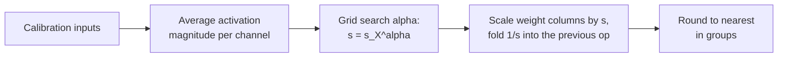

# Lição 11. AWQ

**Ligação com a missão:** O AWQ chega a bons pesos de 4 bits por um caminho diferente do GPTQ: nenhuma atualização de pesos, apenas uma scale por canal encontrada a partir das ativações, então conhecer os dois permite dizer o que cada um protege e o que arrisca.
**Fonte principal:** [Artigo científico: "AWQ: Activation-aware Weight Quantization for LLM Compression and Acceleration", Lin et al., 2023](https://arxiv.org/abs/2306.00978), seção 3
**Pré-requisitos:** [Lição 10](0010-gptq.md), [Quantização somente de pesos](../GLOSSARY.md), [Tamanho do grupo](../GLOSSARY.md), [Ativação](../GLOSSARY.md)

## Aquecimento

1. ▢ A lição 8 nomeou quatro famílias de correção de outliers: mantê-los em alta precisão, diminuir o grupo, migrá-los ou eliminá-los por rotação. Qual família é "multiplicar um canal de pesos por `s` e dividir a ativação correspondente por `s`"?

<details markdown="1"><summary>Verificação</summary>

Migrar. O produto fica inalterado, então a transformação é exata antes do arredondamento, e a dificuldade se move de um operando para o outro.

</details>

2. ▢ O que o GPTQ lê do seu calibration set, e o que ele faz com isso?

<details markdown="1"><summary>Verificação</summary>

As entradas de cada camada, a partir das quais ele constrói `H = 2 X X^T`. Ele usa `H` para empurrar o erro de arredondamento de cada coluna para as colunas ainda não quantizadas. Ele muda os valores dos pesos à medida que avança.

</details>

3. ▢ Um grupo de pesos tem um valor dez vezes maior que o resto. Usando a lição 6, o que acontece com o passo para os outros pesos?

<details markdown="1"><summary>Verificação</summary>

A scale vem do maior valor, então o passo fica dez vezes mais grosseiro do que os pesos típicos precisam, e a maioria deles arredonda para pouquíssimos níveis.

</details>

## Saiba isto

### Nem todos os pesos importam igualmente

O AWQ parte de uma observação: uma pequena fração dos pesos, de 0.1% a 1%, importa muito mais que o resto, e pular a quantização deles fecha boa parte da diferença. A evidência do artigo é no OPT-6.7B em 3 bits com grupos de 128 ([Tabela 1](https://arxiv.org/abs/2306.00978)):

| Pesos mantidos em 16 bits (1%) | Perplexity no WikiText |
|---|---|
| Nenhum, round-to-nearest simples | 23.54 |
| Escolhidos ao acaso | 24.23 |
| Escolhidos pela magnitude do peso | 22.37 |
| Escolhidos pela magnitude da ativação | 11.39 |

O modelo de 16 bits marca 10.86. Escolher os pesos a proteger pelo tamanho deles não faz quase nada, e escolher ao acaso não faz nada. Escolher pelo tamanho da ativação que eles encontram recupera quase tudo. Uma coluna de pesos que multiplica uma feature de entrada consistentemente grande contribui muito para toda saída, então o erro de arredondamento nela é multiplicado por essa entrada grande. Os autores levantam a hipótese de que features de entrada com maiores magnitudes são mais importantes, e esta tabela é o apoio para isso. Isso se liga à lição 7: os canais de ativação grandes são os que dizem quais pesos proteger.

### Precisão mista funciona e não dá para entregar

Manter 1% dos pesos em 16 bits é a correção óbvia, e funciona: a tabela acima mostra perplexity de 11.39 contra 23.54 do round-to-nearest. Mas o artigo chama o formato de precisão mista de não eficiente em hardware. O custo é fácil de ver: uma matriz que intercala alguns canais de 16 bits entre canais de 3 ou 4 bits precisa de dois tipos de dados dentro de um kernel em vez de um formato empacotado. A pergunta do AWQ é como obter a mesma proteção sem mudar o formato.

### Escalar o canal em vez disso

Quantizar com uma scale, da Equação 1 do artigo, é `Q(w) = Delta * Round(w / Delta)` com `Delta = max(|w|) / 2^(N-1)` para `N` bits. Agora multiplique um peso por `s > 1` e divida a sua entrada por `s`, o que deixa o produto inalterado antes do arredondamento:

```text
error of  Q(w) x            =  Delta  * RoundErr(w / Delta)   * x
error of  Q(w s) (x / s)    =  Delta' * RoundErr(w s / Delta') * x * (1 / s)
```

Os autores mediram três coisas. O erro de arredondamento `RoundErr` não muda; a sua média é cerca de 0.25 de um passo nos dois casos. Escalar um peso para cima raramente muda o maior valor do grupo, então `Delta'` é quase `Delta`. E `Delta` e `x` são armazenados em 16 bits, então não carregam erro de quantização. O erro do canal escalado é, portanto, o erro antigo vezes cerca de `1 / s`. Um canal saliente escalado por 2 é arredondado com cerca de metade do erro relativo, e nenhum peso muda de formato.

Há um limite. Escalar demais muda o maior valor do grupo, o que aumenta `Delta` para os outros canais do grupo. No OPT-6.7B com 1% dos canais escalados, o artigo relata perplexity de 23.54 em `s = 1`, 11.92 em `s = 2` e 12.36 em `s = 4`. Em `s = 4` o passo cresceu para 21.2% dos canais, então os canais não salientes perderam mais do que os salientes ganharam. O melhor `s` é uma troca, encontrada por busca.

### Escolhendo as scales

O AWQ não escolhe 1% e um `s` fixo. Ele busca sobre um único hiperparâmetro. Com `s_X` a magnitude média da ativação de cada canal de entrada no calibration set, a scale de cada canal é:

```text
s = s_X ^ alpha        alpha searched on a grid over [0, 1]
choose alpha to minimise  || Q(W diag(s)) (diag(s)^-1 X) - W X ||
```

Em `alpha = 0` nada é escalado e isto é o round-to-nearest. Em `alpha = 1` os canais são escalados em proporção à sua ativação, a escolha mais agressiva do espaço de busca. O artigo usa uma grade de 20 valores, um calibration set tirado do Pile e grupos de 128, e também aplica um clipping de pesos escolhido para minimizar o MSE de quantização. A divisão por `s` normalmente pode ser fundida no operador anterior, então o checkpoint armazena pesos comuns de 4 bits e a inferência tem pouco de novo a calcular. Os pesos são então arredondados para o mais próximo na grade escalada.



Duas propriedades decorrem disso, e ambas são afirmações dos autores. A busca nunca faz backpropagation e nunca resolve uma regressão: a única estatística dos dados que ela guarda é uma média por canal, mais uma comparação das saídas da camada para escolher `alpha`. Os autores argumentam que é por isso que ele faz menos overfit no calibration set do que um método que reconstrói saídas, o que a lição 12 testa.

### Como ele se compara

No Llama-2 7B com grupos de 128, a Tabela 4 do artigo dá perplexity no WikiText de 5.47 em 16 bits. Em 4 bits, o round-to-nearest marca 5.73, o GPTQ 5.69, o AWQ 5.60. Em 3 bits, round-to-nearest 6.66, GPTQ 6.43, AWQ 6.24. Essas são execuções dos próprios autores, e as diferenças em 4 bits são pequenas. Os autores também relatam que o AWQ é ortogonal ao GPTQ e que combiná-los melhora o cenário extremo de 2 bits. Um contraste aproximado com a lição 10: o GPTQ muda os pesos depois do fato para cancelar cada erro de arredondamento. O AWQ muda a grade em que os pesos são arredondados, antes, de modo que os canais importantes tenham menos erro a cancelar. Os checkpoints AWQ registram isso na sua configuração: a documentação do Transformers mostra `quant_method` awq, `bits` 4, `group_size` 128 e `zero_point` true ([Docs](https://huggingface.co/docs/transformers/main/en/quantization/awq)).

## Prática

1. ▢ Em uma frase cada, o que o GPTQ faz com os pesos e o que o AWQ faz, e qual deles roda antes do arredondamento?

<details markdown="1"><summary>Verificação</summary>

O GPTQ arredonda as colunas em ordem e atualiza os pesos ainda não quantizados para cancelar cada erro, então atua durante o arredondamento. O AWQ aumenta a scale dos canais de entrada salientes dos pesos, com a scale inversa na ativação, então atua antes do arredondamento e depois arredonda para o mais próximo.

</details>

2. ▢ Um canal saliente é escalado por `s = 2` e o maior valor do grupo não muda. Por qual fator o erro de arredondamento relativo desse canal muda? O artigo mediu 0.519 para 1% dos canais em `s = 2`. Por que não é exatamente a sua resposta?

<details markdown="1"><summary>Verificação</summary>

Ele cai pela metade, um fator de 0.5, porque o erro é o antigo vezes `1 / s`. A média medida de 0.519 é ligeiramente maior porque o passo `Delta'` cresce um pouco: o `Delta' / Delta` médio na Tabela 2 é 1.038 em `s = 2`, e 1.038 / 2 = 0.519.

</details>

3. ▢ Quatro canais de entrada têm magnitudes médias de ativação de 0.1, 0.4, 0.9 e 1.6. Quais são as scales `s = s_X^alpha` em `alpha = 0` e em `alpha = 1`, e qual delas é o round-to-nearest?

<details markdown="1"><summary>Verificação</summary>

Em `alpha = 0`, toda scale é 1 (qualquer número elevado a 0), então nada muda: isto é o round-to-nearest. Em `alpha = 1`, as scales são 0.1, 0.4, 0.9 e 1.6, espalhando os canais na razão completa das suas ativações. Em `alpha = 0.5` elas seriam cerca de 0.32, 0.63, 0.95 e 1.26, uma razão de 4 entre a maior e a menor em vez de 16.

</details>

4. ▢ Por que o AWQ escala os canais salientes em vez de manter os 1% do topo em 16 bits, quando a versão de 16 bits marca bem?

    - a) Colunas fp16 precisam de backpropagation pela etapa de arredondamento a cada vez
    - b) Os canais salientes são escolhidos pelo tamanho do peso, não pela ativação
    - c) A precisão mista é impossível porque os kernels rejeitam todos os pesos de 16 bits
    - d) Uma matriz que mistura dois tipos de dados é ineficiente de calcular em hardware

<details markdown="1"><summary>Verificação</summary>

**d)** O artigo chama o formato de precisão mista de não eficiente em hardware, embora a sua perplexity seja boa (11.39 na Tabela 1). Escalar mantém um único formato empacotado. (a) está errada porque nenhum dos dois envolve backpropagation. (b) está errada porque a Tabela 1 mostra que o tamanho do peso é o critério ruim e o tamanho da ativação o bom. (c) está errada porque a precisão mista roda; é lenta e desajeitada, não impossível.

</details>

5. ▢ Preveja e depois execute. Uma matriz de pesos aleatória, grupos de 128 em 3 bits e ativações em que 5 de 512 canais (cerca de 1%) são 20 vezes maiores. O código pontua o round-to-nearest, depois três valores de `alpha`, depois busca em 21 valores de `alpha`. Preveja se `alpha = 1` supera `alpha = 0` e se o melhor `alpha` fica perto de 0, perto de 0.5 ou perto de 1.

    ```python
    import numpy as np

    rng = np.random.default_rng(0)
    out_f, in_f, n, group, bits = 256, 512, 1024, 128, 3
    W = rng.standard_normal((out_f, in_f))
    chan = np.ones(in_f)
    chan[rng.choice(in_f, size=5, replace=False)] = 20.0
    X = chan[:, None] * rng.standard_normal((in_f, n))
    s_x = np.abs(X).mean(axis=1)

    def rtn(W):
        qmax = 2 ** (bits - 1) - 1
        Wg = W.reshape(W.shape[0], -1, group)
        scale = np.abs(Wg).max(axis=2, keepdims=True) / qmax
        return (np.clip(np.round(Wg / scale), -qmax, qmax) * scale).reshape(W.shape)

    ref = W @ X
    def err(Wq):
        return np.linalg.norm(ref - Wq @ X) / np.linalg.norm(ref)

    print(f"RTN: {err(rtn(W)):.4f}")
    best = None
    for alpha in np.linspace(0, 1, 21):
        s = s_x ** alpha
        e = err(rtn(W * s) / s)
        if best is None or e < best[1]:
            best = (alpha, e)
        if alpha in (0.0, 0.5, 1.0):
            print(f"  alpha {alpha:.2f}: {e:.4f}")
    print(f"best alpha {best[0]:.2f}, error {best[1]:.4f}")
    ```

<details markdown="1"><summary>Dica</summary>

Lembre o resultado do artigo em `s = 4`: escalar mais nem sempre é melhor.

</details>

<details markdown="1"><summary>Verificação</summary>

```text
RTN: 0.2741
  alpha 0.00: 0.2741
  alpha 0.50: 0.2161
  alpha 1.00: 0.3889
best alpha 0.30, error 0.1712
```

`alpha = 1` é pior que não fazer nada (0.3889 contra 0.2741): escalar em plena proporção às ativações estica os maiores valores dos grupos tanto que os outros canais perdem precisão. Um valor intermediário, aqui 0.30, reduz o erro em cerca de 38%. Este exemplo simplificado não tem estrutura de modelo real, então o melhor `alpha` não é uma previsão para uma camada real, mas a forma da curva é o ponto: uma troca com um ótimo interior.

</details>

6. ▢ Um colega diz "o AWQ encontra os pesos importantes procurando os maiores pesos". Corrija-o com um número desta lição.

<details markdown="1"><summary>Verificação</summary>

O AWQ olha para as ativações, não para os pesos. Na Tabela 1, no OPT-6.7B em 3 bits, proteger 1% dos canais escolhidos pela magnitude do peso deu perplexity de 22.37, mal melhor que os 23.54 do round-to-nearest, enquanto os mesmos 1% escolhidos pela magnitude da ativação deram 11.39.

</details>

## Prática no mundo real

- [ ] Troque `size=5` por `size=50` no trecho do item 5 da prática, o que torna cerca de 10% dos canais grandes, e preveja primeiro se o ganho de buscar `alpha` diminui ou aumenta. Registre o melhor `alpha` e o erro.
- [ ] Abra o `config.json` de qualquer modelo quantizado com AWQ no Hugging Face Hub e encontre `quant_method`, `bits`, `group_size` e `zero_point`. Calcule os seus bits efetivos por peso se a scale do grupo for de 16 bits.
- [ ] Amanhã: sem consultar anotações, escreva `s = s_X^alpha`, diga o que `alpha = 0` e `alpha = 1` significam e explique por que a divisão por `s` não custa nada na inferência.

## Para ir além

- [Métodos de PTQ de Pesos](../reference/weight-ptq-methods.md)
- [Docs: "AWQ", Hugging Face Transformers](https://huggingface.co/docs/transformers/main/en/quantization/awq), para carregar um checkpoint AWQ
- [Repositório: llm-compressor, vLLM project](https://github.com/vllm-project/llm-compressor), para aplicar o AWQ com uma receita
- [Inferência: Quantização no Serving](../../inference/reference/quantization-at-serve-time.md), para ver como um checkpoint AWQ é servido
- [Recursos](../RESOURCES.md)

---

Não ficou claro? Releia a fonte principal no topo, já que esta lição a comprime e é na compressão que o entendimento escapa. Consulte o [glossário](../GLOSSARY.md) para qualquer termo que pareceu escorregadio.

Se o problema é a lição em si, e não o material, isso é um defeito: [abra uma issue](https://github.com/TokenCemetery/teach/issues).
