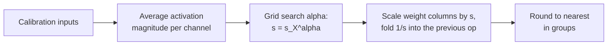

# Урок 11. AWQ

**Связь с целью курса:** AWQ приходит к хорошим 4-битным весам другим путём, чем GPTQ: без обновления весов, только с масштабом на канал, найденным по активациям, поэтому знание обоих позволяет сказать, что защищает каждый из них и чем он рискует.
**Первоисточник:** [Научная статья: "AWQ: Activation-aware Weight Quantization for LLM Compression and Acceleration", Lin et al., 2023](https://arxiv.org/abs/2306.00978), раздел 3
**Предварительные требования:** [Урок 10](0010-gptq.md), [Квантизация только весов](../GLOSSARY.md), [Размер группы](../GLOSSARY.md), [Активация](../GLOSSARY.md)

## Разминка

1. ▢ Урок 8 назвал четыре семейства исправления выбросов: оставить их в высокой точности, уменьшить группу, перенести их или повернуть их прочь. К какому семейству относится «умножить канал весов на `s` и разделить соответствующую активацию на `s`»?

<details markdown="1"><summary>Проверка</summary>

К переносу. Произведение не меняется, поэтому преобразование точно до округления, а сложность переходит от одного операнда к другому.

</details>

2. ▢ Что GPTQ читает из своего калибровочного набора и что с этим делает?

<details markdown="1"><summary>Проверка</summary>

Входы каждого слоя, из которых он строит `H = 2 X X^T`. Он использует `H`, чтобы переложить ошибку округления каждого столбца на ещё не квантизованные столбцы. По ходу он меняет значения весов.

</details>

3. ▢ В группе весов одно значение в десять раз больше остальных. Что по уроку 6 происходит с шагом для других весов?

<details markdown="1"><summary>Проверка</summary>

Масштаб берётся от наибольшего значения, поэтому шаг в десять раз грубее, чем нужно типичным весам, и большинство из них округляется на очень малое число уровней.

</details>

## Что нужно знать

### Не все веса важны одинаково

AWQ исходит из наблюдения: небольшая доля весов, от 0,1% до 1%, важна гораздо больше остальных, и пропуск их квантизации закрывает значительную часть разрыва. Свидетельство статьи относится к OPT-6.7B в 3 битах с группами по 128 ([таблица 1](https://arxiv.org/abs/2306.00978)):

| Веса, оставленные в 16 битах (1%) | Перплексия на WikiText |
|---|---|
| Никакие, обычное округление к ближайшему | 23,54 |
| Выбранные случайно | 24,23 |
| Выбранные по величине весов | 22,37 |
| Выбранные по величине активации | 11,39 |

16-битная модель даёт 10,86. Выбор защищаемых весов по их собственному размеру почти ничего не даёт, а выбор случайный не даёт ничего. Выбор по размеру активации, с которой они встречаются, возвращает почти всё. Столбец весов, умножающий стабильно большой входной признак, вносит большой вклад в каждый выход, поэтому ошибка округления в нём умножается на этот большой вход. Авторы выдвигают гипотезу, что входные признаки с большей величиной важнее, и эта таблица её подтверждает. Это связано с уроком 7: большие каналы активаций показывают, какие веса охранять.

### Смешанная точность работает, но не годится для поставки

Оставить 1% весов в 16 битах это очевидное исправление, и оно работает: таблица выше показывает перплексию 11,39 против 23,54 у округления к ближайшему. Но статья называет формат со смешанной точностью неэффективным для оборудования. Цену легко увидеть: матрице, в которой несколько 16-битных каналов вкраплены среди 3- или 4-битных, внутри одного ядра нужны два типа данных вместо одного упакованного формата. Вопрос AWQ в том, как получить ту же защиту, не меняя формат.

### Вместо этого масштабировать канал

Квантизация с масштабом, по уравнению 1 статьи, это `Q(w) = Delta * Round(w / Delta)` с `Delta = max(|w|) / 2^(N-1)` для `N` бит. Теперь умножим вес на `s > 1` и разделим его вход на `s`, что оставляет произведение неизменным до округления:

```text
error of  Q(w) x            =  Delta  * RoundErr(w / Delta)   * x
error of  Q(w s) (x / s)    =  Delta' * RoundErr(w s / Delta') * x * (1 / s)
```

Авторы измерили три вещи. Ошибка округления `RoundErr` не меняется: её среднее составляет около 0,25 шага в любом случае. Увеличение одного веса масштабом редко меняет наибольшее значение группы, поэтому `Delta'` почти равна `Delta`. А `Delta` и `x` хранятся в 16 битах, поэтому не несут ошибки квантизации. Ошибка масштабированного канала поэтому равна прежней ошибке, умноженной примерно на `1 / s`. Значимый канал, масштабированный на 2, округляется с примерно вдвое меньшей относительной ошибкой, и ни один вес не меняет формат.

Есть предел. Слишком сильное масштабирование меняет наибольшее значение группы, что повышает `Delta` для других каналов группы. На OPT-6.7B с 1% масштабированных каналов статья сообщает перплексию 23,54 при `s = 1`, 11,92 при `s = 2` и 12,36 при `s = 4`. При `s = 4` шаг вырос для 21,2% каналов, поэтому незначимые каналы потеряли больше, чем выиграли значимые. Лучшее `s` это компромисс, найденный поиском.

### Выбор масштабов

AWQ не выбирает 1% и фиксированное `s`. Он ищет по одному гиперпараметру. Если `s_X` это средняя величина активации каждого входного канала на калибровочном наборе, масштаб каждого канала равен:

```text
s = s_X ^ alpha        alpha searched on a grid over [0, 1]
choose alpha to minimise  || Q(W diag(s)) (diag(s)^-1 X) - W X ||
```

При `alpha = 0` ничего не масштабируется, и это округление к ближайшему. При `alpha = 1` каналы масштабируются пропорционально своей активации, это самый агрессивный выбор в пространстве поиска. Статья использует сетку из 20 значений, калибровочный набор из Pile и группы по 128, а также применяет отсечение весов, выбранное так, чтобы минимизировать MSE квантизации. Деление на `s` обычно можно слить с предыдущим оператором, поэтому чекпоинт хранит обычные 4-битные веса, а при инференсе почти нечего вычислять заново. Затем веса округляются к ближайшему на масштабированной сетке.



Отсюда следуют два свойства, и оба это утверждения авторов. Поиск никогда не выполняет обратное распространение и никогда не решает регрессию: единственная статистика данных, которую он хранит, это среднее на канал, плюс сравнение выходов слоя для выбора `alpha`. Авторы утверждают, что поэтому он переобучается на калибровочный набор меньше, чем метод, восстанавливающий выходы, и это проверяет урок 12.

### Как это соотносится

На Llama-2 7B с группами по 128 таблица 4 статьи даёт перплексию на WikiText 5,47 в 16 битах. В 4 битах округление к ближайшему даёт 5,73, GPTQ 5,69, AWQ 5,60. В 3 битах округление к ближайшему 6,66, GPTQ 6,43, AWQ 6,24. Это собственные запуски авторов, и разрывы в 4 битах малы. Авторы также сообщают, что AWQ ортогонален GPTQ и что их сочетание улучшает предельную 2-битную настройку. Грубое противопоставление с уроком 10: GPTQ меняет веса постфактум, чтобы погасить каждую ошибку округления. AWQ меняет сетку, на которую округляются веса, заранее, так что у важных каналов меньше ошибки, которую нужно гасить. Чекпоинты AWQ записывают это в свою конфигурацию: документация Transformers показывает `quant_method` awq, `bits` 4, `group_size` 128 и `zero_point` true ([документация](https://huggingface.co/docs/transformers/main/en/quantization/awq)).

## Практика

1. ▢ Одним предложением каждый: что GPTQ делает с весами, что делает AWQ и что из них выполняется до округления?

<details markdown="1"><summary>Проверка</summary>

GPTQ округляет столбцы по порядку и обновляет ещё не квантизованные веса, чтобы погасить каждую ошибку, то есть действует во время округления. AWQ увеличивает масштабом значимые входные каналы весов, с обратным масштабом на активации, то есть действует до округления, а затем округляет к ближайшему.

</details>

2. ▢ Значимый канал масштабирован на `s = 2`, и наибольшее значение группы не изменилось. Во сколько раз изменяется относительная ошибка округления этого канала? Статья измерила 0,519 для 1% каналов при `s = 2`. Почему это не в точности ваш ответ?

<details markdown="1"><summary>Проверка</summary>

Она уменьшается вдвое, в 0,5 раза, потому что ошибка равна прежней, умноженной на `1 / s`. Измеренное среднее 0,519 чуть выше, потому что шаг `Delta'` немного растёт: среднее `Delta' / Delta` в таблице 2 равно 1,038 при `s = 2`, а 1,038 / 2 = 0,519.

</details>

3. ▢ У четырёх входных каналов средние величины активаций равны 0,1, 0,4, 0,9 и 1,6. Чему равны масштабы `s = s_X^alpha` при `alpha = 0` и при `alpha = 1` и какой из них это округление к ближайшему?

<details markdown="1"><summary>Проверка</summary>

При `alpha = 0` каждый масштаб равен 1 (любое число в степени 0), поэтому ничего не меняется: это округление к ближайшему. При `alpha = 1` масштабы равны 0,1, 0,4, 0,9 и 1,6, раздвигая каналы в полном отношении их активаций. При `alpha = 0.5` они были бы около 0,32, 0,63, 0,95 и 1,26, то есть отношение между наибольшим и наименьшим равно 4 вместо 16.

</details>

4. ▢ Почему AWQ масштабирует значимые каналы, а не оставляет верхний 1% в 16 битах, раз 16-битный вариант даёт хороший результат?

    - a) Столбцы fp16 каждый раз требуют обратного распространения через шаг округления
    - b) Значимые каналы выбираются по размеру весов, а не по активации
    - c) Смешанная точность невозможна, потому что ядра отвергают все 16-битные веса
    - d) Матрица со смесью двух типов данных неэффективна для оборудования

<details markdown="1"><summary>Проверка</summary>

**d)** Статья называет формат со смешанной точностью неэффективным для оборудования, хотя его перплексия хороша (11,39 в таблице 1). Масштабирование сохраняет один упакованный формат. (a) неверно, потому что ни в одном из вариантов обратного распространения нет. (b) неверно, потому что таблица 1 показывает, что размер весов плохой критерий, а размер активации хороший. (c) неверно, потому что смешанная точность работает; она медленная и неудобная, но не невозможная.

</details>

5. ▢ Предскажите, затем запустите. Случайная матрица весов, 3-битные группы по 128 и активации, в которых 5 из 512 каналов (около 1%) в 20 раз больше. Код оценивает округление к ближайшему, затем три значения `alpha`, затем ищет по 21 значению `alpha`. Предскажите, побеждает ли `alpha = 1` значение `alpha = 0` и находится ли лучшее `alpha` около 0, около 0,5 или около 1.

    ```python
    import numpy as np

    rng = np.random.default_rng(0)
    out_f, in_f, n, group, bits = 256, 512, 1024, 128, 3
    W = rng.standard_normal((out_f, in_f))
    chan = np.ones(in_f)
    chan[rng.choice(in_f, size=5, replace=False)] = 20.0
    X = chan[:, None] * rng.standard_normal((in_f, n))
    s_x = np.abs(X).mean(axis=1)

    def rtn(W):
        qmax = 2 ** (bits - 1) - 1
        Wg = W.reshape(W.shape[0], -1, group)
        scale = np.abs(Wg).max(axis=2, keepdims=True) / qmax
        return (np.clip(np.round(Wg / scale), -qmax, qmax) * scale).reshape(W.shape)

    ref = W @ X
    def err(Wq):
        return np.linalg.norm(ref - Wq @ X) / np.linalg.norm(ref)

    print(f"RTN: {err(rtn(W)):.4f}")
    best = None
    for alpha in np.linspace(0, 1, 21):
        s = s_x ** alpha
        e = err(rtn(W * s) / s)
        if best is None or e < best[1]:
            best = (alpha, e)
        if alpha in (0.0, 0.5, 1.0):
            print(f"  alpha {alpha:.2f}: {e:.4f}")
    print(f"best alpha {best[0]:.2f}, error {best[1]:.4f}")
    ```

<details markdown="1"><summary>Подсказка</summary>

Вспомните результат статьи при `s = 4`: больше масштабирования не всегда лучше.

</details>

<details markdown="1"><summary>Проверка</summary>

```text
RTN: 0.2741
  alpha 0.00: 0.2741
  alpha 0.50: 0.2161
  alpha 1.00: 0.3889
best alpha 0.30, error 0.1712
```

`alpha = 1` хуже, чем ничего не делать (0,3889 против 0,2741): масштабирование в полной пропорции к активациям растягивает наибольшие значения в группах так сильно, что остальные каналы теряют точность. Среднее значение, здесь 0,30, сокращает ошибку примерно на 38%. В этой игрушке нет структуры настоящей модели, поэтому лучшее `alpha` не предсказание для настоящего слоя, но суть в форме кривой: компромисс с оптимумом внутри.

</details>

6. ▢ Коллега говорит: «AWQ находит важные веса, ища наибольшие веса». Поправьте его числом из этого урока.

<details markdown="1"><summary>Проверка</summary>

AWQ смотрит на активации, а не на веса. В таблице 1 на OPT-6.7B в 3 битах защита 1% каналов, выбранных по величине весов, дала перплексию 22,37, лишь чуть лучше округления к ближайшему с 23,54, тогда как тот же 1%, выбранный по величине активации, дал 11,39.

</details>

## Практика в реальной работе

- [ ] Замените `size=5` на `size=50` во фрагменте из упражнения 5 практики, что делает большими около 10% каналов, и сначала предскажите, сократится или вырастет выигрыш от поиска `alpha`. Запишите лучшее `alpha` и ошибку.
- [ ] Откройте `config.json` любой квантизованной AWQ модели на Hugging Face Hub и найдите `quant_method`, `bits`, `group_size` и `zero_point`. Посчитайте её эффективное число бит на вес, если масштаб группы 16-битный.
- [ ] Завтра, без заметок, запишите `s = s_X^alpha`, скажите, что означают `alpha = 0` и `alpha = 1`, и объясните, почему деление на `s` ничего не стоит при инференсе.

## Что почитать дальше

- [Методы PTQ для весов](../reference/weight-ptq-methods.md)
- [Документация: "AWQ", Hugging Face Transformers](https://huggingface.co/docs/transformers/main/en/quantization/awq), о загрузке чекпоинта AWQ
- [Репозиторий: llm-compressor, vLLM project](https://github.com/vllm-project/llm-compressor), о применении AWQ с рецептом
- [Инференс: Квантизация при обслуживании](../../inference/reference/quantization-at-serve-time.md), о том, как обслуживается чекпоинт AWQ
- [Ресурсы](../RESOURCES.md)

---

Не доходит? Перечитайте первоисточник в начале: этот урок его сжимает, а при сжатии понимание как раз и теряется. Загляните в [глоссарий](../GLOSSARY.md), если какой-то термин показался скользким.

Если неясен сам урок, а не материал, это дефект: [откройте issue](https://github.com/TokenCemetery/teach/issues).
