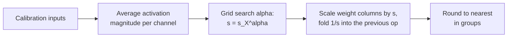

# 第 11 课：AWQ

**使命关联:** AWQ 得到好的 4 位权重所走的路与 GPTQ 不同：不更新权重，只根据激活值找出每个通道的缩放因子，所以把两者都弄懂，你才能说出各自保护什么、冒什么风险。
**主要来源:** [论文：“AWQ: Activation-aware Weight Quantization for LLM Compression and Acceleration”，Lin 等，2023](https://arxiv.org/abs/2306.00978)，第 3 节
**前置知识:** [第 10 课](0010-gptq.md)、[仅权重量化](../GLOSSARY.md)、[分组大小](../GLOSSARY.md)、[激活值](../GLOSSARY.md)

## 热身

1. ▢ 第 8 课列出了四类离群值修复办法：把它们保留在高精度、缩小分组、迁移它们，或者把它们旋转掉。“把某个权重通道乘以 `s`，并把对应的激活值除以 `s`”属于哪一类？

<details markdown="1"><summary>检查</summary>

迁移。乘积保持不变，所以这个变换在舍入之前是精确的，难度从一个操作数转移到了另一个操作数上。

</details>

2. ▢ GPTQ 从它的校准集里读取什么？拿它做什么？

<details markdown="1"><summary>检查</summary>

读取每一层的输入，并据此构造 `H = 2 X X^T`。它用 `H` 把每一列的舍入误差推到尚未量化的列上。它一边进行，一边改变权重的值。

</details>

3. ▢ 一个权重组里有一个值比其余的大十倍。用第 6 课的内容说，其他权重的步长会怎样？

<details markdown="1"><summary>检查</summary>

缩放因子来自最大值，所以步长比典型权重所需要的粗十倍，它们中的大多数被舍入到极少的几个档位上。

</details>

## 要点

### 并非所有权重都同样重要

AWQ 从一个观察出发：一小部分权重（0.1% 到 1%）比其余的重要得多，跳过对它们的量化，就能弥合大部分差距。论文的证据来自 3 位、以 128 为一组的 OPT-6.7B（[表 1](https://arxiv.org/abs/2306.00978)）：

| 保留 16 位的权重（1%） | WikiText 困惑度 |
|---|---|
| 无，即普通的就近舍入 | 23.54 |
| 随机选取 | 24.23 |
| 按权重幅值选取 | 22.37 |
| 按激活值幅值选取 | 11.39 |

16 位模型的得分是 10.86。按权重自身的大小来选择要保护的权重，几乎没有作用，随机选取则毫无作用。按它们所遇到的激活值的大小来选，几乎能把一切都挽回来。一列权重如果乘的是一个始终很大的输入特征，它对每个输出的贡献都很大，所以其中的舍入误差会被那个大输入放大。作者假设幅值更大的输入特征更重要，这张表就是对这个假设的支持。这与第 7 课相连：那些大的激活值通道，正是告诉你该保护哪些权重的东西。

### 混合精度行得通，但没法上线

把 1% 的权重保留在 16 位，是显而易见的修复办法，而且它有效：上表显示困惑度为 11.39，而就近舍入是 23.54。但论文称这种混合精度的格式在硬件上不高效。代价很容易看出来：一个在 3 位或 4 位通道中间夹杂着少数 16 位通道的矩阵，在一个内核里需要两种数据类型，而不是一种打包好的格式。AWQ 的问题是，怎样在不改变格式的前提下得到同样的保护。

### 改为缩放通道

带缩放因子的量化，来自论文的公式 1，是 `Q(w) = Delta * Round(w / Delta)`，其中对 `N` 位有 `Delta = max(|w|) / 2^(N-1)`。现在把一个权重乘以 `s > 1`，并把它的输入除以 `s`，这在舍入之前保持乘积不变：

```text
error of  Q(w) x            =  Delta  * RoundErr(w / Delta)   * x
error of  Q(w s) (x / s)    =  Delta' * RoundErr(w s / Delta') * x * (1 / s)
```

作者度量了三件事。舍入误差 `RoundErr` 不变，无论哪种情形，它的平均值都约为一个步长的 0.25。把一个权重放大，很少会改变该组的最大值，所以 `Delta'` 几乎等于 `Delta`。而 `Delta` 和 `x` 是以 16 位存储的，所以它们不带量化误差。因此，被缩放的通道的误差，就是原来的误差乘以约 `1 / s`。一个被放大 2 倍的显著通道，舍入时的相对误差约减半，而且没有任何权重改变格式。

这里有个限度。放大过头会改变该组的最大值，使同组其他通道的 `Delta` 变大。在 OPT-6.7B 上，缩放 1% 的通道，论文报告的困惑度在 `s = 1` 时是 23.54，`s = 2` 时是 11.92，`s = 4` 时是 12.36。在 `s = 4` 时，有 21.2% 的通道步长变大了，所以非显著通道损失的比显著通道获得的还多。最佳的 `s` 是一种权衡，要靠搜索来找。

### 选择缩放因子

AWQ 并不是选定 1% 加一个固定的 `s`。它只对一个超参数做搜索。设 `s_X` 为校准集上每个输入通道的平均激活值幅值，每个通道的缩放因子是：

```text
s = s_X ^ alpha        alpha searched on a grid over [0, 1]
choose alpha to minimise  || Q(W diag(s)) (diag(s)^-1 X) - W X ||
```

`alpha = 0` 时什么都不缩放，这就是就近舍入。`alpha = 1` 时，通道按各自激活值的比例缩放，这是搜索空间里最激进的选择。论文使用 20 个值的网格、取自 Pile 的校准集和以 128 为一组的分组，并且还采用了为使量化 MSE 最小而选择的权重截断。除以 `s` 通常可以融合进前一个算子，所以检查点存的是普通的 4 位权重，推理几乎没有新的东西要算。然后，权重在缩放后的网格上做就近舍入。



由此得出两条性质，都是作者的主张。这个搜索从不反向传播，也从不求解回归：它保留的数据统计量只有每个通道的一个均值，外加一次对各层输出的比较，用来选定 `alpha`。作者认为，这就是它比重建输出的方法更少过拟合校准集的原因，第 12 课会对此做检验。

### 它与其他方法相比如何

在以 128 为一组的 Llama-2 7B 上，论文的表 4 给出 16 位的 WikiText 困惑度为 5.47。在 4 位时，就近舍入得 5.73，GPTQ 得 5.69，AWQ 得 5.60。在 3 位时，就近舍入 6.66，GPTQ 6.43，AWQ 6.24。这些是作者自己的运行结果，4 位时的差距很小。作者还报告说，AWQ 与 GPTQ 是正交的，把二者结合，能改进极端的 2 位设置。与第 10 课做一个粗略的对比：GPTQ 事后改变权重，来抵消每一次舍入误差。AWQ 则事先改变权重被舍入的那个网格，使重要的通道要抵消的误差更少。AWQ 检查点把这些记录在它的配置里：Transformers 文档显示 `quant_method` 为 awq，`bits` 为 4，`group_size` 为 128，`zero_point` 为 true（[文档](https://huggingface.co/docs/transformers/main/en/quantization/awq)）。

## 练习

1. ▢ 各用一句话说明，GPTQ 对权重做了什么，AWQ 做了什么，哪一个在舍入之前运行？

<details markdown="1"><summary>检查</summary>

GPTQ 依次对各列舍入，并更新尚未量化的权重以抵消每一次误差，所以它作用于舍入期间。AWQ 把权重的显著输入通道放大，激活值上带着逆缩放因子，所以它作用于舍入之前，然后再做就近舍入。

</details>

2. ▢ 一个显著通道被缩放了 `s = 2`，而该组的最大值没有变。这个通道的相对舍入误差变化了多少倍？论文对 1% 的通道在 `s = 2` 时度量到 0.519。为什么它不恰好等于你的答案？

<details markdown="1"><summary>检查</summary>

减半，即 0.5 倍，因为误差是原来的误差乘以 `1 / s`。度量到的平均值 0.519 略高一些，是因为步长 `Delta'` 稍有增大：表 2 中 `s = 2` 时 `Delta' / Delta` 的平均值是 1.038，而 1.038 / 2 = 0.519。

</details>

3. ▢ 四个输入通道的平均激活值幅值分别是 0.1、0.4、0.9 和 1.6。在 `alpha = 0` 和 `alpha = 1` 时，缩放因子 `s = s_X^alpha` 各是多少？哪一个是就近舍入？

<details markdown="1"><summary>检查</summary>

`alpha = 0` 时，每个缩放因子都是 1（任何数的 0 次方），所以什么都不变：这就是就近舍入。`alpha = 1` 时，缩放因子是 0.1、0.4、0.9 和 1.6，按各通道激活值的完整比例把它们拉开。`alpha = 0.5` 时它们约是 0.32、0.63、0.95 和 1.26，最大与最小之比是 4，而不是 16。

</details>

4. ▢ 既然保留 16 位的版本得分很好，为什么 AWQ 要缩放显著通道，而不是把前 1% 保留在 16 位？

    - a) Fp16 的列每次都需要穿过舍入这一步做反向传播
    - b) 显著通道是按权重大小选的，而不是按激活值
    - c) 混合精度不可能实现，因为内核拒绝一切 16 位权重
    - d) 混合两种数据类型的矩阵，在硬件上计算起来不高效

<details markdown="1"><summary>检查</summary>

**d)** 论文称混合精度的格式在硬件上不高效，而它的困惑度是没问题的（表 1 中是 11.39）。缩放则保留了一种打包好的格式。(a) 是错的，因为两者都不涉及反向传播。(b) 是错的，因为表 1 显示权重大小是糟糕的标准，激活值大小才是好的。(c) 是错的，因为混合精度确实能运行；它又慢又别扭，但不是不可能。

</details>

5. ▢ 先预测，再运行。一个随机的权重矩阵，3 位、以 128 为一组，激活值中 512 个通道里有 5 个（约 1%）大 20 倍。代码先给就近舍入打分，再给 `alpha` 的三个取值打分，然后在 `alpha` 的 21 个取值上做搜索。预测 `alpha = 1` 是否胜过 `alpha = 0`，以及最佳的 `alpha` 是接近 0、接近 0.5 还是接近 1。

    ```python
    import numpy as np

    rng = np.random.default_rng(0)
    out_f, in_f, n, group, bits = 256, 512, 1024, 128, 3
    W = rng.standard_normal((out_f, in_f))
    chan = np.ones(in_f)
    chan[rng.choice(in_f, size=5, replace=False)] = 20.0
    X = chan[:, None] * rng.standard_normal((in_f, n))
    s_x = np.abs(X).mean(axis=1)

    def rtn(W):
        qmax = 2 ** (bits - 1) - 1
        Wg = W.reshape(W.shape[0], -1, group)
        scale = np.abs(Wg).max(axis=2, keepdims=True) / qmax
        return (np.clip(np.round(Wg / scale), -qmax, qmax) * scale).reshape(W.shape)

    ref = W @ X
    def err(Wq):
        return np.linalg.norm(ref - Wq @ X) / np.linalg.norm(ref)

    print(f"RTN: {err(rtn(W)):.4f}")
    best = None
    for alpha in np.linspace(0, 1, 21):
        s = s_x ** alpha
        e = err(rtn(W * s) / s)
        if best is None or e < best[1]:
            best = (alpha, e)
        if alpha in (0.0, 0.5, 1.0):
            print(f"  alpha {alpha:.2f}: {e:.4f}")
    print(f"best alpha {best[0]:.2f}, error {best[1]:.4f}")
    ```

<details markdown="1"><summary>提示</summary>

回想论文在 `s = 4` 时的结果：缩放得越多并不总是越好。

</details>

<details markdown="1"><summary>检查</summary>

```text
RTN: 0.2741
  alpha 0.00: 0.2741
  alpha 0.50: 0.2161
  alpha 1.00: 0.3889
best alpha 0.30, error 0.1712
```

`alpha = 1` 比什么都不做还差（0.3889 对 0.2741）：完全按激活值的比例缩放，把各组中的最大值拉伸得太多，使其他通道损失了精度。一个中间值，这里是 0.30，把误差降低了约 38%。这个玩具例子没有真实模型的结构，所以最佳的 `alpha` 并不是对真实层的预测，但曲线的形态才是重点：一种带内部最优点的权衡。

</details>

6. ▢ 一位队友说：“AWQ 通过寻找最大的权重来找出重要的权重。”请用本课中的一个数字来纠正他。

<details markdown="1"><summary>检查</summary>

AWQ 看的是激活值，不是权重。在表 1 中，对 3 位的 OPT-6.7B，保护按权重幅值选出的 1% 通道，困惑度是 22.37，仅比就近舍入的 23.54 略好一点，而按激活值幅值选出的同样 1%，困惑度是 11.39。

</details>

## 实战练习

- [ ] 把练习第 5 题代码片段中的 `size=5` 改成 `size=50`，使约 10% 的通道变大，并先预测，搜索 `alpha` 带来的收益是缩小还是增大。记录最佳的 `alpha` 和误差。
- [ ] 打开 Hugging Face Hub 上任意一个 AWQ 量化模型的 `config.json`，找到 `quant_method`、`bits`、`group_size` 和 `zero_point`。如果分组缩放因子是 16 位，算出它的每个权重的有效位数。
- [ ] 明天：不看笔记，写出 `s = s_X^alpha`，说明 `alpha = 0` 和 `alpha = 1` 各意味着什么，并解释为什么除以 `s` 在推理时不花任何代价。

## 延伸阅读

- [权重训练后量化方法](../reference/weight-ptq-methods.md)
- [文档：“AWQ”，Hugging Face Transformers](https://huggingface.co/docs/transformers/main/en/quantization/awq)，讲如何加载 AWQ 检查点
- [仓库：llm-compressor，vLLM project](https://github.com/vllm-project/llm-compressor)，讲如何用配方应用 AWQ
- [推理：服务时量化](../../inference/reference/quantization-at-serve-time.md)，AWQ 检查点是怎样提供服务的
- [资源](../RESOURCES.md)

---

没学明白？请重读顶部的主要来源，因为本课是对它的压缩，而理解正是在压缩中流失的。如果有哪个术语觉得含糊，可以查看[术语表](../GLOSSARY.md)。

如果问题出在课程本身，而不是学习材料，那就是一个缺陷：[提交 issue](https://github.com/TokenCemetery/teach/issues)。
