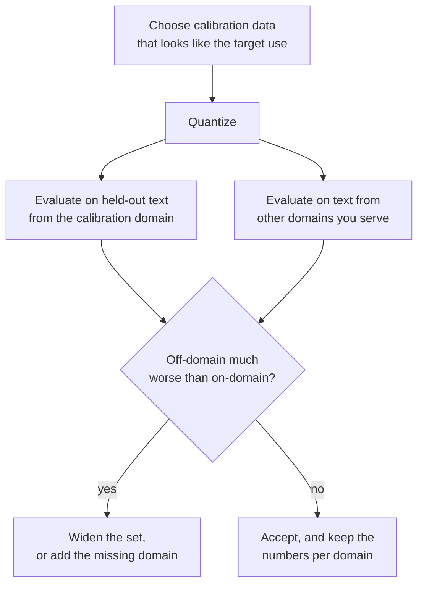

# Lección 12. El calibration set

**Vínculo con la misión:** GPTQ y AWQ valen lo que valgan los datos que leen, así que necesitas saber qué toma cada uno del calibration set, cuánto es suficiente y cómo se esconde una mala elección detrás de una perplexity de buen aspecto.
**Fuente principal:** [Paper: "AWQ: Activation-aware Weight Quantization for LLM Compression and Acceleration", Lin et al., 2023](https://arxiv.org/abs/2306.00978), sección 5.3
**Requisitos previos:** [Lección 11](0011-awq.md), [Calibration set](../GLOSSARY.md), [GPTQ](../GLOSSARY.md), [Perplexity](../GLOSSARY.md)

## Calentamiento

1. ▢ ¿Cuál de round-to-nearest, GPTQ y AWQ no necesita datos en absoluto?

<details markdown="1"><summary>Comprobación</summary>

Round-to-nearest. Solo lee los pesos. GPTQ y AWQ necesitan ambos entradas de capa procedentes de datos de calibración.

</details>

2. ▢ El calibration set de GPTQ en el paper son 128 segmentos de 2048 tokens. ¿Cuántos tokens son, y cómo se comparan con las 4096 features de entrada de una capa típica?

<details markdown="1"><summary>Comprobación</summary>

128 × 2048 = 262,144 tokens, que es 64 veces 4096. Para una capa con 4096 entradas la Hessiana `H = 2 X X^T` es de 4096 por 4096 y se estima con muchos más tokens que filas tiene.

</details>

3. ▢ En AWQ, ¿qué le hace a los pesos el scale `s = s_X^alpha`, y de dónde sale `s_X`?

<details markdown="1"><summary>Comprobación</summary>

Multiplica cada canal de entrada de los pesos, con el scale inverso aplicado a la activación, antes de que se redondeen los pesos. `s_X` es el promedio de la magnitud de activación de cada canal de entrada, medido en el calibration set.

</details>

## Qué debes saber

### Qué lee cada método

| Método | Qué toma del calibration set | Para qué lo usa |
|---|---|---|
| Round-to-nearest | Nada | Nada: los scales salen de los pesos |
| GPTQ | La entrada de cada capa, sumada en `H = 2 X X^T` | Decidir cómo repartir cada error de redondeo entre las columnas posteriores |
| AWQ | El promedio de la magnitud de activación por canal, más las salidas de la capa para puntuar cada `alpha` | Elegir los scales de los canales antes de redondear |

llm-compressor lo expone con claridad: round-to-nearest no usa datos, GPTQ, AWQ, SmoothQuant y AutoRound requieren un dataset de calibración, y los métodos basados en calibración suelen lograr una mejor recuperación de accuracy, sobre todo con anchos de bits menores ([documentación de llm-compressor](https://docs.vllm.ai/projects/llm-compressor/en/latest/steps/choosing-dataset/)). Ni GPTQ ni AWQ entrenan el modelo con los datos. Sigue en pie lo que dice el glosario: un calibration set no son datos de entrenamiento, y la cuantización post-entrenamiento nunca hace backpropagation a través de él.

El paper de GPTQ añade un detalle: las entradas de cada bloque de Transformer las producen los bloques ya cuantizados que lo preceden, de modo que las capas posteriores se ajustan a lo que de verdad verán ([Frantar et al., 2022](https://arxiv.org/abs/2210.17323)).

### Cuánto es suficiente

Los números de las fuentes, y qué son:

| Fuente | Calibration set | Nota |
|---|---|---|
| Paper de GPTQ | 128 segmentos aleatorios de 2048 tokens de C4 | Texto web genérico; sin datos de tareas |
| Paper de AWQ, Figura 8a | AWQ con 16 secuencias de 2048 tokens alcanza mejor perplexity que GPTQ con 192 | OPT-6.7B a 3 bits, grupos de 128; los autores lo leen como 10 veces menos datos |
| Documentación de llm-compressor | 128 a 512 muestras típicas, empezar con 128 a 256 | Más muestras mejoran la representación pero cuestan tiempo de compresión |
| Ejemplos de llm-compressor | 512 muestras de longitud 2048 para GPTQ, 256 de longitud 512 para AWQ | Scripts de ejemplo, no recomendaciones ajustadas |

El patrón se sigue de lo que estima cada método. AWQ conserva una media por canal, unos pocos miles de números, que una muestra pequeña fija. GPTQ estima toda una matriz de cómo covarían las features, lo que necesita al menos tantos tokens como features, y un conjunto demasiado pequeño se ajusta al ruido de esa muestra. El ejercicio 4 de la práctica muestra ese fallo en un ejemplo de juguete.

### Qué hace un conjunto que no coincide

Todo número que aprenden GPTQ y AWQ describe las entradas que vieron. Si cuantizas con texto de un dominio, la compensación o los scales quedan ajustados a la estructura de activaciones de ese dominio. En otro dominio quedan ajustados a lo equivocado.

El paper de AWQ lo prueba en OPT-6.7B a 3 bits con grupos de 128, usando dos subconjuntos del Pile, resúmenes de PubMed y correos de Enron, como calibration set y como conjunto de evaluación en las cuatro combinaciones. Aquí no se usa la perplexity de WikiText; cada celda es la perplexity en ese subconjunto ([Figura 8b](https://arxiv.org/abs/2306.00978)):

| Calibrado con | Evaluado en | GPTQ | AWQ |
|---|---|---|---|
| PubMed | PubMed | 32.48 | 32.56 |
| PubMed | Enron | 50.41 | 45.07 |
| Enron | PubMed | 34.81 | 33.16 |
| Enron | Enron | 45.52 | 44.57 |

Que coincidan los dominios de calibración y de evaluación es lo mejor para ambos. Cuando no coinciden, los autores informan de que AWQ empeora entre 0.5 y 0.6 y GPTQ entre 2.3 y 4.9. Los autores lo explican con su afirmación de la lección 11, que reconstruir salidas sobreajusta el calibration set. Son los números de los autores de AWQ en un modelo y con un ancho de bits, y los autores de AWQ comparan contra GPTQ, así que trata el tamaño de la brecha como una pista y no como una constante. La dirección es la lección.

El paper de GPTQ contiene la misma advertencia en una frase. Sus perplexities en C4 vienen de un modelo calibrado con texto de C4, y el paper señala que por eso la tarea no es del todo zero-shot.

### Cómo se manifiesta, y cómo evitarlo

Un conjunto que no coincide no falla con estruendo. La perplexity en el dominio de calibración, o en texto parecido, sale bien, y el daño aparece en otra parte: código, un idioma distinto del inglés, un documento largo y estructurado, el formato de chat con el que sirve el modelo. La orientación de llm-compressor es hacer que el conjunto sea representativo del uso previsto: WikiText o C4 para un modelo de propósito general, datos de instrucciones como UltraChat para un modelo que sigue instrucciones, datasets de código para un modelo de programación. La documentación de Transformers para GPTQ acepta `dataset="c4"` o tu propia lista de cadenas, y recomienda usar el dataset del paper de GPTQ ([documentación](https://huggingface.co/docs/transformers/main/en/quantization/gptq)). Los dos consejos coinciden para un modelo general en inglés y se separan para cualquier otra cosa.



## Práctica

1. ▢ Un ejemplo de llm-compressor cuantiza con 512 muestras de hasta 2048 tokens. ¿Cuántos tokens son como máximo, y cómo se compara con el conjunto del paper de GPTQ?

<details markdown="1"><summary>Comprobación</summary>

512 × 2048 = 1,048,576 tokens, cerca de 1 millón, 4 veces los 262,144 del paper de GPTQ. La documentación trata de 128 a 512 muestras como el rango típico.

</details>

2. ▢ ¿Qué frase enuncia correctamente lo que lee cada uno de los dos métodos del calibration set?

    - a) GPTQ construye una Hessiana a partir de las entradas, mientras que AWQ promedia magnitudes de canales
    - b) GPTQ promedia magnitudes de canales, mientras que AWQ construye una Hessiana a partir de las entradas
    - c) Ambos hacen backpropagation de una pérdida de calibración por cada capa de los pesos
    - d) Ninguno lee datos, porque ambos inspeccionan solo los valores de los pesos almacenados

<details markdown="1"><summary>Comprobación</summary>

**a)** GPTQ acumula `H = 2 X X^T` a partir de las entradas de cada capa. AWQ conserva la magnitud media de activación por canal y compara las salidas de la capa para cada `alpha`. (b) los intercambia. (c) es incorrecta porque la cuantización post-entrenamiento nunca hace backpropagation a través de los datos de calibración. (d) es incorrecta porque ambos necesitan activaciones, que los pesos por sí solos no pueden suministrar.

</details>

3. ▢ A partir de la tabla de la Figura 8b del paper de AWQ de arriba, calcula cuánto empeoran GPTQ y AWQ cuando se calibran con el otro dominio, para la evaluación en Enron y en PubMed.

<details markdown="1"><summary>Comprobación</summary>

Evaluado en Enron, GPTQ pasa de 45.52 (calibrado con Enron) a 50.41 (calibrado con PubMed), 4.89 peor, y AWQ de 44.57 a 45.07, 0.50 peor. Evaluado en PubMed, GPTQ pasa de 32.48 a 34.81, 2.33 peor, y AWQ de 32.56 a 33.16, 0.60 peor. Son los 2.3 a 4.9 y los 0.5 a 0.6 que enuncia el paper.

</details>

4. ▢ Predice y luego ejecuta. Una capa de juguete tiene 128 features de entrada y dos dominios cuyas entradas están correlacionadas de maneras distintas. GPTQ se calibra con el dominio A con 1024 muestras, con el dominio A con solo 64 muestras y con el dominio B con 1024 muestras, y cada resultado se prueba con muestras nuevas de ambos dominios. Predice cuáles de los tres resultados calibrados superan a round-to-nearest en el dominio B.

    ```python
    import numpy as np

    rng = np.random.default_rng(0)
    rows, cols, bits = 64, 128, 3
    qmax = 2 ** (bits - 1) - 1
    W = rng.standard_normal((rows, cols))
    scale = np.abs(W).max(axis=1) / qmax

    mix_a = rng.standard_normal((cols, cols)) / np.sqrt(cols)
    mix_b = rng.standard_normal((cols, cols)) / np.sqrt(cols)

    def sample(mix, n):
        return mix @ rng.standard_normal((cols, n))

    def quant(w, s):
        return np.clip(np.round(w / s), -qmax, qmax) * s

    def gptq(W, X):
        W = W.copy()
        H = 2 * X @ X.T
        H += 0.01 * np.mean(np.diag(H)) * np.eye(cols)
        U = np.linalg.cholesky(np.linalg.inv(H)).T
        Q = np.zeros_like(W)
        for i in range(cols):
            Q[:, i] = quant(W[:, i], scale)
            err = (W[:, i] - Q[:, i]) / U[i, i]
            W[:, i + 1:] -= np.outer(err, U[i, i + 1:])
        return Q

    def rel_err(Q, X):
        return np.linalg.norm(W @ X - Q @ X) / np.linalg.norm(W @ X)

    test_a, test_b = sample(mix_a, 2048), sample(mix_b, 2048)
    rtn_q = quant(W, scale[:, None])
    print(f"RTN                 test A {rel_err(rtn_q, test_a):.4f}  test B {rel_err(rtn_q, test_b):.4f}")
    for name, X in (("GPTQ, 1024 from A", sample(mix_a, 1024)),
                    ("GPTQ, 64 from A  ", sample(mix_a, 64)),
                    ("GPTQ, 1024 from B", sample(mix_b, 1024))):
        q = gptq(W, X)
        print(f"{name}   test A {rel_err(q, test_a):.4f}  test B {rel_err(q, test_b):.4f}")
    ```

<details markdown="1"><summary>Pista</summary>

Round-to-nearest no lee datos, así que sus dos números son la referencia. Pregúntate qué dice sobre el dominio B la Hessiana del dominio A, y qué puede decir sobre cualquier cosa una Hessiana construida con 64 muestras de 128 features.

</details>

<details markdown="1"><summary>Comprobación</summary>

```text
RTN                 test A 0.2658  test B 0.2725
GPTQ, 1024 from A   test A 0.1967  test B 0.4187
GPTQ, 64 from A     test A 0.3291  test B 0.4437
GPTQ, 1024 from B   test A 0.4068  test B 0.2003
```

Solo la ejecución de GPTQ calibrada con el dominio B supera a round-to-nearest en el dominio B (0.2003 frente a 0.2725). La ejecución calibrada con el dominio A es mejor en A (0.1967) y claramente peor que no calibrar en B (0.4187). La ejecución de 64 muestras, con menos muestras que las 128 features, es peor que round-to-nearest incluso en su propio dominio. Los dominios del ejemplo de juguete no comparten estructura, algo que el texto real sí hace, así que las penalizaciones reales son más suaves que estas, pero los tres patrones son los que hay que buscar: ganancia dentro del dominio, pérdida fuera del dominio y pérdida por muy pocas muestras.

</details>

5. ▢ Un equipo cuantiza un asistente de código con GPTQ, calibrado con texto web en inglés, e informa de una perplexity en WikiText a menos de 0.1 del modelo de 16 bits. Luego los usuarios reportan peores completados de código. ¿Cuál es la causa más probable, y qué cambiarías?

<details markdown="1"><summary>Comprobación</summary>

Desajuste de dominio: la compensación se ajustó a las activaciones de prosa en inglés, y WikiText se parece a eso, así que el informe coincide con el dominio de calibración y no dice nada sobre el código. Calibra con código, como sugiere llm-compressor para un modelo de programación, quizá mezclado con el formato de instrucciones con el que sirve el modelo, y evalúa con código held-out además de con texto. Compara con round-to-nearest en la misma evaluación de código para confirmar que la calibración ayudó ahí.

</details>

6. ▢ Alguien informa "la perplexity de GPTQ en C4 está cerca de la de 16 bits, así que generaliza", y el conjunto usado para calibrar también se tomó de C4. ¿Qué deberías decir?

<details markdown="1"><summary>Comprobación</summary>

La medición está favorecida, porque el texto de calibración y el de evaluación vienen de la misma distribución. El propio paper de GPTQ señala que sus resultados en C4 no son del todo zero-shot por esta razón. Los resultados del paper en WikiText-2 y PTB, sobre texto de otras fuentes, y una evaluación held-out de tu propio dominio son la mejor evidencia.

</details>

## Prácticas en el mundo real

- [ ] Abre la página "Choosing a dataset" de llm-compressor. Anota su rango de muestras recomendado, y luego encuentra el número de muestras de calibración y el dataset en su script de ejemplo de GPTQ y en su script de ejemplo de AWQ.
- [ ] Encuentra un checkpoint de GPTQ o AWQ en el Hugging Face Hub para un modelo que uses. Lee su model card para ver el dataset de calibración y el número de muestras. Si no lo dice, anótalo como una laguna, y decide si confiarías en él en tu propio dominio.
- [ ] Mañana: sin apuntes, escribe qué lee cada uno de round-to-nearest, GPTQ y AWQ del calibration set, y los tres patrones del ejemplo de juguete del ejercicio 4 de la práctica.

## Para profundizar

- [Métodos PTQ de pesos](../reference/weight-ptq-methods.md)
- [Docs: "Choosing a dataset", LLM Compressor](https://docs.vllm.ai/projects/llm-compressor/en/latest/steps/choosing-dataset/)
- [Docs: "GPTQ", Hugging Face Transformers](https://huggingface.co/docs/transformers/main/en/quantization/gptq)
- [Repo: llm-compressor, vLLM project](https://github.com/vllm-project/llm-compressor)
- [Recursos](../RESOURCES.md)

---

¿No termina de quedar claro? Vuelve a leer la fuente primaria de arriba, ya que esta lección la comprime y en la compresión es donde se escapa la comprensión. Consulta el [glosario](../GLOSSARY.md) por si algún término te resultó resbaladizo.

Si lo poco claro es la propia lección y no el material, eso es un defecto: [abre un issue](https://github.com/TokenCemetery/teach/issues).
