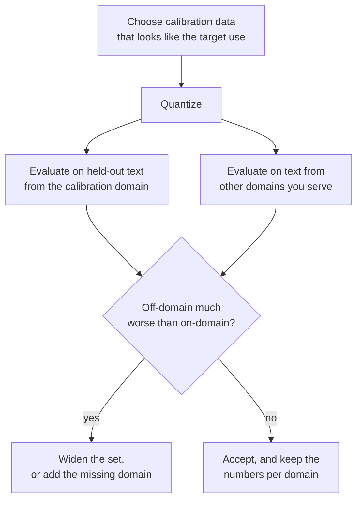

# Leçon 12. Le calibration set

**Lien avec la mission :** GPTQ et AWQ ne valent que par les données qu'ils lisent, donc vous devez savoir ce que chacun prend dans le calibration set, combien suffit, et comment un mauvais choix se cache dans une perplexity d'apparence correcte.
**Source primaire :** [Article : "AWQ: Activation-aware Weight Quantization for LLM Compression and Acceleration", Lin et al., 2023](https://arxiv.org/abs/2306.00978), section 5.3
**Prérequis :** [Leçon 11](0011-awq.md), [Calibration set](../GLOSSARY.md), [GPTQ](../GLOSSARY.md), [Perplexity](../GLOSSARY.md)

## Échauffement

1. ▢ Laquelle de l'arrondi au plus proche, de GPTQ et d'AWQ n'a besoin d'aucune donnée ?

<details markdown="1"><summary>Vérifier</summary>

L'arrondi au plus proche. Il ne lit que les poids. GPTQ et AWQ ont tous deux besoin des entrées de couche issues de données de calibration.

</details>

2. ▢ Le calibration set de GPTQ dans l'article fait 128 segments de 2048 tokens. Combien de tokens cela fait-il, et comment cela se compare-t-il aux 4096 features d'entrée d'une couche typique ?

<details markdown="1"><summary>Vérifier</summary>

128 × 2048 = 262,144 tokens, soit 64 fois 4096. Pour une couche à 4096 entrées, la hessienne `H = 2 X X^T` fait 4096 par 4096 et est estimée à partir de bien plus de tokens qu'elle n'a de lignes.

</details>

3. ▢ Dans AWQ, que fait le scale `s = s_X^alpha` aux poids, et d'où vient `s_X` ?

<details markdown="1"><summary>Vérifier</summary>

Il multiplie chaque canal d'entrée des poids, avec le scale inverse appliqué à l'activation, avant que les poids soient arrondis. `s_X` est la grandeur moyenne d'activation de chaque canal d'entrée, mesurée sur le calibration set.

</details>

## À savoir

### Ce que chaque méthode lit

| Méthode | Ce qu'elle prend dans le calibration set | À quoi elle l'utilise |
|---|---|---|
| Arrondi au plus proche | Rien | Rien : les scales viennent des poids |
| GPTQ | L'entrée de chaque couche, sommée en `H = 2 X X^T` | Décider comment répartir chaque erreur d'arrondi sur les colonnes suivantes |
| AWQ | La grandeur moyenne d'activation par canal, plus les sorties de couche pour noter chaque `alpha` | Choisir les scales des canaux avant l'arrondi |

llm-compressor énonce clairement la répartition : l'arrondi au plus proche ne demande pas de données, GPTQ, AWQ, SmoothQuant et AutoRound exigent un jeu de données de calibration, et les méthodes fondées sur la calibration retrouvent en général mieux la précision, surtout aux faibles largeurs en bits ([docs de llm-compressor](https://docs.vllm.ai/projects/llm-compressor/en/latest/steps/choosing-dataset/)). Ni GPTQ ni AWQ n'entraînent le modèle sur les données. Le point du glossaire tient : un calibration set n'est pas un jeu d'entraînement, et la quantification post-entraînement ne rétropropage jamais à travers lui.

L'article GPTQ ajoute un détail : les entrées de chaque bloc Transformer sont produites par les blocs déjà quantifiés avant lui, donc les couches ultérieures sont ajustées à ce qu'elles verront réellement ([Frantar et al., 2022](https://arxiv.org/abs/2210.17323)).

### Combien suffit

Les chiffres des sources, et ce qu'ils sont :

| Source | Calibration set | Remarque |
|---|---|---|
| Article GPTQ | 128 segments aléatoires de 2048 tokens issus de C4 | Texte web générique ; aucune donnée de tâche |
| Article AWQ, figure 8a | AWQ à 16 séquences de 2048 tokens atteint une meilleure perplexity que GPTQ à 192 | OPT-6.7B en 3 bits, groupes de 128 ; les auteurs y lisent 10 fois moins de données |
| Docs de llm-compressor | 128 à 512 échantillons typiques, commencer à 128 à 256 | Plus d'échantillons améliorent la représentation mais coûtent du temps de compression |
| Exemples de llm-compressor | 512 échantillons de longueur 2048 pour GPTQ, 256 de longueur 512 pour AWQ | Scripts d'exemple, pas des recommandations réglées |

Le schéma découle de ce que chaque méthode estime. AWQ garde une moyenne par canal, quelques milliers de nombres, qu'un petit échantillon fixe bien. GPTQ estime toute une matrice de covariation des features, ce qui demande au moins autant de tokens que de features, et un jeu trop petit ajuste le bruit de cet échantillon. L'exercice 4 de la pratique montre cet échec dans un jouet.

### Ce que fait un jeu inadapté

Chaque nombre qu'apprennent GPTQ et AWQ décrit les entrées qu'ils ont vues. Quantifiez avec du texte d'un domaine et la compensation ou les scales sont réglés sur la structure d'activation de ce domaine. Sur un autre domaine, ils sont réglés sur la mauvaise chose.

L'article AWQ teste cela sur OPT-6.7B en 3 bits avec des groupes de 128, en utilisant deux sous-ensembles du Pile, des résumés PubMed et des e-mails Enron, comme calibration set et jeu d'évaluation dans les quatre combinaisons. La perplexity WikiText n'est pas utilisée ici ; chaque cellule est la perplexity sur ce sous-ensemble ([figure 8b](https://arxiv.org/abs/2306.00978)) :

| Calibré sur | Évalué sur | GPTQ | AWQ |
|---|---|---|---|
| PubMed | PubMed | 32.48 | 32.56 |
| PubMed | Enron | 50.41 | 45.07 |
| Enron | PubMed | 34.81 | 33.16 |
| Enron | Enron | 45.52 | 44.57 |

Faire correspondre les domaines de calibration et d'évaluation est le mieux pour les deux. En cas de désaccord, les auteurs rapportent qu'AWQ est de 0.5 à 0.6 moins bon et GPTQ de 2.3 à 4.9 moins bon. Les auteurs expliquent cela par leur affirmation de la leçon 11, selon laquelle reconstruire les sorties surajuste le calibration set. Ce sont les chiffres des auteurs d'AWQ sur un modèle à une largeur en bits, et les auteurs d'AWQ se comparent à GPTQ, donc traitez la taille de l'écart comme une piste et pas comme une constante. La direction est la leçon.

L'article GPTQ contient le même avertissement en une phrase. Ses perplexities sur C4 viennent d'un modèle calibré sur du texte C4, et l'article note que la tâche n'est donc pas entièrement zero-shot.

### Comment cela se manifeste, et comment l'éviter

Un jeu inadapté n'échoue pas bruyamment. La perplexity sur le domaine de calibration, ou sur un texte qui lui ressemble, ressort correcte, et les dégâts apparaissent ailleurs : le code, une langue autre que l'anglais, un long document structuré, le format de conversation que sert le modèle. Le conseil de llm-compressor est de rendre le jeu représentatif de l'usage visé : WikiText ou C4 pour un modèle généraliste, des données d'instructions comme UltraChat pour un modèle qui suit des instructions, des jeux de code pour un modèle de programmation. La documentation de Transformers pour GPTQ accepte `dataset="c4"` ou votre propre liste de chaînes, et recommande d'utiliser le jeu de données de l'article GPTQ ([Doc](https://huggingface.co/docs/transformers/main/en/quantization/gptq)). Les deux conseils concordent pour un modèle généraliste en anglais et divergent pour tout le reste.



## Pratique

1. ▢ Un exemple de llm-compressor quantifie avec 512 échantillons d'au plus 2048 tokens. Combien de tokens cela fait-il au maximum, et comment cela se compare-t-il au jeu de l'article GPTQ ?

<details markdown="1"><summary>Vérifier</summary>

512 × 2048 = 1,048,576 tokens, environ 1 million, soit 4 fois les 262,144 de l'article GPTQ. Les docs traitent 128 à 512 échantillons comme la plage typique.

</details>

2. ▢ Quelle phrase énonce correctement ce que les deux méthodes lisent dans le calibration set ?

    - a) GPTQ construit une hessienne à partir des entrées, tandis qu'AWQ fait la moyenne des grandeurs de canaux
    - b) GPTQ fait la moyenne des grandeurs de canaux, tandis qu'AWQ construit une hessienne à partir des entrées
    - c) Les deux rétropropagent une loss de calibration à travers chaque couche des poids
    - d) Aucune ne lit de données, parce que les deux n'inspectent que les valeurs de poids stockées

<details markdown="1"><summary>Vérifier</summary>

**a)** GPTQ accumule `H = 2 X X^T` à partir des entrées de chaque couche. AWQ garde la grandeur moyenne d'activation par canal et compare les sorties de couche pour chaque `alpha`. (b) les échange. (c) est faux parce que la quantification post-entraînement ne rétropropage jamais à travers les données de calibration. (d) est faux parce que les deux ont besoin d'activations, que les poids seuls ne peuvent pas fournir.

</details>

3. ▢ À partir du tableau de la figure 8b de l'article AWQ ci-dessus, calculez de combien GPTQ et AWQ se dégradent chacun quand ils sont calibrés sur l'autre domaine, pour une évaluation sur Enron et sur PubMed.

<details markdown="1"><summary>Vérifier</summary>

Évalué sur Enron, GPTQ passe de 45.52 (calibré sur Enron) à 50.41 (calibré sur PubMed), soit 4.89 de plus, et AWQ de 44.57 à 45.07, soit 0.50 de plus. Évalué sur PubMed, GPTQ passe de 32.48 à 34.81, soit 2.33 de plus, et AWQ de 32.56 à 33.16, soit 0.60 de plus. Ce sont les 2.3 à 4.9 et 0.5 à 0.6 que l'article énonce.

</details>

4. ▢ Prédisez, puis exécutez. Une couche jouet a 128 features d'entrée et deux domaines dont les entrées sont corrélées de façons différentes. GPTQ est calibré sur le domaine A avec 1024 échantillons, sur le domaine A avec seulement 64 échantillons, et sur le domaine B avec 1024 échantillons, et chaque résultat est testé sur des échantillons neufs des deux domaines. Prédisez lesquels des trois résultats calibrés battent l'arrondi au plus proche sur le domaine B.

    ```python
    import numpy as np

    rng = np.random.default_rng(0)
    rows, cols, bits = 64, 128, 3
    qmax = 2 ** (bits - 1) - 1
    W = rng.standard_normal((rows, cols))
    scale = np.abs(W).max(axis=1) / qmax

    mix_a = rng.standard_normal((cols, cols)) / np.sqrt(cols)
    mix_b = rng.standard_normal((cols, cols)) / np.sqrt(cols)

    def sample(mix, n):
        return mix @ rng.standard_normal((cols, n))

    def quant(w, s):
        return np.clip(np.round(w / s), -qmax, qmax) * s

    def gptq(W, X):
        W = W.copy()
        H = 2 * X @ X.T
        H += 0.01 * np.mean(np.diag(H)) * np.eye(cols)
        U = np.linalg.cholesky(np.linalg.inv(H)).T
        Q = np.zeros_like(W)
        for i in range(cols):
            Q[:, i] = quant(W[:, i], scale)
            err = (W[:, i] - Q[:, i]) / U[i, i]
            W[:, i + 1:] -= np.outer(err, U[i, i + 1:])
        return Q

    def rel_err(Q, X):
        return np.linalg.norm(W @ X - Q @ X) / np.linalg.norm(W @ X)

    test_a, test_b = sample(mix_a, 2048), sample(mix_b, 2048)
    rtn_q = quant(W, scale[:, None])
    print(f"RTN                 test A {rel_err(rtn_q, test_a):.4f}  test B {rel_err(rtn_q, test_b):.4f}")
    for name, X in (("GPTQ, 1024 from A", sample(mix_a, 1024)),
                    ("GPTQ, 64 from A  ", sample(mix_a, 64)),
                    ("GPTQ, 1024 from B", sample(mix_b, 1024))):
        q = gptq(W, X)
        print(f"{name}   test A {rel_err(q, test_a):.4f}  test B {rel_err(q, test_b):.4f}")
    ```

<details markdown="1"><summary>Indice</summary>

L'arrondi au plus proche ne lit aucune donnée, donc ses deux chiffres sont la référence. Demandez-vous ce que la hessienne du domaine A dit du domaine B, et ce qu'une hessienne construite à partir de 64 échantillons de 128 features peut dire de quoi que ce soit.

</details>

<details markdown="1"><summary>Vérifier</summary>

```text
RTN                 test A 0.2658  test B 0.2725
GPTQ, 1024 from A   test A 0.1967  test B 0.4187
GPTQ, 64 from A     test A 0.3291  test B 0.4437
GPTQ, 1024 from B   test A 0.4068  test B 0.2003
```

Seule l'exécution GPTQ calibrée sur le domaine B bat l'arrondi au plus proche sur le domaine B (0.2003 contre 0.2725). L'exécution calibrée sur le domaine A est meilleure sur A (0.1967) et nettement pire que l'absence de calibration sur B (0.4187). L'exécution à 64 échantillons, avec moins d'échantillons que de features (128), est pire que l'arrondi au plus proche même sur son propre domaine. Les domaines du jouet ne partagent aucune structure, ce que fait le vrai texte, donc les pénalités réelles sont plus douces que celles-ci, mais les trois motifs sont ceux à chercher : un gain dans le domaine, une perte hors domaine, et une perte due à trop peu d'échantillons.

</details>

5. ▢ Une équipe quantifie un assistant de code avec GPTQ, calibré sur du texte web en anglais, et rapporte une perplexity WikiText à moins de 0.1 du modèle en 16 bits. Les utilisateurs signalent ensuite de moins bonnes complétions de code. Quelle est la cause la plus probable, et que changeriez-vous ?

<details markdown="1"><summary>Vérifier</summary>

Une inadéquation de domaine : la compensation a été ajustée aux activations de la prose anglaise, et WikiText en est proche, donc le rapport correspond au domaine de calibration et ne dit rien du code. Calibrez sur du code, comme le suggère llm-compressor pour un modèle de programmation, éventuellement mélangé au format d'instructions que sert le modèle, et évaluez sur du code held-out aussi bien que sur du texte. Comparez à l'arrondi au plus proche sur la même évaluation de code pour confirmer que la calibration y a aidé.

</details>

6. ▢ Quelqu'un rapporte « la perplexity GPTQ sur C4 est proche du 16 bits, donc il généralise », et le jeu utilisé pour calibrer était aussi tiré de C4. Que devez-vous dire ?

<details markdown="1"><summary>Vérifier</summary>

La mesure est flattée, parce que le texte de calibration et le texte d'évaluation viennent de la même distribution. L'article GPTQ note lui-même que ses résultats sur C4 ne sont pas entièrement zero-shot pour cette raison. Les résultats WikiText-2 et PTB de l'article, sur des textes d'autres sources, et une évaluation held-out de votre propre domaine sont de meilleures preuves.

</details>

## Exercices en situation réelle

- [ ] Ouvrez la page « Choosing a dataset » de llm-compressor. Notez la plage d'échantillons qu'elle recommande, puis trouvez le nombre d'échantillons de calibration et le jeu de données dans son script d'exemple GPTQ et dans son script d'exemple AWQ.
- [ ] Trouvez un checkpoint GPTQ ou AWQ sur le Hugging Face Hub pour un modèle que vous utilisez. Lisez sa fiche de modèle pour le jeu de données de calibration et le nombre d'échantillons. S'il n'est pas indiqué, notez-le comme une lacune, et décidez si vous lui feriez confiance sur votre propre domaine.
- [ ] Demain : sans notes, écrivez ce que l'arrondi au plus proche, GPTQ et AWQ lisent chacun dans le calibration set, et les trois motifs du jouet de l'exercice 4 de la pratique.

## Pour aller plus loin

- [Méthodes PTQ pour les poids](../reference/weight-ptq-methods.md)
- [Doc : "Choosing a dataset", LLM Compressor](https://docs.vllm.ai/projects/llm-compressor/en/latest/steps/choosing-dataset/)
- [Doc : "GPTQ", Hugging Face Transformers](https://huggingface.co/docs/transformers/main/en/quantization/gptq)
- [Dépôt : llm-compressor, projet vLLM](https://github.com/vllm-project/llm-compressor)
- [Ressources](../RESOURCES.md)

---

Ça ne passe pas ? Relisez la source primaire en haut de page, car cette leçon la condense et c'est dans la condensation que la compréhension s'échappe. Consultez le [glossaire](../GLOSSARY.md) pour tout terme qui vous a paru glissant.

Si c'est la leçon elle-même qui n'est pas claire plutôt que la matière, c'est un défaut : [ouvrez une issue](https://github.com/TokenCemetery/teach/issues).
