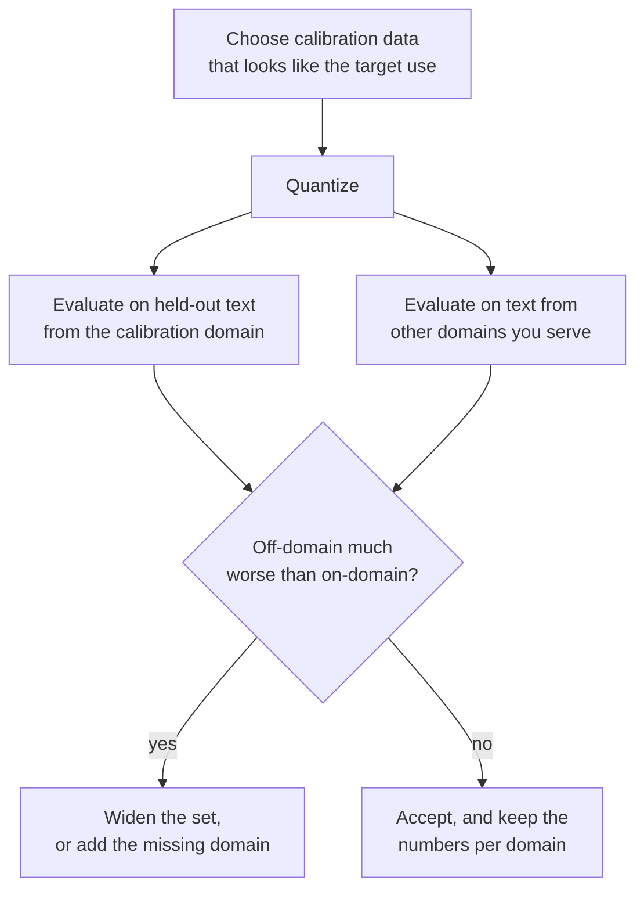

# पाठ 12. Calibration Set

**मिशन से संबंध:** GPTQ और AWQ उतने ही अच्छे हैं जितना वह data जो वे पढ़ते हैं, इसलिए आपको जानना होगा कि हर एक calibration set से क्या लेता है, कितना काफ़ी है, और ग़लत चुनाव अच्छी दिखती perplexity में कैसे छिप जाता है।
**मुख्य स्रोत:** [पेपर: "AWQ: Activation-aware Weight Quantization for LLM Compression and Acceleration", Lin et al., 2023](https://arxiv.org/abs/2306.00978), section 5.3
**पूर्व-आवश्यकताएँ:** [पाठ 11](0011-awq.md), [Calibration set](../GLOSSARY.md), [GPTQ](../GLOSSARY.md), [Perplexity](../GLOSSARY.md)

## वार्म-अप

1. ▢ Round-to-nearest, GPTQ और AWQ में से किसे बिल्कुल data नहीं चाहिए?

<details markdown="1"><summary>जाँचें</summary>

Round-to-nearest को। वह सिर्फ़ weights पढ़ता है। GPTQ और AWQ दोनों को calibration data से layer inputs चाहिए।

</details>

2. ▢ पेपर में GPTQ का calibration set 2048 tokens के 128 segments है। वह कितने tokens हैं, और किसी आम layer के 4096 input features से उसकी तुलना कैसी है?

<details markdown="1"><summary>जाँचें</summary>

128 × 2048 = 262,144 tokens, जो 4096 का 64 गुना है। 4096 inputs वाली layer के लिए Hessian `H = 2 X X^T` 4096 गुना 4096 का है और उसकी rows से कहीं ज़्यादा tokens से अनुमानित होता है।

</details>

3. ▢ AWQ में, scale `s = s_X^alpha` weights के साथ क्या करता है, और `s_X` कहाँ से आता है?

<details markdown="1"><summary>जाँचें</summary>

वह weights के हर input channel को गुणा करता है, activation पर उलटे scale के साथ, weights के round होने से पहले। `s_X` हर input channel की औसत activation magnitude है, जो calibration set पर मापी जाती है।

</details>

## यह जानें

### हर method क्या पढ़ता है

| Method | Calibration set से क्या लेता है | उसका इस्तेमाल किसलिए करता है |
|---|---|---|
| Round-to-nearest | कुछ नहीं | कुछ नहीं: scales weights से आते हैं |
| GPTQ | हर layer का input, जिसे `H = 2 X X^T` में जोड़ा जाता है | यह तय करने में कि हर rounding error को बाद के columns पर कैसे फैलाया जाए |
| AWQ | हर channel की औसत activation magnitude, और हर `alpha` को score करने के लिए layer outputs | Rounding से पहले channel scales चुनने में |

llm-compressor यह बँटवारा साफ़ कहता है: round-to-nearest data-free है, GPTQ, AWQ, SmoothQuant और AutoRound को calibration dataset चाहिए, और calibration-आधारित methods आम तौर पर बेहतर accuracy recovery पाते हैं, ख़ासकर कम bit widths पर ([llm-compressor दस्तावेज़](https://docs.vllm.ai/projects/llm-compressor/en/latest/steps/choosing-dataset/))। न GPTQ और न AWQ model को data पर train करता है। शब्दावली की बात क़ायम है: calibration set training data नहीं है, और post-training quantization उस पर कभी backpropagate नहीं करता।

GPTQ पेपर एक ब्योरा जोड़ता है: हर Transformer block के inputs उससे पहले के पहले से quantize हो चुके blocks बनाते हैं, इसलिए बाद की layers उसके हिसाब से fit होती हैं जो वे सचमुच देखेंगी ([Frantar et al., 2022](https://arxiv.org/abs/2210.17323))।

### कितना काफ़ी है

स्रोतों की संख्याएँ, और वे क्या हैं:

| स्रोत | Calibration set | टिप्पणी |
|---|---|---|
| GPTQ पेपर | C4 से 2048 tokens के 128 random segments | आम web text; कोई task data नहीं |
| AWQ पेपर, Figure 8a | 2048 tokens के 16 sequences पर AWQ, 192 पर GPTQ से बेहतर perplexity पाता है | 128 के groups के साथ 3 bits पर OPT-6.7B; लेखक इसे 10 गुना कम data की तरह पढ़ते हैं |
| llm-compressor दस्तावेज़ | आम तौर पर 128 से 512 samples, 128 से 256 से शुरू करें | ज़्यादा samples से representation सुधरता है पर compression का समय लगता है |
| llm-compressor उदाहरण | GPTQ के लिए लंबाई 2048 पर 512 samples, AWQ के लिए लंबाई 512 पर 256 | उदाहरण scripts, tune की गई सिफ़ारिशें नहीं |

यह pattern इससे निकलता है कि हर method क्या अनुमानित करता है। AWQ हर channel का एक mean रखता है, कुछ हज़ार संख्याएँ, जिन्हें छोटा नमूना बाँध देता है। GPTQ features के साथ-साथ बदलने की पूरी matrix का अनुमान लगाता है, जिसके लिए कम से कम उतने tokens चाहिए जितने features, और बहुत छोटा set उस नमूने के noise पर fit हो जाता है। अभ्यास का सवाल 4 उस विफलता को एक खिलौने में दिखाता है।

### बेमेल set क्या करता है

GPTQ और AWQ जो भी संख्या सीखते हैं वह उन inputs का वर्णन करती है जो उन्होंने देखे। किसी एक domain के text से quantize करें तो compensation या scales उस domain की activation की बनावट के हिसाब से tune हो जाते हैं। दूसरे domain पर वे ग़लत चीज़ के हिसाब से tune हैं।

AWQ पेपर इसे 128 के groups के साथ 3 bits पर OPT-6.7B पर परखता है, Pile के दो उपसमूहों, PubMed abstracts और Enron emails, को चारों संयोजनों में calibration set और evaluation set बनाकर। यहाँ WikiText perplexity इस्तेमाल नहीं होती; हर cell उस उपसमूह की perplexity है ([Figure 8b](https://arxiv.org/abs/2306.00978)):

| Calibrate किया गया | Evaluate किया गया | GPTQ | AWQ |
|---|---|---|---|
| PubMed | PubMed | 32.48 | 32.56 |
| PubMed | Enron | 50.41 | 45.07 |
| Enron | PubMed | 34.81 | 33.16 |
| Enron | Enron | 45.52 | 44.57 |

Calibration और evaluation domains का मेल दोनों के लिए सबसे अच्छा है। बेमेल होने पर, लेखक बताते हैं कि AWQ 0.5 से 0.6 बदतर होता है और GPTQ 2.3 से 4.9। लेखक इसे पाठ 11 के अपने उस दावे से समझाते हैं कि outputs का पुनर्निर्माण calibration set पर overfit करता है। ये AWQ के लेखकों की संख्याएँ हैं, एक model पर एक bit width पर, और AWQ के लेखक GPTQ से तुलना करते हैं, इसलिए अंतर के आकार को सुराग़ मानें, स्थिरांक नहीं। दिशा ही सबक़ है।

GPTQ पेपर में एक वाक्य में वही चेतावनी है। उसकी C4 perplexities C4 text पर calibrate किए गए model से आती हैं, और पेपर ध्यान दिलाता है कि इसलिए task पूरी तरह zero-shot नहीं है।

### यह कैसे दिखता है, और इससे कैसे बचें

बेमेल set ज़ोर से विफल नहीं होता। Calibration domain पर, या उससे मिलते-जुलते text पर, perplexity ठीक आती है, और नुक़सान कहीं और दिखता है: code, कोई ग़ैर-अंग्रेज़ी भाषा, लंबा संरचित document, वह chat format जिसमें model serve होता है। llm-compressor का मार्गदर्शन है कि set को लक्ष्य उपयोग का प्रतिनिधि बनाएँ: सामान्य-उद्देश्य model के लिए WikiText या C4, instruction-following model के लिए UltraChat जैसा instruction data, coding model के लिए code datasets। GPTQ के लिए Transformers का दस्तावेज़ `dataset="c4"` या आपकी अपनी strings की सूची स्वीकार करता है, और GPTQ पेपर वाला dataset इस्तेमाल करने की सलाह देता है ([दस्तावेज़](https://huggingface.co/docs/transformers/main/en/quantization/gptq))। दोनों सलाहें सामान्य अंग्रेज़ी model के लिए मेल खाती हैं और बाक़ी हर चीज़ के लिए अलग हो जाती हैं।



## अभ्यास

1. ▢ llm-compressor का एक उदाहरण 2048 tokens तक के 512 samples से quantize करता है। वह ज़्यादा से ज़्यादा कितने tokens है, और GPTQ पेपर के set से उसकी तुलना कैसी है?

<details markdown="1"><summary>जाँचें</summary>

512 × 2048 = 1,048,576 tokens, लगभग 10 लाख, GPTQ पेपर के 262,144 का 4 गुना। दस्तावेज़ 128 से 512 samples को आम range मानते हैं।

</details>

2. ▢ कौन-सा वाक्य सही बताता है कि दोनों methods calibration set से क्या पढ़ते हैं?

    - a) GPTQ inputs से Hessian बनाता है, जबकि AWQ channel magnitudes का औसत लेता है
    - b) GPTQ channel magnitudes का औसत लेता है, जबकि AWQ inputs से Hessian बनाता है
    - c) दोनों weights की हर layer के आर-पार calibration loss को backpropagate करते हैं
    - d) कोई data नहीं पढ़ता, क्योंकि दोनों सिर्फ़ store की गई weight values देखते हैं

<details markdown="1"><summary>जाँचें</summary>

**a)** GPTQ हर layer के inputs से `H = 2 X X^T` जमा करता है। AWQ हर channel की औसत activation magnitude रखता है और हर `alpha` के लिए layer outputs की तुलना करता है। (b) दोनों को उलट देता है। (c) ग़लत है क्योंकि post-training quantization calibration data के आर-पार कभी backpropagate नहीं करता। (d) ग़लत है क्योंकि दोनों को activations चाहिए, जो अकेले weights नहीं दे सकते।

</details>

3. ▢ ऊपर की AWQ पेपर के Figure 8b वाली table से गिनें कि दूसरे domain पर calibrate करने पर GPTQ और AWQ हर एक कितना बदतर होता है, Enron और PubMed पर evaluation के लिए।

<details markdown="1"><summary>जाँचें</summary>

Enron पर evaluate करने पर, GPTQ 45.52 (Enron पर calibrate) से 50.41 (PubMed पर calibrate) पर जाता है, 4.89 बदतर, और AWQ 44.57 से 45.07, 0.50 बदतर। PubMed पर evaluate करने पर, GPTQ 32.48 से 34.81, 2.33 बदतर, और AWQ 32.56 से 33.16, 0.60 बदतर। ये वही 2.3 से 4.9 और 0.5 से 0.6 हैं जो पेपर कहता है।

</details>

4. ▢ पहले अनुमान लगाएँ, फिर चलाएँ। एक खिलौना layer में 128 input features हैं और दो domains हैं जिनके inputs अलग-अलग तरह से correlated हैं। GPTQ को domain A पर 1024 samples से, domain A पर सिर्फ़ 64 samples से, और domain B पर 1024 samples से calibrate किया जाता है, और हर नतीजा दोनों domains के नए samples पर परखा जाता है। अनुमान लगाएँ कि तीन calibrated नतीजों में से कौन-से domain B पर round-to-nearest को हराते हैं।

    ```python
    import numpy as np

    rng = np.random.default_rng(0)
    rows, cols, bits = 64, 128, 3
    qmax = 2 ** (bits - 1) - 1
    W = rng.standard_normal((rows, cols))
    scale = np.abs(W).max(axis=1) / qmax

    mix_a = rng.standard_normal((cols, cols)) / np.sqrt(cols)
    mix_b = rng.standard_normal((cols, cols)) / np.sqrt(cols)

    def sample(mix, n):
        return mix @ rng.standard_normal((cols, n))

    def quant(w, s):
        return np.clip(np.round(w / s), -qmax, qmax) * s

    def gptq(W, X):
        W = W.copy()
        H = 2 * X @ X.T
        H += 0.01 * np.mean(np.diag(H)) * np.eye(cols)
        U = np.linalg.cholesky(np.linalg.inv(H)).T
        Q = np.zeros_like(W)
        for i in range(cols):
            Q[:, i] = quant(W[:, i], scale)
            err = (W[:, i] - Q[:, i]) / U[i, i]
            W[:, i + 1:] -= np.outer(err, U[i, i + 1:])
        return Q

    def rel_err(Q, X):
        return np.linalg.norm(W @ X - Q @ X) / np.linalg.norm(W @ X)

    test_a, test_b = sample(mix_a, 2048), sample(mix_b, 2048)
    rtn_q = quant(W, scale[:, None])
    print(f"RTN                 test A {rel_err(rtn_q, test_a):.4f}  test B {rel_err(rtn_q, test_b):.4f}")
    for name, X in (("GPTQ, 1024 from A", sample(mix_a, 1024)),
                    ("GPTQ, 64 from A  ", sample(mix_a, 64)),
                    ("GPTQ, 1024 from B", sample(mix_b, 1024))):
        q = gptq(W, X)
        print(f"{name}   test A {rel_err(q, test_a):.4f}  test B {rel_err(q, test_b):.4f}")
    ```

<details markdown="1"><summary>संकेत</summary>

Round-to-nearest कोई data नहीं पढ़ता, इसलिए उसकी दोनों संख्याएँ संदर्भ हैं। पूछें कि domain A का Hessian domain B के बारे में क्या कहता है, और 128 features के 64 samples से बना Hessian किसी भी चीज़ के बारे में क्या कह सकता है।

</details>

<details markdown="1"><summary>जाँचें</summary>

```text
RTN                 test A 0.2658  test B 0.2725
GPTQ, 1024 from A   test A 0.1967  test B 0.4187
GPTQ, 64 from A     test A 0.3291  test B 0.4437
GPTQ, 1024 from B   test A 0.4068  test B 0.2003
```

सिर्फ़ domain B पर calibrate किया गया GPTQ run domain B पर round-to-nearest को हराता है (0.2003 बनाम 0.2725)। Domain A पर calibrate किया गया run A पर बेहतर है (0.1967) और B पर calibration न करने से साफ़ बदतर (0.4187)। 64-sample वाला run, जिसमें 128 features से कम samples हैं, अपने ही domain पर भी round-to-nearest से बदतर है। खिलौने के domains कोई बनावट साझा नहीं करते, जबकि असली text करता है, इसलिए असली जुर्माने इनसे नरम होते हैं, पर तीनों pattern वही हैं जिन्हें खोजना है: domain के भीतर फ़ायदा, domain के बाहर नुक़सान, और बहुत कम samples से नुक़सान।

</details>

5. ▢ कोई team code assistant को GPTQ से quantize करती है, अंग्रेज़ी web text पर calibrate करके, और 16-bit model से 0.1 के भीतर WikiText perplexity बताती है। उसके बाद users बदतर code completions की शिकायत करते हैं। सबसे संभावित कारण क्या है, और आप क्या बदलेंगे?

<details markdown="1"><summary>जाँचें</summary>

Domain का बेमेल होना: compensation अंग्रेज़ी गद्य की activations पर fit हुआ था, और WikiText उसके क़रीब है, इसलिए रिपोर्ट calibration domain से मेल खाती है और code के बारे में कुछ नहीं कहती। Code पर calibrate करें, जैसा llm-compressor coding model के लिए सुझाता है, शायद उस instruction format के साथ मिलाकर जिसमें model serve होता है, और held-out code पर भी evaluate करें, सिर्फ़ text पर नहीं। उसी code evaluation पर round-to-nearest से तुलना करके पुष्टि करें कि calibration ने वहाँ मदद की।

</details>

6. ▢ कोई बताता है "C4 पर GPTQ perplexity 16-bit के क़रीब है, इसलिए यह generalise करता है", और calibrate करने वाला set भी C4 से लिया गया था। आपको क्या कहना चाहिए?

<details markdown="1"><summary>जाँचें</summary>

माप को बढ़ा-चढ़ाकर दिखाया गया है, क्योंकि calibration text और evaluation text एक ही distribution से आते हैं। GPTQ पेपर ख़ुद इसी वजह से ध्यान दिलाता है कि उसके C4 नतीजे पूरी तरह zero-shot नहीं हैं। पेपर के WikiText-2 और PTB नतीजे, जो दूसरे स्रोतों के text पर हैं, और आपके अपने domain का held-out evaluation बेहतर सबूत हैं।

</details>

## असली दुनिया का अभ्यास

- [ ] llm-compressor का "Choosing a dataset" पन्ना खोलें। उसकी सुझाई sample range लिखें, फिर उसकी GPTQ उदाहरण script और AWQ उदाहरण script में calibration samples की संख्या और dataset खोजें।
- [ ] Hugging Face Hub पर किसी ऐसे model के लिए GPTQ या AWQ checkpoint खोजें जो आप इस्तेमाल करते हैं। उसके model card में calibration dataset और sample count पढ़ें। अगर वह नहीं बताता, तो उसे कमी की तरह दर्ज करें, और तय करें कि क्या आप अपने domain पर उस पर भरोसा करेंगे।
- [ ] कल: बिना नोट्स के लिखें कि round-to-nearest, GPTQ और AWQ हर एक calibration set से क्या पढ़ता है, और अभ्यास 4 के खिलौने के तीन pattern।

## आगे बढ़ने के लिए

- [Weight PTQ Methods शीट](../reference/weight-ptq-methods.md)
- [दस्तावेज़: "Choosing a dataset", LLM Compressor](https://docs.vllm.ai/projects/llm-compressor/en/latest/steps/choosing-dataset/)
- [दस्तावेज़: "GPTQ", Hugging Face Transformers](https://huggingface.co/docs/transformers/main/en/quantization/gptq)
- [Repo: llm-compressor, vLLM project](https://github.com/vllm-project/llm-compressor)
- [संसाधन](../RESOURCES.md)

---

बात नहीं बन रही? ऊपर दिए मुख्य स्रोत को दोबारा पढ़ें, क्योंकि यह पाठ उसे संक्षिप्त करता है और समझ संक्षेप में ही रिसती है। जो शब्द फिसलन भरा लगे, उसके लिए [शब्दावली](../GLOSSARY.md) देखें।

अगर दिक़्क़त सामग्री की नहीं बल्कि पाठ की ही है, तो वह एक खोट है: [issue खोलें](https://github.com/TokenCemetery/teach/issues)।
