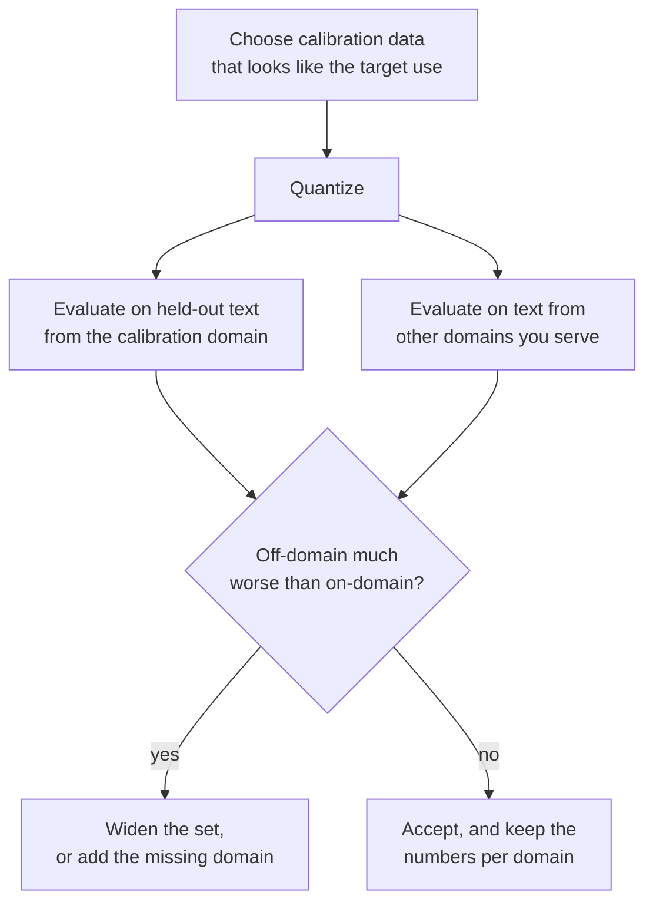

# Lesson 12. The Calibration Set

**Mission link:** GPTQ and AWQ are only as good as the data they read, so you need to know what each takes from the calibration set, how much is enough, and how a bad choice hides in a good-looking perplexity.
**Primary source:** [Paper: "AWQ: Activation-aware Weight Quantization for LLM Compression and Acceleration", Lin et al., 2023](https://arxiv.org/abs/2306.00978), section 5.3
**Prerequisites:** [Lesson 11](0011-awq.md), [Calibration set](../GLOSSARY.md), [GPTQ](../GLOSSARY.md), [Perplexity](../GLOSSARY.md)

## Warm-up

1. ▢ Which of round-to-nearest, GPTQ and AWQ needs no data at all?

<details markdown="1"><summary>Check</summary>

Round-to-nearest. It reads only the weights. GPTQ and AWQ both need layer inputs from calibration data.

</details>

2. ▢ GPTQ's calibration set in the paper is 128 segments of 2048 tokens. How many tokens is that, and how does that compare with the 4096 input features of a typical layer?

<details markdown="1"><summary>Check</summary>

128 × 2048 = 262,144 tokens, which is 64 times 4096. For a layer with 4096 inputs the Hessian `H = 2 X X^T` is 4096 by 4096 and is estimated from far more tokens than it has rows.

</details>

3. ▢ In AWQ, what does the scale `s = s_X^alpha` do to the weights, and where does `s_X` come from?

<details markdown="1"><summary>Check</summary>

It multiplies each input channel of the weights, with the inverse scale applied to the activation, before the weights are rounded. `s_X` is the average activation magnitude of each input channel, measured on the calibration set.

</details>

## Know this

### What each method reads

| Method | What it takes from the calibration set | What it uses it for |
|---|---|---|
| Round-to-nearest | Nothing | Nothing: scales come from the weights |
| GPTQ | The input to every layer, summed into `H = 2 X X^T` | Deciding how to spread each rounding error over later columns |
| AWQ | The average activation magnitude per channel, plus layer outputs to score each `alpha` | Choosing channel scales before rounding |

llm-compressor states the split plainly: round-to-nearest is data-free, GPTQ, AWQ, SmoothQuant and AutoRound require a calibration dataset, and calibration-based methods typically achieve better accuracy recovery, especially at lower bit widths ([llm-compressor docs](https://docs.vllm.ai/projects/llm-compressor/en/latest/steps/choosing-dataset/)). Neither GPTQ nor AWQ trains the model on the data. The glossary's point stands: a calibration set is not training data, and post-training quantization never backpropagates through it.

The GPTQ paper adds a detail: the inputs for each Transformer block are produced by the blocks already quantized before it, so later layers are fitted to what they will really see ([Frantar et al., 2022](https://arxiv.org/abs/2210.17323)).

### How much is enough

The numbers in the sources, and what they are:

| Source | Calibration set | Note |
|---|---|---|
| GPTQ paper | 128 random segments of 2048 tokens from C4 | Generic web text; no task data |
| AWQ paper, Figure 8a | AWQ at 16 sequences of 2048 tokens reaches better perplexity than GPTQ at 192 | OPT-6.7B at 3 bits, groups of 128; the authors read this as 10 times less data |
| llm-compressor docs | 128 to 512 samples typical, start with 128 to 256 | More samples improve representation but cost compression time |
| llm-compressor examples | 512 samples at length 2048 for GPTQ, 256 at length 512 for AWQ | Example scripts, not tuned recommendations |

The pattern follows from what each method estimates. AWQ keeps one mean per channel, a few thousand numbers, which a small sample pins down. GPTQ estimates a whole matrix of how features co-vary, which needs at least as many tokens as features, and a set that is too small fits the noise in that sample. Practice item 4 shows that failure in a toy.

### What a mismatched set does

Every number GPTQ and AWQ learn describes the inputs they saw. Quantize with text from one domain and the compensation or the scales are tuned to that domain's activation structure. On another domain they are tuned to the wrong thing.

The AWQ paper tests this on OPT-6.7B at 3 bits with groups of 128, using two subsets of the Pile, PubMed abstracts and Enron emails, as calibration set and evaluation set in all four combinations. WikiText perplexity is not used here; each cell is the perplexity on that subset ([Figure 8b](https://arxiv.org/abs/2306.00978)):

| Calibrated on | Evaluated on | GPTQ | AWQ |
|---|---|---|---|
| PubMed | PubMed | 32.48 | 32.56 |
| PubMed | Enron | 50.41 | 45.07 |
| Enron | PubMed | 34.81 | 33.16 |
| Enron | Enron | 45.52 | 44.57 |

Matching calibration and evaluation domains is best for both. Mismatched, the authors report AWQ gets 0.5 to 0.6 worse and GPTQ 2.3 to 4.9 worse. The authors explain this with their claim from lesson 11, that reconstructing outputs overfits the calibration set. These are the AWQ authors' numbers on one model at one bit width, and the AWQ authors compare against GPTQ, so treat the size of the gap as a lead and not as a constant. The direction is the lesson.

The GPTQ paper contains the same warning in one sentence. Its C4 perplexities come from a model calibrated on C4 text, and the paper notes that the task is therefore not fully zero-shot.

### How it shows up, and how to avoid it

A mismatched set does not fail loudly. Perplexity on the calibration domain, or on text that looks like it, comes out fine, and the damage appears elsewhere: code, a non-English language, a long structured document, the chat format the model serves. The llm-compressor guidance is to make the set representative of the target use: WikiText or C4 for a general-purpose model, instruction data such as UltraChat for an instruction-following model, code datasets for a coding model. The Transformers documentation for GPTQ accepts `dataset="c4"` or your own list of strings, and recommends using the dataset from the GPTQ paper ([Docs](https://huggingface.co/docs/transformers/main/en/quantization/gptq)). The two pieces of advice agree for a general English model and part ways for anything else.



## Practice

1. ▢ An llm-compressor example quantizes with 512 samples of up to 2048 tokens. How many tokens is that at most, and how does it compare with the GPTQ paper's set?

<details markdown="1"><summary>Check</summary>

512 × 2048 = 1,048,576 tokens, about 1 million, 4 times the GPTQ paper's 262,144. The docs treat 128 to 512 samples as the typical range.

</details>

2. ▢ Which sentence correctly states what the two methods read from the calibration set?

    - a) GPTQ builds a Hessian from inputs, while AWQ averages channel magnitudes
    - b) GPTQ averages channel magnitudes, while AWQ builds a Hessian from inputs
    - c) Both backpropagate a calibration loss through every layer of the weights
    - d) Neither reads data, because both inspect only the stored weight values

<details markdown="1"><summary>Check</summary>

**a)** GPTQ accumulates `H = 2 X X^T` from each layer's inputs. AWQ keeps the mean activation magnitude per channel and compares layer outputs for each `alpha`. (b) swaps them. (c) is wrong because post-training quantization never backpropagates through the calibration data. (d) is wrong because both need activations, which weights alone cannot supply.

</details>

3. ▢ From the AWQ paper's Figure 8b table above, compute how much worse GPTQ and AWQ each get when calibrated on the other domain, for evaluation on Enron and on PubMed.

<details markdown="1"><summary>Check</summary>

Evaluated on Enron, GPTQ goes from 45.52 (calibrated on Enron) to 50.41 (calibrated on PubMed), 4.89 worse, and AWQ from 44.57 to 45.07, 0.50 worse. Evaluated on PubMed, GPTQ goes from 32.48 to 34.81, 2.33 worse, and AWQ from 32.56 to 33.16, 0.60 worse. Those are the 2.3 to 4.9 and 0.5 to 0.6 the paper states.

</details>

4. ▢ Predict, then run. A toy layer has 128 input features and two domains whose inputs are correlated in different ways. GPTQ is calibrated on domain A with 1024 samples, on domain A with only 64 samples, and on domain B with 1024 samples, and each result is tested on fresh samples from both domains. Predict which of the three calibrated results beat round-to-nearest on domain B.

    ```python
    import numpy as np

    rng = np.random.default_rng(0)
    rows, cols, bits = 64, 128, 3
    qmax = 2 ** (bits - 1) - 1
    W = rng.standard_normal((rows, cols))
    scale = np.abs(W).max(axis=1) / qmax

    mix_a = rng.standard_normal((cols, cols)) / np.sqrt(cols)
    mix_b = rng.standard_normal((cols, cols)) / np.sqrt(cols)

    def sample(mix, n):
        return mix @ rng.standard_normal((cols, n))

    def quant(w, s):
        return np.clip(np.round(w / s), -qmax, qmax) * s

    def gptq(W, X):
        W = W.copy()
        H = 2 * X @ X.T
        H += 0.01 * np.mean(np.diag(H)) * np.eye(cols)
        U = np.linalg.cholesky(np.linalg.inv(H)).T
        Q = np.zeros_like(W)
        for i in range(cols):
            Q[:, i] = quant(W[:, i], scale)
            err = (W[:, i] - Q[:, i]) / U[i, i]
            W[:, i + 1:] -= np.outer(err, U[i, i + 1:])
        return Q

    def rel_err(Q, X):
        return np.linalg.norm(W @ X - Q @ X) / np.linalg.norm(W @ X)

    test_a, test_b = sample(mix_a, 2048), sample(mix_b, 2048)
    rtn_q = quant(W, scale[:, None])
    print(f"RTN                 test A {rel_err(rtn_q, test_a):.4f}  test B {rel_err(rtn_q, test_b):.4f}")
    for name, X in (("GPTQ, 1024 from A", sample(mix_a, 1024)),
                    ("GPTQ, 64 from A  ", sample(mix_a, 64)),
                    ("GPTQ, 1024 from B", sample(mix_b, 1024))):
        q = gptq(W, X)
        print(f"{name}   test A {rel_err(q, test_a):.4f}  test B {rel_err(q, test_b):.4f}")
    ```

<details markdown="1"><summary>Hint</summary>

Round-to-nearest reads no data, so its two numbers are the reference. Ask what the Hessian from domain A says about domain B, and what a Hessian built from 64 samples of 128 features can say about anything.

</details>

<details markdown="1"><summary>Check</summary>

```text
RTN                 test A 0.2658  test B 0.2725
GPTQ, 1024 from A   test A 0.1967  test B 0.4187
GPTQ, 64 from A     test A 0.3291  test B 0.4437
GPTQ, 1024 from B   test A 0.4068  test B 0.2003
```

Only the GPTQ run calibrated on domain B beats round-to-nearest on domain B (0.2003 against 0.2725). The run calibrated on domain A is better on A (0.1967) and clearly worse than doing no calibration on B (0.4187). The 64-sample run, with fewer samples than the 128 features, is worse than round-to-nearest even on its own domain. The toy domains share no structure, which real text does, so real penalties are milder than these, but the three patterns are the ones to look for: gain in-domain, loss out-of-domain, and a loss from too few samples.

</details>

5. ▢ A team quantizes a code assistant with GPTQ, calibrated on English web text, and reports WikiText perplexity within 0.1 of the 16-bit model. Users then report worse code completions. What is the most likely cause, and what would you change?

<details markdown="1"><summary>Check</summary>

Domain mismatch: the compensation was fitted to the activations of English prose, and WikiText is close to that, so the report matches the calibration domain and says nothing about code. Calibrate on code, as llm-compressor suggests for a coding model, perhaps mixed with the instruction format the model serves, and evaluate on held-out code as well as on text. Compare against round-to-nearest on the same code evaluation to confirm the calibration helped there.

</details>

6. ▢ Someone reports "GPTQ perplexity on C4 is close to 16-bit, so it generalises", and the set used to calibrate was drawn from C4 as well. What should you say?

<details markdown="1"><summary>Check</summary>

The measurement is flattered, because the calibration text and the evaluation text come from the same distribution. The GPTQ paper itself notes that its C4 results are not fully zero-shot for this reason. The paper's WikiText-2 and PTB results, on text from other sources, and a held-out evaluation of your own domain are the better evidence.

</details>

## Real-world reps

- [ ] Open the llm-compressor "Choosing a dataset" page. Write down its recommended sample range, then find the number of calibration samples and the dataset in its GPTQ example script and in its AWQ example script.
- [ ] Find a GPTQ or AWQ checkpoint on the Hugging Face Hub for a model you use. Read its model card for the calibration dataset and sample count. If it does not say, note that as a gap, and decide whether you would trust it on your own domain.
- [ ] Tomorrow: without notes, write what round-to-nearest, GPTQ and AWQ each read from the calibration set, and the three patterns in the toy of practice item 4.

## Going further

- [Weight PTQ Methods](../reference/weight-ptq-methods.md)
- [Docs: "Choosing a dataset", LLM Compressor](https://docs.vllm.ai/projects/llm-compressor/en/latest/steps/choosing-dataset/)
- [Docs: "GPTQ", Hugging Face Transformers](https://huggingface.co/docs/transformers/main/en/quantization/gptq)
- [Repo: llm-compressor, vLLM project](https://github.com/vllm-project/llm-compressor)
- [Resources](../RESOURCES.md)

---

Not landing? Reread the primary source at the top, since this lesson compresses it and compression is where understanding leaks. Check the [glossary](../GLOSSARY.md) for any term that felt slippery.

If the lesson itself is unclear rather than the material, that is a defect: [open an issue](https://github.com/TokenCemetery/teach/issues).
