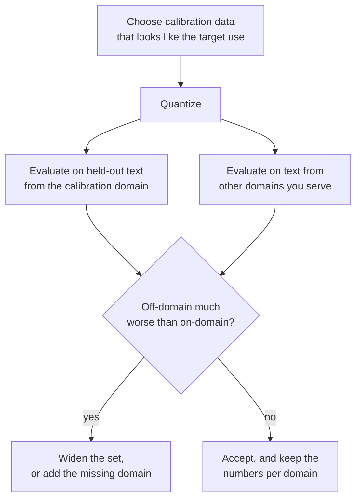

# Lição 12. O calibration set

**Ligação com a missão:** O GPTQ e o AWQ são tão bons quanto os dados que leem, então você precisa saber o que cada um tira do calibration set, quanto é suficiente e como uma má escolha se esconde em uma perplexity de boa aparência.
**Fonte principal:** [Artigo científico: "AWQ: Activation-aware Weight Quantization for LLM Compression and Acceleration", Lin et al., 2023](https://arxiv.org/abs/2306.00978), seção 5.3
**Pré-requisitos:** [Lição 11](0011-awq.md), [Calibration set](../GLOSSARY.md), [GPTQ](../GLOSSARY.md), [Perplexity](../GLOSSARY.md)

## Aquecimento

1. ▢ Qual entre round-to-nearest, GPTQ e AWQ não precisa de dados de jeito nenhum?

<details markdown="1"><summary>Verificação</summary>

O round-to-nearest. Ele lê apenas os pesos. O GPTQ e o AWQ precisam ambos de entradas de camada vindas de dados de calibração.

</details>

2. ▢ O calibration set do GPTQ no artigo é de 128 segmentos de 2048 tokens. Quantos tokens são, e como isso se compara com as 4096 features de entrada de uma camada típica?

<details markdown="1"><summary>Verificação</summary>

128 × 2048 = 262.144 tokens, que é 64 vezes 4096. Para uma camada com 4096 entradas, a Hessiana `H = 2 X X^T` é 4096 por 4096 e é estimada a partir de muito mais tokens do que linhas.

</details>

3. ▢ No AWQ, o que a scale `s = s_X^alpha` faz com os pesos, e de onde vem `s_X`?

<details markdown="1"><summary>Verificação</summary>

Ela multiplica cada canal de entrada dos pesos, com a scale inversa aplicada na ativação, antes de os pesos serem arredondados. `s_X` é a magnitude média da ativação de cada canal de entrada, medida no calibration set.

</details>

## Saiba isto

### O que cada método lê

| Método | O que tira do calibration set | Para que usa |
|---|---|---|
| Round-to-nearest | Nada | Nada: as scales vêm dos pesos |
| GPTQ | A entrada de cada camada, somada em `H = 2 X X^T` | Decidir como espalhar cada erro de arredondamento pelas colunas posteriores |
| AWQ | A magnitude média da ativação por canal, mais as saídas da camada para pontuar cada `alpha` | Escolher scales de canal antes do arredondamento |

O llm-compressor afirma a divisão com clareza: o round-to-nearest não usa dados, GPTQ, AWQ, SmoothQuant e AutoRound exigem um dataset de calibração, e os métodos baseados em calibração tipicamente alcançam melhor recuperação de acurácia, especialmente em larguras em bits menores ([docs do llm-compressor](https://docs.vllm.ai/projects/llm-compressor/en/latest/steps/choosing-dataset/)). Nem o GPTQ nem o AWQ treinam o modelo com os dados. O ponto do glossário se mantém: um calibration set não são dados de treinamento, e a quantização pós-treinamento nunca faz backpropagation por ele.

O artigo do GPTQ acrescenta um detalhe: as entradas de cada bloco do Transformer são produzidas pelos blocos já quantizados antes dele, de modo que as camadas posteriores sejam ajustadas ao que realmente verão ([Frantar et al., 2022](https://arxiv.org/abs/2210.17323)).

### Quanto é suficiente

Os números das fontes, e o que eles são:

| Fonte | Calibration set | Observação |
|---|---|---|
| Artigo do GPTQ | 128 segmentos aleatórios de 2048 tokens do C4 | Texto genérico da web; sem dados de tarefa |
| Artigo do AWQ, Figura 8a | O AWQ com 16 sequências de 2048 tokens alcança perplexity melhor que o GPTQ com 192 | OPT-6.7B em 3 bits, grupos de 128; os autores leem isso como 10 vezes menos dados |
| Docs do llm-compressor | 128 a 512 amostras é o típico, comece com 128 a 256 | Mais amostras melhoram a representação, mas custam tempo de compressão |
| Exemplos do llm-compressor | 512 amostras com comprimento 2048 para o GPTQ, 256 com comprimento 512 para o AWQ | Scripts de exemplo, não recomendações ajustadas |

O padrão decorre do que cada método estima. O AWQ guarda uma média por canal, alguns milhares de números, que uma amostra pequena fixa. O GPTQ estima uma matriz inteira de como as features co-variam, o que exige pelo menos tantos tokens quanto features, e um conjunto pequeno demais ajusta o ruído dessa amostra. O item 4 da Prática mostra essa falha em um exemplo simplificado.

### O que um conjunto incompatível faz

Todo número que o GPTQ e o AWQ aprendem descreve as entradas que eles viram. Quantize com texto de um domínio e a compensação ou as scales ficam ajustadas à estrutura de ativação desse domínio. Em outro domínio, elas ficam ajustadas ao que não deveriam.

O artigo do AWQ testa isso no OPT-6.7B em 3 bits com grupos de 128, usando dois subconjuntos do Pile, resumos do PubMed e e-mails da Enron, como calibration set e conjunto de avaliação nas quatro combinações. A perplexity do WikiText não é usada aqui; cada célula é a perplexity naquele subconjunto ([Figura 8b](https://arxiv.org/abs/2306.00978)):

| Calibrado em | Avaliado em | GPTQ | AWQ |
|---|---|---|---|
| PubMed | PubMed | 32.48 | 32.56 |
| PubMed | Enron | 50.41 | 45.07 |
| Enron | PubMed | 34.81 | 33.16 |
| Enron | Enron | 45.52 | 44.57 |

Casar os domínios de calibração e de avaliação é o melhor para ambos. Descasados, os autores relatam que o AWQ fica de 0.5 a 0.6 pior e o GPTQ de 2.3 a 4.9 pior. Os autores explicam isso com a sua afirmação da lição 11, de que reconstruir saídas faz overfit no calibration set. Esses são os números dos autores do AWQ em um modelo e uma largura em bits, e os autores do AWQ comparam contra o GPTQ, então trate o tamanho da diferença como uma pista e não como uma constante. A direção é a lição.

O artigo do GPTQ contém o mesmo alerta em uma frase. As suas perplexities no C4 vêm de um modelo calibrado com texto do C4, e o artigo observa que a tarefa, portanto, não é totalmente zero-shot.

### Como aparece, e como evitar

Um conjunto incompatível não falha de forma ruidosa. A perplexity no domínio de calibração, ou em texto parecido com ele, sai bem, e o dano aparece em outro lugar: código, um idioma que não é o inglês, um documento estruturado longo, o formato de chat que o modelo serve. A orientação do llm-compressor é tornar o conjunto representativo do uso-alvo: WikiText ou C4 para um modelo de uso geral, dados de instrução como o UltraChat para um modelo que segue instruções, datasets de código para um modelo de código. A documentação do Transformers para o GPTQ aceita `dataset="c4"` ou a sua própria lista de strings, e recomenda usar o dataset do artigo do GPTQ ([Docs](https://huggingface.co/docs/transformers/main/en/quantization/gptq)). Os dois conselhos concordam para um modelo geral em inglês e divergem para qualquer outra coisa.



## Prática

1. ▢ Um exemplo do llm-compressor quantiza com 512 amostras de até 2048 tokens. Quantos tokens são no máximo, e como isso se compara com o conjunto do artigo do GPTQ?

<details markdown="1"><summary>Verificação</summary>

512 × 2048 = 1.048.576 tokens, cerca de 1 milhão, 4 vezes os 262.144 do artigo do GPTQ. A documentação trata 128 a 512 amostras como a faixa típica.

</details>

2. ▢ Qual frase afirma corretamente o que os dois métodos leem do calibration set?

    - a) O GPTQ constrói uma Hessiana a partir das entradas, enquanto o AWQ tira a média das magnitudes dos canais
    - b) O GPTQ tira a média das magnitudes dos canais, enquanto o AWQ constrói uma Hessiana a partir das entradas
    - c) Ambos fazem backpropagation de uma loss de calibração por toda camada dos pesos
    - d) Nenhum dos dois lê dados, porque ambos inspecionam apenas os valores dos pesos armazenados

<details markdown="1"><summary>Verificação</summary>

**a)** O GPTQ acumula `H = 2 X X^T` a partir das entradas de cada camada. O AWQ guarda a magnitude média da ativação por canal e compara as saídas da camada para cada `alpha`. (b) os troca. (c) está errada porque a quantização pós-treinamento nunca faz backpropagation pelos dados de calibração. (d) está errada porque ambos precisam de ativações, que só os pesos não conseguem fornecer.

</details>

3. ▢ Da tabela da Figura 8b do artigo do AWQ acima, calcule o quanto o GPTQ e o AWQ ficam piores cada um quando calibrados no outro domínio, para avaliação no Enron e no PubMed.

<details markdown="1"><summary>Verificação</summary>

Avaliado no Enron, o GPTQ vai de 45.52 (calibrado no Enron) para 50.41 (calibrado no PubMed), 4.89 pior, e o AWQ de 44.57 para 45.07, 0.50 pior. Avaliado no PubMed, o GPTQ vai de 32.48 para 34.81, 2.33 pior, e o AWQ de 32.56 para 33.16, 0.60 pior. Esses são os 2.3 a 4.9 e os 0.5 a 0.6 que o artigo afirma.

</details>

4. ▢ Preveja e depois execute. Uma camada simplificada tem 128 features de entrada e dois domínios cujas entradas são correlacionadas de maneiras diferentes. O GPTQ é calibrado no domínio A com 1024 amostras, no domínio A com apenas 64 amostras e no domínio B com 1024 amostras, e cada resultado é testado em amostras novas dos dois domínios. Preveja quais dos três resultados calibrados superam o round-to-nearest no domínio B.

    ```python
    import numpy as np

    rng = np.random.default_rng(0)
    rows, cols, bits = 64, 128, 3
    qmax = 2 ** (bits - 1) - 1
    W = rng.standard_normal((rows, cols))
    scale = np.abs(W).max(axis=1) / qmax

    mix_a = rng.standard_normal((cols, cols)) / np.sqrt(cols)
    mix_b = rng.standard_normal((cols, cols)) / np.sqrt(cols)

    def sample(mix, n):
        return mix @ rng.standard_normal((cols, n))

    def quant(w, s):
        return np.clip(np.round(w / s), -qmax, qmax) * s

    def gptq(W, X):
        W = W.copy()
        H = 2 * X @ X.T
        H += 0.01 * np.mean(np.diag(H)) * np.eye(cols)
        U = np.linalg.cholesky(np.linalg.inv(H)).T
        Q = np.zeros_like(W)
        for i in range(cols):
            Q[:, i] = quant(W[:, i], scale)
            err = (W[:, i] - Q[:, i]) / U[i, i]
            W[:, i + 1:] -= np.outer(err, U[i, i + 1:])
        return Q

    def rel_err(Q, X):
        return np.linalg.norm(W @ X - Q @ X) / np.linalg.norm(W @ X)

    test_a, test_b = sample(mix_a, 2048), sample(mix_b, 2048)
    rtn_q = quant(W, scale[:, None])
    print(f"RTN                 test A {rel_err(rtn_q, test_a):.4f}  test B {rel_err(rtn_q, test_b):.4f}")
    for name, X in (("GPTQ, 1024 from A", sample(mix_a, 1024)),
                    ("GPTQ, 64 from A  ", sample(mix_a, 64)),
                    ("GPTQ, 1024 from B", sample(mix_b, 1024))):
        q = gptq(W, X)
        print(f"{name}   test A {rel_err(q, test_a):.4f}  test B {rel_err(q, test_b):.4f}")
    ```

<details markdown="1"><summary>Dica</summary>

O round-to-nearest não lê dados, então os seus dois números são a referência. Pergunte o que a Hessiana do domínio A diz sobre o domínio B, e o que uma Hessiana construída a partir de 64 amostras de 128 features pode dizer sobre qualquer coisa.

</details>

<details markdown="1"><summary>Verificação</summary>

```text
RTN                 test A 0.2658  test B 0.2725
GPTQ, 1024 from A   test A 0.1967  test B 0.4187
GPTQ, 64 from A     test A 0.3291  test B 0.4437
GPTQ, 1024 from B   test A 0.4068  test B 0.2003
```

Só a execução do GPTQ calibrada no domínio B supera o round-to-nearest no domínio B (0.2003 contra 0.2725). A execução calibrada no domínio A é melhor em A (0.1967) e claramente pior que não fazer calibração em B (0.4187). A execução de 64 amostras, com menos amostras que as 128 features, é pior que o round-to-nearest até no seu próprio domínio. Os domínios do exemplo simplificado não compartilham nenhuma estrutura, o que o texto real faz, então as penalidades reais são mais brandas que estas, mas os três padrões são os que se deve procurar: ganho no domínio, perda fora do domínio e uma perda por amostras de menos.

</details>

5. ▢ Uma equipe quantiza um assistente de código com GPTQ, calibrado em texto web em inglês, e reporta perplexity no WikiText a menos de 0.1 do modelo de 16 bits. Os usuários então relatam completions de código piores. Qual é a causa mais provável, e o que você mudaria?

<details markdown="1"><summary>Verificação</summary>

Incompatibilidade de domínio: a compensação foi ajustada às ativações de prosa em inglês, e o WikiText é próximo disso, então o relatório coincide com o domínio de calibração e não diz nada sobre código. Calibre em código, como o llm-compressor sugere para um modelo de código, talvez misturado com o formato de instrução que o modelo serve, e avalie em código held-out além de texto. Compare com o round-to-nearest na mesma avaliação de código para confirmar que a calibração ajudou ali.

</details>

6. ▢ Alguém reporta "a perplexity do GPTQ no C4 está próxima da de 16 bits, então ele generaliza", e o conjunto usado para calibrar também foi tirado do C4. O que você deve dizer?

<details markdown="1"><summary>Verificação</summary>

A medição sai favorecida, porque o texto de calibração e o texto de avaliação vêm da mesma distribuição. O próprio artigo do GPTQ observa que os seus resultados no C4 não são totalmente zero-shot por esse motivo. Os resultados do artigo no WikiText-2 e no PTB, em texto de outras fontes, e uma avaliação held-out do seu próprio domínio são a melhor evidência.

</details>

## Prática no mundo real

- [ ] Abra a página "Choosing a dataset" do llm-compressor. Anote a faixa de amostras recomendada e depois encontre o número de amostras de calibração e o dataset no script de exemplo de GPTQ e no de AWQ.
- [ ] Encontre um checkpoint GPTQ ou AWQ no Hugging Face Hub para um modelo que você usa. Leia o model card para ver o dataset de calibração e a contagem de amostras. Se ele não disser, anote isso como uma lacuna e decida se você confiaria nele no seu próprio domínio.
- [ ] Amanhã: sem consultar anotações, escreva o que o round-to-nearest, o GPTQ e o AWQ leem cada um do calibration set, e os três padrões do exemplo simplificado do item 4 da prática.

## Para ir além

- [Métodos de PTQ de Pesos](../reference/weight-ptq-methods.md)
- [Docs: "Choosing a dataset", LLM Compressor](https://docs.vllm.ai/projects/llm-compressor/en/latest/steps/choosing-dataset/)
- [Docs: "GPTQ", Hugging Face Transformers](https://huggingface.co/docs/transformers/main/en/quantization/gptq)
- [Repositório: llm-compressor, vLLM project](https://github.com/vllm-project/llm-compressor)
- [Recursos](../RESOURCES.md)

---

Não ficou claro? Releia a fonte principal no topo, já que esta lição a comprime e é na compressão que o entendimento escapa. Consulte o [glossário](../GLOSSARY.md) para qualquer termo que pareceu escorregadio.

Se o problema é a lição em si, e não o material, isso é um defeito: [abra uma issue](https://github.com/TokenCemetery/teach/issues).
