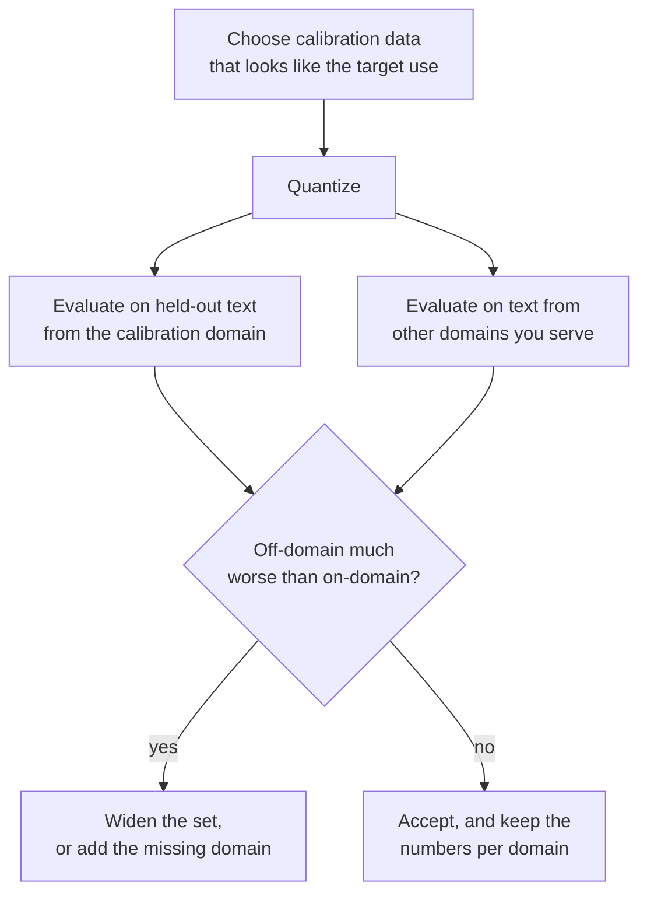

# Урок 12. Калибровочный набор

**Связь с целью курса:** GPTQ и AWQ настолько хороши, насколько хороши данные, которые они читают, поэтому нужно знать, что каждый берёт из калибровочного набора, сколько его достаточно и как плохой выбор прячется за красиво выглядящей перплексией.
**Первоисточник:** [Научная статья: "AWQ: Activation-aware Weight Quantization for LLM Compression and Acceleration", Lin et al., 2023](https://arxiv.org/abs/2306.00978), раздел 5.3
**Предварительные требования:** [Урок 11](0011-awq.md), [Калибровочный набор](../GLOSSARY.md), [GPTQ](../GLOSSARY.md), [Перплексия](../GLOSSARY.md)

## Разминка

1. ▢ Какому из округления к ближайшему, GPTQ и AWQ данные не нужны вообще?

<details markdown="1"><summary>Проверка</summary>

Округлению к ближайшему. Оно читает только веса. GPTQ и AWQ оба нуждаются во входах слоёв из калибровочных данных.

</details>

2. ▢ Калибровочный набор GPTQ в статье это 128 сегментов по 2048 токенов. Сколько это токенов и как это соотносится с 4096 входных признаков типичного слоя?

<details markdown="1"><summary>Проверка</summary>

128 × 2048 = 262 144 токена, то есть в 64 раза больше 4096. Для слоя с 4096 входами гессиан `H = 2 X X^T` имеет размер 4096 на 4096 и оценивается по гораздо большему числу токенов, чем у него строк.

</details>

3. ▢ Что делает в AWQ масштаб `s = s_X^alpha` с весами и откуда берётся `s_X`?

<details markdown="1"><summary>Проверка</summary>

Он умножает каждый входной канал весов, а обратный масштаб применяется к активации, до округления весов. `s_X` это средняя величина активации каждого входного канала, измеренная на калибровочном наборе.

</details>

## Что нужно знать

### Что читает каждый метод

| Метод | Что он берёт из калибровочного набора | Для чего он это использует |
|---|---|---|
| Округление к ближайшему | Ничего | Ничего: масштабы берутся из весов |
| GPTQ | Вход каждого слоя, суммируемый в `H = 2 X X^T` | Чтобы решить, как распределить каждую ошибку округления по более поздним столбцам |
| AWQ | Среднюю величину активации на канал, плюс выходы слоя, чтобы оценить каждое `alpha` | Чтобы выбрать масштабы каналов перед округлением |

llm-compressor формулирует это разделение прямо: округление к ближайшему не требует данных, GPTQ, AWQ, SmoothQuant и AutoRound требуют калибровочного датасета, а методы с калибровкой обычно лучше восстанавливают точность, особенно при малой разрядности ([документация llm-compressor](https://docs.vllm.ai/projects/llm-compressor/en/latest/steps/choosing-dataset/)). Ни GPTQ, ни AWQ не обучают модель на этих данных. Замечание глоссария остаётся в силе: калибровочный набор это не обучающие данные, и посттренировочная квантизация никогда не пропускает через него обратное распространение.

Статья о GPTQ добавляет деталь: входы для каждого блока трансформера порождаются блоками, уже квантизованными до него, так что более поздние слои подгоняются под то, что они действительно увидят ([Frantar et al., 2022](https://arxiv.org/abs/2210.17323)).

### Сколько достаточно

Числа из источников и что они такое:

| Источник | Калибровочный набор | Примечание |
|---|---|---|
| Статья о GPTQ | 128 случайных сегментов по 2048 токенов из C4 | Обычный веб-текст; данных задачи нет |
| Статья об AWQ, рисунок 8a | AWQ на 16 последовательностях по 2048 токенов достигает лучшей перплексии, чем GPTQ на 192 | OPT-6.7B в 3 битах, группы по 128; авторы читают это как в 10 раз меньше данных |
| Документация llm-compressor | Типично от 128 до 512 образцов, начинать с 128-256 | Больше образцов улучшают репрезентативность, но стоят времени сжатия |
| Примеры llm-compressor | 512 образцов длиной 2048 для GPTQ, 256 длиной 512 для AWQ | Примеры скриптов, а не настроенные рекомендации |

Закономерность следует из того, что оценивает каждый метод. AWQ хранит одно среднее на канал, несколько тысяч чисел, которые малая выборка определяет. GPTQ оценивает целую матрицу того, как признаки изменяются вместе, для чего нужно не меньше токенов, чем признаков, а слишком малый набор подгоняется под шум этой выборки. Упражнение 4 практики показывает этот отказ в игрушечном примере.

### Что делает неподходящий набор

Каждое число, которое узнают GPTQ и AWQ, описывает увиденные ими входы. Квантизуйте с текстом из одной предметной области, и компенсация или масштабы настроены на структуру активаций этой области. В другой области они настроены не на то.

Статья об AWQ проверяет это на OPT-6.7B в 3 битах с группами по 128, используя два подмножества Pile, аннотации PubMed и письма Enron, как калибровочный и как оценочный набор во всех четырёх сочетаниях. Перплексия на WikiText здесь не используется; каждая ячейка это перплексия на этом подмножестве ([рисунок 8b](https://arxiv.org/abs/2306.00978)):

| Калибровка на | Оценка на | GPTQ | AWQ |
|---|---|---|---|
| PubMed | PubMed | 32,48 | 32,56 |
| PubMed | Enron | 50,41 | 45,07 |
| Enron | PubMed | 34,81 | 33,16 |
| Enron | Enron | 45,52 | 44,57 |

Совпадение предметных областей калибровки и оценки лучше для обоих. При несовпадении, по сообщению авторов, AWQ становится хуже на 0,5-0,6, а GPTQ на 2,3-4,9. Авторы объясняют это своим утверждением из урока 11 о том, что восстановление выходов переобучается на калибровочный набор. Это числа авторов AWQ на одной модели при одной разрядности, и авторы AWQ сравнивают с GPTQ, поэтому относитесь к размеру разрыва как к наводке, а не как к константе. Урок в направлении.

В статье о GPTQ то же предупреждение содержится в одном предложении. Её перплексии на C4 получены на модели, откалиброванной на тексте C4, и статья отмечает, что поэтому задача не вполне zero-shot.

### Как это проявляется и как этого избежать

Неподходящий набор не ломается громко. Перплексия на калибровочной области или на тексте, похожем на неё, выходит в порядке, а ущерб проявляется в другом месте: в коде, в неанглийском языке, в длинном структурированном документе, в чат-формате, который обслуживает модель. Рекомендация llm-compressor в том, чтобы сделать набор репрезентативным для целевого применения: WikiText или C4 для модели общего назначения, инструктивные данные вроде UltraChat для модели, следующей инструкциям, наборы кода для модели для программирования. Документация Transformers по GPTQ принимает `dataset="c4"` или ваш собственный список строк и рекомендует использовать датасет из статьи о GPTQ ([документация](https://huggingface.co/docs/transformers/main/en/quantization/gptq)). Два совета согласуются для общей англоязычной модели и расходятся для всего остального.



## Практика

1. ▢ Пример llm-compressor квантизует на 512 образцах длиной до 2048 токенов. Сколько это токенов не более и как это соотносится с набором из статьи о GPTQ?

<details markdown="1"><summary>Проверка</summary>

512 × 2048 = 1 048 576 токенов, около 1 миллиона, в 4 раза больше 262 144 из статьи о GPTQ. Документация считает типичным диапазоном от 128 до 512 образцов.

</details>

2. ▢ Какое предложение верно говорит, что два метода читают из калибровочного набора?

    - a) GPTQ строит гессиан по входам, а AWQ усредняет величины каналов
    - b) GPTQ усредняет величины каналов, а AWQ строит гессиан по входам
    - c) Оба пропускают калибровочные потери через каждый слой весов обратным распространением
    - d) Ни один не читает данные, потому что оба изучают только хранимые значения весов

<details markdown="1"><summary>Проверка</summary>

**a)** GPTQ накапливает `H = 2 X X^T` по входам каждого слоя. AWQ хранит среднюю величину активации на канал и сравнивает выходы слоя для каждого `alpha`. (b) меняет их местами. (c) неверно, потому что посттренировочная квантизация никогда не пропускает обратное распространение через калибровочные данные. (d) неверно, потому что обоим нужны активации, а одни веса их дать не могут.

</details>

3. ▢ По таблице рисунка 8b статьи об AWQ выше посчитайте, насколько хуже становятся GPTQ и AWQ при калибровке на другой области, для оценки на Enron и на PubMed.

<details markdown="1"><summary>Проверка</summary>

При оценке на Enron GPTQ идёт от 45,52 (калибровка на Enron) к 50,41 (калибровка на PubMed), на 4,89 хуже, а AWQ от 44,57 к 45,07, на 0,50 хуже. При оценке на PubMed GPTQ идёт от 32,48 к 34,81, на 2,33 хуже, а AWQ от 32,56 к 33,16, на 0,60 хуже. Это те самые 2,3-4,9 и 0,5-0,6, которые указывает статья.

</details>

4. ▢ Предскажите, затем запустите. У игрушечного слоя 128 входных признаков и две предметные области, входы которых коррелированы по-разному. GPTQ калибруется на области A на 1024 образцах, на области A всего на 64 образцах и на области B на 1024 образцах, и каждый результат проверяется на свежих образцах из обеих областей. Предскажите, какие из трёх откалиброванных результатов побеждают округление к ближайшему на области B.

    ```python
    import numpy as np

    rng = np.random.default_rng(0)
    rows, cols, bits = 64, 128, 3
    qmax = 2 ** (bits - 1) - 1
    W = rng.standard_normal((rows, cols))
    scale = np.abs(W).max(axis=1) / qmax

    mix_a = rng.standard_normal((cols, cols)) / np.sqrt(cols)
    mix_b = rng.standard_normal((cols, cols)) / np.sqrt(cols)

    def sample(mix, n):
        return mix @ rng.standard_normal((cols, n))

    def quant(w, s):
        return np.clip(np.round(w / s), -qmax, qmax) * s

    def gptq(W, X):
        W = W.copy()
        H = 2 * X @ X.T
        H += 0.01 * np.mean(np.diag(H)) * np.eye(cols)
        U = np.linalg.cholesky(np.linalg.inv(H)).T
        Q = np.zeros_like(W)
        for i in range(cols):
            Q[:, i] = quant(W[:, i], scale)
            err = (W[:, i] - Q[:, i]) / U[i, i]
            W[:, i + 1:] -= np.outer(err, U[i, i + 1:])
        return Q

    def rel_err(Q, X):
        return np.linalg.norm(W @ X - Q @ X) / np.linalg.norm(W @ X)

    test_a, test_b = sample(mix_a, 2048), sample(mix_b, 2048)
    rtn_q = quant(W, scale[:, None])
    print(f"RTN                 test A {rel_err(rtn_q, test_a):.4f}  test B {rel_err(rtn_q, test_b):.4f}")
    for name, X in (("GPTQ, 1024 from A", sample(mix_a, 1024)),
                    ("GPTQ, 64 from A  ", sample(mix_a, 64)),
                    ("GPTQ, 1024 from B", sample(mix_b, 1024))):
        q = gptq(W, X)
        print(f"{name}   test A {rel_err(q, test_a):.4f}  test B {rel_err(q, test_b):.4f}")
    ```

<details markdown="1"><summary>Подсказка</summary>

Округление к ближайшему не читает данных, поэтому два его числа это эталон. Спросите, что гессиан из области A говорит об области B и что гессиан, построенный по 64 образцам из 128 признаков, может сказать о чём бы то ни было.

</details>

<details markdown="1"><summary>Проверка</summary>

```text
RTN                 test A 0.2658  test B 0.2725
GPTQ, 1024 from A   test A 0.1967  test B 0.4187
GPTQ, 64 from A     test A 0.3291  test B 0.4437
GPTQ, 1024 from B   test A 0.4068  test B 0.2003
```

Только запуск GPTQ, откалиброванный на области B, побеждает округление к ближайшему на области B (0,2003 против 0,2725). Запуск, откалиброванный на области A, лучше на A (0,1967) и явно хуже, чем отсутствие калибровки, на B (0,4187). Запуск на 64 образцах, где образцов меньше, чем 128 признаков, хуже округления к ближайшему даже на собственной области. Игрушечные области не делят никакой структуры, а настоящие тексты делят, поэтому настоящие потери мягче этих, но три паттерна те, которые нужно искать: выигрыш внутри области, потеря вне области и потеря от слишком малого числа образцов.

</details>

5. ▢ Команда квантизует ассистента для программирования с GPTQ, откалиброванным на английском веб-тексте, и сообщает перплексию на WikiText в пределах 0,1 от 16-битной модели. Затем пользователи сообщают о худших дополнениях кода. Какова наиболее вероятная причина и что бы вы изменили?

<details markdown="1"><summary>Проверка</summary>

Несовпадение предметных областей: компенсация подгонялась под активации английской прозы, а WikiText близок к ней, поэтому отчёт соответствует области калибровки и ничего не говорит о коде. Калибруйте на коде, как советует llm-compressor для модели для программирования, возможно, вместе с форматом инструкций, который обслуживает модель, и оценивайте на отложенном коде, а не только на тексте. Сравните с округлением к ближайшему на той же оценке кода, чтобы убедиться, что калибровка там помогла.

</details>

6. ▢ Кто-то сообщает: «Перплексия GPTQ на C4 близка к 16-битной, так что он обобщается», а набор для калибровки тоже был взят из C4. Что вам следует сказать?

<details markdown="1"><summary>Проверка</summary>

Измерение приукрашено, потому что калибровочный и оценочный тексты происходят из одного распределения. Сама статья о GPTQ отмечает, что её результаты на C4 по этой причине не вполне zero-shot. Результаты статьи на WikiText-2 и PTB, на текстах из других источников, и отложенная оценка в вашей собственной области это лучшее свидетельство.

</details>

## Практика в реальной работе

- [ ] Откройте страницу «Choosing a dataset» llm-compressor. Запишите рекомендуемый диапазон образцов, затем найдите число калибровочных образцов и датасет в её примере скрипта GPTQ и в примере скрипта AWQ.
- [ ] Найдите на Hugging Face Hub чекпоинт GPTQ или AWQ для модели, которой вы пользуетесь. Прочитайте его карточку модели на предмет калибровочного датасета и числа образцов. Если там не сказано, отметьте это как пробел и решите, доверились бы вы ему в своей области.
- [ ] Завтра, без заметок, запишите, что читает из калибровочного набора каждый из округления к ближайшему, GPTQ и AWQ, и три паттерна из игрушечного примера в упражнении 4 практики.

## Что почитать дальше

- [Методы PTQ для весов](../reference/weight-ptq-methods.md)
- [Документация: "Choosing a dataset", LLM Compressor](https://docs.vllm.ai/projects/llm-compressor/en/latest/steps/choosing-dataset/)
- [Документация: "GPTQ", Hugging Face Transformers](https://huggingface.co/docs/transformers/main/en/quantization/gptq)
- [Репозиторий: llm-compressor, vLLM project](https://github.com/vllm-project/llm-compressor)
- [Ресурсы](../RESOURCES.md)

---

Не доходит? Перечитайте первоисточник в начале: этот урок его сжимает, а при сжатии понимание как раз и теряется. Загляните в [глоссарий](../GLOSSARY.md), если какой-то термин показался скользким.

Если неясен сам урок, а не материал, это дефект: [откройте issue](https://github.com/TokenCemetery/teach/issues).
