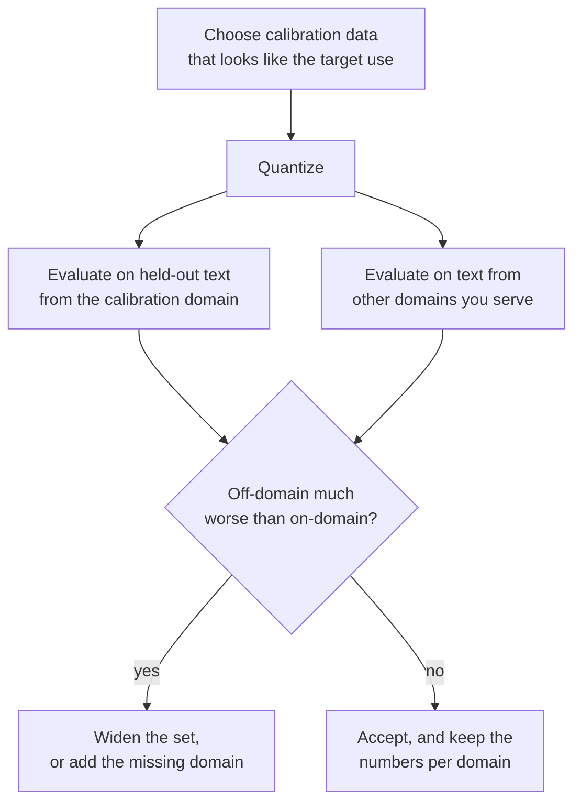

# 第 12 课：校准集

**使命关联:** GPTQ 和 AWQ 的好坏，取决于它们读到的数据，所以你要知道各自从校准集里取走什么、多少才够，以及一个糟糕的选择怎样藏在一个好看的困惑度背后。
**主要来源:** [论文：“AWQ: Activation-aware Weight Quantization for LLM Compression and Acceleration”，Lin 等，2023](https://arxiv.org/abs/2306.00978)，第 5.3 节
**前置知识:** [第 11 课](0011-awq.md)、[校准集](../GLOSSARY.md)、[GPTQ](../GLOSSARY.md)、[困惑度](../GLOSSARY.md)

## 热身

1. ▢ 就近舍入、GPTQ 和 AWQ 中，哪一个完全不需要数据？

<details markdown="1"><summary>检查</summary>

就近舍入。它只读权重。GPTQ 和 AWQ 都需要校准数据产生的各层输入。

</details>

2. ▢ 论文里 GPTQ 的校准集是 128 个 2048 token 的片段。那是多少个 token？与一个典型层的 4096 个输入特征相比如何？

<details markdown="1"><summary>检查</summary>

128 × 2048 = 262,144 个 token，是 4096 的 64 倍。对一个有 4096 个输入的层，海森矩阵 `H = 2 X X^T` 是 4096 乘 4096，估计它所用的 token 远多于它的行数。

</details>

3. ▢ 在 AWQ 中，缩放因子 `s = s_X^alpha` 对权重做了什么？`s_X` 从哪里来？

<details markdown="1"><summary>检查</summary>

在权重被舍入之前，它乘到权重的每个输入通道上，激活值上则带着逆缩放因子。`s_X` 是每个输入通道的平均激活值幅值，在校准集上度量得到。

</details>

## 要点

### 每种方法读取什么

| 方法 | 从校准集中取走什么 | 用它来做什么 |
|---|---|---|
| 就近舍入 | 什么都不取 | 什么都不做：缩放因子来自权重 |
| GPTQ | 每一层的输入，累加成 `H = 2 X X^T` | 决定怎样把每一次舍入误差分摊到后面的列上 |
| AWQ | 每个通道的平均激活值幅值，加上用来给每个 `alpha` 打分的各层输出 | 在舍入之前选择通道缩放因子 |

llm-compressor 把这种划分说得很直白：就近舍入不需要数据，GPTQ、AWQ、SmoothQuant 和 AutoRound 需要一个校准数据集，而基于校准的方法通常能取得更好的精度恢复，在位宽较低时尤其如此（[llm-compressor 文档](https://docs.vllm.ai/projects/llm-compressor/en/latest/steps/choosing-dataset/)）。GPTQ 和 AWQ 都不会在这些数据上训练模型。术语表里的那一点依然成立：校准集不是训练数据，训练后量化也绝不会对它做反向传播。

GPTQ 论文补充了一个细节：每个 Transformer 块的输入，是由它前面已经量化好的块产生的，所以后面的层拟合的是它们将真正看到的东西（[Frantar 等，2022](https://arxiv.org/abs/2210.17323)）。

### 多少才够

各来源里的数字，以及它们是什么：

| 来源 | 校准集 | 说明 |
|---|---|---|
| GPTQ 论文 | 来自 C4 的 128 个随机的 2048 token 片段 | 通用的网页文本；没有任务数据 |
| AWQ 论文，图 8a | AWQ 用 16 条 2048 token 的序列，就达到了比 GPTQ 用 192 条更好的困惑度 | 3 位、以 128 为一组的 OPT-6.7B；作者把它解读为数据少 10 倍 |
| llm-compressor 文档 | 典型为 128 到 512 个样本，从 128 到 256 个开始 | 样本越多代表性越好，但压缩时间越长 |
| llm-compressor 示例 | GPTQ 用 512 个长度为 2048 的样本，AWQ 用 256 个长度为 512 的样本 | 示例脚本，不是调优后的推荐值 |

这个规律源于各方法所估计的东西。AWQ 每个通道只保留一个均值，也就是几千个数，一个小样本就能把它们确定下来。GPTQ 估计的是一整个特征如何共同变化的矩阵，需要的 token 至少和特征一样多，样本太小，就会去拟合那个样本里的噪声。练习第 4 题用一个玩具例子展示了这种失败。

### 不匹配的校准集会造成什么

GPTQ 和 AWQ 学到的每一个数，描述的都是它们看到的输入。用某一个领域的文本来量化，补偿或缩放因子就被调成适合那个领域的激活值结构。换到另一个领域，它们调好的就是错误的东西了。

AWQ 论文在 3 位、以 128 为一组的 OPT-6.7B 上检验了这一点，用 Pile 的两个子集，PubMed 摘要和 Enron 邮件，分别作校准集和评测集，四种组合全试了一遍。这里不用 WikiText 困惑度；每个格子是在该子集上的困惑度（[图 8b](https://arxiv.org/abs/2306.00978)）：

| 校准所用 | 评测所用 | GPTQ | AWQ |
|---|---|---|---|
| PubMed | PubMed | 32.48 | 32.56 |
| PubMed | Enron | 50.41 | 45.07 |
| Enron | PubMed | 34.81 | 33.16 |
| Enron | Enron | 45.52 | 44.57 |

校准领域与评测领域一致时，对两种方法都最好。不一致时，作者报告 AWQ 差 0.5 到 0.6，GPTQ 差 2.3 到 4.9。作者用他们在第 11 课中的主张来解释这一点，即重建输出会过拟合校准集。这些是 AWQ 作者在一个模型、一种位宽上的数字，而且是 AWQ 的作者拿它与 GPTQ 比，所以请把差距的大小当作线索，而不是常数。方向才是这一课的要点。

GPTQ 论文用一句话包含了同样的警告。它在 C4 上的困惑度，来自一个用 C4 文本校准的模型，论文指出，这个任务因此并非完全零样本。

### 它如何暴露出来，以及如何避免

不匹配的校准集不会大声地失败。在校准领域上，或者在与之相似的文本上，困惑度表现良好，损害出现在别的地方：代码、非英语的语言、长的结构化文档、模型所服务的对话格式。llm-compressor 的指导意见是，让校准集代表目标用途：通用模型用 WikiText 或 C4，遵循指令的模型用 UltraChat 这样的指令数据，代码模型用代码数据集。Transformers 关于 GPTQ 的文档接受 `dataset="c4"` 或你自己的字符串列表，并建议使用 GPTQ 论文中的数据集（[文档](https://huggingface.co/docs/transformers/main/en/quantization/gptq)）。这两条建议，对通用的英语模型是一致的，对其他任何情形则各走各的。



## 练习

1. ▢ 一个 llm-compressor 示例用 512 个最长 2048 token 的样本来量化。最多是多少个 token？与 GPTQ 论文的集合相比如何？

<details markdown="1"><summary>检查</summary>

512 × 2048 = 1,048,576 个 token，约 100 万，是 GPTQ 论文 262,144 的 4 倍。文档把 128 到 512 个样本视为典型范围。

</details>

2. ▢ 哪一句话正确地说明了这两种方法从校准集里读取什么？

    - a) GPTQ 由输入构造海森矩阵，而 AWQ 对通道幅值取平均
    - b) GPTQ 对通道幅值取平均，而 AWQ 由输入构造海森矩阵
    - c) 两者都把校准损失反向传播穿过权重的每一层
    - d) 两者都不读数据，因为都只检查存储的权重值

<details markdown="1"><summary>检查</summary>

**a)** GPTQ 由每一层的输入累积出 `H = 2 X X^T`。AWQ 保留每个通道的平均激活值幅值，并对每个 `alpha` 比较各层的输出。(b) 把它们说反了。(c) 是错的，因为训练后量化绝不会对校准数据做反向传播。(d) 是错的，因为两者都需要激活值，而光靠权重提供不了。

</details>

3. ▢ 根据上面 AWQ 论文图 8b 的表，分别算出，当在另一个领域上校准时，GPTQ 和 AWQ 在 Enron 和 PubMed 上的评测各差了多少。

<details markdown="1"><summary>检查</summary>

在 Enron 上评测，GPTQ 从 45.52（用 Enron 校准）变成 50.41（用 PubMed 校准），差 4.89，AWQ 从 44.57 变成 45.07，差 0.50。在 PubMed 上评测，GPTQ 从 32.48 变成 34.81，差 2.33，AWQ 从 32.56 变成 33.16，差 0.60。这就是论文所说的 2.3 到 4.9 和 0.5 到 0.6。

</details>

4. ▢ 先预测，再运行。一个玩具层有 128 个输入特征，以及两个领域，输入在两个领域里以不同的方式相关。GPTQ 先用领域 A 的 1024 个样本校准，再只用领域 A 的 64 个样本校准，最后用领域 B 的 1024 个样本校准，每个结果都在两个领域的新鲜样本上测试。预测这三个校准后的结果中，哪些在领域 B 上胜过就近舍入。

    ```python
    import numpy as np

    rng = np.random.default_rng(0)
    rows, cols, bits = 64, 128, 3
    qmax = 2 ** (bits - 1) - 1
    W = rng.standard_normal((rows, cols))
    scale = np.abs(W).max(axis=1) / qmax

    mix_a = rng.standard_normal((cols, cols)) / np.sqrt(cols)
    mix_b = rng.standard_normal((cols, cols)) / np.sqrt(cols)

    def sample(mix, n):
        return mix @ rng.standard_normal((cols, n))

    def quant(w, s):
        return np.clip(np.round(w / s), -qmax, qmax) * s

    def gptq(W, X):
        W = W.copy()
        H = 2 * X @ X.T
        H += 0.01 * np.mean(np.diag(H)) * np.eye(cols)
        U = np.linalg.cholesky(np.linalg.inv(H)).T
        Q = np.zeros_like(W)
        for i in range(cols):
            Q[:, i] = quant(W[:, i], scale)
            err = (W[:, i] - Q[:, i]) / U[i, i]
            W[:, i + 1:] -= np.outer(err, U[i, i + 1:])
        return Q

    def rel_err(Q, X):
        return np.linalg.norm(W @ X - Q @ X) / np.linalg.norm(W @ X)

    test_a, test_b = sample(mix_a, 2048), sample(mix_b, 2048)
    rtn_q = quant(W, scale[:, None])
    print(f"RTN                 test A {rel_err(rtn_q, test_a):.4f}  test B {rel_err(rtn_q, test_b):.4f}")
    for name, X in (("GPTQ, 1024 from A", sample(mix_a, 1024)),
                    ("GPTQ, 64 from A  ", sample(mix_a, 64)),
                    ("GPTQ, 1024 from B", sample(mix_b, 1024))):
        q = gptq(W, X)
        print(f"{name}   test A {rel_err(q, test_a):.4f}  test B {rel_err(q, test_b):.4f}")
    ```

<details markdown="1"><summary>提示</summary>

就近舍入不读数据，所以它的两个数是参照。想想来自领域 A 的海森矩阵对领域 B 说了什么，以及一个由 128 个特征的 64 个样本构造出来的海森矩阵，能对任何东西说什么。

</details>

<details markdown="1"><summary>检查</summary>

```text
RTN                 test A 0.2658  test B 0.2725
GPTQ, 1024 from A   test A 0.1967  test B 0.4187
GPTQ, 64 from A     test A 0.3291  test B 0.4437
GPTQ, 1024 from B   test A 0.4068  test B 0.2003
```

只有用领域 B 校准的 GPTQ 运行，在领域 B 上胜过了就近舍入（0.2003 对 0.2725）。用领域 A 校准的运行，在 A 上更好（0.1967），而在 B 上明显比不做校准还差（0.4187）。64 个样本的那次运行，样本数少于 128 个特征，即使在它自己的领域上也比就近舍入差。这两个玩具领域之间没有共同的结构，而真实文本是有的，所以真实的损失会比这些温和，但这三种规律就是该留意的：领域内有收益，领域外有损失，以及样本太少造成的损失。

</details>

5. ▢ 一个团队用 GPTQ 量化一个代码助手，校准用的是英文网页文本，并报告 WikiText 困惑度与 16 位模型相差不到 0.1。随后用户反映代码补全变差了。最可能的原因是什么？你会改什么？

<details markdown="1"><summary>检查</summary>

领域不匹配：补偿是拟合英文散文的激活值得到的，而 WikiText 与之很接近，所以这个报告只与校准领域吻合，对代码什么也没说。像 llm-compressor 对代码模型所建议的那样，用代码来校准，也许再混入模型所服务的指令格式，并且除了文本之外，还要在留出的代码上做评测。在同样的代码评测上与就近舍入比较，来确认校准在那里确有帮助。

</details>

6. ▢ 有人报告说“GPTQ 在 C4 上的困惑度接近 16 位，所以它泛化得很好”，而用来校准的集合也是取自 C4。你该怎么说？

<details markdown="1"><summary>检查</summary>

这个度量被抬高了，因为校准文本和评测文本来自同一个分布。GPTQ 论文自己就指出，它在 C4 上的结果因为这个原因并非完全零样本。论文在其他来源的文本上得到的 WikiText-2 和 PTB 结果，以及你自己领域上留出的评测，才是更好的证据。

</details>

## 实战练习

- [ ] 打开 llm-compressor 的“Choosing a dataset”页面。写下它推荐的样本范围，然后在它的 GPTQ 示例脚本和 AWQ 示例脚本里，找出校准样本的数量和数据集。
- [ ] 在 Hugging Face Hub 上，为你用的某个模型找一个 GPTQ 或 AWQ 检查点。读它的模型卡，看校准数据集和样本数。如果没有写，就把这一点记成一个缺口，并判断你是否会在自己的领域里信任它。
- [ ] 明天：不看笔记，写出就近舍入、GPTQ 和 AWQ 各自从校准集里读取什么，以及练习第 4 题玩具例子里的三种规律。

## 延伸阅读

- [权重训练后量化方法](../reference/weight-ptq-methods.md)
- [文档：“Choosing a dataset”，LLM Compressor](https://docs.vllm.ai/projects/llm-compressor/en/latest/steps/choosing-dataset/)
- [文档：“GPTQ”，Hugging Face Transformers](https://huggingface.co/docs/transformers/main/en/quantization/gptq)
- [仓库：llm-compressor，vLLM project](https://github.com/vllm-project/llm-compressor)
- [资源](../RESOURCES.md)

---

没学明白？请重读顶部的主要来源，因为本课是对它的压缩，而理解正是在压缩中流失的。如果有哪个术语觉得含糊，可以查看[术语表](../GLOSSARY.md)。

如果问题出在课程本身，而不是学习材料，那就是一个缺陷：[提交 issue](https://github.com/TokenCemetery/teach/issues)。
