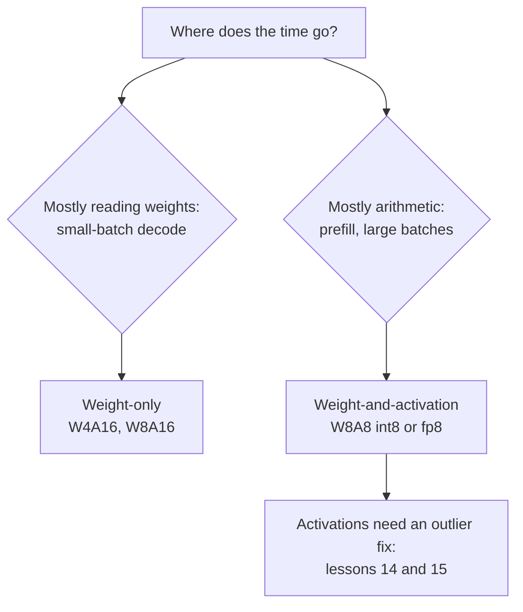

# Lección 13. Pesos, activaciones o ambos

**Vínculo con la misión:** Decidir qué cuantizar además de los pesos es la primera bifurcación al elegir un esquema, y decide si estás comprando memoria o aritmética.
**Fuente principal:** [Paper: "SmoothQuant: Accurate and Efficient Post-Training Quantization for Large Language Models", Xiao et al., 2022](https://arxiv.org/abs/2211.10438), secciones 1 a 3
**Requisitos previos:** [Lección 12](0012-the-calibration-set.md), [Cuantización solo de pesos](../GLOSSARY.md), [Notación WxAy](../GLOSSARY.md), [Cuantización estática](../GLOSSARY.md), [Cuantización dinámica](../GLOSSARY.md)

## Calentamiento

1. ▢ La lección 1 dijo que el decode con lote 1 está limitado por el ancho de banda de memoria. ¿Qué significa eso para adónde va el tiempo, y qué cambia cuantizar los pesos?

<details markdown="1"><summary>Comprobación</summary>

El tiempo se va en leer cada peso de la memoria una vez por token, no en las multiplicaciones-sumas. Menos bits por peso significa menos bytes leídos, así que sube el techo de tokens por segundo.

</details>

2. ▢ Las lecciones 10 y 11 cuantizaron los pesos a 4 bits. ¿Qué dejaron GPTQ y AWQ en 16 bits?

<details markdown="1"><summary>Comprobación</summary>

Las activaciones, y por tanto la aritmética. Ambos son métodos de solo pesos: el kernel descuantiza los pesos de 4 bits de vuelta a 16 bits y los multiplica con activaciones de 16 bits.

</details>

3. ▢ La lección 7 describió las outlier features. ¿Viven en tokens concretos o en canales concretos?

<details markdown="1"><summary>Comprobación</summary>

En canales concretos (dimensiones ocultas), y aparecen en la mayoría de los tokens. Es la propiedad en la que se apoyan esta lección y la siguiente.

</details>

## Qué debes saber

### Dos clases de esquema

La **notación WxAy** nombra un esquema por los anchos de bits de sus pesos y activaciones: W4A16 son pesos de 4 bits con activaciones de 16 bits, W8A8 son pesos de 8 bits y activaciones de 8 bits. Compran cosas distintas.

- **Solo pesos** (W4A16, W8A16). Los pesos se almacenan pequeños y se convierten de vuelta en números de 16 bits dentro del kernel, y luego se multiplican con activaciones de 16 bits. Esto ahorra memoria y bytes leídos por token, que es lo que necesita el decode limitado por el ancho de banda de memoria. La aritmética no cambia.
- **Pesos y activaciones** (W8A8 en int8 o fp8). Ambos operandos de la multiplicación de matrices son de 8 bits, así que la multiplicación misma corre en unidades de hardware de baja precisión. Xiao et al. señalan que los pesos y las activaciones en int8 "pueden reducir a la mitad el uso de memoria de la GPU y casi duplicar el throughput de las multiplicaciones de matrices en comparación con FP16". Esto es lo que necesita el trabajo limitado por cómputo, el prefill y el decode con lotes grandes.

La lección 19 convierte esto en una predicción de cuál corre más rápido para un tamaño de lote dado. Por ahora, quédate con la división: solo pesos compra bytes, pesos y activaciones compra aritmética.

### Por qué las activaciones son más difíciles

Xiao et al. enuncian la asimetría directamente: los pesos son fáciles de cuantizar, las activaciones no. Tres razones, todas de su sección 3:

- **Outliers.** Los outliers de las activaciones son unas 100 veces mayores que la mayoría de los valores de activación. Un scale por tensor lo fija el outlier, así que los valores ordinarios reciben solo unos pocos niveles.
- **Persisten por canal.** "Si un canal tiene un outlier, aparece de forma persistente en todos los tokens", mientras que la variación dentro de un canal entre tokens es pequeña. Las activaciones varían de un canal a otro, no de un token a otro.
- **Su rango depende de la entrada.** El rango de un peso queda fijo cuando termina el entrenamiento. El rango de una activación solo se conoce cuando llega la entrada.

### La restricción que añade el hardware

La solución obvia para los outliers que viven en canales es un scale por canal de entrada. El hardware lo descarta. Una multiplicación de matrices en int8 calcula `Y = diag(s_X) · (X_int8 @ W_int8) · diag(s_W)`, y los scales solo pueden quedar fuera del producto entero: uno por token (filas de `X`) y uno por canal de salida (columnas de `W`). Xiao et al.: para usar los kernels GEMM en int8 de forma eficiente, "solo podemos usar factores de escala de las dimensiones externas (es decir, la dimensión de tokens T y la dimensión de canales de salida C_o) pero no de la dimensión interna (es decir, la dimensión de canales de entrada C_i)". Un scale por canal de entrada tendría que aplicarse dentro de la suma, en cada producto.

Así que las activaciones reciben un scale por tensor o por token, y el per-token no puede aislar un outlier que aparece en todos los tokens.

### Scales estáticos o dinámicos

El scale de la activación puede fijarse de antemano o medirse en tiempo de ejecución. Xiao et al. definen ambos: calcularlo offline a partir de muestras de calibración es **cuantización estática**, usar las estadísticas de las activaciones en tiempo de ejecución es **cuantización dinámica**. La estática es más barata por solicitud y depende de que el calibration set coincida con el tráfico real, el riesgo que nombró la lección 12. La dinámica se adapta a cada entrada y cuesta una reducción sobre el tensor antes de cada multiplicación cuantizada.

### Qué encontró una comparación cuidadosa

Kurtic et al. ejecutaron más de 500,000 evaluaciones sobre la familia Llama 3.1 y encontraron que fp8 W8A8 es "efectivamente sin pérdida en todas las escalas de modelo", que int8 W8A8 bien ajustado tiene una degradación de accuracy del 1 al 3%, y que W4A16 int es "más competitivo de lo esperado, rivalizando con la cuantización de 8 bits" ([Kurtic et al., 2024](https://arxiv.org/abs/2411.02355)). Su consejo de despliegue sigue la división de arriba: W4A16 para servicio síncrono, W8A8 para continuous batching. Trátalos como resultados de una familia de modelos en sus tareas, y mide los tuyos (lección 22).



## Práctica

1. ▢ Nombra los anchos de bits de W4A16 y W8A8, y di cuál de los dos acelera la propia multiplicación de matrices.

<details markdown="1"><summary>Comprobación</summary>

W4A16 son pesos de 4 bits y activaciones de 16 bits; W8A8 son pesos de 8 bits y activaciones de 8 bits. Solo W8A8 acelera la multiplicación, porque solo allí ambos operandos son de baja precisión. W4A16 descuantiza los pesos a 16 bits y multiplica en 16 bits.

</details>

2. ▢ Un colega propone dar a cada canal de entrada de las activaciones su propio scale int8, para aislar los canales outlier. ¿Por qué no lo permite un kernel GEMM en int8?

<details markdown="1"><summary>Pista</summary>

Escribe el producto entero como una suma sobre el canal de entrada, y pregúntate adónde tendría que ir un scale que cambia con ese índice.

</details>

<details markdown="1"><summary>Comprobación</summary>

El kernel calcula productos enteros sumados sobre el canal de entrada, y luego multiplica el resultado por los scales. Un scale por token sale de factor común de cada fila y un scale por canal de salida sale de cada columna, así que ambos pueden aplicarse una sola vez, tras la suma. Un scale por canal de entrada cambia dentro de la suma, así que tendría que aplicarse a cada producto antes de sumar, lo que ya no es un GEMM en int8.

</details>

3. ▢ Predice y luego ejecuta. Un canal de las activaciones es 100 veces mayor en todos los tokens. Predice si un scale por token arregla el error en los demás canales, en comparación con el mismo tensor sin el outlier.

    ```python
    import numpy as np
    rng = np.random.default_rng(0)
    X = rng.normal(0, 1, (64, 8))       # 64 tokens, 8 channels
    X[:, 3] *= 100                      # an outlier channel, present in every token

    def q8(t, axis=None):               # symmetric int8, one scale per slice
        s = np.abs(t).max(axis=axis, keepdims=True) / 127
        return np.clip(np.round(t / s), -127, 127) * s

    normal = [c for c in range(8) if c != 3]
    for name, Xq in [("per-tensor", q8(X)), ("per-token ", q8(X, axis=1))]:
        print(name, "error on normal channels:", round(np.abs(Xq - X)[:, normal].mean(), 3))
    Xc = X.copy(); Xc[:, 3] /= 100      # same tensor without the outlier channel
    print("per-token, no outlier       :", round(np.abs(q8(Xc, axis=1) - Xc)[:, normal].mean(), 3))
    ```

<details markdown="1"><summary>Pista</summary>

Un scale por token lo fija el mayor valor de la fila de ese token. ¿Cuál es ese valor, en cada fila?

</details>

<details markdown="1"><summary>Comprobación</summary>

```text
per-tensor error on normal channels: 0.622
per-token  error on normal channels: 0.166
per-token, no outlier       : 0.003
```

Per-token ayuda, porque el scale de cada fila lo fija el outlier de esa fila y no el mayor outlier de todo el tensor. No arregla el problema: cada fila sigue conteniendo el outlier, así que los canales ordinarios siguen estando unas 50 veces peor que sin él. Los outliers que viven en canales necesitan una solución que actúe sobre canales, que es lo que hace SmoothQuant (lección 14) sin romper el kernel.

</details>

4. ▢ Un equipo sirve un modelo de 8B a un usuario a la vez en una GPU con soporte de fp8, y otro equipo sirve el mismo modelo a cientos de usuarios concurrentes con continuous batching. ¿Qué emparejamiento de esquema y equipo respalda el razonamiento de esta lección?

    - a) W4A16 para el usuario único, W8A8 para el servidor concurrido
    - b) W8A8 para el usuario único, W4A16 para el servidor concurrido
    - c) W4A16 para ambos equipos, ya que menos bits siempre corren más rápido
    - d) W8A8 para ambos equipos, ya que las activaciones dominan en cualquier caso

<details markdown="1"><summary>Comprobación</summary>

**a)** El usuario único está limitado por el ancho de banda de memoria, así que recortar bytes de pesos es lo que más importa; el servidor concurrido está limitado por cómputo, así que lo que más importa es la aritmética de baja precisión. Coincide con la recomendación de Kurtic et al. (b) invierte los dos cuellos de botella. (c) supone que menos bits siempre significa más rápido, lo que falla cuando el cuello de botella es la aritmética y solo pesos la deja en 16 bits. (d) supone que las activaciones dominan con lote 1, donde dominan las lecturas de pesos.

</details>

## Prácticas en el mundo real

- [ ] Encuentra un checkpoint W8A8 y uno W4A16 del mismo modelo en el Hugging Face Hub y compara el tamaño de sus archivos con el original en bf16. Explica la diferencia a partir de los anchos de bits.
- [ ] Lee la sección 3 del paper de SmoothQuant y encuentra la figura que muestra las magnitudes de activación por canal y token. Di en una frase qué muestra sobre dónde viven los outliers.
- [ ] Mañana: sin apuntes, escribe la fórmula del GEMM en int8 con sus dos scales y explica qué granularidades permite para las activaciones y para los pesos.

## Para profundizar

- [Activaciones y KV cache](../reference/activations-and-kv-cache.md)
- [Paper: "Give Me BF16 or Give Me Death? Accuracy-Performance Trade-Offs in LLM Quantization", Kurtic et al., 2024](https://arxiv.org/abs/2411.02355)
- [Recursos](../RESOURCES.md)

---

¿No termina de quedar claro? Vuelve a leer la fuente primaria de arriba, ya que esta lección la comprime y en la compresión es donde se escapa la comprensión. Consulta el [glosario](../GLOSSARY.md) por si algún término te resultó resbaladizo.

Si lo poco claro es la propia lección y no el material, eso es un defecto: [abre un issue](https://github.com/TokenCemetery/teach/issues).
