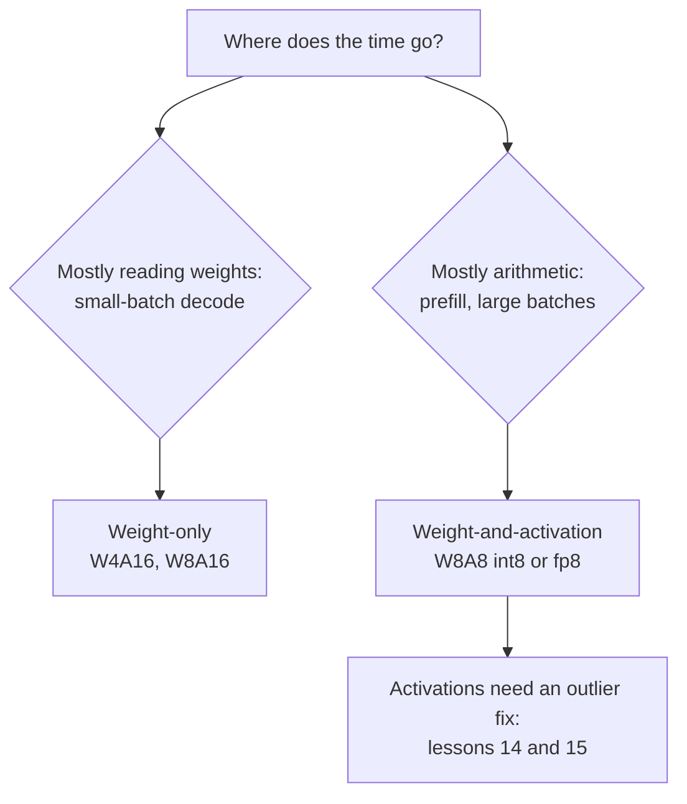

# Leçon 13. Poids, activations ou les deux

**Lien avec la mission :** Décider quoi quantifier au-delà des poids est la première bifurcation dans le choix d'un schéma, et cela décide si vous achetez de la mémoire ou de l'arithmétique.
**Source primaire :** [Article : "SmoothQuant: Accurate and Efficient Post-Training Quantization for Large Language Models", Xiao et al., 2022](https://arxiv.org/abs/2211.10438), sections 1 à 3
**Prérequis :** [Leçon 12](0012-the-calibration-set.md), [Quantification weight-only](../GLOSSARY.md), [Notation WxAy](../GLOSSARY.md), [Quantification statique](../GLOSSARY.md), [Quantification dynamique](../GLOSSARY.md)

## Échauffement

1. ▢ La leçon 1 disait que le décodage à batch 1 est limité par la mémoire. Qu'est-ce que cela signifie pour l'endroit où passe le temps, et que change la quantification des poids ?

<details markdown="1"><summary>Vérifier</summary>

Le temps passe à lire chaque poids en mémoire une fois par token, pas dans les multiplications-additions. Moins de bits par poids signifie moins d'octets lus, donc le plafond de tokens par seconde monte.

</details>

2. ▢ Les leçons 10 et 11 ont quantifié les poids en 4 bits. Qu'ont laissé en 16 bits GPTQ et AWQ ?

<details markdown="1"><summary>Vérifier</summary>

Les activations, et donc l'arithmétique. Les deux sont des méthodes weight-only : le kernel déquantifie les poids en 4 bits vers du 16 bits et les multiplie avec des activations en 16 bits.

</details>

3. ▢ La leçon 7 a décrit les features outlier. Vivent-elles dans des tokens particuliers ou dans des canaux particuliers ?

<details markdown="1"><summary>Vérifier</summary>

Dans des canaux particuliers (dimensions cachées), et elles apparaissent sur la plupart des tokens. C'est la propriété sur laquelle s'appuient cette leçon et la suivante.

</details>

## À savoir

### Deux sortes de schémas

La **notation WxAy** nomme un schéma d'après les largeurs en bits de ses poids et de ses activations : W4A16 désigne des poids en 4 bits avec des activations en 16 bits, W8A8 des poids et des activations en 8 bits. Ils n'achètent pas la même chose.

- **Weight-only** (W4A16, W8A16). Les poids sont stockés petits et retransformés en nombres de 16 bits à l'intérieur du kernel, puis multipliés avec des activations en 16 bits. Cela économise de la mémoire et des octets lus par token, ce dont a besoin un décodage limité par la mémoire. L'arithmétique est inchangée.
- **Poids-et-activations** (W8A8 en int8 ou fp8). Les deux opérandes de la multiplication de matrices sont en 8 bits, donc la multiplication elle-même tourne sur des unités matérielles de basse précision. Xiao et al. notent que des poids et des activations en int8 « peuvent diviser par deux la mémoire GPU utilisée et presque doubler le débit des multiplications de matrices par rapport au FP16 ». C'est ce dont a besoin un travail limité par le calcul, le prefill et le décodage à grand batch.

La leçon 19 transforme cela en prédiction de ce qui tourne plus vite pour une taille de batch donnée. Pour l'instant, retenez la répartition : le weight-only achète des octets, le poids-et-activations achète de l'arithmétique.

### Pourquoi les activations sont plus difficiles

Xiao et al. énoncent directement l'asymétrie : les poids sont faciles à quantifier, les activations ne le sont pas. Trois raisons, toutes tirées de leur section 3 :

- **Outliers.** Les outliers des activations sont environ 100 fois plus grands que la plupart des valeurs d'activation. Un scale par tenseur est fixé par l'outlier, donc les valeurs ordinaires n'obtiennent que quelques niveaux.
- **Ils persistent par canal.** « Si un canal a un outlier, il apparaît de façon persistante dans tous les tokens », alors que la variation au sein d'un canal d'un token à l'autre est faible. Les activations varient d'un canal à l'autre, pas d'un token à l'autre.
- **Leur plage dépend de l'entrée.** La plage d'un poids est fixée une fois l'entraînement terminé. La plage d'une activation n'est connue que quand l'entrée arrive.

### La contrainte qu'ajoute le matériel

La parade évidente pour des outliers qui vivent dans des canaux est un scale par canal d'entrée. Le matériel l'exclut. Une multiplication de matrices int8 calcule `Y = diag(s_X) · (X_int8 @ W_int8) · diag(s_W)`, et les scales ne peuvent se placer qu'en dehors du produit entier : un par token (lignes de `X`) et un par canal de sortie (colonnes de `W`). Xiao et al. : pour utiliser efficacement les kernels GEMM int8, « nous ne pouvons utiliser que des facteurs d'échelle des dimensions extérieures (c'est-à-dire la dimension des tokens T et la dimension des canaux de sortie C_o) mais pas de la dimension intérieure (c'est-à-dire la dimension des canaux d'entrée C_i) ». Un scale par canal d'entrée devrait être appliqué à l'intérieur de la somme, sur chaque produit.

Les activations reçoivent donc un scale par tenseur ou par token, et le par-token ne peut pas isoler un outlier qui apparaît dans chaque token.

### Scales statiques ou dynamiques

Le scale d'une activation peut être fixé à l'avance ou mesuré à l'exécution. Xiao et al. définissent les deux : le calculer hors ligne à partir d'échantillons de calibration est la **quantification statique**, utiliser les statistiques des activations à l'exécution est la **quantification dynamique**. Le statique est moins cher par requête et dépend de la correspondance entre le calibration set et le trafic réel, le risque que nommait la leçon 12. Le dynamique s'adapte à chaque entrée et coûte une réduction sur le tenseur avant chaque multiplication quantifiée.

### Ce qu'a trouvé une comparaison soignée

Kurtic et al. ont mené plus de 500,000 évaluations sur la famille Llama 3.1 et ont trouvé le fp8 W8A8 « effectivement sans perte à toutes les échelles de modèle », l'int8 W8A8 bien réglé à 1 à 3 % de dégradation de précision, et le W4A16 int « plus compétitif que prévu, rivalisant avec la quantification en 8 bits » ([Kurtic et al., 2024](https://arxiv.org/abs/2411.02355)). Leur conseil de déploiement suit la répartition ci-dessus : W4A16 pour le serving synchrone, W8A8 pour le continuous batching. Traitez cela comme des résultats pour une famille de modèles sur leurs tâches, et mesurez les vôtres (leçon 22).



## Pratique

1. ▢ Nommez les largeurs en bits de W4A16 et de W8A8, et dites lequel des deux accélère la multiplication de matrices elle-même.

<details markdown="1"><summary>Vérifier</summary>

W4A16 désigne des poids en 4 bits et des activations en 16 bits ; W8A8 des poids en 8 bits et des activations en 8 bits. Seul W8A8 accélère la multiplication, parce que seulement là les deux opérandes sont en basse précision. W4A16 déquantifie les poids en 16 bits et multiplie en 16 bits.

</details>

2. ▢ Un collègue propose de donner à chaque canal d'entrée des activations son propre scale int8, pour isoler les canaux outlier. Pourquoi un kernel GEMM int8 ne le permet-il pas ?

<details markdown="1"><summary>Indice</summary>

Écrivez le produit entier comme une somme sur le canal d'entrée, et demandez-vous où devrait se placer un scale qui change avec cet indice.

</details>

<details markdown="1"><summary>Vérifier</summary>

Le kernel calcule des produits entiers sommés sur le canal d'entrée, puis multiplie le résultat par les scales. Un scale par token se factorise hors de chaque ligne et un scale par canal de sortie hors de chaque colonne, donc les deux peuvent être appliqués une seule fois, après la somme. Un scale par canal d'entrée change à l'intérieur de la somme, donc il devrait être appliqué à chaque produit avant l'addition, ce qui n'est plus un GEMM int8.

</details>

3. ▢ Prédisez, puis exécutez. Un canal des activations est 100 fois plus grand à chaque token. Prédisez si un scale par token corrige l'erreur sur les autres canaux, par rapport au même tenseur sans l'outlier.

    ```python
    import numpy as np
    rng = np.random.default_rng(0)
    X = rng.normal(0, 1, (64, 8))       # 64 tokens, 8 channels
    X[:, 3] *= 100                      # an outlier channel, present in every token

    def q8(t, axis=None):               # symmetric int8, one scale per slice
        s = np.abs(t).max(axis=axis, keepdims=True) / 127
        return np.clip(np.round(t / s), -127, 127) * s

    normal = [c for c in range(8) if c != 3]
    for name, Xq in [("per-tensor", q8(X)), ("per-token ", q8(X, axis=1))]:
        print(name, "error on normal channels:", round(np.abs(Xq - X)[:, normal].mean(), 3))
    Xc = X.copy(); Xc[:, 3] /= 100      # same tensor without the outlier channel
    print("per-token, no outlier       :", round(np.abs(q8(Xc, axis=1) - Xc)[:, normal].mean(), 3))
    ```

<details markdown="1"><summary>Indice</summary>

Un scale par token est fixé par la plus grande valeur de la ligne de ce token. Quelle est cette valeur, dans chaque ligne ?

</details>

<details markdown="1"><summary>Vérifier</summary>

```text
per-tensor error on normal channels: 0.622
per-token  error on normal channels: 0.166
per-token, no outlier       : 0.003
```

Le par-token aide, parce que le scale de chaque ligne est fixé par l'outlier de cette ligne plutôt que par le plus grand outlier de tout le tenseur. Il ne règle pas le problème : chaque ligne contient encore l'outlier, donc les canaux ordinaires sont encore environ 50 fois plus mal lotis que sans lui. Des outliers qui vivent dans des canaux demandent une parade qui agit sur les canaux, ce que fait SmoothQuant (leçon 14) sans casser le kernel.

</details>

4. ▢ Une équipe sert un modèle 8B à un seul utilisateur à la fois sur un GPU avec prise en charge du fp8, et une autre équipe sert le même modèle à des centaines d'utilisateurs concurrents avec du continuous batching. Quel appariement de schéma et d'équipe le raisonnement de cette leçon soutient-il ?

    - a) W4A16 pour l'utilisateur unique, W8A8 pour le serveur occupé
    - b) W8A8 pour l'utilisateur unique, W4A16 pour le serveur occupé
    - c) W4A16 pour les deux équipes, puisque moins de bits tourne toujours plus vite
    - d) W8A8 pour les deux équipes, puisque les activations dominent dans les deux cas

<details markdown="1"><summary>Vérifier</summary>

**a)** L'utilisateur unique est limité par la mémoire, donc réduire les octets de poids compte le plus ; le serveur occupé est limité par le calcul, donc l'arithmétique en basse précision compte le plus. Cela correspond à la recommandation de Kurtic et al. (b) inverse les deux goulots d'étranglement. (c) suppose que moins de bits veut toujours dire plus vite, ce qui échoue quand l'arithmétique est le goulot et que le weight-only la laisse en 16 bits. (d) suppose que les activations dominent à batch 1, où ce sont les lectures de poids.

</details>

## Exercices en situation réelle

- [ ] Trouvez un checkpoint W8A8 et un checkpoint W4A16 du même modèle sur le Hugging Face Hub et comparez la taille de leurs fichiers à l'original en bf16. Expliquez la différence par les largeurs en bits.
- [ ] Lisez la section 3 de l'article SmoothQuant et trouvez la figure qui montre les grandeurs d'activation par canal et par token. Dites en une phrase ce qu'elle montre de l'endroit où vivent les outliers.
- [ ] Demain : sans notes, écrivez la formule du GEMM int8 avec ses deux scales et expliquez quelles granularités elle permet pour les activations et pour les poids.

## Pour aller plus loin

- [Activations et KV cache](../reference/activations-and-kv-cache.md)
- [Article : "Give Me BF16 or Give Me Death? Accuracy-Performance Trade-Offs in LLM Quantization", Kurtic et al., 2024](https://arxiv.org/abs/2411.02355)
- [Ressources](../RESOURCES.md)

---

Ça ne passe pas ? Relisez la source primaire en haut de page, car cette leçon la condense et c'est dans la condensation que la compréhension s'échappe. Consultez le [glossaire](../GLOSSARY.md) pour tout terme qui vous a paru glissant.

Si c'est la leçon elle-même qui n'est pas claire plutôt que la matière, c'est un défaut : [ouvrez une issue](https://github.com/TokenCemetery/teach/issues).
