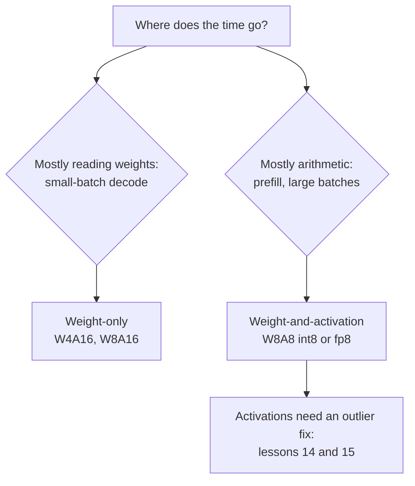

# पाठ 13. Weights, Activations या दोनों

**मिशन से संबंध:** Weights के अलावा क्या quantize करना है यह तय करना scheme चुनने का पहला दोराहा है, और वही तय करता है कि आप memory ख़रीद रहे हैं या arithmetic।
**मुख्य स्रोत:** [पेपर: "SmoothQuant: Accurate and Efficient Post-Training Quantization for Large Language Models", Xiao et al., 2022](https://arxiv.org/abs/2211.10438), sections 1 से 3
**पूर्व-आवश्यकताएँ:** [पाठ 12](0012-the-calibration-set.md), [Weight-only quantization](../GLOSSARY.md), [WxAy notation](../GLOSSARY.md), [Static quantization](../GLOSSARY.md), [Dynamic quantization](../GLOSSARY.md)

## वार्म-अप

1. ▢ पाठ 1 ने कहा था कि batch-1 decode memory-bound है। इसका मतलब है कि समय कहाँ जाता है, और weights को quantize करने से क्या बदलता है?

<details markdown="1"><summary>जाँचें</summary>

समय हर token पर हर weight को memory से एक बार पढ़ने में जाता है, multiply-adds में नहीं। प्रति weight कम bits का मतलब कम bytes पढ़ना, इसलिए प्रति सेकंड tokens की ऊपरी सीमा बढ़ती है।

</details>

2. ▢ पाठ 10 और 11 ने weights को 4 bits पर quantize किया। GPTQ और AWQ ने 16-bit में क्या छोड़ दिया?

<details markdown="1"><summary>जाँचें</summary>

Activations, और इसलिए arithmetic। दोनों weight-only methods हैं: kernel 4-bit weights को वापस 16-bit में dequantize करता है और उन्हें 16-bit activations से गुणा करता है।

</details>

3. ▢ पाठ 7 ने outlier features का वर्णन किया। क्या वे ख़ास tokens में रहते हैं या ख़ास channels में?

<details markdown="1"><summary>जाँचें</summary>

ख़ास channels (hidden dimensions) में, और वे ज़्यादातर tokens में दिखते हैं। यही वह गुण है जिस पर यह पाठ और अगला टिकते हैं।

</details>

## यह जानें

### Scheme के दो प्रकार

**WxAy notation** किसी scheme को उसके weights और activations की bit widths से नाम देता है: W4A16 यानी 4-bit weights और 16-bit activations, W8A8 यानी 8-bit weights और 8-bit activations। वे अलग चीज़ें ख़रीदते हैं।

- **Weight-only** (W4A16, W8A16)। Weights छोटे store होते हैं और kernel के भीतर वापस 16-bit संख्याओं में बदले जाते हैं, फिर 16-bit activations से गुणा किए जाते हैं। यह memory और हर token पर पढ़े जाने वाले bytes बचाता है, जो memory-bound decode को चाहिए। Arithmetic नहीं बदलता।
- **Weight-और-activation** (int8 या fp8 में W8A8)। Matrix multiplication के दोनों operands 8-bit हैं, इसलिए multiplication ख़ुद low-precision hardware units पर चलता है। Xiao et al. ध्यान दिलाते हैं कि int8 weights और activations "GPU memory का इस्तेमाल आधा और matrix multiplications का throughput FP16 की तुलना में लगभग दुगुना कर सकते हैं"। यही compute-bound काम, यानी prefill और बड़े batch का decode, को चाहिए।

पाठ 19 इसे इस अनुमान में बदलता है कि दिए batch size के लिए कौन-सा तेज़ चलता है। अभी यह बँटवारा थामे रखें: weight-only bytes ख़रीदता है, weight-और-activation arithmetic।

### Activations ज़्यादा कठिन क्यों हैं

Xiao et al. असमानता सीधे कहते हैं: weights को quantize करना आसान है, activations को नहीं। तीन कारण, सब उनके section 3 से:

- **Outliers।** Activations में outliers ज़्यादातर activation values से लगभग 100 गुना बड़े हैं। Per-tensor scale outlier से तय होता है, इसलिए सामान्य values को सिर्फ़ कुछ levels मिलते हैं।
- **वे channel के हिसाब से टिके रहते हैं।** "अगर किसी channel में outlier है, तो वह सभी tokens में लगातार दिखता है", जबकि tokens के पार एक channel के भीतर का फ़र्क़ छोटा है। Activations channel से channel बदलती हैं, token से token नहीं।
- **उनकी range input पर निर्भर करती है।** Weight की range training ख़त्म होने के बाद तय है। Activation की range तभी पता चलती है जब input आता है।

### Hardware जो बाध्यता जोड़ता है

Channels में रहने वाले outliers का साफ़ इलाज हर input channel के लिए एक scale है। Hardware उसे नामंज़ूर करता है। Int8 matrix multiplication `Y = diag(s_X) · (X_int8 @ W_int8) · diag(s_W)` compute करता है, और scales सिर्फ़ integer product के बाहर बैठ सकते हैं: एक हर token के लिए (`X` की rows) और एक हर output channel के लिए (`W` के columns)। Xiao et al.: int8 GEMM kernels को कुशलता से इस्तेमाल करने के लिए, "हम सिर्फ़ बाहरी dimensions (यानी token dimension T और out channel dimension C_o) के scaling factors इस्तेमाल कर सकते हैं, भीतरी dimension (यानी in channel dimension C_i) के नहीं"। Per-input-channel scale को योग के भीतर, हर गुणनफल पर लगाना पड़ता।

इसलिए activations को per-tensor या per-token scale मिलता है, और per-token उस outlier को अलग नहीं कर सकता जो हर token में दिखता है।

### Static या dynamic scales

Activation का scale पहले से तय किया जा सकता है या run time पर मापा जा सकता है। Xiao et al. दोनों परिभाषित करते हैं: उसे calibration samples से offline compute करना **static quantization** है, activations के run-time statistics इस्तेमाल करना **dynamic quantization**। Static प्रति request सस्ता है और इस पर निर्भर करता है कि calibration set असली traffic से मेल खाता हो, यह वही जोखिम है जो पाठ 12 ने बताया था। Dynamic हर input के हिसाब से ढलता है और हर quantized multiplication से पहले tensor पर एक reduction की क़ीमत लेता है।

### सावधान तुलना में क्या मिला

Kurtic et al. ने Llama 3.1 परिवार पर 500,000 से ज़्यादा evaluations चलाए और पाया कि fp8 W8A8 "सभी model scales पर प्रभावी रूप से lossless" है, ठीक से tune किया int8 W8A8 1 से 3% accuracy गिरावट पर है, और W4A16 int "अपेक्षा से ज़्यादा प्रतिस्पर्धी, 8-bit quantization को टक्कर देता हुआ" ([Kurtic et al., 2024](https://arxiv.org/abs/2411.02355))। उनकी deployment सलाह ऊपर के बँटवारे का अनुसरण करती है: synchronous serving के लिए W4A16, continuous batching के लिए W8A8। इन्हें एक model परिवार के उनके tasks पर नतीजे मानें, और अपना ख़ुद मापें (पाठ 22)।



## अभ्यास

1. ▢ W4A16 और W8A8 की bit widths बताएँ, और बताएँ कि दोनों में से कौन matrix multiplication को ख़ुद तेज़ करता है।

<details markdown="1"><summary>जाँचें</summary>

W4A16 यानी 4-bit weights और 16-bit activations; W8A8 यानी 8-bit weights और 8-bit activations। सिर्फ़ W8A8 multiplication को तेज़ करता है, क्योंकि सिर्फ़ वहाँ दोनों operands low precision हैं। W4A16 weights को 16-bit में dequantize करता है और 16-bit में गुणा करता है।

</details>

2. ▢ कोई साथी सुझाता है कि outlier channels को अलग करने के लिए activations के हर input channel को अपना int8 scale दिया जाए। Int8 GEMM kernel इसकी अनुमति क्यों नहीं देता?

<details markdown="1"><summary>संकेत</summary>

Integer product को input channel पर योग के रूप में लिखें, और पूछें कि उस index के साथ बदलने वाला scale कहाँ जाएगा।

</details>

<details markdown="1"><summary>जाँचें</summary>

Kernel input channel पर जुड़े integer products compute करता है, फिर नतीजे को scales से गुणा करता है। Per-token scale हर row से बाहर निकल जाता है और per-output-channel scale हर column से, इसलिए दोनों योग के बाद एक बार लगाए जा सकते हैं। Per-input-channel scale योग के भीतर बदलता है, इसलिए उसे जोड़ने से पहले हर गुणनफल पर लगाना पड़ेगा, जो अब int8 GEMM नहीं रहा।

</details>

3. ▢ पहले अनुमान लगाएँ, फिर चलाएँ। Activations का एक channel हर token में 100 गुना बड़ा है। अनुमान लगाएँ कि क्या per-token scale बाक़ी channels की error ठीक करता है, outlier के बिना उसी tensor की तुलना में।

    ```python
    import numpy as np
    rng = np.random.default_rng(0)
    X = rng.normal(0, 1, (64, 8))       # 64 tokens, 8 channels
    X[:, 3] *= 100                      # an outlier channel, present in every token

    def q8(t, axis=None):               # symmetric int8, one scale per slice
        s = np.abs(t).max(axis=axis, keepdims=True) / 127
        return np.clip(np.round(t / s), -127, 127) * s

    normal = [c for c in range(8) if c != 3]
    for name, Xq in [("per-tensor", q8(X)), ("per-token ", q8(X, axis=1))]:
        print(name, "error on normal channels:", round(np.abs(Xq - X)[:, normal].mean(), 3))
    Xc = X.copy(); Xc[:, 3] /= 100      # same tensor without the outlier channel
    print("per-token, no outlier       :", round(np.abs(q8(Xc, axis=1) - Xc)[:, normal].mean(), 3))
    ```

<details markdown="1"><summary>संकेत</summary>

Per-token scale उस token की row की सबसे बड़ी value से तय होता है। हर row में वह कौन-सी value है?

</details>

<details markdown="1"><summary>जाँचें</summary>

```text
per-tensor error on normal channels: 0.622
per-token  error on normal channels: 0.166
per-token, no outlier       : 0.003
```

Per-token मदद करता है, क्योंकि हर row का scale उस row के outlier से तय होता है, पूरे tensor के सबसे बड़े outlier से नहीं। यह समस्या ठीक नहीं करता: हर row में अब भी outlier है, इसलिए सामान्य channels उसके बिना की तुलना में अब भी लगभग 50 गुना बदतर हालत में हैं। Channels में रहने वाले outliers को ऐसा इलाज चाहिए जो channels पर काम करे, जो SmoothQuant (पाठ 14) kernel को तोड़े बिना करता है।

</details>

4. ▢ एक team 8B model को fp8 support वाले GPU पर एक समय में एक user को serve करती है, और दूसरी team वही model continuous batching से सैकड़ों एक साथ चल रहे users को serve करती है। इस पाठ का तर्क scheme और team की कौन-सी जोड़ी का समर्थन करता है?

    - a) अकेले user के लिए W4A16, व्यस्त server के लिए W8A8
    - b) अकेले user के लिए W8A8, व्यस्त server के लिए W4A16
    - c) दोनों teams के लिए W4A16, क्योंकि कम bits हमेशा तेज़ चलते हैं
    - d) दोनों teams के लिए W8A8, क्योंकि दोनों मामलों में activations हावी रहती हैं

<details markdown="1"><summary>जाँचें</summary>

**a)** अकेला user memory-bound है, इसलिए weight bytes घटाना सबसे ज़्यादा मायने रखता है; व्यस्त server compute-bound है, इसलिए low-precision arithmetic सबसे ज़्यादा मायने रखता है। यह Kurtic et al. की सिफ़ारिश से मेल खाता है। (b) दोनों अड़चनें उलट देता है। (c) मानता है कि कम bits का मतलब हमेशा तेज़ है, जो तब विफल होता है जब arithmetic अड़चन हो और weight-only उसे 16-bit में छोड़ दे। (d) मानता है कि batch 1 पर activations हावी हैं, जहाँ असल में weight की reads हावी हैं।

</details>

## असली दुनिया का अभ्यास

- [ ] Hugging Face Hub पर एक ही model का W8A8 और W4A16 checkpoint खोजें और उनकी file sizes की तुलना bf16 मूल से करें। अंतर को bit widths से समझाएँ।
- [ ] SmoothQuant पेपर का section 3 पढ़ें और वह figure खोजें जो channel और token के हिसाब से activation magnitudes दिखाती है। एक वाक्य में बताएँ कि वह outliers के रहने की जगह के बारे में क्या दिखाती है।
- [ ] कल: बिना नोट्स के अपने दो scales के साथ int8 GEMM का formula लिखें और समझाएँ कि वह activations और weights के लिए कौन-सी granularities की अनुमति देता है।

## आगे बढ़ने के लिए

- [Activations और KV Cache शीट](../reference/activations-and-kv-cache.md)
- [पेपर: "Give Me BF16 or Give Me Death? Accuracy-Performance Trade-Offs in LLM Quantization", Kurtic et al., 2024](https://arxiv.org/abs/2411.02355)
- [संसाधन](../RESOURCES.md)

---

बात नहीं बन रही? ऊपर दिए मुख्य स्रोत को दोबारा पढ़ें, क्योंकि यह पाठ उसे संक्षिप्त करता है और समझ संक्षेप में ही रिसती है। जो शब्द फिसलन भरा लगे, उसके लिए [शब्दावली](../GLOSSARY.md) देखें।

अगर दिक़्क़त सामग्री की नहीं बल्कि पाठ की ही है, तो वह एक खोट है: [issue खोलें](https://github.com/TokenCemetery/teach/issues)।
