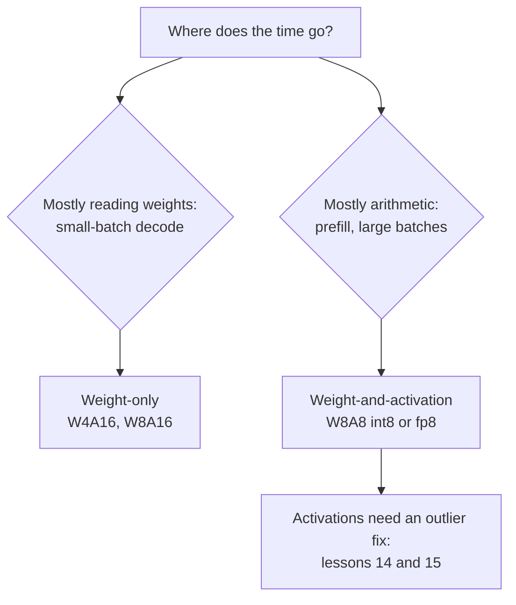

# Lesson 13. Weights, Activations or Both

**Mission link:** Deciding what to quantize beyond the weights is the first fork in choosing a scheme, and it decides whether you are buying memory or arithmetic.
**Primary source:** [Paper: "SmoothQuant: Accurate and Efficient Post-Training Quantization for Large Language Models", Xiao et al., 2022](https://arxiv.org/abs/2211.10438), sections 1 to 3
**Prerequisites:** [Lesson 12](0012-the-calibration-set.md), [Weight-only quantization](../GLOSSARY.md), [WxAy notation](../GLOSSARY.md), [Static quantization](../GLOSSARY.md), [Dynamic quantization](../GLOSSARY.md)

## Warm-up

1. ▢ Lesson 1 said batch-1 decode is memory-bound. What does that mean for where the time goes, and what does quantizing the weights change?

<details markdown="1"><summary>Check</summary>

The time goes on reading every weight from memory once per token, not on the multiply-adds. Fewer bits per weight means fewer bytes read, so the ceiling on tokens per second rises.

</details>

2. ▢ Lessons 10 and 11 quantized weights to 4 bits. What did GPTQ and AWQ leave in 16-bit?

<details markdown="1"><summary>Check</summary>

The activations, and so the arithmetic. Both are weight-only methods: the kernel dequantizes the 4-bit weights back to 16-bit and multiplies them with 16-bit activations.

</details>

3. ▢ Lesson 7 described outlier features. Do they live in particular tokens or in particular channels?

<details markdown="1"><summary>Check</summary>

In particular channels (hidden dimensions), and they show up across most tokens. That is the property this lesson and the next one lean on.

</details>

## Know this

### Two kinds of scheme

**WxAy notation** names a scheme by the bit widths of its weights and activations: W4A16 is 4-bit weights with 16-bit activations, W8A8 is 8-bit weights and 8-bit activations. They buy different things.

- **Weight-only** (W4A16, W8A16). The weights are stored small and turned back into 16-bit numbers inside the kernel, then multiplied with 16-bit activations. This saves memory and the bytes read per token, which is what memory-bound decode needs. The arithmetic is unchanged.
- **Weight-and-activation** (W8A8 in int8 or fp8). Both operands of the matrix multiplication are 8-bit, so the multiplication itself runs on low-precision hardware units. Xiao et al. note that int8 weights and activations "can halve the GPU memory usage and nearly double the throughput of matrix multiplications compared to FP16". This is what compute-bound work, prefill and large-batch decode, needs.

Lesson 19 turns this into a prediction of which one runs faster for a given batch size. For now, hold the split: weight-only buys bytes, weight-and-activation buys arithmetic.

### Why activations are harder

Xiao et al. state the asymmetry directly: weights are easy to quantize, activations are not. Three reasons, all from their section 3:

- **Outliers.** The outliers in activations are about 100 times larger than most activation values. A per-tensor scale is set by the outlier, so the ordinary values get only a few levels.
- **They persist by channel.** "If one channel has an outlier, it persistently appears in all tokens", while the variation within one channel across tokens is small. Activations vary channel to channel, not token to token.
- **Their range depends on the input.** A weight's range is fixed once training ends. An activation's range is only known when the input arrives.

### The constraint the hardware adds

The obvious fix for outliers that live in channels is a scale per input channel. The hardware rules it out. An int8 matrix multiplication computes `Y = diag(s_X) · (X_int8 @ W_int8) · diag(s_W)`, and the scales can only sit outside the integer product: one per token (rows of `X`) and one per output channel (columns of `W`). Xiao et al.: to use int8 GEMM kernels efficiently, "we can only use scaling factors from the outer dimensions (i.e., token dimension T and out channel dimension C_o) but not inner dimension (i.e., in channel dimension C_i)". A per-input-channel scale would have to be applied inside the sum, on every product.

So activations get a per-tensor or a per-token scale, and per-token cannot isolate an outlier that appears in every token.

### Static or dynamic scales

The activation's scale can be fixed ahead of time or measured at run time. Xiao et al. define both: computing it offline from calibration samples is **static quantization**, using the activations' run-time statistics is **dynamic quantization**. Static is cheaper per request and depends on the calibration set matching real traffic, the risk lesson 12 named. Dynamic adapts to each input and costs a reduction over the tensor before every quantized multiplication.

### What a careful comparison found

Kurtic et al. ran over 500,000 evaluations across the Llama 3.1 family and found fp8 W8A8 "effectively lossless across all model scales", well-tuned int8 W8A8 at 1 to 3% accuracy degradation, and W4A16 int "more competitive than expected, rivaling 8-bit quantization" ([Kurtic et al., 2024](https://arxiv.org/abs/2411.02355)). Their deployment advice follows the split above: W4A16 for synchronous serving, W8A8 for continuous batching. Treat those as results for one model family on their tasks, and measure your own (lesson 22).



## Practice

1. ▢ Name the bit widths in W4A16 and W8A8, and say which of the two speeds up the matrix multiplication itself.

<details markdown="1"><summary>Check</summary>

W4A16 is 4-bit weights and 16-bit activations; W8A8 is 8-bit weights and 8-bit activations. Only W8A8 speeds up the multiplication, because only there are both operands low precision. W4A16 dequantizes the weights to 16-bit and multiplies in 16-bit.

</details>

2. ▢ A colleague proposes giving each input channel of the activations its own int8 scale, to isolate the outlier channels. Why does an int8 GEMM kernel not allow it?

<details markdown="1"><summary>Hint</summary>

Write the integer product as a sum over the input channel, and ask where a scale that changes with that index would have to go.

</details>

<details markdown="1"><summary>Check</summary>

The kernel computes integer products summed over the input channel, then multiplies the result by the scales. A scale per token factors out of each row and a scale per output channel factors out of each column, so both can be applied once, after the sum. A scale per input channel changes inside the sum, so it would have to be applied to every product before adding, which is no longer an int8 GEMM.

</details>

3. ▢ Predict, then run. One channel of the activations is 100 times larger in every token. Predict whether a per-token scale fixes the error on the other channels, compared with the same tensor without the outlier.

    ```python
    import numpy as np
    rng = np.random.default_rng(0)
    X = rng.normal(0, 1, (64, 8))       # 64 tokens, 8 channels
    X[:, 3] *= 100                      # an outlier channel, present in every token

    def q8(t, axis=None):               # symmetric int8, one scale per slice
        s = np.abs(t).max(axis=axis, keepdims=True) / 127
        return np.clip(np.round(t / s), -127, 127) * s

    normal = [c for c in range(8) if c != 3]
    for name, Xq in [("per-tensor", q8(X)), ("per-token ", q8(X, axis=1))]:
        print(name, "error on normal channels:", round(np.abs(Xq - X)[:, normal].mean(), 3))
    Xc = X.copy(); Xc[:, 3] /= 100      # same tensor without the outlier channel
    print("per-token, no outlier       :", round(np.abs(q8(Xc, axis=1) - Xc)[:, normal].mean(), 3))
    ```

<details markdown="1"><summary>Hint</summary>

A per-token scale is set by the largest value in that token's row. Which value is that, in every row?

</details>

<details markdown="1"><summary>Check</summary>

```text
per-tensor error on normal channels: 0.622
per-token  error on normal channels: 0.166
per-token, no outlier       : 0.003
```

Per-token helps, because each row's scale is set by that row's outlier rather than by the largest outlier in the whole tensor. It does not fix the problem: every row still contains the outlier, so the ordinary channels are still about 50 times worse off than without it. Outliers that live in channels need a fix that works on channels, which is what SmoothQuant (lesson 14) does without breaking the kernel.

</details>

4. ▢ A team serves an 8B model to one user at a time on a GPU with fp8 support, and another team serves the same model to hundreds of concurrent users with continuous batching. Which pairing of scheme to team does the reasoning in this lesson support?

    - a) W4A16 for the single user, W8A8 for the busy server
    - b) W8A8 for the single user, W4A16 for the busy server
    - c) W4A16 for both teams, since fewer bits always run faster
    - d) W8A8 for both teams, since activations dominate in either case

<details markdown="1"><summary>Check</summary>

**a)** The single user is memory-bound, so cutting weight bytes matters most; the busy server is compute-bound, so low-precision arithmetic matters most. This matches Kurtic et al.'s recommendation. (b) has the two bottlenecks reversed. (c) assumes fewer bits always means faster, which fails when the arithmetic is the bottleneck and weight-only leaves it in 16-bit. (d) assumes activations dominate at batch 1, where the weight reads do.

</details>

## Real-world reps

- [ ] Find a W8A8 and a W4A16 checkpoint of the same model on the Hugging Face Hub and compare their file sizes against the bf16 original. Explain the difference from the bit widths.
- [ ] Read section 3 of the SmoothQuant paper and find the figure that shows activation magnitudes by channel and token. Say in one sentence what it shows about where the outliers live.
- [ ] Tomorrow: without notes, write the int8 GEMM formula with its two scales and explain which granularities it allows for activations and for weights.

## Going further

- [Activations and the KV Cache](../reference/activations-and-kv-cache.md)
- [Paper: "Give Me BF16 or Give Me Death? Accuracy-Performance Trade-Offs in LLM Quantization", Kurtic et al., 2024](https://arxiv.org/abs/2411.02355)
- [Resources](../RESOURCES.md)

---

Not landing? Reread the primary source at the top, since this lesson compresses it and compression is where understanding leaks. Check the [glossary](../GLOSSARY.md) for any term that felt slippery.

If the lesson itself is unclear rather than the material, that is a defect: [open an issue](https://github.com/TokenCemetery/teach/issues).
