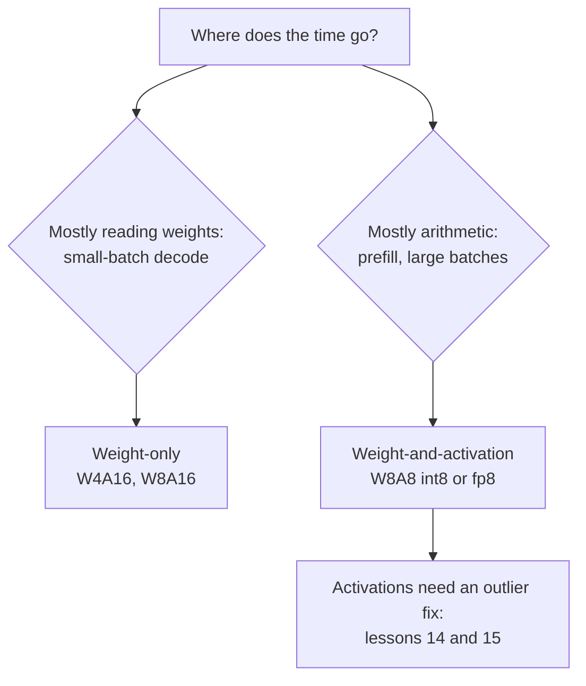

# Lição 13. Pesos, ativações ou ambos

**Ligação com a missão:** Decidir o que quantizar além dos pesos é a primeira bifurcação na escolha de um esquema, e decide se você está comprando memória ou aritmética.
**Fonte principal:** [Artigo científico: "SmoothQuant: Accurate and Efficient Post-Training Quantization for Large Language Models", Xiao et al., 2022](https://arxiv.org/abs/2211.10438), seções 1 a 3
**Pré-requisitos:** [Lição 12](0012-the-calibration-set.md), [Quantização somente de pesos](../GLOSSARY.md), [Notação WxAy](../GLOSSARY.md), [Quantização estática](../GLOSSARY.md), [Quantização dinâmica](../GLOSSARY.md)

## Aquecimento

1. ▢ A lição 1 disse que o decode com batch 1 é limitado pela largura de banda de memória. O que isso significa para onde o tempo vai, e o que quantizar os pesos muda?

<details markdown="1"><summary>Verificação</summary>

O tempo vai na leitura de cada peso da memória uma vez por token, não nas multiplicações e somas. Menos bits por peso significa menos bytes lidos, então o teto de tokens por segundo sobe.

</details>

2. ▢ As lições 10 e 11 quantizaram pesos para 4 bits. O que o GPTQ e o AWQ deixaram em 16 bits?

<details markdown="1"><summary>Verificação</summary>

As ativações e, portanto, a aritmética. Ambos são métodos somente de pesos: o kernel dequantiza os pesos de 4 bits de volta para 16 bits e os multiplica com ativações de 16 bits.

</details>

3. ▢ A lição 7 descreveu as features outliers. Elas vivem em tokens específicos ou em canais específicos?

<details markdown="1"><summary>Verificação</summary>

Em canais específicos (dimensões do hidden state), e aparecem na maioria dos tokens. Essa é a propriedade em que esta lição e a próxima se apoiam.

</details>

## Saiba isto

### Dois tipos de esquema

A **notação WxAy** nomeia um esquema pelas larguras em bits dos seus pesos e ativações: W4A16 é pesos de 4 bits com ativações de 16 bits, W8A8 é pesos de 8 bits e ativações de 8 bits. Eles compram coisas diferentes.

- **Somente pesos** (W4A16, W8A16). Os pesos são armazenados pequenos e convertidos de volta para números de 16 bits dentro do kernel, e depois multiplicados com ativações de 16 bits. Isso economiza memória e os bytes lidos por token, que é o que o decode limitado pela largura de banda de memória precisa. A aritmética fica inalterada.
- **Pesos e ativações** (W8A8 em int8 ou fp8). Os dois operandos da multiplicação de matrizes têm 8 bits, então a própria multiplicação roda em unidades de hardware de baixa precisão. Xiao et al. observam que pesos e ativações int8 "podem reduzir pela metade o uso de memória da GPU e quase dobrar a vazão das multiplicações de matrizes em comparação com o FP16". É o que o trabalho limitado por compute, o prefill e o decode com batch grande, precisa.

A lição 19 transforma isso em uma previsão de qual roda mais rápido para um dado batch size. Por ora, guarde a divisão: somente pesos compra bytes, pesos e ativações compra aritmética.

### Por que as ativações são mais difíceis

Xiao et al. enunciam a assimetria diretamente: os pesos são fáceis de quantizar, as ativações não. Três motivos, todos da seção 3 deles:

- **Outliers.** Os outliers nas ativações são cerca de 100 vezes maiores que a maioria dos valores de ativação. Uma scale per-tensor é definida pelo outlier, então os valores comuns recebem apenas alguns níveis.
- **Eles persistem por canal.** "Se um canal tem um outlier, ele aparece persistentemente em todos os tokens", enquanto a variação dentro de um canal entre tokens é pequena. As ativações variam de canal para canal, não de token para token.
- **A sua faixa depende da entrada.** A faixa de um peso é fixa quando o treinamento termina. A faixa de uma ativação só é conhecida quando a entrada chega.

### A restrição que o hardware acrescenta

A correção óbvia para outliers que vivem em canais é uma scale por canal de entrada. O hardware a descarta. Uma multiplicação de matrizes int8 calcula `Y = diag(s_X) · (X_int8 @ W_int8) · diag(s_W)`, e as scales só podem ficar fora do produto de inteiros: uma por token (linhas de `X`) e uma por canal de saída (colunas de `W`). Xiao et al.: para usar kernels GEMM int8 de forma eficiente, "só podemos usar fatores de escala das dimensões externas (isto é, a dimensão de tokens T e a dimensão de canais de saída C_o) mas não da dimensão interna (isto é, a dimensão de canais de entrada C_i)". Uma scale por canal de entrada teria de ser aplicada dentro da soma, em cada produto.

Então as ativações recebem uma scale per-tensor ou per-token, e a per-token não consegue isolar um outlier que aparece em todo token.

### Scales estáticas ou dinâmicas

A scale da ativação pode ser fixada antes ou medida em tempo de execução. Xiao et al. definem ambas: calculá-la offline a partir de amostras de calibração é **quantização estática**, usar as estatísticas das ativações em tempo de execução é **quantização dinâmica**. A estática é mais barata por requisição e depende de o calibration set casar com o tráfego real, o risco que a lição 12 nomeou. A dinâmica se adapta a cada entrada e custa uma redução sobre o tensor antes de cada multiplicação quantizada.

### O que uma comparação cuidadosa encontrou

Kurtic et al. rodaram mais de 500.000 avaliações na família Llama 3.1 e descobriram que o fp8 W8A8 é "efetivamente sem perdas em todas as escalas de modelo", o int8 W8A8 bem ajustado tem 1 a 3% de degradação de acurácia e o W4A16 int é "mais competitivo do que o esperado, rivalizando com a quantização de 8 bits" ([Kurtic et al., 2024](https://arxiv.org/abs/2411.02355)). A orientação de deployment deles segue a divisão acima: W4A16 para serving síncrono, W8A8 para continuous batching. Trate esses como resultados para uma família de modelos nas tarefas deles, e meça os seus próprios (lição 22).



## Prática

1. ▢ Nomeie as larguras em bits em W4A16 e W8A8 e diga qual dos dois acelera a própria multiplicação de matrizes.

<details markdown="1"><summary>Verificação</summary>

W4A16 é pesos de 4 bits e ativações de 16 bits; W8A8 é pesos de 8 bits e ativações de 8 bits. Só o W8A8 acelera a multiplicação, porque só nele os dois operandos são de baixa precisão. O W4A16 dequantiza os pesos para 16 bits e multiplica em 16 bits.

</details>

2. ▢ Um colega propõe dar a cada canal de entrada das ativações a sua própria scale int8, para isolar os canais outliers. Por que um kernel GEMM int8 não permite isso?

<details markdown="1"><summary>Dica</summary>

Escreva o produto de inteiros como uma soma sobre o canal de entrada e pergunte onde uma scale que muda com esse índice teria de ficar.

</details>

<details markdown="1"><summary>Verificação</summary>

O kernel calcula produtos de inteiros somados sobre o canal de entrada e depois multiplica o resultado pelas scales. Uma scale por token sai em evidência de cada linha e uma scale por canal de saída sai em evidência de cada coluna, então ambas podem ser aplicadas uma vez, depois da soma. Uma scale por canal de entrada muda dentro da soma, então teria de ser aplicada a cada produto antes de somar, o que deixa de ser um GEMM int8.

</details>

3. ▢ Preveja e depois execute. Um canal das ativações é 100 vezes maior em todo token. Preveja se uma scale per-token corrige o erro nos outros canais, em comparação com o mesmo tensor sem o outlier.

    ```python
    import numpy as np
    rng = np.random.default_rng(0)
    X = rng.normal(0, 1, (64, 8))       # 64 tokens, 8 channels
    X[:, 3] *= 100                      # an outlier channel, present in every token

    def q8(t, axis=None):               # symmetric int8, one scale per slice
        s = np.abs(t).max(axis=axis, keepdims=True) / 127
        return np.clip(np.round(t / s), -127, 127) * s

    normal = [c for c in range(8) if c != 3]
    for name, Xq in [("per-tensor", q8(X)), ("per-token ", q8(X, axis=1))]:
        print(name, "error on normal channels:", round(np.abs(Xq - X)[:, normal].mean(), 3))
    Xc = X.copy(); Xc[:, 3] /= 100      # same tensor without the outlier channel
    print("per-token, no outlier       :", round(np.abs(q8(Xc, axis=1) - Xc)[:, normal].mean(), 3))
    ```

<details markdown="1"><summary>Dica</summary>

Uma scale per-token é definida pelo maior valor da linha daquele token. Qual valor é esse, em toda linha?

</details>

<details markdown="1"><summary>Verificação</summary>

```text
per-tensor error on normal channels: 0.622
per-token  error on normal channels: 0.166
per-token, no outlier       : 0.003
```

O per-token ajuda, porque a scale de cada linha é definida pelo outlier daquela linha e não pelo maior outlier do tensor inteiro. Ele não resolve o problema: toda linha ainda contém o outlier, então os canais comuns continuam cerca de 50 vezes pior do que sem ele. Outliers que vivem em canais precisam de uma correção que funcione sobre canais, que é o que o SmoothQuant (lição 14) faz sem quebrar o kernel.

</details>

4. ▢ Uma equipe serve um modelo de 8B a um usuário por vez em uma GPU com suporte a fp8, e outra equipe serve o mesmo modelo a centenas de usuários simultâneos com continuous batching. Qual pareamento de esquema e equipe o raciocínio desta lição sustenta?

    - a) W4A16 para o usuário único, W8A8 para o servidor movimentado
    - b) W8A8 para o usuário único, W4A16 para o servidor movimentado
    - c) W4A16 para as duas equipes, já que menos bits sempre rodam mais rápido
    - d) W8A8 para as duas equipes, já que as ativações dominam em qualquer caso

<details markdown="1"><summary>Verificação</summary>

**a)** O usuário único é limitado pela largura de banda de memória, então reduzir os bytes dos pesos é o que mais importa; o servidor movimentado é limitado por compute, então a aritmética de baixa precisão é o que mais importa. Isso coincide com a recomendação de Kurtic et al. (b) tem os dois gargalos invertidos. (c) pressupõe que menos bits sempre significa mais rápido, o que falha quando a aritmética é o gargalo e o somente pesos a deixa em 16 bits. (d) pressupõe que as ativações dominam no batch 1, onde as leituras dos pesos dominam.

</details>

## Prática no mundo real

- [ ] Encontre um checkpoint W8A8 e um W4A16 do mesmo modelo no Hugging Face Hub e compare os tamanhos de arquivo deles com o original em bf16. Explique a diferença a partir das larguras em bits.
- [ ] Leia a seção 3 do artigo do SmoothQuant e encontre a figura que mostra as magnitudes das ativações por canal e por token. Diga em uma frase o que ela mostra sobre onde os outliers vivem.
- [ ] Amanhã: sem consultar anotações, escreva a fórmula do GEMM int8 com as suas duas scales e explique quais granularidades ele permite para as ativações e para os pesos.

## Para ir além

- [Ativações e o KV Cache](../reference/activations-and-kv-cache.md)
- [Artigo científico: "Give Me BF16 or Give Me Death? Accuracy-Performance Trade-Offs in LLM Quantization", Kurtic et al., 2024](https://arxiv.org/abs/2411.02355)
- [Recursos](../RESOURCES.md)

---

Não ficou claro? Releia a fonte principal no topo, já que esta lição a comprime e é na compressão que o entendimento escapa. Consulte o [glossário](../GLOSSARY.md) para qualquer termo que pareceu escorregadio.

Se o problema é a lição em si, e não o material, isso é um defeito: [abra uma issue](https://github.com/TokenCemetery/teach/issues).
