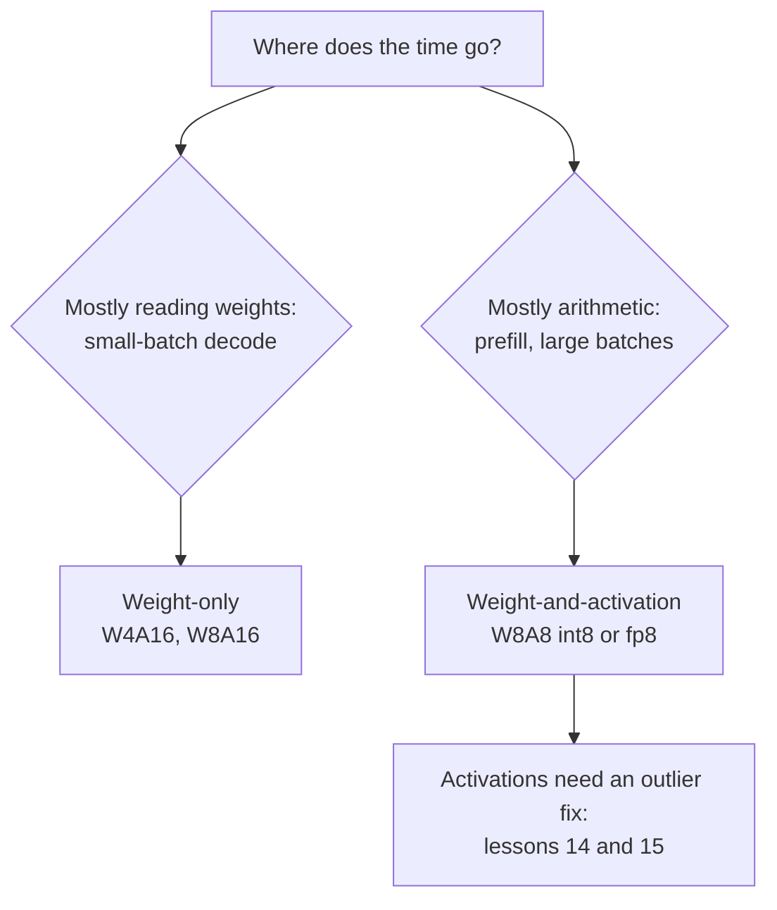

# Урок 13. Веса, активации или и то и другое

**Связь с целью курса:** Решение о том, что квантизовать помимо весов, это первая развилка при выборе схемы, и оно определяет, покупаете ли вы память или арифметику.
**Первоисточник:** [Научная статья: "SmoothQuant: Accurate and Efficient Post-Training Quantization for Large Language Models", Xiao et al., 2022](https://arxiv.org/abs/2211.10438), разделы с 1 по 3
**Предварительные требования:** [Урок 12](0012-the-calibration-set.md), [Квантизация только весов](../GLOSSARY.md), [Нотация WxAy](../GLOSSARY.md), [Статическая квантизация](../GLOSSARY.md), [Динамическая квантизация](../GLOSSARY.md)

## Разминка

1. ▢ Урок 1 говорил, что декодирование при батче 1 ограничено памятью. Что это значит для того, куда уходит время, и что меняет квантизация весов?

<details markdown="1"><summary>Проверка</summary>

Время уходит на чтение каждого веса из памяти один раз на токен, а не на умножения со сложениями. Меньше бит на вес означает меньше прочитанных байт, поэтому потолок токенов в секунду растёт.

</details>

2. ▢ Уроки 10 и 11 квантизовали веса в 4 бита. Что GPTQ и AWQ оставили в 16 битах?

<details markdown="1"><summary>Проверка</summary>

Активации, а значит и арифметику. Оба это методы только для весов: ядро деквантизует 4-битные веса обратно в 16 бит и умножает их на 16-битные активации.

</details>

3. ▢ Урок 7 описал признаки-выбросы. Живут ли они в определённых токенах или в определённых каналах?

<details markdown="1"><summary>Проверка</summary>

В определённых каналах (скрытых измерениях), и проявляются на большинстве токенов. Это свойство, на которое опираются этот урок и следующий.

</details>

## Что нужно знать

### Два вида схем

**Нотация WxAy** называет схему по разрядности её весов и активаций: W4A16 это 4-битные веса с 16-битными активациями, W8A8 это 8-битные веса и 8-битные активации. Они покупают разное.

- **Только веса** (W4A16, W8A16). Веса хранятся в малом виде и внутри ядра превращаются обратно в 16-битные числа, затем умножаются на 16-битные активации. Это экономит память и число байт, читаемых на токен, а именно это нужно декодированию, ограниченному памятью. Арифметика не меняется.
- **Веса и активации** (W8A8 в int8 или fp8). Оба операнда умножения матриц 8-битные, поэтому само умножение выполняется на блоках оборудования с низкой точностью. Xiao и соавторы отмечают, что веса и активации в int8 «могут вдвое сократить использование памяти GPU и почти вдвое повысить пропускную способность умножения матриц по сравнению с FP16». Это то, что нужно работе, ограниченной вычислениями: prefill и декодированию с большим батчем.

Урок 19 превращает это в предсказание того, какая из схем быстрее при данном размере батча. Пока запомните разделение: только веса покупает байты, веса и активации покупают арифметику.

### Почему активации сложнее

Xiao и соавторы прямо формулируют асимметрию: веса легко квантизовать, активации нет. Три причины, все из их раздела 3:

- **Выбросы.** Выбросы в активациях примерно в 100 раз больше большинства значений активаций. Масштаб per-tensor задаётся выбросом, поэтому обычным значениям достаётся лишь несколько уровней.
- **Они устойчиво живут по каналам.** «Если в одном канале есть выброс, он постоянно появляется во всех токенах», тогда как вариация внутри одного канала между токенами мала. Активации различаются от канала к каналу, а не от токена к токену.
- **Их диапазон зависит от входа.** Диапазон веса фиксируется по окончании обучения. Диапазон активации известен, только когда приходит вход.

### Ограничение, которое добавляет оборудование

Очевидное исправление для выбросов, живущих в каналах, это масштаб на входной канал. Оборудование его исключает. Умножение матриц в int8 вычисляет `Y = diag(s_X) · (X_int8 @ W_int8) · diag(s_W)`, и масштабы могут стоять только снаружи целочисленного произведения: один на токен (строки `X`) и один на выходной канал (столбцы `W`). Xiao и соавторы: чтобы эффективно использовать ядра GEMM в int8, «мы можем использовать только множители масштаба по внешним измерениям (то есть по измерению токенов T и по измерению выходных каналов C_o), но не по внутреннему измерению (то есть по измерению входных каналов C_i)». Масштаб на входной канал пришлось бы применять внутри суммы, к каждому произведению.

Поэтому активации получают масштаб per-tensor или per-token, а per-token не может изолировать выброс, который появляется в каждом токене.

### Статические или динамические масштабы

Масштаб активации можно зафиксировать заранее или измерять во время выполнения. Xiao и соавторы определяют оба: вычисление его офлайн по калибровочным образцам это **статическая квантизация**, использование статистики активаций во время выполнения это **динамическая квантизация**. Статическая дешевле на запрос и зависит от того, что калибровочный набор совпадает с реальным трафиком, а это риск, названный в уроке 12. Динамическая подстраивается под каждый вход и стоит редукции по тензору перед каждым квантизованным умножением.

### Что нашло аккуратное сравнение

Kurtic и соавторы провели более 500 000 замеров на семействе Llama 3.1 и обнаружили, что fp8 W8A8 «фактически без потерь на всех масштабах моделей», хорошо настроенный int8 W8A8 даёт деградацию точности на 1-3%, а W4A16 int «конкурентоспособнее, чем ожидалось, и соперничает с 8-битной квантизацией» ([Kurtic et al., 2024](https://arxiv.org/abs/2411.02355)). Их совет по развёртыванию следует разделению выше: W4A16 для синхронного обслуживания, W8A8 для непрерывной пакетной обработки. Считайте это результатами для одного семейства моделей на их задачах и измеряйте своё (урок 22).



## Практика

1. ▢ Назовите разрядности в W4A16 и W8A8 и скажите, какая из двух ускоряет само умножение матриц.

<details markdown="1"><summary>Проверка</summary>

W4A16 это 4-битные веса и 16-битные активации; W8A8 это 8-битные веса и 8-битные активации. Умножение ускоряет только W8A8, потому что только там оба операнда имеют низкую точность. W4A16 деквантизует веса в 16 бит и умножает в 16 битах.

</details>

2. ▢ Коллега предлагает дать каждому входному каналу активаций собственный масштаб int8, чтобы изолировать каналы-выбросы. Почему ядро GEMM в int8 этого не позволяет?

<details markdown="1"><summary>Подсказка</summary>

Запишите целочисленное произведение как сумму по входному каналу и спросите, куда пришлось бы поместить масштаб, меняющийся вместе с этим индексом.

</details>

<details markdown="1"><summary>Проверка</summary>

Ядро вычисляет целочисленные произведения, суммируемые по входному каналу, а затем умножает результат на масштабы. Масштаб на токен выносится из каждой строки, а масштаб на выходной канал выносится из каждого столбца, поэтому оба можно применить один раз, после суммы. Масштаб на входной канал меняется внутри суммы, поэтому его пришлось бы применять к каждому произведению до сложения, а это уже не GEMM в int8.

</details>

3. ▢ Предскажите, затем запустите. Один канал активаций в 100 раз больше в каждом токене. Предскажите, исправляет ли масштаб per-token ошибку на остальных каналах по сравнению с тем же тензором без выброса.

    ```python
    import numpy as np
    rng = np.random.default_rng(0)
    X = rng.normal(0, 1, (64, 8))       # 64 tokens, 8 channels
    X[:, 3] *= 100                      # an outlier channel, present in every token

    def q8(t, axis=None):               # symmetric int8, one scale per slice
        s = np.abs(t).max(axis=axis, keepdims=True) / 127
        return np.clip(np.round(t / s), -127, 127) * s

    normal = [c for c in range(8) if c != 3]
    for name, Xq in [("per-tensor", q8(X)), ("per-token ", q8(X, axis=1))]:
        print(name, "error on normal channels:", round(np.abs(Xq - X)[:, normal].mean(), 3))
    Xc = X.copy(); Xc[:, 3] /= 100      # same tensor without the outlier channel
    print("per-token, no outlier       :", round(np.abs(q8(Xc, axis=1) - Xc)[:, normal].mean(), 3))
    ```

<details markdown="1"><summary>Подсказка</summary>

Масштаб per-token задаётся наибольшим значением в строке этого токена. Какое это значение в каждой строке?

</details>

<details markdown="1"><summary>Проверка</summary>

```text
per-tensor error on normal channels: 0.622
per-token  error on normal channels: 0.166
per-token, no outlier       : 0.003
```

Per-token помогает, потому что масштаб каждой строки задаётся выбросом этой строки, а не наибольшим выбросом во всём тензоре. Проблему он не решает: каждая строка по-прежнему содержит выброс, поэтому обычным каналам всё ещё примерно в 50 раз хуже, чем без него. Выбросам, живущим в каналах, нужно исправление, работающее по каналам, а именно это делает SmoothQuant (урок 14), не ломая ядро.

</details>

4. ▢ Одна команда обслуживает модель на 8 млрд одному пользователю за раз на GPU с поддержкой fp8, а другая обслуживает ту же модель сотням одновременных пользователей с непрерывной пакетной обработкой. Какое сопоставление схемы и команды поддерживает рассуждение этого урока?

    - a) W4A16 для одного пользователя, W8A8 для загруженного сервера
    - b) W8A8 для одного пользователя, W4A16 для загруженного сервера
    - c) W4A16 для обеих команд, поскольку меньше бит всегда работает быстрее
    - d) W8A8 для обеих команд, поскольку активации доминируют в любом случае

<details markdown="1"><summary>Проверка</summary>

**a)** Один пользователь ограничен памятью, поэтому важнее всего сократить байты весов; загруженный сервер ограничен вычислениями, поэтому важнее всего арифметика с низкой точностью. Это соответствует рекомендации Kurtic и соавторов. (b) меняет два узких места местами. (c) предполагает, что меньше бит всегда значит быстрее, что не так, когда узкое место арифметика, а схема только для весов оставляет её в 16 битах. (d) предполагает, что активации доминируют при батче 1, где доминирует чтение весов.

</details>

## Практика в реальной работе

- [ ] Найдите на Hugging Face Hub чекпоинты W8A8 и W4A16 одной и той же модели и сравните размеры их файлов с оригиналом в bf16. Объясните разницу по разрядностям.
- [ ] Прочитайте раздел 3 статьи о SmoothQuant и найдите рисунок, показывающий величины активаций по каналам и токенам. Скажите одним предложением, что он показывает о том, где живут выбросы.
- [ ] Завтра, без заметок, запишите формулу GEMM в int8 с её двумя масштабами и объясните, какие гранулярности она допускает для активаций и для весов.

## Что почитать дальше

- [Активации и KV-кеш](../reference/activations-and-kv-cache.md)
- [Научная статья: "Give Me BF16 or Give Me Death? Accuracy-Performance Trade-Offs in LLM Quantization", Kurtic et al., 2024](https://arxiv.org/abs/2411.02355)
- [Ресурсы](../RESOURCES.md)

---

Не доходит? Перечитайте первоисточник в начале: этот урок его сжимает, а при сжатии понимание как раз и теряется. Загляните в [глоссарий](../GLOSSARY.md), если какой-то термин показался скользким.

Если неясен сам урок, а не материал, это дефект: [откройте issue](https://github.com/TokenCemetery/teach/issues).
