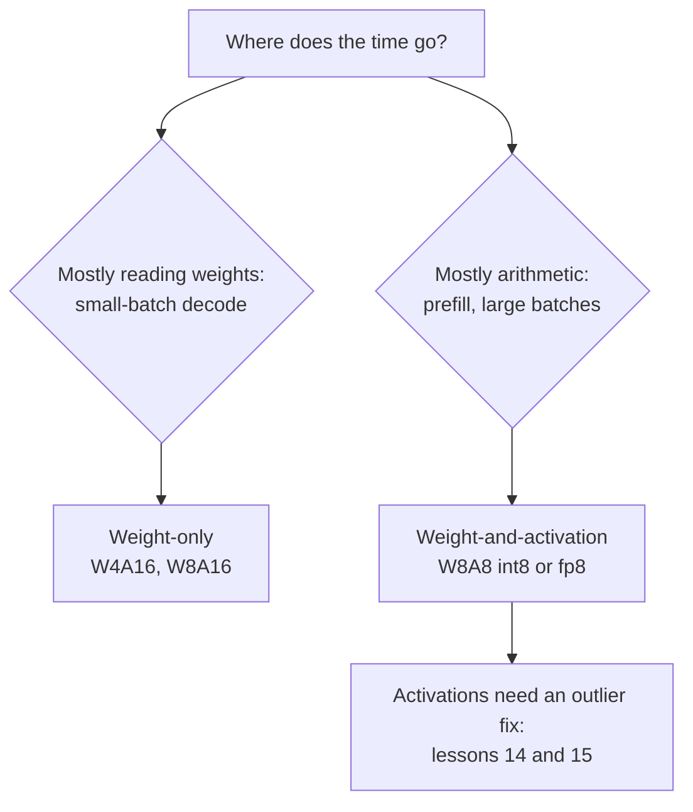

# 第 13 课：权重、激活值，还是两者兼顾

**使命关联:** 决定除权重之外还要量化什么，是选择方案时的第一个岔路口，它决定了你买的是内存，还是算术。
**主要来源:** [论文：“SmoothQuant: Accurate and Efficient Post-Training Quantization for Large Language Models”，Xiao 等，2022](https://arxiv.org/abs/2211.10438)，第 1 节到第 3 节
**前置知识:** [第 12 课](0012-the-calibration-set.md)、[仅权重量化](../GLOSSARY.md)、[WxAy 记法](../GLOSSARY.md)、[静态量化](../GLOSSARY.md)、[动态量化](../GLOSSARY.md)

## 热身

1. ▢ 第 1 课说批大小为 1 的解码受内存带宽限制。这对时间花在哪里意味着什么？量化权重改变了什么？

<details markdown="1"><summary>检查</summary>

时间花在每生成一个 token 都要从内存读取每一个权重上，而不是乘加运算上。每个权重的位数越少，读取的字节就越少，所以每秒 token 数的上限就升高了。

</details>

2. ▢ 第 10 和第 11 课把权重量化到了 4 位。GPTQ 和 AWQ 把什么留在了 16 位？

<details markdown="1"><summary>检查</summary>

激活值，也就是算术。两者都是仅权重量化方法：内核把 4 位权重反量化回 16 位，再与 16 位的激活值相乘。

</details>

3. ▢ 第 7 课描述了离群特征。它们存在于特定的 token 里，还是特定的通道里？

<details markdown="1"><summary>检查</summary>

存在于特定的通道（隐藏维度）里，并且在大多数 token 上都会出现。这就是本课和下一课所依靠的性质。

</details>

## 要点

### 两类方案

**WxAy 记法**用权重和激活值的位宽来给一种方案命名：W4A16 是 4 位权重配 16 位激活值，W8A8 是 8 位权重和 8 位激活值。它们买到的东西不同。

- **仅权重量化**（W4A16、W8A16）。权重以较小的体积存储，在内核内部还原成 16 位数，再与 16 位激活值相乘。这节省了内存和每个 token 读取的字节，而这正是受内存带宽限制的解码所需要的。算术没有变。
- **权重加激活值量化**（int8 或 fp8 的 W8A8）。矩阵乘法的两个操作数都是 8 位，所以乘法本身运行在低精度的硬件单元上。Xiao 等人指出，int8 的权重和激活值“与 FP16 相比，可以把 GPU 内存占用减半，并让矩阵乘法的吞吐量几乎翻倍”。这是受算力限制的工作，也就是预填充和大批量解码，所需要的。

第 19 课会把这一点变成对给定批大小下哪种方案跑得更快的预测。现在先记住这个划分：仅权重量化买的是字节，权重加激活值量化买的是算术。

### 为什么激活值更难

Xiao 等人直接说出了这种不对称：权重容易量化，激活值不容易。有三个原因，都来自他们的第 3 节：

- **离群值**。激活值中的离群值比大多数激活值大约 100 倍。逐张量的缩放因子由离群值决定，所以普通的值只得到寥寥几个档位。
- **它们按通道持续存在**。“如果某个通道有一个离群值，它会持续出现在所有 token 里”，而同一个通道在各 token 之间的变化很小。激活值是在通道与通道之间变化，而不是在 token 与 token 之间变化。
- **它们的范围取决于输入**。权重的范围在训练结束时就固定了。激活值的范围只有在输入到来时才知道。

### 硬件增加的约束

对于存在于通道里的离群值，显而易见的修复办法是每个输入通道一个缩放因子。硬件把这条路堵死了。int8 矩阵乘法计算 `Y = diag(s_X) · (X_int8 @ W_int8) · diag(s_W)`，缩放因子只能放在整数乘积之外：每个 token 一个（`X` 的各行），每个输出通道一个（`W` 的各列）。Xiao 等人说：要高效地使用 int8 GEMM 内核，“我们只能使用来自外侧维度（即 token 维度 T 和输出通道维度 C_o）的缩放因子，而不能使用内侧维度（即输入通道维度 C_i）的”。逐输入通道的缩放因子，就得应用在求和内部，作用于每一个乘积。

所以激活值只能得到逐张量或逐 token 的缩放因子，而逐 token 的缩放因子，无法把出现在每个 token 里的离群值隔离出来。

### 静态还是动态的缩放因子

激活值的缩放因子可以事先固定，也可以在运行时度量。Xiao 等人对两者都做了定义：根据校准样本离线算出它，是**静态量化**，使用激活值的运行时统计量，是**动态量化**。静态对每个请求来说更便宜，但要依赖校准集与真实流量相匹配，这正是第 12 课点出的风险。动态能适应每一个输入，代价是在每次量化乘法之前，都要对张量做一次归约。

### 一次细致的比较发现了什么

Kurtic 等人在 Llama 3.1 系列上运行了超过 500,000 次评测，发现 fp8 的 W8A8“在所有模型规模上实际上都是无损的”，调得好的 int8 W8A8 有 1% 到 3% 的精度下降，而 W4A16 的 int“比预期更有竞争力，足以媲美 8 位量化”（[Kurtic 等，2024](https://arxiv.org/abs/2411.02355)）。他们的部署建议遵循上面的划分：同步服务用 W4A16，连续批处理用 W8A8。请把这些当作一个模型系列在他们的任务上的结果，并去度量你自己的（第 22 课）。



## 练习

1. ▢ 说出 W4A16 和 W8A8 里的位宽，并说明两者之中哪一个加快了矩阵乘法本身。

<details markdown="1"><summary>检查</summary>

W4A16 是 4 位权重和 16 位激活值；W8A8 是 8 位权重和 8 位激活值。只有 W8A8 加快了乘法，因为只有在它那里，两个操作数都是低精度。W4A16 把权重反量化成 16 位，并以 16 位相乘。

</details>

2. ▢ 一位同事提议给激活值的每个输入通道各配一个 int8 缩放因子，来隔离离群通道。为什么 int8 GEMM 内核不允许这样做？

<details markdown="1"><summary>提示</summary>

把整数乘积写成对输入通道的求和，再想想，随这个下标变化的缩放因子得放在哪里。

</details>

<details markdown="1"><summary>检查</summary>

内核计算对输入通道求和的整数乘积，然后把结果乘以缩放因子。每个 token 一个的缩放因子可以从每一行中提出来，每个输出通道一个的缩放因子可以从每一列中提出来，所以两者都可以在求和之后只应用一次。逐输入通道的缩放因子在求和内部就变了，所以它得在相加之前应用到每一个乘积上，这就不再是 int8 GEMM 了。

</details>

3. ▢ 先预测，再运行。激活值的一个通道在每个 token 里都大 100 倍。预测逐 token 的缩放因子能否修复其他通道上的误差，与没有这个离群值的同一个张量相比。

    ```python
    import numpy as np
    rng = np.random.default_rng(0)
    X = rng.normal(0, 1, (64, 8))       # 64 tokens, 8 channels
    X[:, 3] *= 100                      # an outlier channel, present in every token

    def q8(t, axis=None):               # symmetric int8, one scale per slice
        s = np.abs(t).max(axis=axis, keepdims=True) / 127
        return np.clip(np.round(t / s), -127, 127) * s

    normal = [c for c in range(8) if c != 3]
    for name, Xq in [("per-tensor", q8(X)), ("per-token ", q8(X, axis=1))]:
        print(name, "error on normal channels:", round(np.abs(Xq - X)[:, normal].mean(), 3))
    Xc = X.copy(); Xc[:, 3] /= 100      # same tensor without the outlier channel
    print("per-token, no outlier       :", round(np.abs(q8(Xc, axis=1) - Xc)[:, normal].mean(), 3))
    ```

<details markdown="1"><summary>提示</summary>

逐 token 的缩放因子由该 token 那一行里的最大值决定。在每一行里，那个值是哪一个？

</details>

<details markdown="1"><summary>检查</summary>

```text
per-tensor error on normal channels: 0.622
per-token  error on normal channels: 0.166
per-token, no outlier       : 0.003
```

逐 token 有帮助，因为每一行的缩放因子由那一行自己的离群值决定，而不是由整个张量里最大的离群值决定。它并没有解决问题：每一行仍然含有那个离群值，所以普通通道的状况，仍然比没有它时差大约 50 倍。存在于通道里的离群值，需要一种作用在通道上的修复办法，这正是 SmoothQuant（第 14 课）在不破坏内核的前提下所做的。

</details>

4. ▢ 一个团队在支持 fp8 的 GPU 上，一次只给一个用户提供一个 8B 模型的服务，另一个团队用连续批处理，给数百个并发用户提供同一个模型的服务。本课的推理支持哪一种方案与团队的搭配？

    - a) 单用户用 W4A16，繁忙的服务器用 W8A8
    - b) 单用户用 W8A8，繁忙的服务器用 W4A16
    - c) 两个团队都用 W4A16，因为位数越少总是跑得越快
    - d) 两个团队都用 W8A8，因为在任何一种情形下激活值都占主导

<details markdown="1"><summary>检查</summary>

**a)** 单用户受内存带宽限制，所以削减权重字节最要紧；繁忙的服务器受算力限制，所以低精度算术最要紧。这与 Kurtic 等人的建议一致。(b) 把两个瓶颈弄反了。(c) 假定位数越少总是越快，而当算术是瓶颈、仅权重量化把它留在 16 位时，这就不成立了。(d) 假定在批大小为 1 时激活值占主导，而那里占主导的是权重的读取。

</details>

## 实战练习

- [ ] 在 Hugging Face Hub 上找同一个模型的一个 W8A8 检查点和一个 W4A16 检查点，把它们的文件大小与 bf16 的原版做比较。根据位宽解释这个差别。
- [ ] 阅读 SmoothQuant 论文的第 3 节，找到按通道和 token 展示激活值幅值的那张图。用一句话说出它显示了离群值存在于哪里。
- [ ] 明天：不看笔记，写出带两个缩放因子的 int8 GEMM 公式，并解释它对激活值和对权重各允许哪些粒度。

## 延伸阅读

- [激活值与 KV 缓存](../reference/activations-and-kv-cache.md)
- [论文：“Give Me BF16 or Give Me Death? Accuracy-Performance Trade-Offs in LLM Quantization”，Kurtic 等，2024](https://arxiv.org/abs/2411.02355)
- [资源](../RESOURCES.md)

---

没学明白？请重读顶部的主要来源，因为本课是对它的压缩，而理解正是在压缩中流失的。如果有哪个术语觉得含糊，可以查看[术语表](../GLOSSARY.md)。

如果问题出在课程本身，而不是学习材料，那就是一个缺陷：[提交 issue](https://github.com/TokenCemetery/teach/issues)。
