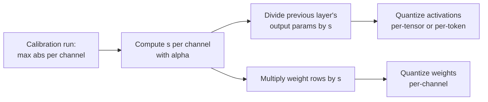

# Lección 14. SmoothQuant

**Vínculo con la misión:** W8A8 es el esquema que acelera el servicio limitado por cómputo, y SmoothQuant es la manera estándar de hacer cuantizables sus activaciones sin un scale por canal que el hardware no puede usar.
**Fuente principal:** [Paper: "SmoothQuant: Accurate and Efficient Post-Training Quantization for Large Language Models", Xiao et al., 2022](https://arxiv.org/abs/2211.10438), sección 4
**Requisitos previos:** [Lección 13](0013-weights-activations-or-both.md), [Outlier feature](../GLOSSARY.md), [Calibration set](../GLOSSARY.md)

## Calentamiento

1. ▢ La lección 13 dijo que un GEMM en int8 solo puede aplicar scales a lo largo de dos dimensiones. ¿Cuáles dos, y cuál habría aislado los outliers de las activaciones?

<details markdown="1"><summary>Comprobación</summary>

Por token (filas de las activaciones) y por canal de salida (columnas de los pesos). Un scale por canal de entrada habría aislado los canales outlier, y es exactamente el que el kernel no puede aplicar.

</details>

2. ▢ La lección 11 escaló hacia arriba algunos canales de pesos antes de redondear. ¿En qué fusionó AWQ el scale inverso correspondiente, y por qué no cambió la salida de la capa?

<details markdown="1"><summary>Comprobación</summary>

En las activaciones que multiplican esos canales, en la práctica en la operación que las produce. Escalar una fila de pesos por `s` y su columna de activaciones por `1 / s` se cancela en el producto, así que la salida en precisión completa es idéntica.

</details>

## Qué debes saber

### La idea en una línea

Las activaciones son difíciles de cuantizar porque unos pocos canales son enormes; los pesos son fáciles porque son planos. SmoothQuant divide cada canal de activaciones por un factor y multiplica la fila de pesos correspondiente por el mismo factor, de modo que el producto no cambia y la dificultad se reparte entre los dos:

```text
Y = X @ W = (X @ diag(s)^-1) @ (diag(s) @ W)
```

Dividir el canal `j` de las activaciones por `s_j` reduce el canal outlier; multiplicar la fila `j` de los pesos por `s_j` hace mayor esa fila, algo que los pesos pueden absorber porque partían de ser planos. Xiao et al. lo llaman migrar la dificultad de cuantizar de las activaciones a los pesos, y se aplica offline.

### Elegir el factor

Xiao et al. introducen una **fuerza de migración** `α` y fijan, por canal de entrada `j`:

```text
s_j = max(|X_j|)^α / max(|W_j|)^(1 - α)
```

- `α = 1` es la "opción directa" `s_j = max(|X_j|)`: cada canal de activación acaba con el mismo máximo, y toda la dificultad pasa a los pesos.
- `α = 0` deja las activaciones como estaban.
- El paper encuentra que `α = 0.5` es un punto bien equilibrado que reparte la dificultad por igual, y un punto óptimo general para todos los modelos OPT y BLOOM. Para modelos cuyos outliers de activaciones son más significativos, como GLM-130B con cerca de un 30% de outliers, un `α` mayor mueve más de ella a los pesos.

`max(|X_j|)` se mide en un **calibration set**, así que SmoothQuant es un método post-entrenamiento con los riesgos de calibración de la lección 12.

### Por qué no cuesta nada en tiempo de ejecución

La entrada `X` de una capa lineal suele producirla una operación anterior, como una layer norm u otra capa lineal. Xiao et al. fusionan el factor de suavizado en los parámetros de esa capa anterior offline, así que no hay un kernel extra ni una multiplicación extra por solicitud. Los pesos se multiplican por `s` una vez, antes de cuantizarse.



### Qué aporta

El resumen informa de W8A8 int8 para todas las multiplicaciones de matrices en los modelos OPT, BLOOM, GLM, MT-NLG, Llama, Falcon, Mistral y Mixtral, con hasta 1.56x de aceleración y 2x de reducción de memoria con una pérdida de accuracy despreciable, y de servir un modelo de 530B dentro de un solo nodo. Fíjate en lo que es: un método de 8 bits. Con activaciones de 4 bits, los outliers que quedan tras el suavizado siguen dominando, y por eso existen las rotaciones de la lección 15.

## Práctica

1. ▢ Escribe la identidad de SmoothQuant y di qué lado se divide por `s` y cuál se multiplica.

<details markdown="1"><summary>Comprobación</summary>

`X @ W = (X @ diag(s)^-1) @ (diag(s) @ W)`. Las activaciones se dividen por `s` por canal de entrada, y las filas de pesos de esos canales de entrada se multiplican por `s`. Si pones el scale en los canales de salida, deja de cancelarse.

</details>

2. ▢ Predice y luego ejecuta. Predice si el suavizado cambia el producto en precisión completa, y aproximadamente cuánto cambia el error de int8 per-tensor en ambos operandos.

    ```python
    import numpy as np
    rng = np.random.default_rng(0)
    X = rng.normal(0, 1, (64, 8))       # 64 tokens, 8 input channels
    X[:, 3] *= 100                      # channel 3 is an outlier channel
    W = rng.normal(0, 1, (8, 8))        # weights: 8 in, 8 out

    def q8(t):                          # symmetric per-tensor int8
        s = np.abs(t).max() / 127
        return np.clip(np.round(t / s), -127, 127) * s

    s = np.sqrt(np.abs(X).max(0) / np.abs(W).max(1))   # alpha = 0.5
    Xs, Ws = X / s, W * s[:, None]
    print("same product :", np.allclose(Xs @ Ws, X @ W))
    print("error, plain   :", round(np.abs(q8(X) @ q8(W) - X @ W).mean(), 3))
    print("error, smoothed:", round(np.abs(q8(Xs) @ q8(Ws) - X @ W).mean(), 3))
    ```

<details markdown="1"><summary>Pista</summary>

La primera línea comprueba la identidad, que se cumple en aritmética exacta. Para el error, pregúntate qué fija el scale per-tensor de las activaciones antes y después de dividir el canal 3 por su factor.

</details>

<details markdown="1"><summary>Comprobación</summary>

```text
same product : True
error, plain   : 1.542
error, smoothed: 0.663
```

El producto en precisión completa es el mismo, y el error cuantizado cae a bastante menos de la mitad. Antes del suavizado, el canal 3 fijaba el scale de las activaciones y los otros siete canales recibían un puñado de niveles; después, los canales de activación son más parecidos en tamaño y los pesos cargan con una fila que es mayor pero sigue siendo fácil de cuantizar.

</details>

3. ▢ Las activaciones de un modelo tienen outliers inusualmente numerosos e inusualmente grandes. ¿Deberías subir o bajar `α` respecto de 0.5, y cuál es el riesgo si llegas hasta 1?

<details markdown="1"><summary>Comprobación</summary>

Subirlo: un `α` mayor divide más las activaciones y mueve más de la dificultad a los pesos, que es lo que hace el paper para GLM-130B. Con `α = 1` cada canal de activación tiene el mismo máximo, pero los pesos cargan ahora con todos los outliers, y su error de cuantización crece. El objetivo de `α` es repartir la dificultad para que ningún lado quede arruinado.

</details>

4. ▢ Un colega dice que SmoothQuant ralentiza la inferencia porque cada solicitud tiene ahora que dividir las activaciones por `s`. ¿Qué falla en esa afirmación?

    - a) El scale se fusiona offline en los parámetros de la capa anterior
    - b) La división corre en núcleos de CPU mientras calcula la GPU
    - c) El scale es un solo número por tensor, que cuesta casi nada
    - d) La división se omite para los tokens que no contienen outliers

<details markdown="1"><summary>Comprobación</summary>

**a)** El factor se incorpora a la capa que produce `X`, como una layer norm, una sola vez, offline, así que no corre ninguna operación extra por solicitud. (b) inventa un paso en CPU que no existe. (c) es incorrecta porque `s` tiene un valor por canal de entrada, no uno por tensor. (d) es incorrecta porque los canales outlier aparecen en todos los tokens y el scale se aplica a todos.

</details>

## Prácticas en el mundo real

- [ ] Lee la sección 4 del paper de SmoothQuant y encuentra la figura que muestra las magnitudes de activaciones y de pesos antes y después del suavizado. Describe en una frase qué cambió en cada lado.
- [ ] Cambia `α` en el fragmento de la práctica a 0.25, 0.75 y 1.0 (usa `s = np.abs(X).max(0) ** a / np.abs(W).max(1) ** (1 - a)`) y anota el error suavizado de cada uno. Encuentra el valor que lo minimiza para este tensor.
- [ ] Mañana: sin apuntes, escribe la fórmula de `s_j`, di qué hacen `α = 0` y `α = 1` y dónde se fusiona el factor.

## Para profundizar

- [Activaciones y KV cache](../reference/activations-and-kv-cache.md)
- [Docs: "int8 W8A8" example, llm-compressor](https://github.com/vllm-project/llm-compressor/blob/main/examples/quantization_w8a8_int8/README.md), una receta que ejecuta SmoothQuant con una fuerza de migración de 0.8, luego GPTQ y luego scales de activaciones dinámicos por token
- [Recursos](../RESOURCES.md)

---

¿No termina de quedar claro? Vuelve a leer la fuente primaria de arriba, ya que esta lección la comprime y en la compresión es donde se escapa la comprensión. Consulta el [glosario](../GLOSSARY.md) por si algún término te resultó resbaladizo.

Si lo poco claro es la propia lección y no el material, eso es un defecto: [abre un issue](https://github.com/TokenCemetery/teach/issues).
