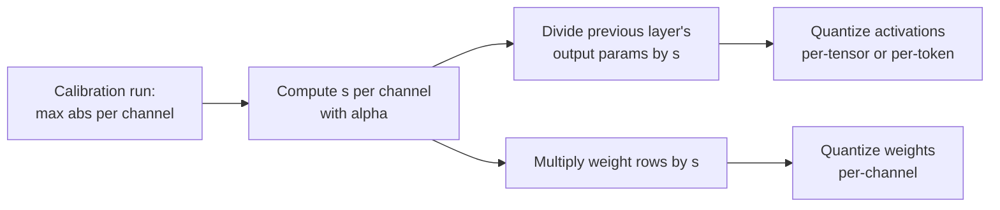

# Leçon 14. SmoothQuant

**Lien avec la mission :** Le W8A8 est le schéma qui accélère un serving limité par le calcul, et SmoothQuant est la manière standard de rendre ses activations quantifiables sans scale par canal que le matériel ne peut pas utiliser.
**Source primaire :** [Article : "SmoothQuant: Accurate and Efficient Post-Training Quantization for Large Language Models", Xiao et al., 2022](https://arxiv.org/abs/2211.10438), section 4
**Prérequis :** [Leçon 13](0013-weights-activations-or-both.md), [Feature outlier](../GLOSSARY.md), [Calibration set](../GLOSSARY.md)

## Échauffement

1. ▢ La leçon 13 disait qu'un GEMM int8 ne peut appliquer des scales que selon deux dimensions. Lesquelles, et laquelle aurait isolé les outliers d'activation ?

<details markdown="1"><summary>Vérifier</summary>

Par token (lignes des activations) et par canal de sortie (colonnes des poids). Un scale par canal d'entrée aurait isolé les canaux outlier, et c'est précisément celui que le kernel ne peut pas appliquer.

</details>

2. ▢ La leçon 11 a mis à l'échelle supérieure certains canaux de poids avant l'arrondi. Dans quoi AWQ a-t-il fusionné le scale inverse correspondant, et pourquoi la sortie de la couche n'a-t-elle pas changé ?

<details markdown="1"><summary>Vérifier</summary>

Dans les activations qui multiplient ces canaux, en pratique dans l'opération qui les produit. Mettre une ligne de poids à l'échelle `s` et sa colonne d'activations à l'échelle `1 / s` s'annule dans le produit, donc la sortie en pleine précision est identique.

</details>

## À savoir

### L'idée en une ligne

Les activations sont difficiles à quantifier parce que quelques canaux sont énormes ; les poids sont faciles parce qu'ils sont plats. SmoothQuant divise chaque canal d'activation par un facteur et multiplie la ligne de poids correspondante par le même facteur, de sorte que le produit est inchangé et que la difficulté est partagée entre les deux :

```text
Y = X @ W = (X @ diag(s)^-1) @ (diag(s) @ W)
```

Diviser le canal `j` des activations par `s_j` fait rétrécir le canal outlier ; multiplier la ligne `j` des poids par `s_j` agrandit cette ligne, ce que les poids peuvent absorber parce qu'ils étaient plats au départ. Xiao et al. appellent cela migrer la difficulté de quantification des activations vers les poids, et c'est appliqué hors ligne.

### Choisir le facteur

Xiao et al. introduisent une **force de migration** `α` et posent, par canal d'entrée `j` :

```text
s_j = max(|X_j|)^α / max(|W_j|)^(1 - α)
```

- `α = 1` est le « choix direct » `s_j = max(|X_j|)` : chaque canal d'activation finit avec le même maximum, et toute la difficulté passe dans les poids.
- `α = 0` laisse les activations comme elles étaient.
- L'article trouve que `α = 0.5` est un point bien équilibré qui répartit la difficulté de façon égale, et un point idéal général pour tous les modèles OPT et BLOOM. Pour les modèles dont les outliers d'activation sont plus marqués, comme GLM-130B avec environ 30 % d'outliers, un `α` plus grand en déplace davantage vers les poids.

`max(|X_j|)` est mesuré sur un **calibration set**, donc SmoothQuant est une méthode post-entraînement qui porte les risques de calibration de la leçon 12.

### Pourquoi cela ne coûte rien à l'exécution

L'entrée `X` d'une couche linéaire est d'ordinaire produite par une opération précédente, comme une layer norm ou une autre couche linéaire. Xiao et al. fusionnent hors ligne le facteur de lissage dans les paramètres de cette couche précédente, donc il n'y a ni kernel supplémentaire ni multiplication supplémentaire par requête. Les poids sont multipliés par `s` une seule fois, avant d'être quantifiés.



### Ce qu'elle apporte

Le résumé rapporte du W8A8 int8 pour toutes les multiplications de matrices sur les modèles OPT, BLOOM, GLM, MT-NLG, Llama, Falcon, Mistral et Mixtral, jusqu'à 1.56x d'accélération et 2x de réduction de mémoire avec une perte de précision négligeable, et le serving d'un modèle de 530B dans un seul nœud. Notez ce que c'est : une méthode en 8 bits. Avec des activations en 4 bits, les outliers qui restent après lissage dominent encore, ce qui explique l'existence des rotations de la leçon 15.

## Pratique

1. ▢ Écrivez l'identité de SmoothQuant et dites quel côté est divisé par `s` et lequel est multiplié.

<details markdown="1"><summary>Vérifier</summary>

`X @ W = (X @ diag(s)^-1) @ (diag(s) @ W)`. Les activations sont divisées par `s` par canal d'entrée, et les lignes de poids correspondant à ces canaux d'entrée sont multipliées par `s`. Si vous mettez le scale sur les canaux de sortie à la place, il ne s'annule plus.

</details>

2. ▢ Prédisez, puis exécutez. Prédisez si le lissage change le produit en pleine précision, et à peu près de combien il change l'erreur de l'int8 par tenseur sur les deux opérandes.

    ```python
    import numpy as np
    rng = np.random.default_rng(0)
    X = rng.normal(0, 1, (64, 8))       # 64 tokens, 8 input channels
    X[:, 3] *= 100                      # channel 3 is an outlier channel
    W = rng.normal(0, 1, (8, 8))        # weights: 8 in, 8 out

    def q8(t):                          # symmetric per-tensor int8
        s = np.abs(t).max() / 127
        return np.clip(np.round(t / s), -127, 127) * s

    s = np.sqrt(np.abs(X).max(0) / np.abs(W).max(1))   # alpha = 0.5
    Xs, Ws = X / s, W * s[:, None]
    print("same product :", np.allclose(Xs @ Ws, X @ W))
    print("error, plain   :", round(np.abs(q8(X) @ q8(W) - X @ W).mean(), 3))
    print("error, smoothed:", round(np.abs(q8(Xs) @ q8(Ws) - X @ W).mean(), 3))
    ```

<details markdown="1"><summary>Indice</summary>

La première ligne teste l'identité, qui tient en arithmétique exacte. Pour l'erreur, demandez-vous ce qui fixe le scale d'activation par tenseur avant et après la division du canal 3 par son facteur.

</details>

<details markdown="1"><summary>Vérifier</summary>

```text
same product : True
error, plain   : 1.542
error, smoothed: 0.663
```

Le produit en pleine précision est le même, et l'erreur quantifiée tombe à bien moins de la moitié. Avant le lissage, le canal 3 fixait le scale d'activation et les sept autres canaux obtenaient une poignée de niveaux ; après, les canaux d'activation sont plus proches en taille et les poids portent une ligne plus grande mais encore facile à quantifier.

</details>

3. ▢ Les activations d'un modèle ont des outliers inhabituellement nombreux et inhabituellement grands. Devez-vous monter ou baisser `α` à partir de 0.5, et quel est le risque si vous allez jusqu'à 1 ?

<details markdown="1"><summary>Vérifier</summary>

Monter : un `α` plus grand divise davantage les activations et déplace plus de difficulté dans les poids, ce que fait l'article pour GLM-130B. À `α = 1`, chaque canal d'activation a le même maximum, mais les poids portent désormais tous les outliers, et leur erreur de quantification croît. Le but de `α` est de répartir la difficulté pour qu'aucun côté ne soit ruiné.

</details>

4. ▢ Un collègue dit que SmoothQuant ralentit l'inférence parce que chaque requête doit maintenant diviser les activations par `s`. Qu'est-ce qui cloche dans cette affirmation ?

    - a) Le scale est fusionné hors ligne dans les paramètres de la couche précédente
    - b) La division tourne sur des cœurs CPU pendant que le GPU calcule
    - c) Le scale est un nombre par tenseur, qui ne coûte presque rien
    - d) La division est sautée pour les tokens qui ne contiennent aucun outlier

<details markdown="1"><summary>Vérifier</summary>

**a)** Le facteur est intégré une fois, hors ligne, dans la couche qui produit `X`, comme une layer norm, donc aucune opération supplémentaire ne tourne par requête. (b) invente une étape CPU qui n'existe pas. (c) est faux parce que `s` a une valeur par canal d'entrée, pas une par tenseur. (d) est faux parce que les canaux outlier apparaissent dans tous les tokens et que le scale s'applique à chacun.

</details>

## Exercices en situation réelle

- [ ] Lisez la section 4 de l'article SmoothQuant et trouvez la figure qui montre les grandeurs d'activations et de poids avant et après lissage. Décrivez en une phrase ce qui a changé de chaque côté.
- [ ] Changez `α` dans l'extrait de la pratique en 0.25, 0.75 et 1.0 (utilisez `s = np.abs(X).max(0) ** a / np.abs(W).max(1) ** (1 - a)`) et notez l'erreur après lissage pour chacune. Trouvez la valeur qui la minimise pour ce tenseur.
- [ ] Demain : sans notes, écrivez la formule de `s_j`, dites ce que font `α = 0` et `α = 1`, et où le facteur est fusionné.

## Pour aller plus loin

- [Activations et KV cache](../reference/activations-and-kv-cache.md)
- [Doc : exemple "int8 W8A8", llm-compressor](https://github.com/vllm-project/llm-compressor/blob/main/examples/quantization_w8a8_int8/README.md), une recette qui exécute SmoothQuant avec une force de migration de 0.8, puis GPTQ, puis des scales d'activation dynamiques par token
- [Ressources](../RESOURCES.md)

---

Ça ne passe pas ? Relisez la source primaire en haut de page, car cette leçon la condense et c'est dans la condensation que la compréhension s'échappe. Consultez le [glossaire](../GLOSSARY.md) pour tout terme qui vous a paru glissant.

Si c'est la leçon elle-même qui n'est pas claire plutôt que la matière, c'est un défaut : [ouvrez une issue](https://github.com/TokenCemetery/teach/issues).
