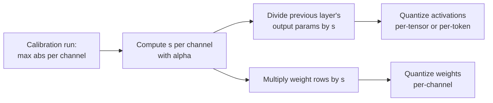

# पाठ 14. SmoothQuant

**मिशन से संबंध:** W8A8 वह scheme है जो compute-bound serving को तेज़ करती है, और SmoothQuant उसकी activations को quantize करने लायक़ बनाने का मानक तरीक़ा है, उस per-channel scale के बिना जिसे hardware इस्तेमाल नहीं कर सकता।
**मुख्य स्रोत:** [पेपर: "SmoothQuant: Accurate and Efficient Post-Training Quantization for Large Language Models", Xiao et al., 2022](https://arxiv.org/abs/2211.10438), section 4
**पूर्व-आवश्यकताएँ:** [पाठ 13](0013-weights-activations-or-both.md), [Outlier feature](../GLOSSARY.md), [Calibration set](../GLOSSARY.md)

## वार्म-अप

1. ▢ पाठ 13 ने कहा था कि int8 GEMM सिर्फ़ दो dimensions के साथ scales लगा सकता है। कौन-सी दो, और कौन-सी activation outliers को अलग करती?

<details markdown="1"><summary>जाँचें</summary>

Per token (activations की rows) और per output channel (weights के columns)। Per-input-channel scale outlier channels को अलग करता, और वही वह है जिसे kernel लगा नहीं सकता।

</details>

2. ▢ पाठ 11 ने rounding से पहले कुछ weight channels को ऊपर scale किया था। AWQ ने संबंधित उलटा scale किसमें मिलाया, और layer का output क्यों नहीं बदला?

<details markdown="1"><summary>जाँचें</summary>

उन activations में जो उन channels को गुणा करती हैं, व्यवहार में उस operation में जो उन्हें बनाता है। Weight row को `s` से और उसके activation column को `1 / s` से scale करना गुणनफल में कट जाता है, इसलिए full-precision output वही रहता है।

</details>

## यह जानें

### विचार एक पंक्ति में

Activations को quantize करना कठिन है क्योंकि कुछ channels विशाल हैं; weights आसान हैं क्योंकि वे समतल हैं। SmoothQuant हर activation channel को एक factor से भाग देता है और संबंधित weight row को उसी factor से गुणा करता है, इसलिए गुणनफल नहीं बदलता और कठिनाई दोनों में बँट जाती है:

```text
Y = X @ W = (X @ diag(s)^-1) @ (diag(s) @ W)
```

Activations के channel `j` को `s_j` से भाग देने से outlier channel सिकुड़ता है; weights की row `j` को `s_j` से गुणा करने से वह row बड़ी हो जाती है, जिसे weights सोख सकते हैं क्योंकि वे समतल शुरू हुए थे। Xiao et al. इसे quantization की कठिनाई को activations से weights में migrate करना कहते हैं, और इसे offline लागू किया जाता है।

### Factor चुनना

Xiao et al. एक **migration strength** `α` लाते हैं और हर input channel `j` के लिए तय करते हैं:

```text
s_j = max(|X_j|)^α / max(|W_j|)^(1 - α)
```

- `α = 1` "सीधा-सादा चुनाव" `s_j = max(|X_j|)` है: हर activation channel का maximum एक ही हो जाता है, और सारी कठिनाई weights में चली जाती है।
- `α = 0` activations को वैसा ही छोड़ता है जैसी वे थीं।
- पेपर `α = 0.5` को अच्छी तरह संतुलित बिंदु पाता है जो कठिनाई को बराबर बाँटता है, और सारे OPT और BLOOM models के लिए आम sweet spot। जिन models में activation outliers ज़्यादा गंभीर हैं, जैसे लगभग 30% outliers वाला GLM-130B, वहाँ बड़ा `α` उसका ज़्यादा हिस्सा weights में ले जाता है।

`max(|X_j|)` एक **calibration set** पर मापा जाता है, इसलिए SmoothQuant पाठ 12 के calibration जोखिमों वाला post-training method है।

### Run time पर इसकी कोई क़ीमत क्यों नहीं

Linear layer का input `X` आम तौर पर किसी पिछले operation से बनता है, जैसे layer norm या कोई दूसरी linear layer। Xiao et al. smoothing factor को उस पिछली layer के parameters में offline मिला देते हैं, इसलिए कोई अतिरिक्त kernel नहीं और प्रति request कोई अतिरिक्त गुणा नहीं। Weights को quantize होने से पहले `s` से एक बार गुणा किया जाता है।



### यह क्या देता है

Abstract OPT, BLOOM, GLM, MT-NLG, Llama, Falcon, Mistral और Mixtral models में सभी matrix multiplications के लिए W8A8 int8 बताता है, 1.56 गुना तक speed-up और 2 गुना memory की कमी के साथ, नगण्य accuracy हानि पर, और एक ही node के भीतर 530B model की serving। ध्यान दें कि यह क्या है: 8-bit method। 4-bit activations पर smoothing के बाद भी बचे outliers हावी रहते हैं, इसीलिए पाठ 15 के rotations मौजूद हैं।

## अभ्यास

1. ▢ SmoothQuant का identity लिखें और बताएँ कि किस तरफ़ `s` से भाग दिया जाता है और किस तरफ़ गुणा।

<details markdown="1"><summary>जाँचें</summary>

`X @ W = (X @ diag(s)^-1) @ (diag(s) @ W)`। Activations को हर input channel पर `s` से भाग दिया जाता है, और उन input channels की weight rows को `s` से गुणा किया जाता है। अगर आप scale को output channels पर रखें तो वह अब नहीं कटता।

</details>

2. ▢ पहले अनुमान लगाएँ, फिर चलाएँ। अनुमान लगाएँ कि क्या smoothing full-precision गुणनफल को बदलती है, और दोनों operands पर per-tensor int8 की error को लगभग कितना बदलती है।

    ```python
    import numpy as np
    rng = np.random.default_rng(0)
    X = rng.normal(0, 1, (64, 8))       # 64 tokens, 8 input channels
    X[:, 3] *= 100                      # channel 3 is an outlier channel
    W = rng.normal(0, 1, (8, 8))        # weights: 8 in, 8 out

    def q8(t):                          # symmetric per-tensor int8
        s = np.abs(t).max() / 127
        return np.clip(np.round(t / s), -127, 127) * s

    s = np.sqrt(np.abs(X).max(0) / np.abs(W).max(1))   # alpha = 0.5
    Xs, Ws = X / s, W * s[:, None]
    print("same product :", np.allclose(Xs @ Ws, X @ W))
    print("error, plain   :", round(np.abs(q8(X) @ q8(W) - X @ W).mean(), 3))
    print("error, smoothed:", round(np.abs(q8(Xs) @ q8(Ws) - X @ W).mean(), 3))
    ```

<details markdown="1"><summary>संकेत</summary>

पहली line identity को परखती है, जो सटीक arithmetic में सही है। Error के लिए, पूछें कि channel 3 को उसके factor से भाग देने से पहले और बाद में per-tensor activation scale किससे तय होता है।

</details>

<details markdown="1"><summary>जाँचें</summary>

```text
same product : True
error, plain   : 1.542
error, smoothed: 0.663
```

Full-precision गुणनफल वही है, और quantized error आधे से काफ़ी नीचे गिर जाती है। Smoothing से पहले, channel 3 ने activation scale तय किया था और बाक़ी सात channels को मुट्ठी भर levels मिले थे; उसके बाद, activation channels आकार में क़रीब हैं और weights एक ऐसी row ढोते हैं जो बड़ी है पर अब भी quantize करने में आसान।

</details>

3. ▢ किसी model की activations में असामान्य रूप से ज़्यादा और असामान्य रूप से बड़े outliers हैं। क्या आपको `α` को 0.5 से ऊपर ले जाना चाहिए या नीचे, और अगर आप पूरा 1 तक चले जाएँ तो जोखिम क्या है?

<details markdown="1"><summary>जाँचें</summary>

ऊपर: बड़ा `α` activations को ज़्यादा भाग देता है और कठिनाई का ज़्यादा हिस्सा weights में ले जाता है, जो पेपर GLM-130B के लिए करता है। `α = 1` पर हर activation channel का maximum एक ही है, पर weights अब सारे outliers ढोते हैं, और उनकी quantization error बढ़ती है। `α` का मक़सद कठिनाई को बाँटना है ताकि कोई भी पक्ष बर्बाद न हो।

</details>

4. ▢ कोई साथी कहता है SmoothQuant inference को धीमा करता है क्योंकि अब हर request को activations को `s` से भाग देना पड़ता है। उस दावे में क्या ग़लत है?

    - a) Scale को offline पिछली layer के parameters में मिला दिया जाता है
    - b) भाग CPU cores पर चलता है जबकि GPU compute करता है
    - c) Scale प्रति tensor एक संख्या है, जिसकी लागत लगभग कुछ नहीं
    - d) जिन tokens में outliers नहीं हैं उनके लिए भाग छोड़ दिया जाता है

<details markdown="1"><summary>जाँचें</summary>

**a)** Factor को उस layer में मिला दिया जाता है जो `X` बनाती है, जैसे layer norm, एक बार, offline, इसलिए प्रति request कोई अतिरिक्त operation नहीं चलता। (b) एक ऐसा CPU चरण गढ़ता है जो है नहीं। (c) ग़लत है क्योंकि `s` की हर input channel के लिए एक value है, हर tensor के लिए एक नहीं। (d) ग़लत है क्योंकि outlier channels सभी tokens में दिखते हैं और scale हर एक पर लागू होता है।

</details>

## असली दुनिया का अभ्यास

- [ ] SmoothQuant पेपर का section 4 पढ़ें और वह figure खोजें जो smoothing से पहले और बाद में activation और weight magnitudes दिखाती है। एक वाक्य में बताएँ कि हर तरफ़ क्या बदला।
- [ ] अभ्यास के snippet में `α` को 0.25, 0.75 और 1.0 करें (`s = np.abs(X).max(0) ** a / np.abs(W).max(1) ** (1 - a)` इस्तेमाल करें) और हर एक के लिए smoothed error दर्ज करें। वह value खोजें जो इस tensor के लिए उसे न्यूनतम करती है।
- [ ] कल: बिना नोट्स के `s_j` का formula लिखें, बताएँ कि `α = 0` और `α = 1` हर एक क्या करता है, और factor कहाँ मिलाया जाता है।

## आगे बढ़ने के लिए

- [Activations और KV Cache शीट](../reference/activations-and-kv-cache.md)
- [दस्तावेज़: "int8 W8A8" उदाहरण, llm-compressor](https://github.com/vllm-project/llm-compressor/blob/main/examples/quantization_w8a8_int8/README.md), एक recipe जो 0.8 की migration strength के साथ SmoothQuant चलाती है, फिर GPTQ, फिर dynamic per-token activation scales
- [संसाधन](../RESOURCES.md)

---

बात नहीं बन रही? ऊपर दिए मुख्य स्रोत को दोबारा पढ़ें, क्योंकि यह पाठ उसे संक्षिप्त करता है और समझ संक्षेप में ही रिसती है। जो शब्द फिसलन भरा लगे, उसके लिए [शब्दावली](../GLOSSARY.md) देखें।

अगर दिक़्क़त सामग्री की नहीं बल्कि पाठ की ही है, तो वह एक खोट है: [issue खोलें](https://github.com/TokenCemetery/teach/issues)।
