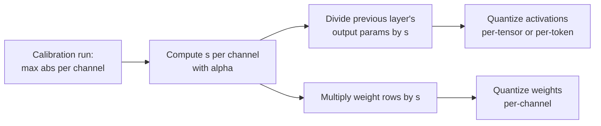

# Lesson 14. SmoothQuant

**Mission link:** W8A8 is the scheme that speeds up compute-bound serving, and SmoothQuant is the standard way to make its activations quantizable without a per-channel scale the hardware cannot use.
**Primary source:** [Paper: "SmoothQuant: Accurate and Efficient Post-Training Quantization for Large Language Models", Xiao et al., 2022](https://arxiv.org/abs/2211.10438), section 4
**Prerequisites:** [Lesson 13](0013-weights-activations-or-both.md), [Outlier feature](../GLOSSARY.md), [Calibration set](../GLOSSARY.md)

## Warm-up

1. ▢ Lesson 13 said an int8 GEMM can only apply scales along two dimensions. Which two, and which one would have isolated activation outliers?

<details markdown="1"><summary>Check</summary>

Per token (rows of the activations) and per output channel (columns of the weights). A per-input-channel scale would have isolated the outlier channels, and it is exactly the one the kernel cannot apply.

</details>

2. ▢ Lesson 11 scaled some weight channels up before rounding. What did AWQ fold the matching inverse scale into, and why did the layer's output not change?

<details markdown="1"><summary>Check</summary>

Into the activations that multiply those channels, in practice into the operation that produces them. Scaling a weight row by `s` and its activation column by `1 / s` cancels in the product, so the full-precision output is identical.

</details>

## Know this

### The idea in one line

Activations are hard to quantize because a few channels are huge; weights are easy because they are flat. SmoothQuant divides each activation channel by a factor and multiplies the matching weight row by the same factor, so the product is unchanged and the difficulty is shared between the two:

```text
Y = X @ W = (X @ diag(s)^-1) @ (diag(s) @ W)
```

Dividing channel `j` of the activations by `s_j` shrinks the outlier channel; multiplying row `j` of the weights by `s_j` makes that row larger, which the weights can absorb because they started flat. Xiao et al. call this migrating the quantization difficulty from activations to weights, and it is applied offline.

### Choosing the factor

Xiao et al. introduce a **migration strength** `α` and set, per input channel `j`:

```text
s_j = max(|X_j|)^α / max(|W_j|)^(1 - α)
```

- `α = 1` is the "straightforward choice" `s_j = max(|X_j|)`: every activation channel ends up with the same maximum, and all the difficulty moves into the weights.
- `α = 0` leaves the activations as they were.
- The paper finds `α = 0.5` a well-balanced point that evenly splits the difficulty, and a general sweet spot for all the OPT and BLOOM models. For models whose activation outliers are more significant, such as GLM-130B with about 30% outliers, a larger `α` moves more of it to the weights.

`max(|X_j|)` is measured on a **calibration set**, so SmoothQuant is a post-training method with the calibration risks of lesson 12.

### Why it costs nothing at run time

The input `X` of a linear layer is usually produced by a previous operation, such as a layer norm or another linear layer. Xiao et al. fuse the smoothing factor into that previous layer's parameters offline, so there is no extra kernel and no extra multiplication per request. The weights are multiplied by `s` once, before they are quantized.



### What it buys

The abstract reports W8A8 int8 for all matrix multiplications across OPT, BLOOM, GLM, MT-NLG, Llama, Falcon, Mistral and Mixtral models, up to 1.56x speed-up and 2x memory reduction with negligible accuracy loss, and serving a 530B model within a single node. Note what it is: an 8-bit method. At 4-bit activations the outliers that remain after smoothing still dominate, which is why lesson 15's rotations exist.

## Practice

1. ▢ Write the SmoothQuant identity and say which side gets divided by `s` and which multiplied.

<details markdown="1"><summary>Check</summary>

`X @ W = (X @ diag(s)^-1) @ (diag(s) @ W)`. The activations are divided by `s` per input channel, and the weight rows for those input channels are multiplied by `s`. If you put the scale on the output channels instead, it no longer cancels.

</details>

2. ▢ Predict, then run. Predict whether smoothing changes the full-precision product, and roughly how much it changes the error of per-tensor int8 on both operands.

    ```python
    import numpy as np
    rng = np.random.default_rng(0)
    X = rng.normal(0, 1, (64, 8))       # 64 tokens, 8 input channels
    X[:, 3] *= 100                      # channel 3 is an outlier channel
    W = rng.normal(0, 1, (8, 8))        # weights: 8 in, 8 out

    def q8(t):                          # symmetric per-tensor int8
        s = np.abs(t).max() / 127
        return np.clip(np.round(t / s), -127, 127) * s

    s = np.sqrt(np.abs(X).max(0) / np.abs(W).max(1))   # alpha = 0.5
    Xs, Ws = X / s, W * s[:, None]
    print("same product :", np.allclose(Xs @ Ws, X @ W))
    print("error, plain   :", round(np.abs(q8(X) @ q8(W) - X @ W).mean(), 3))
    print("error, smoothed:", round(np.abs(q8(Xs) @ q8(Ws) - X @ W).mean(), 3))
    ```

<details markdown="1"><summary>Hint</summary>

The first line tests the identity, which holds in exact arithmetic. For the error, ask what sets the per-tensor activation scale before and after dividing channel 3 by its factor.

</details>

<details markdown="1"><summary>Check</summary>

```text
same product : True
error, plain   : 1.542
error, smoothed: 0.663
```

The full-precision product is the same, and the quantized error falls to well under half. Before smoothing, channel 3 set the activation scale and the other seven channels got a handful of levels; after it, the activation channels are closer in size and the weights carry a row that is larger but still easy to quantize.

</details>

3. ▢ A model's activations have unusually many and unusually large outliers. Should you move `α` up or down from 0.5, and what is the risk if you go all the way to 1?

<details markdown="1"><summary>Check</summary>

Up: a larger `α` divides the activations more and moves more of the difficulty into the weights, which is what the paper does for GLM-130B. At `α = 1` every activation channel has the same maximum, but the weights now carry all of the outliers, and their quantization error grows. The point of `α` is to split the difficulty so neither side is ruined.

</details>

4. ▢ A colleague says SmoothQuant slows down inference because every request now has to divide the activations by `s`. What is wrong with the claim?

    - a) The scale is fused offline into the previous layer's parameters
    - b) The division runs on CPU cores while the GPU computes
    - c) The scale is one number per tensor, costing almost nothing
    - d) The division is skipped for tokens that contain no outliers

<details markdown="1"><summary>Check</summary>

**a)** The factor is folded into the layer that produces `X`, such as a layer norm, once, offline, so no extra operation runs per request. (b) invents a CPU step that does not exist. (c) is wrong because `s` has one value per input channel, not one per tensor. (d) is wrong because the outlier channels appear in all tokens and the scale applies to every one.

</details>

## Real-world reps

- [ ] Read section 4 of the SmoothQuant paper and find the figure that shows activation and weight magnitudes before and after smoothing. Describe in one sentence what changed on each side.
- [ ] Change `α` in the practice snippet to 0.25, 0.75 and 1.0 (use `s = np.abs(X).max(0) ** a / np.abs(W).max(1) ** (1 - a)`) and record the smoothed error for each. Find the value that minimises it for this tensor.
- [ ] Tomorrow: without notes, write the formula for `s_j`, say what `α = 0` and `α = 1` each do, and where the factor is fused.

## Going further

- [Activations and the KV Cache](../reference/activations-and-kv-cache.md)
- [Docs: "int8 W8A8" example, llm-compressor](https://github.com/vllm-project/llm-compressor/blob/main/examples/quantization_w8a8_int8/README.md), a recipe that runs SmoothQuant with a migration strength of 0.8, then GPTQ, then dynamic per-token activation scales
- [Resources](../RESOURCES.md)

---

Not landing? Reread the primary source at the top, since this lesson compresses it and compression is where understanding leaks. Check the [glossary](../GLOSSARY.md) for any term that felt slippery.

If the lesson itself is unclear rather than the material, that is a defect: [open an issue](https://github.com/TokenCemetery/teach/issues).
