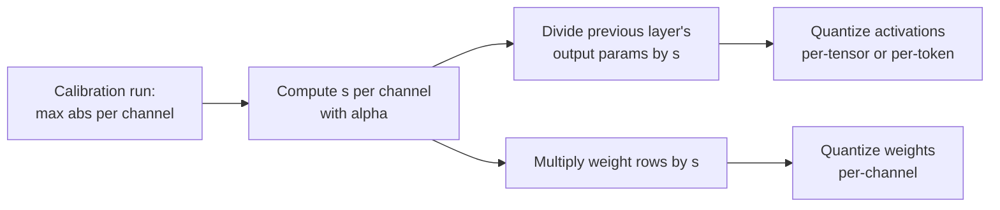

# Lição 14. SmoothQuant

**Ligação com a missão:** O W8A8 é o esquema que acelera o serving limitado por compute, e o SmoothQuant é a forma padrão de tornar as suas ativações quantizáveis sem uma scale por canal que o hardware não consegue usar.
**Fonte principal:** [Artigo científico: "SmoothQuant: Accurate and Efficient Post-Training Quantization for Large Language Models", Xiao et al., 2022](https://arxiv.org/abs/2211.10438), seção 4
**Pré-requisitos:** [Lição 13](0013-weights-activations-or-both.md), [Feature outlier](../GLOSSARY.md), [Calibration set](../GLOSSARY.md)

## Aquecimento

1. ▢ A lição 13 disse que um GEMM int8 só consegue aplicar scales ao longo de duas dimensões. Quais duas, e qual teria isolado os outliers de ativação?

<details markdown="1"><summary>Verificação</summary>

Por token (linhas das ativações) e por canal de saída (colunas dos pesos). Uma scale por canal de entrada teria isolado os canais outliers, e é exatamente a que o kernel não consegue aplicar.

</details>

2. ▢ A lição 11 escalou alguns canais de pesos para cima antes do arredondamento. Em que o AWQ fundiu a scale inversa correspondente, e por que a saída da camada não mudou?

<details markdown="1"><summary>Verificação</summary>

Nas ativações que multiplicam esses canais, na prática na operação que as produz. Escalar uma linha de pesos por `s` e a sua coluna de ativações por `1 / s` se cancela no produto, então a saída em precisão total é idêntica.

</details>

## Saiba isto

### A ideia em uma linha

As ativações são difíceis de quantizar porque alguns canais são enormes; os pesos são fáceis porque são planos. O SmoothQuant divide cada canal de ativação por um fator e multiplica a linha de pesos correspondente pelo mesmo fator, de modo que o produto fica inalterado e a dificuldade é repartida entre os dois:

```text
Y = X @ W = (X @ diag(s)^-1) @ (diag(s) @ W)
```

Dividir o canal `j` das ativações por `s_j` encolhe o canal outlier; multiplicar a linha `j` dos pesos por `s_j` torna essa linha maior, o que os pesos conseguem absorver porque começaram planos. Xiao et al. chamam isso de migrar a dificuldade de quantização das ativações para os pesos, e é aplicado offline.

### Escolhendo o fator

Xiao et al. introduzem uma **força de migração** `α` e definem, por canal de entrada `j`:

```text
s_j = max(|X_j|)^α / max(|W_j|)^(1 - α)
```

- `α = 1` é a "escolha direta" `s_j = max(|X_j|)`: todo canal de ativação acaba com o mesmo máximo, e toda a dificuldade se move para os pesos.
- `α = 0` deixa as ativações como estavam.
- O artigo considera `α = 0.5` um ponto bem equilibrado que divide a dificuldade de forma uniforme, e um ponto ideal geral para todos os modelos OPT e BLOOM. Para modelos cujos outliers de ativação são mais significativos, como o GLM-130B com cerca de 30% de outliers, um `α` maior move mais dessa dificuldade para os pesos.

`max(|X_j|)` é medido em um **calibration set**, então o SmoothQuant é um método post-training com os riscos de calibração da lição 12.

### Por que não custa nada em tempo de execução

A entrada `X` de uma camada linear costuma ser produzida por uma operação anterior, como uma layer norm ou outra camada linear. Xiao et al. fundem o fator de suavização nos parâmetros dessa camada anterior offline, então não há kernel extra nem multiplicação extra por requisição. Os pesos são multiplicados por `s` uma vez, antes de serem quantizados.



### O que ele oferece

O resumo do artigo relata W8A8 int8 para todas as multiplicações de matrizes em modelos OPT, BLOOM, GLM, MT-NLG, Llama, Falcon, Mistral e Mixtral, com até 1.56x de aceleração e 2x de redução de memória com perda de acurácia desprezível, e servindo um modelo de 530B dentro de um único nó. Note o que ele é: um método de 8 bits. Com ativações de 4 bits, os outliers que sobram depois da suavização ainda dominam, e é por isso que as rotações da lição 15 existem.

## Prática

1. ▢ Escreva a identidade do SmoothQuant e diga qual lado é dividido por `s` e qual é multiplicado.

<details markdown="1"><summary>Verificação</summary>

`X @ W = (X @ diag(s)^-1) @ (diag(s) @ W)`. As ativações são divididas por `s` por canal de entrada, e as linhas de pesos desses canais de entrada são multiplicadas por `s`. Se você puser a scale nos canais de saída, ela deixa de se cancelar.

</details>

2. ▢ Preveja e depois execute. Preveja se a suavização muda o produto em precisão total e, aproximadamente, o quanto ela muda o erro do int8 per-tensor nos dois operandos.

    ```python
    import numpy as np
    rng = np.random.default_rng(0)
    X = rng.normal(0, 1, (64, 8))       # 64 tokens, 8 input channels
    X[:, 3] *= 100                      # channel 3 is an outlier channel
    W = rng.normal(0, 1, (8, 8))        # weights: 8 in, 8 out

    def q8(t):                          # symmetric per-tensor int8
        s = np.abs(t).max() / 127
        return np.clip(np.round(t / s), -127, 127) * s

    s = np.sqrt(np.abs(X).max(0) / np.abs(W).max(1))   # alpha = 0.5
    Xs, Ws = X / s, W * s[:, None]
    print("same product :", np.allclose(Xs @ Ws, X @ W))
    print("error, plain   :", round(np.abs(q8(X) @ q8(W) - X @ W).mean(), 3))
    print("error, smoothed:", round(np.abs(q8(Xs) @ q8(Ws) - X @ W).mean(), 3))
    ```

<details markdown="1"><summary>Dica</summary>

A primeira linha testa a identidade, que vale em aritmética exata. Para o erro, pergunte o que define a scale per-tensor das ativações antes e depois de dividir o canal 3 pelo seu fator.

</details>

<details markdown="1"><summary>Verificação</summary>

```text
same product : True
error, plain   : 1.542
error, smoothed: 0.663
```

O produto em precisão total é o mesmo, e o erro quantizado cai para bem menos da metade. Antes da suavização, o canal 3 definia a scale das ativações e os outros sete canais recebiam um punhado de níveis; depois dela, os canais de ativação ficam mais próximos em tamanho e os pesos carregam uma linha maior, mas ainda fácil de quantizar.

</details>

3. ▢ As ativações de um modelo têm outliers incomumente numerosos e incomumente grandes. Você deve subir ou descer `α` a partir de 0.5, e qual é o risco se for até 1?

<details markdown="1"><summary>Verificação</summary>

Subir: um `α` maior divide mais as ativações e move mais da dificuldade para os pesos, que é o que o artigo faz para o GLM-130B. Em `α = 1`, todo canal de ativação tem o mesmo máximo, mas os pesos agora carregam todos os outliers, e o erro de quantização deles cresce. O objetivo do `α` é repartir a dificuldade para que nenhum dos lados seja arruinado.

</details>

4. ▢ Um colega diz que o SmoothQuant deixa a inferência mais lenta porque toda requisição agora precisa dividir as ativações por `s`. O que há de errado na afirmação?

    - a) A scale é fundida offline nos parâmetros da camada anterior
    - b) A divisão roda em núcleos de CPU enquanto a GPU calcula
    - c) A scale é um número por tensor, custando quase nada
    - d) A divisão é pulada para tokens que não contêm outliers

<details markdown="1"><summary>Verificação</summary>

**a)** O fator é incorporado na camada que produz `X`, como uma layer norm, uma vez, offline, então nenhuma operação extra roda por requisição. (b) inventa uma etapa de CPU que não existe. (c) está errada porque `s` tem um valor por canal de entrada, não um por tensor. (d) está errada porque os canais outliers aparecem em todos os tokens e a scale se aplica a todos.

</details>

## Prática no mundo real

- [ ] Leia a seção 4 do artigo do SmoothQuant e encontre a figura que mostra as magnitudes de ativações e pesos antes e depois da suavização. Descreva em uma frase o que mudou em cada lado.
- [ ] Mude `α` no trecho da prática para 0.25, 0.75 e 1.0 (use `s = np.abs(X).max(0) ** a / np.abs(W).max(1) ** (1 - a)`) e registre o erro suavizado de cada um. Encontre o valor que o minimiza para este tensor.
- [ ] Amanhã: sem consultar anotações, escreva a fórmula de `s_j`, diga o que `α = 0` e `α = 1` fazem cada um e onde o fator é fundido.

## Para ir além

- [Ativações e o KV Cache](../reference/activations-and-kv-cache.md)
- [Docs: "int8 W8A8" example, llm-compressor](https://github.com/vllm-project/llm-compressor/blob/main/examples/quantization_w8a8_int8/README.md), uma receita que roda o SmoothQuant com força de migração de 0.8, depois o GPTQ, depois scales de ativação dinâmicas por token
- [Recursos](../RESOURCES.md)

---

Não ficou claro? Releia a fonte principal no topo, já que esta lição a comprime e é na compressão que o entendimento escapa. Consulte o [glossário](../GLOSSARY.md) para qualquer termo que pareceu escorregadio.

Se o problema é a lição em si, e não o material, isso é um defeito: [abra uma issue](https://github.com/TokenCemetery/teach/issues).
