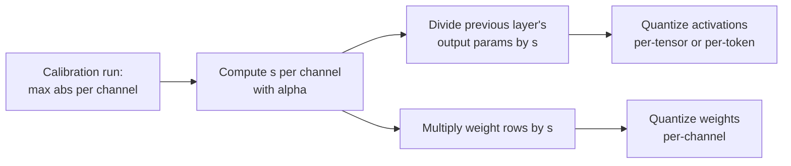

# Урок 14. SmoothQuant

**Связь с целью курса:** W8A8 это схема, ускоряющая обслуживание, ограниченное вычислениями, а SmoothQuant это стандартный способ сделать её активации пригодными к квантизации без масштаба на канал, которым оборудование не может воспользоваться.
**Первоисточник:** [Научная статья: "SmoothQuant: Accurate and Efficient Post-Training Quantization for Large Language Models", Xiao et al., 2022](https://arxiv.org/abs/2211.10438), раздел 4
**Предварительные требования:** [Урок 13](0013-weights-activations-or-both.md), [Признак-выброс](../GLOSSARY.md), [Калибровочный набор](../GLOSSARY.md)

## Разминка

1. ▢ Урок 13 говорил, что GEMM в int8 может применять масштабы только по двум измерениям. По каким двум и какой из них изолировал бы выбросы активаций?

<details markdown="1"><summary>Проверка</summary>

По токену (строки активаций) и по выходному каналу (столбцы весов). Масштаб на входной канал изолировал бы каналы-выбросы, и это как раз тот, который ядро применить не может.

</details>

2. ▢ Урок 11 увеличивал некоторые каналы весов масштабом до округления. Во что AWQ слил соответствующий обратный масштаб и почему выход слоя не изменился?

<details markdown="1"><summary>Проверка</summary>

В активации, которые умножаются на эти каналы, на практике в операцию, которая их порождает. Масштабирование строки весов на `s` и столбца её активации на `1 / s` сокращается в произведении, поэтому выход в полной точности тот же.

</details>

## Что нужно знать

### Идея в одну строку

Активации трудно квантизовать, потому что несколько каналов огромны; веса легко, потому что они плоские. SmoothQuant делит каждый канал активаций на множитель и умножает соответствующую строку весов на тот же множитель, так что произведение не меняется, а сложность делится между ними:

```text
Y = X @ W = (X @ diag(s)^-1) @ (diag(s) @ W)
```

Деление канала `j` активаций на `s_j` уменьшает канал-выброс; умножение строки `j` весов на `s_j` делает эту строку больше, а веса могут это поглотить, потому что начинали плоскими. Xiao и соавторы называют это переносом сложности квантизации из активаций в веса, и применяется оно офлайн.

### Выбор множителя

Xiao и соавторы вводят **силу переноса** `α` и задают для каждого входного канала `j`:

```text
s_j = max(|X_j|)^α / max(|W_j|)^(1 - α)
```

- `α = 1` это «прямолинейный выбор» `s_j = max(|X_j|)`: у каждого канала активаций оказывается один и тот же максимум, и вся сложность переходит в веса.
- `α = 0` оставляет активации как были.
- Статья находит `α = 0.5` хорошо сбалансированной точкой, ровно делящей сложность, и общим оптимумом для всех моделей OPT и BLOOM. Для моделей, у которых выбросы активаций значительнее, например GLM-130B с примерно 30% выбросов, больший `α` переносит в веса больше.

`max(|X_j|)` измеряется на **калибровочном наборе**, поэтому SmoothQuant это посттренировочный метод с калибровочными рисками урока 12.

### Почему это ничего не стоит во время выполнения

Вход `X` линейного слоя обычно порождается предыдущей операцией, например нормализацией слоя или другим линейным слоем. Xiao и соавторы сливают множитель сглаживания в параметры этого предыдущего слоя офлайн, поэтому нет ни дополнительного ядра, ни дополнительного умножения на запрос. Веса умножаются на `s` один раз, до их квантизации.



### Что это даёт

Аннотация сообщает о W8A8 int8 для всех умножений матриц на моделях OPT, BLOOM, GLM, MT-NLG, Llama, Falcon, Mistral и Mixtral, ускорении до 1,56 раза и сокращении памяти в 2 раза при пренебрежимой потере точности и об обслуживании модели на 530 млрд в одном узле. Обратите внимание, что это за метод: 8-битный. На 4-битных активациях выбросы, остающиеся после сглаживания, всё равно доминируют, и поэтому существуют повороты урока 15.

## Практика

1. ▢ Запишите тождество SmoothQuant и скажите, какая сторона делится на `s`, а какая умножается.

<details markdown="1"><summary>Проверка</summary>

`X @ W = (X @ diag(s)^-1) @ (diag(s) @ W)`. Активации делятся на `s` по входным каналам, а строки весов для этих входных каналов умножаются на `s`. Если поставить масштаб на выходные каналы, он больше не сокращается.

</details>

2. ▢ Предскажите, затем запустите. Предскажите, меняет ли сглаживание произведение в полной точности и примерно насколько оно меняет ошибку int8 per-tensor на обоих операндах.

    ```python
    import numpy as np
    rng = np.random.default_rng(0)
    X = rng.normal(0, 1, (64, 8))       # 64 tokens, 8 input channels
    X[:, 3] *= 100                      # channel 3 is an outlier channel
    W = rng.normal(0, 1, (8, 8))        # weights: 8 in, 8 out

    def q8(t):                          # symmetric per-tensor int8
        s = np.abs(t).max() / 127
        return np.clip(np.round(t / s), -127, 127) * s

    s = np.sqrt(np.abs(X).max(0) / np.abs(W).max(1))   # alpha = 0.5
    Xs, Ws = X / s, W * s[:, None]
    print("same product :", np.allclose(Xs @ Ws, X @ W))
    print("error, plain   :", round(np.abs(q8(X) @ q8(W) - X @ W).mean(), 3))
    print("error, smoothed:", round(np.abs(q8(Xs) @ q8(Ws) - X @ W).mean(), 3))
    ```

<details markdown="1"><summary>Подсказка</summary>

Первая строка проверяет тождество, которое выполняется в точной арифметике. Для ошибки спросите, что задаёт масштаб активаций per-tensor до и после деления канала 3 на его множитель.

</details>

<details markdown="1"><summary>Проверка</summary>

```text
same product : True
error, plain   : 1.542
error, smoothed: 0.663
```

Произведение в полной точности то же, а квантизованная ошибка падает до заметно меньше половины. До сглаживания масштаб активаций задавал канал 3, а остальным семи каналам доставалась горсть уровней; после него каналы активаций ближе по размеру, а в весах оказывается строка, которая больше, но всё ещё легко квантизуется.

</details>

3. ▢ У активаций модели необычно много необычно крупных выбросов. Нужно ли двигать `α` вверх или вниз от 0,5 и в чём риск, если дойти до 1?

<details markdown="1"><summary>Проверка</summary>

Вверх: больший `α` сильнее делит активации и переносит в веса больше сложности, что статья и делает для GLM-130B. При `α = 1` у каждого канала активаций один и тот же максимум, но теперь все выбросы несут веса, и их ошибка квантизации растёт. Смысл `α` в том, чтобы разделить сложность так, чтобы ни одна сторона не была испорчена.

</details>

4. ▢ Коллега говорит, что SmoothQuant замедляет инференс, потому что теперь каждому запросу приходится делить активации на `s`. Что неверно в этом утверждении?

    - a) Масштаб слит офлайн в параметры предыдущего слоя
    - b) Деление идёт на ядрах CPU, пока GPU считает
    - c) Масштаб это одно число на тензор, и он почти ничего не стоит
    - d) Деление пропускается для токенов, в которых нет выбросов

<details markdown="1"><summary>Проверка</summary>

**a)** Множитель вливается в слой, порождающий `X`, например в нормализацию слоя, один раз, офлайн, поэтому никакая дополнительная операция на запрос не выполняется. (b) выдумывает шаг на CPU, которого не существует. (c) неверно, потому что у `s` одно значение на входной канал, а не одно на тензор. (d) неверно, потому что каналы-выбросы появляются во всех токенах, а масштаб применяется к каждому.

</details>

## Практика в реальной работе

- [ ] Прочитайте раздел 4 статьи о SmoothQuant и найдите рисунок, показывающий величины активаций и весов до и после сглаживания. Опишите одним предложением, что изменилось с каждой стороны.
- [ ] Измените `α` во фрагменте практики на 0,25, 0,75 и 1,0 (используйте `s = np.abs(X).max(0) ** a / np.abs(W).max(1) ** (1 - a)`) и запишите сглаженную ошибку для каждого. Найдите значение, минимизирующее её для этого тензора.
- [ ] Завтра, без заметок, запишите формулу для `s_j`, скажите, что делают `α = 0` и `α = 1`, и куда сливается множитель.

## Что почитать дальше

- [Активации и KV-кеш](../reference/activations-and-kv-cache.md)
- [Документация: "int8 W8A8" example, llm-compressor](https://github.com/vllm-project/llm-compressor/blob/main/examples/quantization_w8a8_int8/README.md), рецепт, запускающий SmoothQuant с силой переноса 0,8, затем GPTQ, затем динамические масштабы активаций на токен
- [Ресурсы](../RESOURCES.md)

---

Не доходит? Перечитайте первоисточник в начале: этот урок его сжимает, а при сжатии понимание как раз и теряется. Загляните в [глоссарий](../GLOSSARY.md), если какой-то термин показался скользким.

Если неясен сам урок, а не материал, это дефект: [откройте issue](https://github.com/TokenCemetery/teach/issues).
