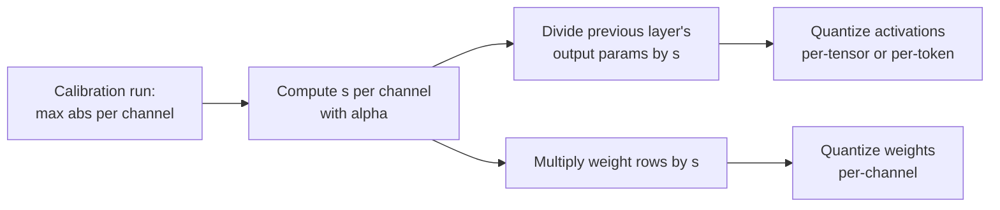

# 第 14 课：SmoothQuant

**使命关联:** W8A8 是加快受算力限制的服务的方案，而 SmoothQuant 是让它的激活值变得可量化的标准办法，且不需要硬件用不了的逐通道缩放因子。
**主要来源:** [论文：“SmoothQuant: Accurate and Efficient Post-Training Quantization for Large Language Models”，Xiao 等，2022](https://arxiv.org/abs/2211.10438)，第 4 节
**前置知识:** [第 13 课](0013-weights-activations-or-both.md)、[离群特征](../GLOSSARY.md)、[校准集](../GLOSSARY.md)

## 热身

1. ▢ 第 13 课说 int8 GEMM 只能沿两个维度应用缩放因子。是哪两个？哪一个本来可以隔离激活值的离群值？

<details markdown="1"><summary>检查</summary>

逐 token（激活值的各行）和逐输出通道（权重的各列）。逐输入通道的缩放因子本来可以隔离离群通道，而它恰恰是内核无法应用的那一个。

</details>

2. ▢ 第 11 课在舍入之前把一些权重通道放大了。AWQ 把对应的逆缩放因子折进了什么里面？为什么这一层的输出没有改变？

<details markdown="1"><summary>检查</summary>

折进了与这些通道相乘的激活值里，实际上是折进产生它们的那个运算里。把权重的一行乘以 `s`，把它的激活值列乘以 `1 / s`，在乘积中互相抵消，所以全精度的输出完全相同。

</details>

## 要点

### 一句话说清思路

激活值难量化，是因为有几个通道特别大；权重容易量化，是因为它们很平。SmoothQuant 把每个激活值通道除以一个因子，并把对应的权重行乘以同一个因子，所以乘积不变，难度由两者分担：

```text
Y = X @ W = (X @ diag(s)^-1) @ (diag(s) @ W)
```

把激活值的通道 `j` 除以 `s_j`，离群通道缩小了；把权重的第 `j` 行乘以 `s_j`，使那一行变大，权重可以吸收它，因为它们一开始是平的。Xiao 等人把这称为把量化难度从激活值迁移到权重上，它是离线应用的。

### 选择因子

Xiao 等人引入了**迁移强度** `α`，对每个输入通道 `j` 设定：

```text
s_j = max(|X_j|)^α / max(|W_j|)^(1 - α)
```

- `α = 1` 是“最直接的选择” `s_j = max(|X_j|)`：每个激活值通道最终的最大值都相同，所有的难度都转移到了权重上。
- `α = 0` 让激活值保持原样。
- 论文发现 `α = 0.5` 是一个平衡得很好的点，能把难度均匀分开，也是所有 OPT 和 BLOOM 模型的一个通用的最佳点。对于激活值离群值更严重的模型，例如有约 30% 离群值的 GLM-130B，更大的 `α` 会把更多的难度转移到权重上。

`max(|X_j|)` 是在**校准集**上度量的，所以 SmoothQuant 是一种训练后方法，带有第 12 课所讲的校准风险。

### 为什么它在运行时不花代价

线性层的输入 `X` 通常由前一个运算产生，例如层归一化或另一个线性层。Xiao 等人把平滑因子离线地融合进前一层的参数里，所以没有额外的内核，每个请求也没有额外的乘法。权重只乘一次 `s`，在量化之前。



### 它能换来什么

摘要报告了对 OPT、BLOOM、GLM、MT-NLG、Llama、Falcon、Mistral 和 Mixtral 模型的所有矩阵乘法采用 W8A8 int8，最高 1.56 倍的加速和 2 倍的内存缩减，精度损失可以忽略，并且能在单个节点内服务一个 530B 的模型。请注意它是什么：一种 8 位方法。到了 4 位激活值，平滑之后仍然留下的离群值依然占主导，这就是第 15 课的旋转存在的原因。

## 练习

1. ▢ 写出 SmoothQuant 的恒等式，并说明哪一边被 `s` 除，哪一边被乘。

<details markdown="1"><summary>检查</summary>

`X @ W = (X @ diag(s)^-1) @ (diag(s) @ W)`。激活值按输入通道除以 `s`，这些输入通道对应的权重行乘以 `s`。如果把缩放因子放在输出通道上，它就不再抵消了。

</details>

2. ▢ 先预测，再运行。预测平滑是否改变全精度的乘积，以及它大致让两个操作数都做逐张量 int8 时的误差改变多少。

    ```python
    import numpy as np
    rng = np.random.default_rng(0)
    X = rng.normal(0, 1, (64, 8))       # 64 tokens, 8 input channels
    X[:, 3] *= 100                      # channel 3 is an outlier channel
    W = rng.normal(0, 1, (8, 8))        # weights: 8 in, 8 out

    def q8(t):                          # symmetric per-tensor int8
        s = np.abs(t).max() / 127
        return np.clip(np.round(t / s), -127, 127) * s

    s = np.sqrt(np.abs(X).max(0) / np.abs(W).max(1))   # alpha = 0.5
    Xs, Ws = X / s, W * s[:, None]
    print("same product :", np.allclose(Xs @ Ws, X @ W))
    print("error, plain   :", round(np.abs(q8(X) @ q8(W) - X @ W).mean(), 3))
    print("error, smoothed:", round(np.abs(q8(Xs) @ q8(Ws) - X @ W).mean(), 3))
    ```

<details markdown="1"><summary>提示</summary>

第一行检验的是恒等式，它在精确算术中成立。至于误差，想想在把通道 3 除以它的因子之前和之后，是什么决定了逐张量的激活值缩放因子。

</details>

<details markdown="1"><summary>检查</summary>

```text
same product : True
error, plain   : 1.542
error, smoothed: 0.663
```

全精度的乘积相同，量化误差降到了一半以下。平滑之前，通道 3 决定了激活值的缩放因子，其他七个通道只得到寥寥几个档位；平滑之后，各激活值通道的大小更接近了，权重里带着一行更大、但仍然容易量化的数。

</details>

3. ▢ 一个模型的激活值有异常多、异常大的离群值。应该把 `α` 从 0.5 调高还是调低？如果一路调到 1，风险是什么？

<details markdown="1"><summary>检查</summary>

调高：更大的 `α` 把激活值除得更多，把更多难度转移到权重里，论文对 GLM-130B 就是这样做的。`α = 1` 时，每个激活值通道都有相同的最大值，但权重现在带着所有的离群值，它们的量化误差会增大。`α` 的意义就在于分摊难度，让哪一边都不被毁掉。

</details>

4. ▢ 一位同事说 SmoothQuant 会拖慢推理，因为现在每个请求都得把激活值除以 `s`。这个说法错在哪里？

    - a) 缩放因子已经离线融合进前一层的参数里了
    - b) 除法在 CPU 核心上运行，而 GPU 同时在计算
    - c) 缩放因子每个张量只有一个数，几乎不花代价
    - d) 对不含离群值的 token，这个除法被跳过了

<details markdown="1"><summary>检查</summary>

**a)** 这个因子被离线地、一次性地折进了产生 `X` 的那一层，例如层归一化，所以每个请求都没有额外的操作要运行。(b) 凭空编出了一个不存在的 CPU 步骤。(c) 是错的，因为 `s` 是每个输入通道一个值，而不是每个张量一个。(d) 是错的，因为离群通道出现在所有 token 里，缩放因子对每一个都适用。

</details>

## 实战练习

- [ ] 阅读 SmoothQuant 论文的第 4 节，找到展示平滑前后激活值和权重幅值的那张图。用一句话描述两边各自发生了什么变化。
- [ ] 把练习代码片段里的 `α` 改成 0.25、0.75 和 1.0（使用 `s = np.abs(X).max(0) ** a / np.abs(W).max(1) ** (1 - a)`），记录每个取值下平滑后的误差。找出对这个张量使它最小的取值。
- [ ] 明天：不看笔记，写出 `s_j` 的公式，说明 `α = 0` 和 `α = 1` 各起什么作用，以及这个因子融合在哪里。

## 延伸阅读

- [激活值与 KV 缓存](../reference/activations-and-kv-cache.md)
- [文档：“int8 W8A8”示例，llm-compressor](https://github.com/vllm-project/llm-compressor/blob/main/examples/quantization_w8a8_int8/README.md)，一份先以 0.8 的迁移强度运行 SmoothQuant，再运行 GPTQ，然后使用动态逐 token 激活值缩放因子的配方
- [资源](../RESOURCES.md)

---

没学明白？请重读顶部的主要来源，因为本课是对它的压缩，而理解正是在压缩中流失的。如果有哪个术语觉得含糊，可以查看[术语表](../GLOSSARY.md)。

如果问题出在课程本身，而不是学习材料，那就是一个缺陷：[提交 issue](https://github.com/TokenCemetery/teach/issues)。
